# Chương 1: Machine Learning Systems in Production (Hệ Thống Học Máy Trong Môi Trường Production)

---

## 1. Bản Chất Của Học Máy & Điều Kiện Ứng Dụng (When to Use Machine Learning)

### 1.1. Định Nghĩa Chuẩn Xác Về Machine Learning
Học máy (Machine Learning - ML) không phải là một công cụ vạn năng hay phép màu kỹ thuật. Về bản chất kỹ thuật:

$$\text{ML là phương pháp} \underbrace{\textbf{học}}_{\text{(1)}} \text{ các } \underbrace{\textbf{mẫu hình phức tạp}}_{\text{(2) \& (3)}} \text{ từ } \underbrace{\textbf{dữ liệu hiện có}}_{\text{(4)}} \text{ để đưa ra } \underbrace{\textbf{dự đoán}}_{\text{(5)}} \text{ trên } \underbrace{\textbf{dữ liệu chưa từng thấy}}_{\text{(6)}}.$$

Sáu thành tố cốt lõi của định nghĩa trên đặt ra các điều kiện tiên quyết cho bất kỳ bài toán nào muốn áp dụng ML:

1. **Khả năng tự học (Capacity to Learn)**:
   - Hệ thống phải có cơ chế tối ưu hóa nội tại dựa trên dữ liệu.
   - *Ví dụ đối chiếu*: Cơ sở dữ liệu quan hệ (RDBMS) không phải là hệ thống ML vì nó không thể tự suy luận ra mối quan hệ giữa hai cột dữ liệu nếu không có truy vấn hoặc ràng buộc được định nghĩa tường minh bằng tay (explicit hardcoded rules).
2. **Độ phức tạp của mẫu hình (Complex Patterns)**:
   - ML chỉ phát huy giá trị kinh tế và kỹ thuật khi các quy tắc chuyển đổi từ Input sang Output quá phức tạp để lập trình viên tự viết bằng mã lệnh logic (if-else).
   - *Ví dụ*: Phân loại danh sách nhà trọ theo tiểu bang dựa trên mã bưu chính (Zip Code) chỉ cần một bảng tra cứu (**Lookup Table**). Nhưng định giá tiền thuê nhà (Rental Price) phụ thuộc phi tuyến vào diện tích, vị trí, tiện ích, đánh giá người dùng... đòi hỏi mô hình ML xấp xỉ hàm đa biến phức tạp.
   - *Nghịch lý nhận thức*: Bài toán khó với con người (tính $10^{10}$) lại cực kỳ tầm thường với máy tính; ngược lại bài toán trực giác của con người (nhận diện con mèo trong ảnh) lại là mẫu hình cực kỳ phức tạp với máy tính.
3. **Sự tồn tại của mẫu hình (Existence of Patterns)**:
   - Dữ liệu đầu vào phải chứa đựng quy luật toán học hoặc thống kê có thể khái quát hóa.
   - *Phân biệt mẫu hình và phân phối*: Kết quả tung xúc xắc đồng chất tuân theo phân phối đều rời rạc ($P(X=k) = \frac{1}{6}$), nhưng giữa các lần gieo không tồn tại mẫu hình tuần tự hay phụ thuộc nào để học. Xây dựng mô hình ML dự đoán lần tung tiếp theo là vô nghĩa.
4. **Dữ liệu hiện có (Existing Data)**:
   - Không có dữ liệu, không có học máy. Các biến thể học đặc thù vẫn dựa trên nền tảng dữ liệu:
     - **Zero-shot Learning**: Mô hình có thể suy luận trên tác vụ mới mà không cần dữ liệu huấn luyện của tác vụ đó, nhưng bản chất mô hình đã phải học từ một lượng khổng lồ dữ liệu của các tác vụ liên quan trước đó.
     - **Online Learning**: Mô hình khởi chạy khi chưa có dữ liệu tĩnh ban đầu và cập nhật trọng số trực tiếp từ luồng dữ liệu production; tuy nhiên chiến lược này chịu rủi ro cao về trải nghiệm người dùng trong giai đoạn đầu (cold start).
     - **Chiến lược "Fake-it-till-you-make-it"**: Khởi chạy hệ thống bằng chuyên gia con người đưa ra quyết định thủ công nhằm thu thập dữ liệu hành vi gán nhãn thực tế trước khi huấn luyện mô hình thay thế.
5. **Bản chất dự đoán (Predictive Nature)**:
   - ML giải quyết các bài toán mang tính xấp xỉ ước lượng ($y \approx f(x)$) với khối lượng lớn và chi phí biên trên mỗi dự đoán rất rẻ.
   - *Kỹ thuật tái cấu trúc bài toán (Reframing compute-intensive problems)*: Thay vì giải chính xác các bài toán mô phỏng vật lý/đồ họa tiêu tốn hàng giờ tính toán, ta có thể tái định nghĩa thành bài toán dự đoán: *"Đầu ra của quá trình này sẽ trông như thế nào?"* (Ví dụ: Deep Shading, Monte Carlo image denoising bằng CNN).
6. **Dữ liệu chưa từng thấy đồng phân phối (Unseen Data Shares Patterns with Training Data)**:
   - Mô hình chỉ hoạt động chính xác trên dữ liệu suy luận (Inference data) nếu dữ liệu này tuân theo phân phối tương đồng với dữ liệu huấn luyện:
   $$P_{\text{unseen}}(X, Y) \approx P_{\text{train}}(X, Y)$$
   - Nếu giả định này bị phá vỡ (ví dụ: huấn luyện mô hình gợi ý ứng dụng di động trên dữ liệu năm 2008 để áp dụng cho năm 2026), mô hình sẽ hoàn toàn mất tác dụng do trôi dạt phân phối (**Distribution Shift**).

---

### 1.2. 4 Đặc Tính Của Bài Toán Lý Tưởng Cho Machine Learning (The 4 Sweet Spots)

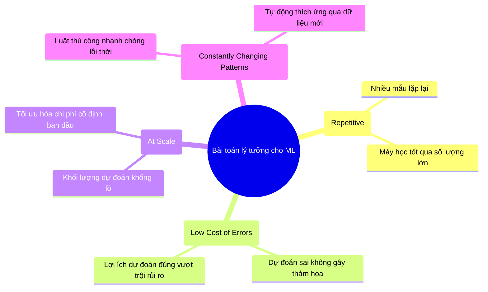

1. **Tính lặp lại cao (Repetitive)**:
   - Con người có khả năng học nhanh từ một vài mẫu (**Few-shot Learning**). Ngược lại, đa số các thuật toán ML hiện đại cần xử lý hàng triệu mẫu để trích xuất trọng số tối ưu. Bài toán có tần suất lặp lại cao cung cấp đủ tín hiệu học cho mô hình.
2. **Chi phí cho một dự đoán sai thấp (Low Cost of Wrong Predictions)**:
   - Không một mô hình ML nào đạt độ chính xác 100% trong môi trường thực tế. Ứng dụng lý tưởng là nơi lỗi sai mang tính chất tha thứ được (forgiving), ví dụ: Hệ thống gợi ý (**Recommender Systems**) — người dùng đơn giản là lướt qua nếu gợi ý không hợp gu.
   - *Trường hợp chi phí sai số cao*: Với xe tự hành (Self-driving cars) hoặc chẩn đoán y khoa, một dự đoán sai có thể dẫn đến tử vong. ML chỉ được chấp nhận khi tỷ lệ an toàn thống kê vượt trội hoàn toàn so với con người hoặc đóng vai trò hệ thống hỗ trợ thứ cấp.
3. **Quy mô vận hành lớn (At Scale)**:
   - Chi phí vốn đầu tư ban đầu (Capex/Opex) cho hạ tầng ML (Compute, Data Pipeline, Talent) rất lớn. Ứng dụng phải phục vụ quy mô dự đoán khổng lồ (hàng triệu truy vấn/ngày) để giảm chi phí biên trên mỗi dự đoán.
   - Bài toán tưởng chừng đơn lẻ (dự đoán người thắng cử Tổng thống 4 năm 1 lần) thực tế là chuỗi dự đoán liên tục theo từng giờ dựa trên dòng dữ liệu biến động.
4. **Mẫu hình biến động liên tục (Constantly Changing Patterns)**:
   - Thị hiếu, văn hóa, công nghệ thay đổi liên tục. Hệ thống phân loại thư rác (Spam Detection) nếu dùng luật cố định (hardcoded rules) sẽ thất bại ngay khi kẻ tấn công thay đổi nội dung lừa đảo. ML vượt trội vì có thể tái huấn luyện định kỳ trên dữ liệu mới mà không cần kỹ sư viết lại logic mã nguồn.

---

### 1.3. Khi Nào KHÔNG NÊN Sử Dụng Machine Learning (When NOT to Use ML)

1. **Vi phạm đạo đức và pháp lý (Unethical / Illegal)**: Thuật toán can thiệp quyền riêng tư, phân biệt chủng tộc/giới tính hoặc vi phạm các chuẩn mực nhân quyền.
2. **Giải pháp đơn giản đáp ứng hoàn hảo yêu cầu (Simpler Solutions Do the Trick)**: Nếu một tập luật kinh doanh (Business Rules), thuật toán heuristic, bảng tra cứu (Lookup Table) hoặc biểu thức chính quy (Regex) giải quyết được bài toán với độ chính xác chấp nhận được và chi phí vận hành bằng 0, không bao giờ dùng ML.
3. **Không đạt hiệu quả kinh tế (Not Cost-Effective)**: Giá trị gia tăng do mô hình ML mang lại nhỏ hơn tổng chi phí thu thập dữ liệu, huấn luyện, hạ tầng GPU/TPU và nhân sự bảo trì.

> **Chiến lược Phân rã bài toán (Problem Decoupling / Fallback)**:
> Nếu không thể xây dựng một mô hình ML giải quyết toàn vẹn bài toán lớn (ví dụ: Chatbot AI trả lời tự động mọi khiếu nại khách hàng), hãy phân rã thành các bài toán con: Dùng ML phân loại xem câu hỏi có thuộc nhóm câu hỏi thường gặp (FAQ) hay không; nếu có $\rightarrow$ trả lời tự động theo mẫu; nếu không $\rightarrow$ chuyển tiếp tới nhân viên tổng đài.

---

## 2. Phân Loại Các Ca Sử Dụng Thực Tế (Machine Learning Use Cases)

### 2.1. Phân Biệt: Ứng Dụng Tiêu Dùng (Consumer) vs. Doanh Nghiệp (Enterprise)

| Tiêu Chí So Sánh | Consumer ML Applications | Enterprise ML Applications |
| :--- | :--- | :--- |
| **Yêu cầu Độ chính xác (Accuracy)** | Chấp nhận sai số tương đối (Ví dụ: Speech-to-text 95% lên 95.5% người dùng khó nhận biết). | **Cực kỳ khắt khe**. Tối ưu hóa 0.1% hiệu suất cấp phát tài nguyên tiết kiệm hàng triệu USD cho tập đoàn. |
| **Ràng buộc Độ trễ (Latency)** | **Rất nghiêm ngặt**. Độ trễ trên 1-3 giây khiến người dùng rời bỏ ứng dụng (User churn). | Thường linh hoạt hơn (tolerant). Có thể chạy batch vài phút hoặc vài giờ qua đêm. |
| **Phân phối & Tiếp cận** | Dễ phân phối qua App Store, Web nhưng cực kỳ khó duy trì Retention và kiếm tiền (Monetization). | Khó tiếp cận, chu kỳ bán hàng (Sales Cycle) kéo dài, nhưng biên lợi nhuận cao và tính gắn kết lớn. |
| **Bản chất bài toán** | Trực quan: Search, Gợi ý video, Nhận diện khuôn mặt, Bàn phím tiên đoán. | Ẩn sâu trong quy trình vận hành nội bộ (Internal Ops) và tối ưu hóa tài chính. |

---

### 2.2. Phân Loại Các Lớp Bài Toán Enterprise ML

Theo khảo sát Enterprise ML của Algorithmia, các ứng dụng doanh nghiệp được chia làm hai trục chính: **Nội bộ (Internal - Cắt giảm chi phí, tự động hóa)** và **Khách hàng (External - Tăng trưởng doanh thu, nâng cao trải nghiệm)**.

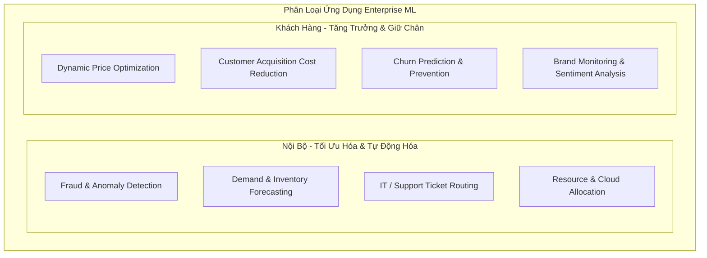

#### Phân tích chi tiết các bài toán trọng yếu:

1. **Phát hiện gian lận (Fraud & Anomaly Detection)**:
   - Áp dụng cho mọi hệ thống giao dịch thanh toán. Bản chất là bài toán phát hiện dị biệt (**Anomaly Detection**) và phân loại mất cân bằng lớp trầm trọng (**Extreme Class Imbalance**).
2. **Tối ưu hóa giá linh hoạt (Price Optimization / Dynamic Pricing)**:
   - Ước tính mức giá tại từng thời điểm để cực đại hóa hàm mục tiêu kinh doanh:
   $$\max_{P} \quad \text{Objective}(P) \in \{\text{Margin}, \text{Revenue}, \text{Growth Rate}\}$$
   - Điều kiện áp dụng: Số lượng giao dịch lớn, nhu cầu biến động theo thời gian thực và khách hàng chấp nhận giá động (Vé máy bay, phòng khách sạn, Ride-sharing như Uber/Grab, Internet Ads).
3. **Dự báo nhu cầu khách hàng (Customer Demand Forecasting)**:
   - Dự báo lượng cầu hàng tồn kho nhằm giải quyết bài toán đánh đổi: Chi phí thiếu hụt hàng hóa (**Stockout Cost**) vs. Chi phí lưu kho/hỏng hóc (**Holding/Spoilage Cost**).
4. **Giảm chi phí thu hút khách hàng (CAC Reduction)**:
   - Chi phí sở hữu khách hàng mới (**Customer Acquisition Cost - CAC**) là nguyên nhân hàng đầu khiến các startup phá sản.
   - ML can thiệp bằng cách: Nhận diện chính xác khách hàng tiềm năng cao (High LTV Lead Scoring), nhắm mục tiêu quảng cáo cá nhân hóa (Targeted Ads), và phân phối mã giảm giá đúng thời điểm nhạy cảm giá nhất.
5. **Dự báo rời bỏ (Churn Prediction)**:
   - *Kinh tế học sản phẩm*: Chi phí thu hút một khách hàng mới đắt gấp **5 đến 25 lần** chi phí giữ chân một khách hàng hiện tại.
   - Mô hình dự báo xác suất rời mạng của từng người dùng để kích hoạt các kịch bản can thiệp kịp thời (Re-engagement campaigns). Áp dụng cả trong quản trị nhân sự (dự báo nhân viên nghỉ việc).
6. **Tự động phân luồng Ticket hỗ trợ (Support Ticket Classification & Routing)**:
   - Phân tích văn bản nội dung khiếu nại (NLP) để định tuyến trực tiếp tới phòng ban chuyên trách, cắt giảm thời gian chờ đợi và chi phí nhân sự xử lý trung gian.
7. **Giám sát thương hiệu (Brand Monitoring & Sentiment Analysis)**:
   - Nhận diện cả nhắc đến trực tiếp (Explicit mentions: "Google") và gián tiếp (Implicit mentions: "gã khổng lồ tìm kiếm") đi kèm phân loại sắc thái cảm xúc (Sentiment) để phát hiện sớm các cuộc khủng hoảng truyền thông.
8. **Hệ thống hỗ trợ chẩn đoán Y tế (Healthcare Diagnostics)**:
   - Phát hiện khối u, võng mạc tiểu đường qua ảnh y khoa. Phục vụ dưới dạng công cụ hỗ trợ bác sĩ (Clinical Decision Support), yêu cầu độ chuẩn xác cực hạn và tuân thủ nghiêm ngặt chuẩn bảo mật dữ liệu y tế (HIPAA/GDPR).

---

## 3. Bản Chất Của Hệ Thống ML: Mind vs. Data & So Sánh Đa Chiều (Understanding ML Systems)

### 3.1. Cuộc Tranh Luận Lịch Sử: Mind vs. Data (Tư Duy vs. Dữ Liệu)

Sự phát triển của AI trong nhiều thập kỷ qua bị chi phối bởi cuộc tranh luận cốt lõi giữa hai trường phái:

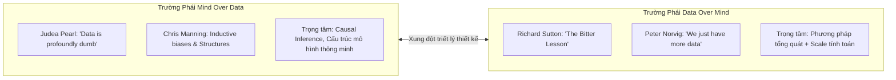

- **Phe "Mind Over Data"**:
  - **Dr. Judea Pearl** (Turing Award, chuyên gia Causal Inference): Khẳng định *"Data is profoundly dumb"*. Dữ liệu thuần túy chỉ ghi lại các tương quan tĩnh trong quá khứ ($P(Y|X)$), không thể trả lời các câu hỏi can thiệp ($P(Y|\text{do}(X))$) hoặc phản thực tế (counterfactuals). Dựa dẫm hoàn toàn vào dữ liệu sẽ đi vào ngõ cụt khi bối cảnh thay đổi.
  - **GS. Christopher Manning** (Giám đốc Stanford AI Lab): Thuật toán học đơn giản kết hợp với tính toán khổng lồ và dữ liệu thô tạo ra những "kẻ học việc tồi tệ" (**incredibly bad learners**). Thiết kế cấu trúc tiên nghiệm (**Inductive Biases**) giúp hệ thống học được nhiều hơn từ lượng dữ liệu ít hơn.
- **Phe "Data Over Mind"**:
  - **GS. Richard Sutton** (Tác giả *"The Bitter Lesson"*): Bài học cay đắng lớn nhất rút ra từ 70 năm nghiên cứu AI là: **Các phương pháp tổng quát tận dụng năng lực tính toán (Computation) luôn chiến thắng áp đảo các phương pháp cố gắng lồng ghép tri thức chuyên gia của con người (Human Domain Knowledge)**. Nỗ lực thiết kế kiến trúc thông minh chỉ mang lại lợi thế ngắn hạn, về dài hạn sức mạnh tính toán và quy mô dữ liệu sẽ đè bẹp tất cả.
  - **Peter Norvig** (Google Director of Search): *"Chúng tôi không có thuật toán tốt hơn. Chúng tôi chỉ có nhiều dữ liệu hơn."*

#### Tháp Nhu Cầu Khoa Học Dữ Liệu (The Data Science Hierarchy of Needs)
Lấy cảm hứng từ tháp Maslow, Tiến sĩ Monica Rogati định nghĩa hệ thống phân tầng để một tổ chức có thể áp dụng AI/ML thành công:

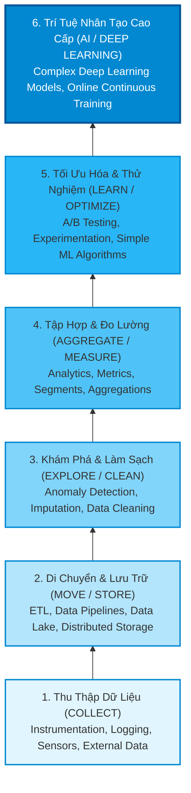

> **Nguyên lý cốt tử**: Nếu không có tầng đáy vững chắc (Thu thập, Lưu trữ, Làm sạch), tầng trên cùng (AI/Deep Learning) hoàn toàn sụp đổ.

#### Dữ liệu hữu hạn (Finite Data) vs. Dữ liệu vô hạn (Infinite Data)
- Nếu có dữ liệu vô hạn, ta không cần đến học máy — chỉ cần lưu trữ và tra cứu trực tiếp nghiệm.
- Thực tế toàn bộ hệ thống ML vận hành trên **dữ liệu hữu hạn**. Quy mô dữ liệu huấn luyện đã bùng nổ theo hàm mũ qua các năm:
  - 2013: *One Billion Words Benchmark* ($0.8 \times 10^9$ tokens) là niềm mơ ước.
  - 2019: GPT-2 sử dụng $10 \times 10^9$ tokens (gấp 12.5 lần).
  - 2020: GPT-3 sử dụng $500 \times 10^9$ tokens (gấp 625 lần so với 2013).
- **Chất lượng > Số lượng**: Tăng lượng dữ liệu nhưng dữ liệu bị gán nhãn sai, trùng lặp hoặc lỗi thời sẽ trực tiếp làm suy giảm hiệu năng của mô hình.

---

### 3.2. Machine Learning Trong Nghiên Cứu vs. Trong Production (Research vs. Production)

Sự chuyển dịch từ môi trường học thuật/nghiên cứu sang môi trường production thực tế là rào cản lớn nhất của các kỹ sư ML.

#### Bảng Ma Trận So Sánh Toàn Diện

| Chiều Đánh Giá | Machine Learning Trong Nghiên Cứu (Research) | Machine Learning Trong Production |
| :--- | :--- | :--- |
| **Mục tiêu chính (Objectives)** | Duy nhất: Đạt đỉnh cao hiệu năng (**SOTA**) trên tập dữ liệu chuẩn (Benchmark). | **Đa mục tiêu và xung đột**: Thỏa mãn nhiều bên liên quan (Business, Ops, Product). |
| **Ưu tiên Tính toán (Compute Priority)** | **Fast Training, High Throughput**. Nút thắt là chu kỳ huấn luyện mô hình. | **Fast Inference, Low Latency**. Nút thắt là thời gian phản hồi dự đoán người dùng. |
| **Bản chất Dữ liệu (Data)** | Tĩnh (Static), sạch sẽ, định dạng chuẩn, dữ liệu lịch sử đóng băng. | Động (Constantly shifting), nhiễu, nhãn thiếu/sai, luồng streaming, ràng buộc pháp lý/bảo mật. |
| **Tính công bằng (Fairness)** | Thường bị xem nhẹ ("Nice to have"); không có leaderboard chuẩn cho fairness. | **Sống còn ("Must have")**. Nguy cơ bị kiện tụng, phạt pháp lý và khủng hoảng truyền thông. |
| **Khả năng giải thích (Interpretability)** | Thứ yếu ("Nice to have"); ưu tiên các mô hình Black-box phức tạp để tối đa điểm số. | **Bắt buộc ("Must have")**. Cần thiết để kỹ sư debug và người dùng/chuyên gia nghiệp vụ tin cậy. |

---

#### Chi Tiết Từng Khía Cạnh Kỹ Thuật

##### 1. Xung đột giữa các bên liên quan & Tách rời mục tiêu (Decoupling Objectives)
Trong production, một hệ thống gợi ý nhà hàng chịu sự chi phối của các bên với các mục tiêu triệt tiêu nhau:
- **ML Engineer**: Muốn dùng mô hình Deep Learning phức tạp nhất để tối đa hóa xác suất người dùng click (Click-through Rate - CTR).
- **Sales Team**: Muốn gợi ý các nhà hàng đắt tiền nhất vì dịch vụ thu phí 10% trên giá trị đơn hàng (Maximize Margin/Revenue).
- **Product Manager**: Yêu cầu thời gian trả kết quả phải $\le 100\text{ ms}$; phát hiện cứ trễ thêm $100\text{ ms}$ thì mất $10\%$ lượng đơn hàng.
- **Platform / Ops Team**: Yêu cầu dừng cập nhật mô hình mới để tập trung vá lỗi hệ thống đang quá tải mỗi đêm.
- **Business Manager**: Muốn tối đa hóa biên lợi nhuận ròng, sẵn sàng cắt giảm chi phí hạ tầng và nhân sự.

> **Giải pháp kiến trúc — Tách rời mục tiêu (Decoupling Objectives)**:
> Không cố gắng huấn luyện một mô hình duy nhất gánh vác mọi mục tiêu mâu thuẫn. Thay vào đó:
> - Huấn luyện **Model A** tối ưu xác suất click: $P(\text{click})$.
> - Huấn luyện **Model B** tối ưu giá trị đơn hàng dự kiến: $\mathbb{E}[\text{Order Value}]$.
> - Điểm số xếp hạng cuối cùng là hàm kết hợp: $\text{Final Score} = f(P(\text{click}), \mathbb{E}[\text{Order Value}])$.
> - Cách tiếp cận này cho phép thay đổi chiến lược kinh doanh bằng cách điều chỉnh trọng số hàm $f$ mà không cần huấn luyện lại toàn bộ mạng nơ-ron.

##### 2. Nghịch lý Ensembling & Bẫy ML Leaderboard
- **Kỹ thuật Ensembling**: Kết hợp nhiều thuật toán học máy khác nhau (Bagging, Boosting, Stacking) để ép thêm vài phần trăm hiệu năng. Đây là công thức chiến thắng quen thuộc của các cuộc thi như Kaggle hay giải thưởng triệu đô **Netflix Prize**.
- **Lý do thất bại trong Production**: Chi phí kỹ thuật quá đắt đỏ:
  - Làm tăng độ trễ suy luận gấp bội (phải chạy suy luận qua $N$ mô hình).
  - Chi phí lưu trữ và hạ tầng phục vụ tăng tuyến tính.
  - Cực kỳ khó bảo trì, giám sát lỗi và giải thích quyết định.
- **Vấn đề kiểm định đa giả thuyết (Multiple-Hypothesis Testing Trap)**: Trên các bảng xếp hạng công khai (như GLUE, Kaggle), khi hàng trăm nhóm cùng thử nghiệm hàng nghìn mô hình trên cùng một tập Hold-out Test cố định, một mô hình đạt điểm số vượt trội hoàn toàn có thể do **ngẫu nhiên thống kê** chứ không phải do kiến trúc vượt trội.

##### 3. Độ Trễ (Latency) vs. Thông Lượng (Throughput)
- **Quy ước thuật ngữ**:
  - *Martin Kleppmann* (Designing Data-Intensive Applications):
    - **Service Time**: Thời gian thực tế để xử lý yêu cầu.
    - **Latency**: Thời gian yêu cầu phải nằm chờ trong hàng đợi để được xử lý.
    - **Response Time**: Thời gian khách hàng thực tế quan sát được ($\text{Response Time} = \text{Service Time} + \text{Queueing Delays} + \text{Network Delays}$).
  - *Quy ước trong cộng đồng ML*: **Latency** được dùng đồng nghĩa với **Response Time** (đo từ lúc client gửi request đến lúc nhận response). **Throughput** là số lượng truy vấn hệ thống xử lý thành công trong một đơn vị thời gian (queries/sec - QPS).

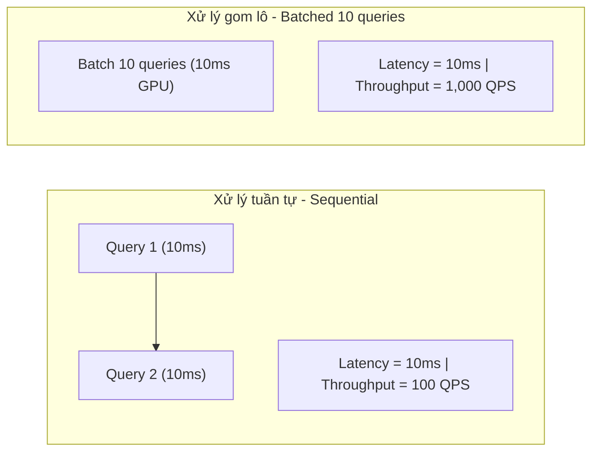

- **Mâu thuẫn Batching trong Online Inference**:
  - Khi tăng kích thước batch, thông lượng tăng mạnh do tận dụng khả năng tính toán song song của GPU.
  - Tuy nhiên, trong môi trường online phục vụ người dùng thực, để tạo một batch gồm 100 truy vấn, hệ thống phải **chờ đợi** gom đủ 100 truy vấn gửi đến $\rightarrow$ làm tăng đáng kể độ trễ cho các truy vấn đầu tiên trong batch.
- **Tác động định lượng của Độ trễ lên kinh doanh**:
  - **Akamai (2017)**: Trễ thêm $100\text{ ms}$ làm giảm **7%** tỷ lệ chuyển đổi (Conversion Rate).
  - **Booking.com (2019)**: Tăng $30\%$ độ trễ làm mất **0.5%** tỷ lệ chuyển đổi — một tổn thất khổng lồ tính trên doanh thu toàn cầu.
  - **Google (2016)**: Hơn **50%** người dùng di động thoát trang nếu thời gian tải vượt quá **3 giây**.

##### 4. Phân Phối Độ Trễ (Latency Distribution) & Nguy Cơ Của Giá Trị Trung Bình
Không bao giờ dùng giá trị trung bình cộng (**Arithmetic Mean**) để đo lường độ trễ của hệ thống!

*Ví dụ thực nghiệm*: Giả sử có 10 truy vấn với độ trễ (ms): $[100, 102, 100, 100, 99, 104, 110, 90, 3000, 95]$.
- Độ trễ trung bình $\text{Mean} = 390\text{ ms} \rightarrow$ Con số này bị bóp méo hoàn toàn bởi 1 ngoại lai ($3000\text{ ms}$ do nghẽn mạng).
- Trung vị ($p50$) là $100\text{ ms} \rightarrow$ Phản ánh đúng trải nghiệm của phần lớn người dùng.
- Phân vị 90 ($p90$) là $3000\text{ ms} \rightarrow$ Chỉ điểm chính xác sự tồn tại của lỗi ngoại lai nghiêm trọng.

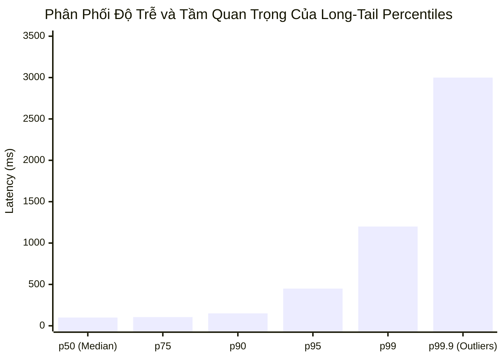

> **Hiệu ứng Khách hàng Giá trị cao tại Phân vị cao (The Amazon Effect)**:
> Amazon phát hiện ra rằng những khách hàng phải chịu độ trễ cao nhất (rơi vào $p99$ và $p99.9$) thường chính là những khách hàng có tài khoản lưu trữ nhiều dữ liệu lịch sử mua sắm nhất — tức là **những khách hàng chi tiêu nhiều tiền nhất cho hệ thống**. Bỏ qua độ trễ đuôi dài (Tail Latency) đồng nghĩa với việc trực tiếp phá hoại trải nghiệm của nhóm khách hàng mang lại nhiều doanh thu nhất.

##### 5. So Sánh Dữ Liệu Thực Tế: Góc Nhìn Của Andrej Karpathy

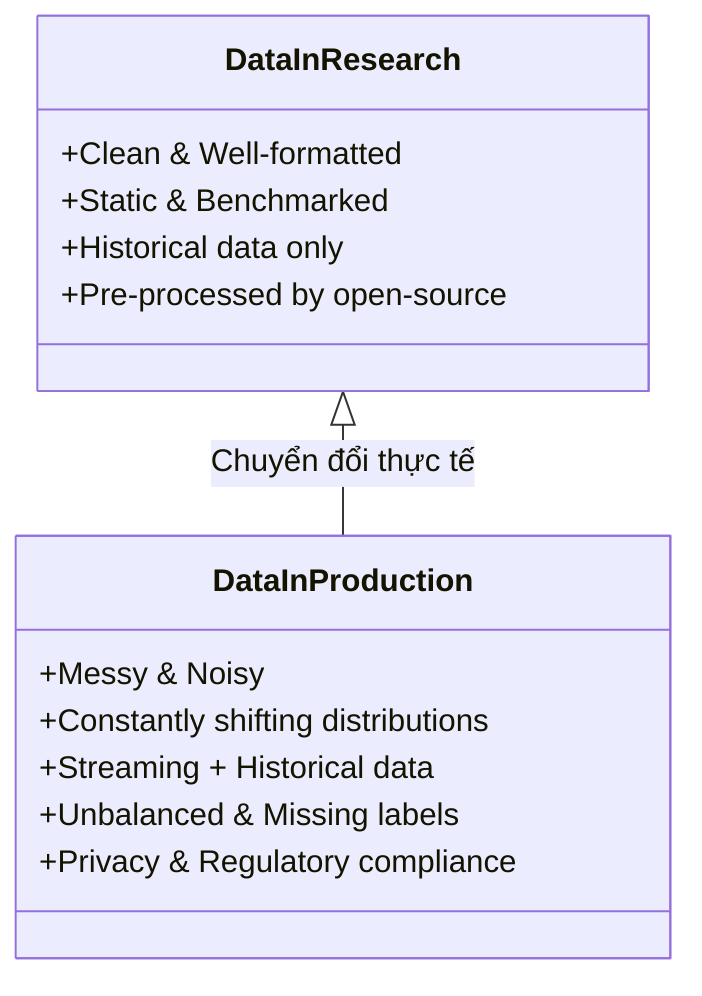

##### 6. Tính Công Bằng & Mã Hóa Định Kiến (Fairness & Bias)
- **Mã hóa quá khứ**: Mô hình học máy không dự đoán tương lai theo nghĩa sáng tạo, mà nó **mã hóa và tái tạo các mẫu hình trong quá khứ**. Nếu dữ liệu lịch sử chứa đựng định kiến xã hội, mô hình sẽ tự động học và khuếch đại định kiến đó ở quy mô công nghiệp.
- **Ví dụ thực chứng**: Nghiên cứu của UC Berkeley (2019) chỉ ra các thuật toán cho vay thế chấp trực tuyến đã từ chối $1.3$ triệu hồ sơ hợp lệ của người da màu và gốc Latinh từ 2008 đến 2015; khi xóa trường dữ liệu danh tính chủng tộc và giữ nguyên thu nhập/điểm tín dụng, các hồ sơ này được chấp thuận ngay lập tức.
- **Rủi ro với nhóm thiểu số (Minority Groups)**: Sai số dự đoán trên nhóm thiểu số chỉ chiếm tỷ trọng cực nhỏ trong hàm mất mát tổng thể (ví dụ: chỉ ảnh hưởng $1-2\%$ tổng accuracy). Doanh nghiệp chạy theo chỉ số tổng quan thường bỏ qua việc tối ưu cho nhóm thiểu số này do chi phí biên tăng vọt.
- **Thực trạng**: Theo khảo sát McKinsey 2019, chỉ có **13%** các tập đoàn lớn thực sự triển khai quy trình kỹ thuật để giảm thiểu rủi ro định kiến thuật toán.

##### 7. Khả Năng Giải Thích (Interpretability & The Hinton Dilemma)
- **Tiến thoái lưỡng nan của Geoffrey Hinton (2020)**:
  > *"Giả sử bạn bị ung thư và phải lựa chọn giữa một Bác sĩ Phẫu thuật AI Black-box không thể giải thích cách thức hoạt động nhưng đạt tỷ lệ chữa khỏi 90%, và một Bác sĩ Phẫu thuật Con người có thể giải thích cặn kẽ nhưng tỷ lệ chữa khỏi chỉ 80%. Bạn có muốn AI surgeon bị coi là bất hợp pháp không?"*
- Khi khảo sát thực tế 30 giám đốc điều hành công nghệ, **50% chọn bác sĩ con người**. Con người không sẵn lòng giao phó tính mạng/quyết định trọng đại cho một cỗ máy mà họ không thể kiểm soát lý do đằng sau.
- **Hai giá trị cốt lõi của Interpretability**:
  1. *Đối với Business & User*: Xây dựng niềm tin, giải thích được lý do từ chối khoản vay/bảo hiểm để tuân thủ pháp luật (GDPR Right to Explanation).
  2. *Đối với Kỹ sư*: Công cụ duy nhất để gỡ lỗi (**Debugging**), phát hiện rò rỉ dữ liệu (**Data Leakage**) và bắt kịp các lỗi tiềm ẩn trước khi mô hình gây thảm họa.

---

### 3.3. ML Systems vs. Traditional Software Engineering

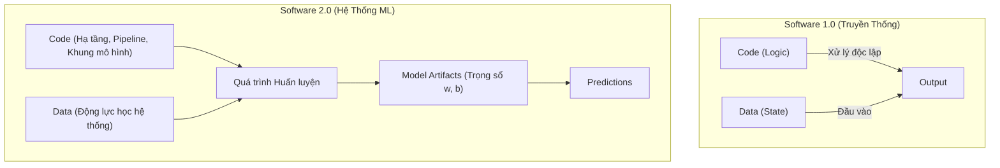

#### Bảng Đối Chiếu Bản Chất Kỹ Thuật

| Đặc Tính Kỹ Thuật | Phần Mềm Truyền Thống (SWE 1.0) | Hệ Thống Học Máy (ML Systems - SWE 2.0) |
| :--- | :--- | :--- |
| **Phân tách mối quan tâm (Separation of Concerns)** | **Code và Data tách biệt rõ ràng**. Code chứa logic, Data chứa trạng thái. | **Code, Data và Artifacts quyện chặt**. Thay đổi dữ liệu làm thay đổi toàn bộ logic vận hành của mô hình. |
| **Kiểm thử & Quản lý phiên bản (Testing & Versioning)** | Tập trung versioning mã nguồn (`git`), Unit Test, Integration Test. | **Bắt buộc versioning cả Code VÀ Dữ liệu khổng lồ**. Khái niệm "Data Testing" phức tạp gấp nhiều lần Code Testing. |
| **Giá trị của từng mẫu dữ liệu** | Mọi bản ghi dữ liệu thường có cấu trúc và vai trò xử lý tương đương. | **Giá trị mẫu cực kỳ bất đối xứng**: 1 mẫu scan phổi ung thư hiếm gặp giá trị hơn 1.000.000 mẫu phổi bình thường. |
| **Tấn công bảo mật** | SQL Injection, XSS, Buffer Overflow, DDoS. | **Data Poisoning, Backdoor Attacks, Adversarial Perturbation, Model Inversion**. |
| **Hành vi khi có lỗi (Failure Modes)** | **Fail Loudly**: Ném Exception, Crash ứng dụng, Runtime Error, HTTP 500/404. | **Fail Silently**: Hệ thống trả lời $200\text{ OK}$, hàm `predict()` chạy trơn tru nhưng kết quả dự đoán hoàn toàn sai lệch vô hình. |
| **Tài nguyên suy luận** | Nhẹ nhàng, CPU/RAM thông thường, tối ưu qua thuật toán $O(n \log n)$. | **Đòi hỏi bộ nhớ khổng lồ**: Mô hình hàng trăm triệu/hàng tỷ tham số cần hàng GB/TB VRAM; bài toán nén mô hình để chạy trên Edge. |

> **Ví dụ về sự tiến hóa kỳ diệu**: Năm 2018, mô hình BERT-Large ra đời với 340 triệu tham số (dung lượng $1.35\text{ GB}$) bị coi là quá cồng kềnh, chậm chạp và bất khả thi để đưa vào production. Chỉ hai năm sau (2020), nhờ sự đột phá về kỹ nghệ phần cứng, quantization và kiến trúc serving, BERT đã được triển khai để phục vụ **hầu như toàn bộ truy vấn tìm kiếm tiếng Anh trên Google**.

---

## 4. Thiết Kế Hệ Thống ML Trong Môi Trường Production (Designing ML Systems in Production)

### 4.1. Định Nghĩa Thiết Kế Hệ Thống ML (ML Systems Design)
> **Thiết kế Hệ thống Học máy (ML Systems Design)** là quá trình xác định toàn diện mọi thành phần của một hệ sinh thái ML — bao gồm giao diện người dùng/hệ thống (**Interface**), thuật toán học máy (**Algorithms**), ngăn xếp dữ liệu (**Data Stack**), cơ sở hạ tầng tính toán (**Infrastructure**) và phần cứng (**Hardware**) — nhằm thỏa mãn một tập hợp các yêu cầu nghiệp vụ và kỹ thuật xác định.

---

### 4.2. 4 Trụ Cột Sống Còn Của Một Hệ Thống ML (The 4 System Requirements)

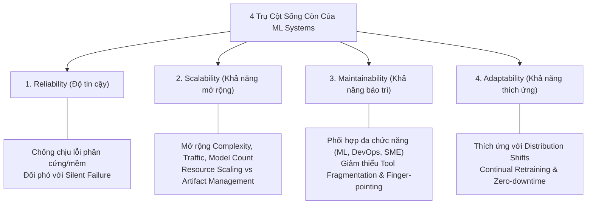

#### 1. Reliability (Độ tin cậy)
- Hệ thống phải tiếp tục thực thi chức năng chính xác ở mức hiệu năng mong muốn ngay cả khi gặp sự cố nghịch cảnh (lỗi phần cứng, lỗi phần mềm hoặc sai sót thao tác của con người).
- **Thách thức cốt lõi của ML - Lỗi Âm Thầm (Silent Failure)**: Trong phần mềm truyền thống, lỗi dẫn đến dừng chương trình. Trong ML, hàm `model.predict()` vẫn trả về mảng xác suất hợp lệ, mã HTTP vẫn là 200, nhưng dự đoán hoàn toàn sai lệch (ví dụ: Google Translate dịch sai ngữ nghĩa một ngôn ngữ hiếm mà người dùng không thể biết). Không có Ground Truth nhãn thực tế ngay tại thời điểm suy luận để đối chiếu.

#### 2. Scalability (Khả năng mở rộng quy mô)
Khả năng mở rộng của hệ thống ML phát triển theo 3 chiều hướng độc lập:
1. **Tăng trưởng về Độ phức tạp của Mô hình (Model Complexity)**: Chuyển dịch từ Logistic Regression ($< 1\text{ GB}$ RAM) lên Mạng Nơ-ron sâu ($> 16\text{ GB}$ VRAM cho suy luận).
2. **Tăng trưởng về Lưu lượng truy vấn (Traffic Volume)**: Hệ thống tăng từ 10.000 dự đoán/ngày lên 1.000.000 đến 10.000.000 dự đoán/ngày với các đợt tăng đột biến (spikes).
3. **Tăng trưởng về Số lượng mô hình (Model Count)**: 
   - Khởi đầu với 1 mô hình phân loại xu hướng chung.
   - Bổ sung mô hình lọc nội dung nhạy cảm (NSFW), mô hình phát hiện bot.
   - *Mô hình Enterprise Multi-tenant*: Mỗi khách hàng doanh nghiệp sở hữu một mô hình cá nhân hóa riêng biệt. Điển hình có những startup vận hành song song **8.000 mô hình phục vụ 8.000 khách hàng doanh nghiệp** trong production.

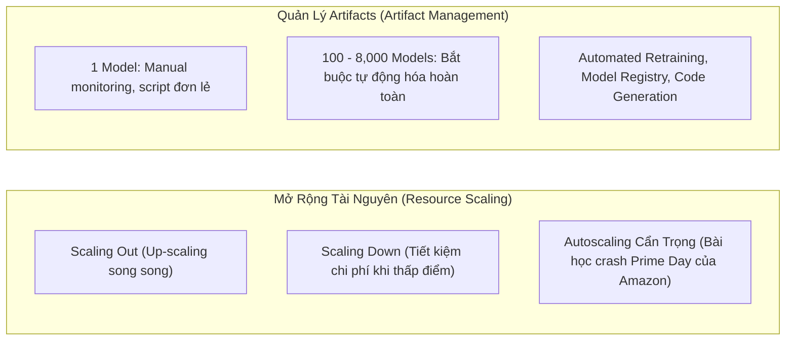

> **Bài học Amazon Prime Day**: Tính năng tự động co giãn (Autoscaling) nếu không được thiết kế và kiểm thử tải kỹ lưỡng có thể sụp đổ dây chuyền. Sự cố hỏng hệ thống tự động co giãn của Amazon trong sự kiện Prime Day kéo dài gần 1 giờ đã gây thiệt hại ước tính từ **72 đến 99 triệu USD**.

#### 3. Maintainability (Khả năng bảo trì)
- Một hệ thống ML liên quan đến nhiều nhóm chuyên môn: ML Engineers (nghiên cứu mô hình, Python, PyTorch), Data Engineers (SQL, Spark, Kafka), DevOps/Platform Engineers (Kubernetes, Terraform, C++ serving engine), và Chuyên gia nghiệp vụ (Domain Experts / SMEs).
- Kiến trúc hệ thống phải chuẩn hóa giao tiếp (APIs, Schemas), cho phép mỗi nhóm sử dụng công cụ tối ưu cho vai trò của mình mà không áp đặt công cụ chéo, đồng thời thiết lập cơ chế giám sát giúp nhanh chóng cô lập nguyên nhân sự cố mà không rơi vào tình trạng "đổ lỗi lẫn nhau" (**no finger-pointing**).

#### 4. Adaptability (Khả năng thích ứng)
- Vì dữ liệu liên tục biến động, hệ thống ML bắt buộc phải có cơ chế:
  - Tự động phát hiện khi nào hiệu năng mô hình bắt đầu suy giảm do trôi dạt dữ liệu (**Data Drift / Concept Drift**).
  - Tích hợp dữ liệu mới để tái huấn luyện (**Continual Learning**) và cập nhật mô hình mới vào production mà không làm gián đoạn dịch vụ (**Zero-Downtime Deployment**).

---

### 4.3. Vòng Đời Lặp Không Hồi Kết Của Hệ Thống ML (The Iterative Lifecycle)

Phát triển hệ thống ML **không bao giờ là một quy trình thác nước tuyến tính (linear waterfall)**: Thu thập dữ liệu $\rightarrow$ Huấn luyện $\rightarrow$ Triển khai $\rightarrow$ Hoàn thành. Trên thực tế, đó là một vòng lặp tuần hoàn liên tục với vô số chu trình phản hồi ngược (feedback loops).

#### Minh Họa Chu Trình 13 Bước Thực Tế Trong Bài Toán Hiển Thị Quảng Cáo (Ad Serving)
```
[Bước 1] Chọn chỉ số tối ưu: Impressions (Số lượt hiển thị quảng cáo).
    │
[Bước 2] Thu thập dữ liệu và gán nhãn.
    │
[Bước 3] Kỹ nghệ đặc trưng (Feature Engineering).
    │
[Bước 4] Huấn luyện mô hình lần đầu.
    │
[Bước 5] Phân tích lỗi (Error Analysis) ──► Phát hiện lỗi do nhãn sai ──► [Gán nhãn lại dữ liệu]
    │                                                                           │
[Bước 6] Huấn luyện lại mô hình ◄───────────────────────────────────────────────┘
    │
[Bước 7] Phân tích lỗi ──► Phát hiện mô hình luôn đoán "Không hiển thị"
    │                      (Do 99.99% dữ liệu là No-Show: Mất cân bằng dữ liệu cực hạn)
    │                      └──► [Thu thập bổ sung dữ liệu Show]
    │                                    │
[Bước 8] Huấn luyện lại mô hình ◄────────┘
    │
[Bước 9] Đánh giá: Tốt trên tập test 2 tháng trước, nhưng tụt dốc trên tập test ngày hôm qua
    │    (Mô hình bị suy thoái do thời gian) ──► [Thu thập dữ liệu mới nhất]
    │                                                    │
[Bước 10] Huấn luyện lại mô hình ◄───────────────────────┘
    │
[Bước 11] Triển khai lên Production (Deploy).
    │
[Bước 12] Phía Kinh doanh cảnh báo doanh thu sụt giảm!
    │     (Nguyên nhân: Quảng cáo hiển thị nhiều nhưng không ai click vì tối ưu sai metric)
    │     └──► Thay đổi bài toán sang tối ưu Click-Through Rate (CTR).
    │
[Bước 13] Quay lại BƯỚC 1 (Khởi động vòng đời mới).
```

---

#### Sơ Đồ Mermaid: Vòng Đời 6 Giai Đoạn Chuẩn Của Hệ Thống ML

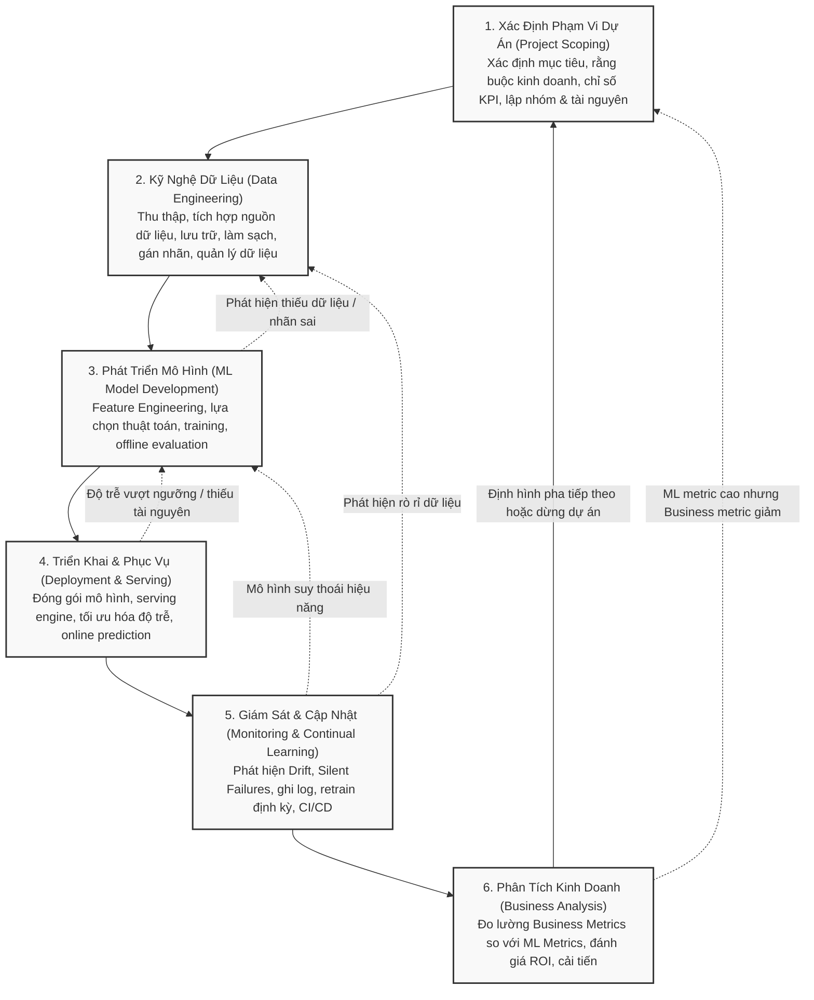

#### Phân Tích Chi Tiết 6 Giai Đoạn Kỹ Thuật:

1. **Giai đoạn 1: Xác định phạm vi dự án (Project Scoping)**:
   - Xác định mục tiêu kinh doanh rõ ràng, chuyển dịch từ bài toán nghiệp vụ sang bài toán dự đoán toán học.
   - Nhận diện các ràng buộc sống còn: Ngân sách tài nguyên tính toán, ngưỡng độ trễ tối đa ($p99 < 100\text{ ms}$), yêu cầu về tính công bằng và giải thích.
   - Thiết lập tiếng nói chung giữa các bên liên quan (**Stakeholder Alignment**).
2. **Giai đoạn 2: Kỹ nghệ dữ liệu (Data Engineering)**:
   - Xây dựng hạ tầng xử lý dòng dữ liệu (Streaming) và xử lý theo mẻ (Batch).
   - Thiết kế kho dữ liệu (Data Warehouse / Lakehouse), tạo lập pipeline thu thập, làm sạch, khử trùng lặp và chiến lược sinh nhãn dữ liệu (**Label Generation / Weak Supervision**).
3. **Giai đoạn 3: Phát triển mô hình ML (ML Model Development)**:
   - Kỹ nghệ đặc trưng (**Feature Engineering**): Trích xuất, chuẩn hóa, biến đổi đặc trưng và quản lý qua Feature Store.
   - Thiết kế mô hình cơ sở đơn giản (**Baseline Model**) trước khi thử nghiệm các mô hình phức tạp.
   - Huấn luyện, điều chỉnh siêu tham số (**Hyperparameter Tuning**), đánh giá ngoại tuyến (**Offline Evaluation**) trên nhiều lát cắt dữ liệu (Data Slices).
4. **Giai đoạn 4: Triển khai & Phục vụ (Deployment & Serving)**:
   - Đóng gói mô hình (Containers, ONNX, TensorRT), tối ưu hóa suy luận (Quantization, Pruning, Distillation).
   - Lựa chọn phương thức phục vụ: Batch Prediction vs. Online Prediction; Edge Serving vs. Cloud Serving.
   - Chiến lược triển khai an toàn: Shadow Deployment, Canary Release, A/B Testing.
5. **Giai đoạn 5: Giám sát & Học liên tục (Monitoring & Continual Learning)**:
   - Xây dựng hệ thống cảnh báo sớm phát hiện trôi dạt dữ liệu (**Data Drift**) và trôi dạt khái niệm (**Concept Drift**).
   - Giám sát độ trễ, lưu lượng truy vấn, tỷ lệ lỗi và suy giảm độ chính xác.
   - Thiết lập đường ống tự động kích hoạt huấn luyện lại (**Automated Retraining Pipelines**).
6. **Giai đoạn 6: Phân tích kinh doanh (Business Analysis)**:
   - Đối chiếu chỉ số kỹ thuật của mô hình (Accuracy, F1, AUC-ROC) với chỉ số kinh doanh thực tế (Doanh thu, Tỷ lệ rời bỏ, Lợi nhuận biên).
   - Đánh giá chỉ số hoàn vốn đầu tư (**ROI**) để quyết định mở rộng quy mô, điều chỉnh hàm mục tiêu hoặc khai tử dự án nếu không đem lại giá trị.

---

## 5. Bảng Tổng Hợp Kiểm Thử Sẵn Sàng Vận Hành (Production Readiness Checklist)

Trước khi quyết định phê duyệt và triển khai một hệ sinh thái ML vào môi trường Production, toàn bộ đội ngũ kỹ thuật phải đối chiếu với bảng kiểm tra chuẩn hóa sau:

| STT | Hạng Mục Kiểm Tra | Nội Dung Chi Tiết Kỹ Thuật Cần Xác Minh | Trạng Thái Phê Duyệt |
| :---: | :--- | :--- | :---: |
| **I** | **Định Vị Bài Toán (Problem Scoping)** | | |
| 1.1 | *Sự cần thiết của ML* | Đã chứng minh các giải pháp truyền thống (Heuristics, Rules, SQL Lookup) không giải quyết tối ưu bài toán? | [ ] Đạt |
| 1.2 | *Hiệu quả kinh tế (ROI)* | Giá trị kinh doanh thặng dư vượt trội hơn tổng chi phí duy trì hạ tầng GPU, Data Pipeline và nhân sự? | [ ] Đạt |
| 1.3 | *Tách rời mục tiêu (Decoupling)* | Các mục tiêu kinh doanh mâu thuẫn (ví dụ: CTR vs Margin) đã được tách thành các mô hình riêng biệt thay vì dồn vào một black-box? | [ ] Đạt |
| **II** | **Kỹ Nghệ & Quản Trị Dữ Liệu** | | |
| 2.1 | *Giả định phân phối* | Đã kiểm chứng phân phối dữ liệu huấn luyện tương đồng với dữ liệu môi trường thực tế ($P_{train} \approx P_{prod}$)? | [ ] Đạt |
| 2.2 | *Data Versioning* | Toàn bộ dữ liệu huấn luyện, mã tiền xử lý và đặc trưng đã được định danh phiên bản bất biến (DVC, Delta Lake, Feature Store)? | [ ] Đạt |
| 2.3 | *Bảo vệ ngộ độc dữ liệu* | Đã có cơ chế kiểm duyệt dữ liệu đầu vào chống tấn công đầu độc (**Data Poisoning / Backdoor attacks**)? | [ ] Đạt |
| **III** | **Mô Hình & Đánh Giá Ngoại Tuyến** | | |
| 3.1 | *Mô hình cơ sở (Baseline)* | Đã so sánh hiệu năng của mô hình phức tạp với một mô hình đơn giản (Linear/Logistic Regression hoặc Heuristic rule)? | [ ] Đạt |
| 3.2 | *Đánh giá trên lát cắt (Data Slices)* | Đã kiểm định độ chính xác trên các nhóm thiểu số (Minority groups) để tránh thiên vị thuật toán và vi phạm Fairness? | [ ] Đạt |
| 3.3 | *Khả năng giải thích (Interpretability)* | Kỹ sư có khả năng giải thích và truy vết nguyên nhân khi mô hình đưa ra một dự đoán sai lệch bất thường? | [ ] Đạt |
| **IV** | **Hạ Tầng Suy Luận & Triển Khai** | | |
| 4.1 | *SLA Độ trễ Phân vị cao* | Độ trễ tại $p90, p99$ có thỏa mãn ngưỡng ràng buộc của sản phẩm (ví dụ $< 100\text{ ms}$) dưới tải định mức? | [ ] Đạt |
| 4.2 | *Kế hoạch co giãn (Autoscaling)* | Hạ tầng hỗ trợ cả scale-out khi tải cao và scale-down khi thấp điểm; đã kiểm thử tải để tránh thảm họa cascading crash? | [ ] Đạt |
| 4.3 | *Quản lý nhiều mô hình (Multi-model)* | Nếu vận hành hàng trăm/nghìn mô hình, hệ thống có cơ chế tự động hóa sinh mã và triển khai mà không cần can thiệp thủ công? | [ ] Đạt |
| **V** | **Vận Hành, Giám Sát & Ứng Phó Sự Cố** | | |
| 5.1 | *Phát hiện Lỗi Âm Thầm (Silent Failures)* | Đã thiết lập các chỉ số đại diện (Proxy Metrics) để giám sát chất lượng dự đoán khi chưa có Ground Truth nhãn thực tế? | [ ] Đạt |
| 5.2 | *Giám sát Drift* | Đã cài đặt cảnh báo tự động khi xuất hiện Data Distribution Drift hoặc Concept Drift trên luồng dữ liệu suy luận? | [ ] Đạt |
| 5.3 | *Cơ chế Fallback & Zero-downtime* | Nếu mô hình ML gặp sự cố hoặc timeout, hệ thống có tự động chuyển hướng sang giải pháp an toàn (Rule-based / Cache / Default) mà không làm sập ứng dụng? | [ ] Đạt |
