# Chương 02: Nền Tảng Kỹ Thuật Dữ Liệu (Data Engineering Fundamentals)

> **Tóm tắt cốt lõi**: Trọng tâm của hệ thống Machine Learning trong production không chỉ nằm ở thuật toán mô hình mà phụ thuộc phần lớn vào hạ tầng kỹ thuật dữ liệu. Chương này mổ xẻ toàn bộ chuỗi giá trị dữ liệu từ nguồn phát sinh (data sources), định dạng lưu trữ (formats), mô hình dữ liệu (data models), động cơ lưu trữ & xử lý (storage engines: OLTP vs. OLAP, ETL vs. ELT), các phương thức luân chuyển dữ liệu (modes of dataflow) cho đến bài toán xử lý theo lô vs. xử lý dòng (Batch vs. Stream Processing) phục vụ kỹ thuật đặc trưng (Feature Engineering).

---

## 1. Nguồn Dữ Liệu (Data Sources)

Dữ liệu đầu vào cho hệ thống ML được thu thập từ nhiều nguồn khác nhau với đặc tính tốc độ, độ tin cậy và định dạng hoàn toàn khác biệt. Việc hiểu rõ bản chất nguồn dữ liệu quyết định trực tiếp đến kiến trúc pipeline xử lý và tính toàn vẹn của mô hình.

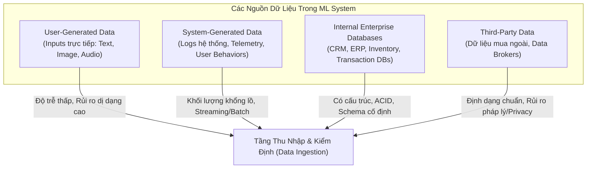

### 1.1. Phân loại theo Nguồn Phát Sinh

#### A. Dữ liệu do người dùng trực tiếp nhập (User-Generated Data)
* **Bản chất**: Dữ liệu do người dùng cung cấp tường minh cho ứng dụng (câu truy vấn tìm kiếm, văn bản bình luận, hình ảnh tải lên, tệp âm thanh, video).
* **Đặc tính kỹ thuật**:
  * **Tỷ lệ dị dạng cực cao (Mal-formatted & Noisy)**: Người dùng có thể nhập chuỗi ký tự vào trường số học, tải tệp sai định dạng (ví dụ đổi đuôi `.txt` thành `.png`), chuỗi văn bản vượt ngưỡng độ dài tối đa hoặc chứa mã độc/ký tự đặc biệt.
  * **Nhạy cảm với độ trễ (Latency-sensitive)**: Người dùng kỳ vọng phản hồi gần như tức thì (near real-time) sau khi gửi yêu cầu. Do đó, pipeline xử lý dữ liệu người dùng phải tối ưu hóa throughput và đạt p99 latency ở mức mili-giây.
  * **Yêu cầu xử lý**: Bắt buộc phải có tầng kiểm định dữ liệu gắt gao (heavy-duty input validation, schema validation, sanitization) ngay tại API Gateway trước khi dữ liệu được chuyển đến mô hình ML.

#### B. Dữ liệu do hệ thống tự động sinh (System-Generated Data)
* **Logs hệ thống (System Logs & Observability Data)**:
  * Ghi nhận trạng thái vận hành của hạ tầng: dung lượng RAM tiêu thụ, CPU utilization, số lượng instances, trace ID của microservices, metadata của các batch training jobs.
  * **Mục đích**: Debugging, profiling, giám sát sự cố (incident alerting).
  * **Vấn đề tỷ lệ tín hiệu / nhiễu (Signal-to-Noise Ratio)**: Quy tắc "ghi log mọi thứ" (log everything) dẫn đến bùng nổ dung lượng cực nhanh. Tín hiệu quan trọng dễ bị chìm trong hàng terabyte log vô thưởng vô phạt. Cần các công cụ log analytics (ELK Stack, Datadog) tích hợp ML để phát hiện dị thường (anomaly detection).
  * **Chính sách phân tầng lưu trữ (Tiered Storage & Retention Policy)**: Log chỉ có giá trị cao trong thời gian ngắn sau phát sinh. Dữ liệu log nóng được giữ trên High-frequency access storage (như S3 Standard), sau đó tự động chuyển dịch (lifecycle rules) về Low-access storage (như S3 Glacier/Deep Archive) hoặc hủy bỏ sau chu kỳ lưu giữ (ví dụ 30-90 ngày) để tối ưu chi phí.
* **Logs hành vi người dùng (User Behavioral & Telemetry Logs)**:
  * Ghi lại tương tác ngầm: lượt click chuột, hành động cuộn trang (scroll depth), thời gian dừng xem (dwell time), tương tác lướt qua (impressions), các đề xuất bị bỏ qua.
  * **Lưu ý pháp lý**: Mặc dù do hệ thống tự sinh ngầm, dữ liệu này phản ánh trực tiếp hành vi cá nhân và được xếp vào danh mục dữ liệu người dùng (User Data), chịu sự ràng buộc nghiêm ngặt của các quy chuẩn bảo mật quốc tế (GDPR, CCPA). Dữ liệu này là nguồn nguyên liệu cốt lõi để đào tạo các hệ thống gợi ý (Recommendation Systems) và phát hiện gian lận (Fraud Detection).

#### C. Cơ sở dữ liệu nội bộ (Internal Enterprise Databases)
* Quản lý các tài sản kinh doanh cốt lõi của doanh nghiệp: quản lý quan hệ khách hàng (CRM), quản lý kho vận (Inventory), dữ liệu giao dịch tài chính (Transactions).
* Trong hệ thống ML thực tế, mô hình hiếm khi hoạt động độc lập mà phải phối hợp chặt chẽ với cơ sở dữ liệu nội bộ.
  * *Ví dụ*: Khi người dùng tìm kiếm sản phẩm trên sàn thương mại điện tử, mô hình Natural Language Processing (NLP) phân tích intent của query $\rightarrow$ Hệ thống tra cứu database nội bộ để kiểm tra trạng thái còn hàng (in-stock status) $\rightarrow$ Mô hình Ranking xếp hạng và trả về danh sách sản phẩm.

---

### 1.2. Phân loại theo Quyền Sở Hữu và Tính Riêng Tư (Data Ownership & Privacy)

| Loại dữ liệu | Định nghĩa | Ưu điểm | Thách thức & Rủi ro |
| :--- | :--- | :--- | :--- |
| **First-party Data** *(Dữ liệu bên thứ nhất)* | Dữ liệu do chính doanh nghiệp thu thập trực tiếp từ tương tác của khách hàng trên nền tảng của mình. | Độ chính xác cao, hiểu rõ nguồn gốc dữ liệu, toàn quyền kiểm soát, tuân thủ pháp lý dễ dàng. | Bị giới hạn trong phạm vi hành vi trên nền tảng nội bộ; thiếu góc nhìn toàn cảnh về người dùng ngoài hệ sinh thái. |
| **Second-party Data** *(Dữ liệu bên thứ hai)* | Dữ liệu do một đối tác chiến lược thu thập từ tệp khách hàng của họ và chia sẻ/bán lại cho doanh nghiệp thông qua hợp đồng thương mại. | Bổ sung ngữ cảnh người dùng từ các dịch vụ liên quan (ví dụ: hãng hàng không chia sẻ dữ liệu với chuỗi khách sạn). | Phụ thuộc vào chất lượng thu thập của đối tác; chi phí tích hợp và đàm phán hợp đồng cao. |
| **Third-party Data** *(Dữ liệu bên thứ ba)* | Dữ liệu được thu thập bởi các thực thể trung gian (Data Brokers) không có quan hệ trực tiếp với người dùng, gom từ nhiều nguồn công cộng và số hóa. | Cung cấp hồ sơ nhân khẩu học sâu rộng (tuổi, thu nhập, xu hướng chính trị, hành vi tiêu dùng đa nền tảng). Đã được làm sạch và chuẩn hóa cấu trúc. | Rủi ro pháp lý cực cao. Thiếu tính minh bạch. Đang bị triệt tiêu bởi các chính sách bảo mật hệ điều hành. |

#### Sự sụp đổ của Third-party Tracking và Bước ngoặt sang First-party Data
* **Cơ chế truyền thống**: Các đơn vị quảng cáo theo dõi hành vi xuyên ứng dụng dựa vào định danh thiết bị độc nhất: Apple IDFA (Identifier for Advertisers) trên iOS và AAID (Android Advertising ID) trên Android.
* **Thay đổi bước ngoặt**: Apple áp dụng chính sách App Tracking Transparency (ATT) trên iOS 14.5+ biến IDFA thành cơ chế *opt-in* (người dùng phải chủ động cho phép mới được theo dõi). Tỷ lệ chấp nhận opt-in giảm sâu (thường < 20-25%), làm tê liệt khả năng tracking của bên thứ ba.
* **Hệ quả kiến trúc**: Các nỗ lực lách luật bằng kỹ thuật Device Fingerprinting (như hiệp hội CAID) bị siết chặt. Các hệ thống ML hiện đại buộc phải thiết kế lại pipeline, giảm thiểu sự phụ thuộc vào dữ liệu bên thứ ba và tập trung tối đa vào việc khai thác **First-party Data** thông qua User Engagement và Contextual Signals.

---

## 2. Định Dạng Dữ Liệu & Tuần Tự Hóa (Data Formats & Serialization)

Tuần tự hóa dữ liệu (Data Serialization) là quá trình chuyển đổi một cấu trúc dữ liệu hoặc trạng thái đối tượng trong bộ nhớ RAM thành một luồng byte (byte stream) có thể lưu trữ bền vững trên đĩa hoặc truyền qua mạng máy tính, và có thể tái tạo lại nguyên vẹn trạng thái ban đầu (Deserialization).

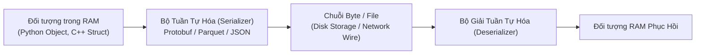

### 2.1. Bảng Tổng Hợp So Sánh Các Định Dạng Dữ Liệu Phổ Biến

| Định dạng | Nhị phân / Văn bản | Khả năng đọc của người (Human-readable) | Schema Support | Trường hợp sử dụng điển hình (Use Cases) |
| :--- | :---: | :---: | :---: | :--- |
| **JSON** | Text | Có | Schema-on-Read / Tuỳ chọn (JSON Schema) | Web APIs, RESTful payload, cấu hình ứng dụng, tài liệu NoSQL. |
| **CSV** | Text | Có | Không (chỉ có dòng tiêu đề quy ước) | Trao đổi dữ liệu dạng bảng đơn giản, phân tích dữ liệu ad-hoc, xuất báo cáo. |
| **Parquet** | Binary | Không | Schema-on-Write (Metadata gắn trong file) | Data Lake, Data Warehouse (Hadoop, Snowflake, BigQuery, AWS S3/Redshift). |
| **Avro** | Binary | Không | Schema-on-Write (Lưu schema dạng JSON trong file) | Truyền tải thông điệp trên Kafka, streaming storage, Hadoop MapReduce. |
| **Protobuf** | Binary | Không | Schema-on-Write (Biên dịch từ file `.proto`) | Giao tiếp liên dịch vụ gRPC, TFRecord (TensorFlow), tối ưu latency mạng. |
| **Pickle** | Binary | Không | Không (gắn liền với cấu trúc class Python) | Serialize model/object nội bộ trong Python/PyTorch. **Rủi ro bảo mật (Arbitrary Code Execution)** nếu giải mã tệp không tin cậy. |

---

### 2.2. Định Dạng Văn Bản (Text) vs. Nhị Phân (Binary)

Sự khác biệt bản chất giữa Text và Binary nằm ở cách biểu diễn dữ liệu ở mức byte:

* **Biểu diễn số học**:
  * Lưu số `1000000` (1 triệu):
    * **Text format (CSV, JSON)**: Cần 7 ký tự ASCII/UTF-8 $\rightarrow$ Tốn **7 bytes** bộ nhớ.
    * **Binary format**: Biểu diễn dưới dạng số nguyên có dấu 32-bit (`int32`) $\rightarrow$ Tốn đúng **4 bytes** (32 bits), cố định và độc lập với giá trị độ lớn của số.
* **Hiệu năng I/O và Dung lượng đĩa**:
  * Dữ liệu nhị phân nhỏ gọn hơn đáng kể, trực tiếp làm giảm băng thông mạng (network bandwidth) khi truyền dữ liệu và I/O đĩa (disk read/write throughput).
  * *Benchmark thực tế*: Một tệp dữ liệu phỏng vấn dạng bảng kích thước 14 MB ở định dạng CSV khi chuyển sang Parquet (nhị phân kết hợp nén) giảm xuống còn 6 MB (tiết kiệm gần 60% dung lượng).
  * AWS khuyến nghị chuyển dịch sang Parquet: Tốc độ trích xuất dữ liệu nhanh hơn tới **2 lần** và giảm dung lượng lưu trữ trên Amazon S3 lên đến **6 lần** so với định dạng văn bản thô.
* **Lỗi ngầm nghiêm trọng của định dạng CSV trong Production**:
  1. **Mất độ chính xác số thực (Float Precision Loss)**: Khi ghi các giá trị `float64` phức tạp (như trọng số mô hình hoặc feature tọa độ GPS) vào CSV, quá trình ép kiểu chuỗi có thể làm tròn hoặc cắt ngắn số (ví dụ: `0.1234567890123456` bị rút gọn thành `"0.123456789"`), gây ra lỗi sai lệch số học không thể phục hồi.
  2. **Chi phí giải mã kiểu dữ liệu (Parsing Overhead)**: CSV không lưu giữ metadata về kiểu. Ứng dụng đọc phải quét toàn bộ tệp, tự suy luận hoặc ép kiểu từng trường ký tự thành số nguyên, số thực hoặc boolean, gây tiêu tốn tài nguyên CPU vô ích.
  3. **Không hỗ trợ kiểu dữ liệu phức tạp**: Rất khó biểu diễn mảng nhiều chiều (multidimensional arrays), cấu trúc lồng nhau (nested structs) hoặc giá trị nhị phân nhúng (embedded binary blobs).

---

### 2.3. Bố Cục Dòng (Row-major) vs. Bố Cục Cột (Column-major)

Kiến trúc phần cứng máy tính và CPU cache line được thiết kế tối ưu hóa cho việc truy cập bộ nhớ tuần tự (sequential memory access). Cách tổ chức dữ liệu dạng bảng trên đĩa và RAM định hình hiệu năng của hệ thống.

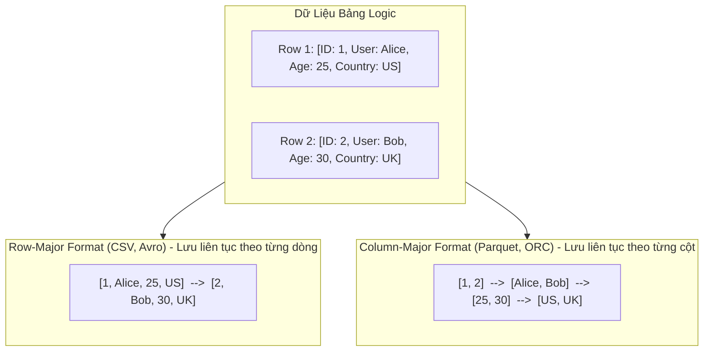

#### A. Cơ chế Hoạt Động & Phân Tích Trade-off

| Đặc tính | Row-Major (Ưu tiên dòng - CSV, Avro) | Column-Major (Ưu tiên cột - Parquet, ORC) |
| :--- | :--- | :--- |
| **Bố cục bộ nhớ** | Các phần tử trong cùng một hàng được lưu trữ cạnh nhau trên đĩa/RAM. | Các phần tử trong cùng một cột được gom thành từng block và lưu liên tục. |
| **Tốc độ Ghi (Write Performance)** | **Rất nhanh (O(1) append)**: Việc ghi thêm một dòng dữ liệu mới chỉ đơn giản là nối tiếp vào cuối tệp hoặc phân vùng. | **Chậm hơn**: Việc chèn thêm một dòng mới đòi hỏi phải tách dòng đó thành các thuộc tính riêng biệt và ghi vào từng khối dữ liệu cột tương ứng. |
| **Tốc độ Đọc (Read Performance)** | Đọc toàn bộ các thuộc tính của một bản ghi cực nhanh. Nhưng đọc một tập con cột (subset of columns) rất lãng phí vì phải quét qua toàn bộ các cột khác trên đĩa. | **Cực nhanh khi quét theo cột (Projection Pushdown)**: Chỉ nạp đúng các cột cần truy vấn vào bộ nhớ, bỏ qua hoàn toàn các cột không liên quan. |
| **Hiệu quả Nén (Compression Ratio)** | Thấp: Các giá trị cạnh nhau có kiểu dữ liệu khác nhau (string, float, int, timestamp), độ phân tán entropy cao. | **Cực cao**: Các giá trị trong cùng một block có cùng kiểu dữ liệu, độ tương đồng cao. Cho phép áp dụng: Run-Length Encoding (RLE), Dictionary Encoding, Bit Packing, Snappy/ZSTD. |
| **Tình huống sử dụng tối ưu** | Transactional systems (OLTP), Ingestion logging, hệ thống ghi dữ liệu liên tục với tần suất cao. | Analytical systems (OLAP), Feature extraction cho ML, Data Warehousing, Data Lake querying. |

* **Kịch bản thực tế trong ML**: Giả sử dataset log giao dịch có **1,000 features**, nhưng mô hình chỉ cần lấy đúng **4 features** (`timestamp`, `user_id`, `distance`, `fare_amount`) để inference:
  * Trong **Row-major format**: Hệ thống buộc phải đọc toàn bộ 1,000 features của từng hàng vào RAM rồi mới lọc bỏ 996 features dư thừa $\rightarrow$ Lãng phí hơn 99% I/O đĩa và băng thông.
  * Trong **Column-major format**: Hệ thống chỉ cần đọc trực tiếp 4 dải byte chứa 4 cột cần thiết $\rightarrow$ Tốc độ đọc tăng vọt, tận dụng triệt để bộ nhớ đệm CPU (L1/L2/L3 Cache).

#### B. Góc nhìn Thực chiến: Pandas DataFrame vs. NumPy ndarray

Một lỗi kinh điển gây suy giảm hiệu năng nghiêm trọng trong mã nguồn Python ML là hiểu sai cơ chế lưu trữ của Pandas:

* **Pandas DataFrame** là một cấu trúc dữ liệu **Column-major** (lấy cảm hứng từ DataFrame của R). Dữ liệu được quản lý dưới dạng tập hợp các Series (cột) liên tục.
* **NumPy `ndarray`** mặc định là **Row-major** (C-contiguous order), nghĩa là các phần tử trong cùng một dòng được bố trí liên tục trong bộ nhớ.
* **Hậu quả**:
  * Khi lặp (iterate) qua một Pandas DataFrame theo từng dòng (ví dụ dùng `for index, row in df.iterrows()`): Hệ thống phải nhảy vùng nhớ liên tục giữa các cột riêng biệt để gom lại thành một Series dòng. Thời gian chạy có thể chậm hơn **hàng chục đến hàng trăm lần** so với việc lặp theo cột.
  * *Benchmark*: Lặp qua DataFrame theo cột mất `0.07 giây`, nhưng lặp theo dòng mất tới `2.41 giây` (chậm hơn ~34 lần).
  * **Giải pháp kỹ thuật**: Nếu bắt buộc phải xử lý dữ liệu theo từng mẫu (row-based access), cần chuyển đổi DataFrame sang NumPy array (`df.to_numpy()`) trước khi thao tác, hoặc vector hóa hoàn toàn phép toán (vectorized operations).

---

## 3. Mô Hình Dữ Liệu (Data Models)

Mô hình dữ liệu (Data Model) là tầng trừu tượng định nghĩa cách thức dữ liệu được mô tả, liên kết và quản lý về mặt logic. Cách chọn mô hình dữ liệu quyết định bản chất các bài toán mà hệ thống có thể giải quyết hiệu quả.

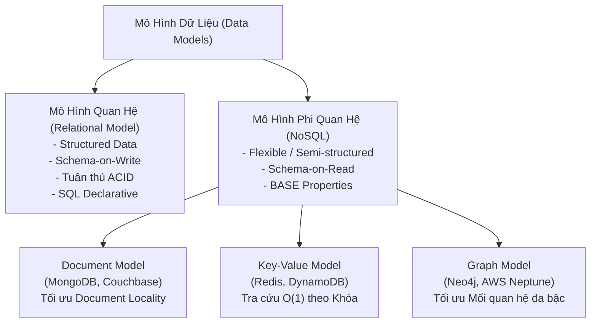

### 3.1. Mô Hình Quan Hệ (Relational Model)

Được phát minh bởi Edgar F. Codd (1970), mô hình quan hệ tổ chức dữ liệu thành các quan hệ (Relations - biểu diễn dưới dạng các Bảng/Tables). Mỗi quan hệ là một tập hợp các bộ dữ liệu không có thứ tự (Tuples - tương ứng các Dòng/Rows), và các Thuộc tính (Attributes - tương ứng các Cột/Columns).

#### A. Chuẩn Hóa Dữ Liệu (Normalization)
Chuẩn hóa dữ liệu tuân theo các dạng chuẩn (1NF, 2NF, 3NF, BCNF) nhằm mục tiêu tối thượng: **Loại bỏ sự dư thừa dữ liệu (Data Redundancy) và ngăn chặn sự bất nhất dữ liệu (Data Inconsistency / Anomalies)** khi thực hiện các thao tác Thêm, Sửa, Xóa.

* **Cơ chế**: Tách một bảng lớn chứa thông tin lặp lại thành nhiều bảng nhỏ có quan hệ khóa ngoại (Foreign Keys).
  * *Ví dụ*: Thay vì lưu trực tiếp chuỗi tên và quốc gia nhà xuất bản (`Banana Press`, `UK`) lặp lại ở mọi dòng sách, ta tách thành bảng `Book` (chứa `publisher_id`) và bảng `Publisher` (chứa `id`, `name`, `country`). Khi nhà xuất bản đổi tên, ta chỉ cần sửa đúng 1 dòng duy nhất trong bảng `Publisher`.
* **Cái giá phải trả (The Trade-off of Normalization)**:
  * Dữ liệu bị phân tán trên nhiều bảng vật lý. Khi cần truy xuất dữ liệu tổng hợp phục vụ huấn luyện mô hình hoặc phân tích, hệ thống phải thực hiện phép nối (**JOIN**).
  * Phép nối giữa các bảng quy mô lớn (hàng trăm triệu đến hàng tỷ dòng) cực kỳ tốn kém CPU, RAM, disk I/O và làm tăng độ trễ truy vấn một cách đột biến.

#### B. Ngôn Ngữ Khai Báo SQL và Bộ Tối Ưu Hóa Truy Vấn (Query Optimizer)
* **Ngôn ngữ Khai báo (Declarative Language)**: Trong SQL, kỹ sư chỉ định **WHAT** (kết quả dữ liệu mong muốn là gì: bảng nào, điều kiện lọc nào, gom nhóm ra sao) chứ không chỉ định **HOW** (thuật toán từng bước để lấy dữ liệu). Ngược lại với ngôn ngữ Mệnh lệnh (Imperative Language như Python/C++), nơi kỹ sư phải tự viết vòng lặp `for`, điều kiện `if`.
* **Bộ tối ưu hóa truy vấn (Query Optimizer)**: Đóng vai trò bộ não của cơ sở dữ liệu quan hệ. Nó phân tích cây cú pháp truy vấn, ước tính chi phí (cost-based optimization), quyết định thuật toán thực thi phép nối (Hash Join, Merge Join, Nested Loop Join) và thứ tự truy cập các chỉ mục (Indexes).
* **Learned Query Optimizers**: Sự phát triển mới trong kỹ thuật dữ liệu ứng dụng ML (như hệ thống Neo của Ryan Marcus et al.) vào bộ tối ưu hóa truy vấn để tự động học hỏi từ lịch sử thực thi và đưa ra Execution Plan tối ưu hơn các thuật toán heuristics truyền thống.

#### C. Mở rộng: Declarative Machine Learning Systems
Lấy cảm hứng từ sự thành công của SQL, phong trào Declarative ML (tiêu biểu như Ludwig của Uber, H2O AutoML) cho phép kỹ sư chỉ cần khai báo schema của đặc trưng đầu vào (features schema) và tác vụ mục tiêu (classification, regression), hệ thống sẽ tự động cấu hình kiến trúc mô hình, hyperparameter tuning và training pipeline.
* **Giới hạn thực tế trong Production**: Việc phát triển mô hình (Model Development) ngày càng được hàng hóa hóa (commoditized) và tự động hóa dễ dàng. Điểm nghẽn thực sự và thách thức lớn nhất của các kỹ sư ML trong thực tế nằm ở **Data Ingestion, Data Validation, Feature Engineering, Monitoring, và Continual Learning**.

---

### 3.2. Mô Hình Phi Quan Hệ (NoSQL: Document vs. Graph)

NoSQL ban đầu là nhãn cho phong trào phản đối sự độc tôn của mô hình quan hệ, sau đó được định nghĩa lại là **Not Only SQL** nhằm nhấn mạnh sự kết hợp linh hoạt đa mô hình (Polyglot Persistence).

#### A. Document Model (Mô hình Tài liệu)
* Dữ liệu được đóng gói thành các tài liệu độc lập (Documents), thường định dạng dưới dạng JSON, BSON (Binary JSON), hoặc XML. Mỗi tài liệu sở hữu một khóa định danh duy nhất (Primary Key).
* Một tập hợp tài liệu (Collection) tương đương với một bảng trong quan hệ, nhưng **không áp đặt cùng một schema cố định**.
* **Ưu điểm - Tính Cục Bộ Dữ Liệu Tuyệt Vời (Document Locality)**:
  * Tất cả các thông tin phụ thuộc (ví dụ thông tin tác giả, danh sách định dạng, giá bán của một cuốn sách) có thể được nhúng trực tiếp (embedded) vào bên trong một tài liệu duy nhất.
  * Khi truy xuất bản ghi theo khóa chính, hệ thống chỉ cần đọc đúng một vùng nhớ/tệp đơn lẻ, không cần thực hiện phép JOIN tốn kém.
* **Nhược điểm**: Khả năng JOIN giữa các tài liệu khác nhau rất yếu hoặc không được hỗ trợ. Việc truy vấn tổng hợp trên nhiều tài liệu (ví dụ: tìm tất cả các sách có giá dưới $25) buộc phải quét toàn bộ collection (Full Collection Scan) nếu không có chỉ mục phụ trợ phù hợp.

#### B. Graph Model (Mô hình Đồ thị)
* Xây dựng dựa trên lý thuyết đồ thị gồm các Nút (**Nodes** - thực thể) và Cạnh (**Edges** - mối quan hệ giữa các thực thể), đi kèm các Thuộc tính (**Properties**).
* **Nguyên lý cốt lõi**: Mối quan hệ (Edges) được coi là công dân hạng nhất (first-class citizens) và được lưu trữ trực tiếp dưới dạng liên kết con trỏ vật lý.
* **Sức mạnh truy vấn quan hệ đa bậc (Multi-hop Queries)**:
  * *Ví dụ*: Bài toán tìm tất cả người dùng sinh ra tại Mỹ trong một mạng xã hội phức tạp. Giữa người dùng và quốc gia có thể cách nhau số bước không cố định: `Person -> City -> State -> Country` (3 hops) hoặc `Person -> Region -> Country` (2 hops).
  * Trong **Relational Model**: Rất khó khăn và phức tạp, đòi hỏi các câu lệnh Recursive SQL JOIN nhiều tầng với chi phí tính toán bùng nổ theo cấp số mũ.
  * Trong **Graph Model**: Hệ thống thực hiện kỹ thuật duyệt đồ thị (Graph Traversal) từ nút đích theo các cạnh tương ứng với tốc độ cực nhanh, độc lập với tổng kích thước dữ liệu toàn bộ hệ thống.

---

### 3.3. Áp Đặt Cấu Trúc Khi Ghi (Schema-on-Write) vs. Áp Đặt Cấu Trúc Khi Đọc (Schema-on-Read)

| Tiêu chí | Schema-on-Write | Schema-on-Read |
| :--- | :--- | :--- |
| **Bản chất kỹ thuật** | Cấu trúc dữ liệu (kiểu dữ liệu, độ dài, ràng buộc toàn vẹn) phải được định nghĩa cứng trước. Hệ thống kiểm tra tính hợp lệ của schema ngay tại thời điểm **ghi** (write time). Dữ liệu sai schema sẽ bị từ chối lập tức. | Dữ liệu thô được ghi trực tiếp vào hệ thống mà không cần định nghĩa schema trước. Cấu trúc và ý nghĩa logic chỉ được suy luận/áp đặt tại thời điểm ứng dụng hạ nguồn **đọc** (read time). |
| **Đại diện tiêu biểu** | RDBMS (PostgreSQL, MySQL), Parquet, Avro, Protobuf. | Data Lake (S3, GCS lưu trữ raw files), Document Stores (MongoDB), JSON logs. |
| **Sự đánh đổi (Trade-off)** | Dữ liệu đầu vào sạch sẽ, nhất quán cao. Nhưng việc thay đổi schema (Schema Evolution/Migration) rất tốn kém, dễ gây lỗi hệ thống nếu phải cập nhật hàng tỷ bản ghi cũ. | Tốc độ tiếp nhận dữ liệu (ingestion) cực nhanh, linh hoạt đón nhận dữ liệu từ các nguồn biến động liên tục. Nhưng dồn toàn bộ gánh nặng kiểm tra lỗi, dị dạng sang ứng dụng tiêu thụ dữ liệu. |
| **Ảo tưởng "Schemaless"** | Không có ảo tưởng; schema được minh bạch hóa ở tầng hạ tầng dữ liệu. | Thuật ngữ "Schemaless" thực chất là một cách gọi sai. Dữ liệu không thể sử dụng nếu không có cấu trúc. Schema-on-read chỉ đơn thuần chuyển trách nhiệm quản lý cấu trúc từ người ghi sang người đọc. |

* **Lỗi ngầm tai hại trong Machine Learning (Silent Bugs due to Schema Shift)**:
  * Khi schema thay đổi mà không có sự đồng bộ giữa tầng Data Engineering và ML Engineering: Một dịch vụ thay đổi giá trị trống (`null`) của trường `Age` thành số `0`.
  * Hệ thống Schema-on-Read chấp nhận giá trị `0` mà không báo lỗi.
  * Mô hình ML trong production nhận giá trị `0` và ngầm hiểu rằng khách hàng thực hiện giao dịch là trẻ sơ sinh 0 tuổi $\rightarrow$ Dự đoán sai lệch hoàn toàn kết quả rủi ro tín dụng nhưng hệ thống không hề ném ra ngoại lệ (exception) hay crash!

---

### 3.4. Dữ Liệu Có Cấu Trúc vs. Phi Cấu Trúc vs. Bán Cấu Trúc

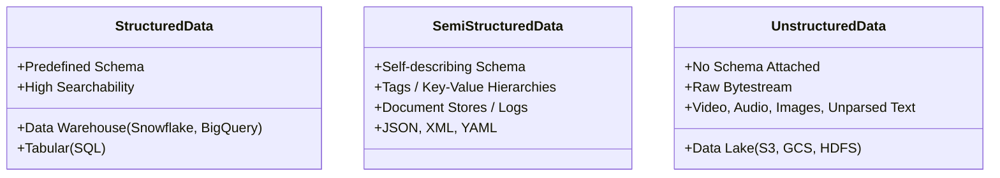

* **Dữ liệu có cấu trúc (Structured Data)**: Tuân thủ nghiêm ngặt theo schema định sẵn (bảng quan hệ, kiểu dữ liệu cố định). Lưu trữ tối ưu trong **Data Warehouse**.
* **Dữ liệu bán cấu trúc (Semi-structured Data)**: Mang theo cấu trúc tự mô tả (self-describing) thông qua các thẻ hoặc cặp key-value (như JSON, XML). Các bản ghi khác nhau có thể chứa các trường thông tin khác nhau.
* **Dữ liệu phi cấu trúc (Unstructured Data)**: Không tuân theo bất kỳ mô hình dữ liệu quy ước nào (ảnh, video, audio, văn bản tự do, raw network packets). Chiếm hơn 80% tổng lượng dữ liệu của doanh nghiệp hiện đại. Lưu trữ tối ưu dưới dạng nhị phân trong **Data Lake**.

---

## 4. Động Cơ Lưu Trữ & Xử Lý Dữ Liệu (Storage Engines & Processing)

### 4.1. Phân Biệt Tác Vụ Giao Dịch (OLTP) vs. Tác Vụ Phân Tích (OLAP)

Các cơ sở dữ liệu truyền thống được tối ưu hóa chuyên biệt cho một trong hai loại khối lượng công việc (workloads) trái ngược nhau:

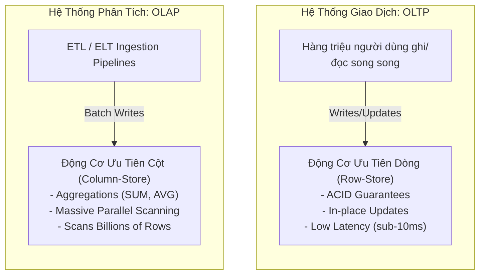

| Đặc tính | OLTP (Online Transaction Processing) | OLAP (Online Analytical Processing) |
| :--- | :--- | :--- |
| **Mục đích chính** | Hỗ trợ vận hành các giao dịch kinh doanh hàng ngày (đặt chuyến xe, mua hàng, chuyển khoản). | Phân tích xu hướng kinh doanh, trích xuất đặc trưng ML, huấn luyện mô hình, BI reporting. |
| **Mô hình truy cập dữ liệu** | Ghi và cập nhật liên tục với khối lượng nhỏ; tra cứu ngẫu nhiên dựa trên khóa chính. | Đọc khối lượng khổng lồ trên một số cột cụ thể; quét qua hàng triệu/tỷ bản ghi để gom nhóm và tính toán tổng hợp. |
| **Độ trễ truy vấn (Latency)** | Rất thấp (thường tính bằng mili-giây, $< 10\text{ ms}$). | Trung bình đến cao (vài giây đến vài phút/giờ tùy độ phức tạp của câu truy vấn). |
| **Tính sẵn sàng (Availability)** | Cực cao (High Availability, $99.99\%+$). Nếu hệ thống OLTP sập, toàn bộ hoạt động kinh doanh bị gián đoạn. | Chấp nhận khả năng gián đoạn ngắn mà không ảnh hưởng trực tiếp đến người dùng cuối. |
| **Kiến trúc lưu trữ ngầm** | Bố cục dạng dòng (Row-oriented storage) để tối ưu việc ghi và cập nhật trọn vẹn bản ghi. | Bố cục dạng cột (Columnar storage) để tối ưu hiệu năng quét cột và nén dữ liệu. |
| **Nguyên lý thiết kế** | Tuân thủ các thuộc tính **ACID** để đảm bảo an toàn giao dịch. | Chấp nhận tính nhất quán cuối cùng (**Eventual Consistency**) hoặc nới lỏng ràng buộc. |

#### Hệ Tiêu Chuẩn Giao Dịch: ACID vs. BASE
* **ACID (Bảo vệ tính toàn vẹn trong OLTP)**:
  * **Atomicity (Tính nguyên tử)**: Mọi thao tác trong một giao dịch phải thành công trọn vẹn; nếu một bước thất bại, toàn bộ giao dịch phải được khôi phục (rollback) về trạng thái ban đầu. *(Ví dụ: Đã trừ tiền khách hàng thì bắt buộc phải ghép được tài xế; nếu hệ thống gán tài xế lỗi, tiền phải được hoàn trả tức thì)*.
  * **Consistency (Tính nhất quán)**: Dữ liệu phải luôn chuyển từ một trạng thái hợp lệ này sang một trạng thái hợp lệ khác, tuân thủ mọi ràng buộc (invariants) của cơ sở dữ liệu.
  * **Isolation (Tính cô lập)**: Các giao dịch thực thi đồng thời không được can thiệp lẫn nhau; kết quả phải tương đương như thể các giao dịch được thực thi tuần tự (serializable). *(Ví dụ: Hai hành khách không thể đặt cùng một tài xế trong cùng một tích tắc)*.
  * **Durability (Tính bền vững)**: Một khi giao dịch đã commit thành công, dữ liệu được đảm bảo an toàn vĩnh viễn trên đĩa, ngay cả khi toàn bộ hệ thống bị mất điện đột ngột.
* **BASE (Nới lỏng ràng buộc trong hệ thống phân tán)**:
  * Nhiều hệ thống phân tán hiện đại từ bỏ ACID để đổi lấy khả năng mở rộng (Scalability) theo định lý CAP:
    * **Basically Available**: Hệ thống luôn đảm bảo tính khả dụng (trả về phản hồi).
    * **Soft state**: Trạng thái dữ liệu có thể biến động theo thời gian mà không cần có tương tác bên ngoài.
    * **Eventual consistency**: Dữ liệu sẽ đạt tới trạng thái nhất quán tại một thời điểm nào đó trong tương lai.

---

### 4.2. Sự Dịch Chuyển Hiện Đại: Phân Tách Lưu Trữ và Tính Toán (Decoupling Storage & Compute)

Trước đây, OLTP và OLAP tồn tại như hai thế giới tách biệt vì tài nguyên tính toán và đĩa lưu trữ bị gắn chặt trên cùng một máy chủ vật lý. Trong thập kỷ qua, kiến trúc dữ liệu đám mây đã hoàn toàn tái cấu trúc mô hình này:

1. **Phân tách Lưu trữ & Tính toán (Decoupling Storage & Compute)**:
   * Được tiên phong bởi Google BigQuery, Snowflake, Databricks.
   * Dữ liệu được lưu trữ vĩnh viễn trên các kho lưu trữ đối tượng chi phí siêu rẻ (như AWS S3, Google Cloud Storage, Azure Blob).
   * Cụm tính toán (Compute Clusters) chỉ được khởi tạo khi có câu truy vấn phân tích, có thể scale từ 0 lên hàng nghìn nodes trong vài giây và tự động tắt đi sau khi hoàn tất.
2. **Sự trỗi dậy của Kiến trúc Lai (HTAP & Modern OLAP)**:
   * **CockroachDB**, **TiDB**: Các cơ sở dữ liệu phân tán hỗ trợ giao dịch ACID nhưng có khả năng mở rộng phân tích ngang hàng.
   * **DuckDB**: Động cơ OLAP nhúng (In-process analytical engine - tương tự SQLite cho OLAP), cho phép thực thi các phép toán phân tích vector hóa dạng cột cực nhanh trực tiếp trên bộ nhớ máy cục bộ hoặc từ file Parquet/S3.
   * **Apache Iceberg**, **Delta Lake**: Đem lại tính năng giao dịch chuẩn ACID, Time-travel, và Schema Evolution trực tiếp lên các định dạng tệp lưu trữ trên Data Lake.

---

### 4.3. Pipeline Xử Lý Dữ Liệu: ETL vs. ELT

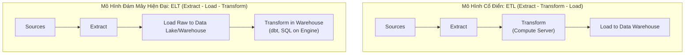

| Tiêu chí | ETL (Extract, Transform, Load) | ELT (Extract, Load, Transform) |
| :--- | :--- | :--- |
| **Quy trình hoạt động** | Trích xuất dữ liệu từ nguồn $\rightarrow$ Biến đổi, làm sạch, chuẩn hóa trên một server trung gian $\rightarrow$ Nạp dữ liệu hoàn chỉnh vào Data Warehouse. | Trích xuất dữ liệu từ nguồn $\rightarrow$ Nạp nguyên trạng dữ liệu thô vào Data Lake/Warehouse $\rightarrow$ Biến đổi trực tiếp trên hạ tầng lưu trữ theo nhu cầu truy vấn. |
| **Địa điểm biến đổi** | Tầng máy chủ xử lý dữ liệu riêng biệt (In-memory server, Spark cluster ngoài). | Trực tiếp bên trong Data Warehouse/Lakehouse (tận dụng sức mạnh tính toán của BigQuery, Snowflake). |
| **Tốc độ nạp (Ingestion Speed)** | Chậm hơn: Dữ liệu phải chờ biến đổi xong mới có thể lưu trữ. | **Cực nhanh**: Dữ liệu thô được lưu trữ gần như ngay lập tức sau khi sinh ra. |
| **Tính linh hoạt** | Kém linh hoạt: Nếu mô hình ML sau này cần các trường dữ liệu thô đã bị loại bỏ trong bước Transform, dữ liệu đó bị mất vĩnh viễn. | **Cực cao**: Dữ liệu thô được bảo toàn nguyên vẹn vĩnh viễn. Bất kỳ tác vụ ML nào trong tương lai cũng có thể tái xử lý lại từ nguồn gốc. |
| **Rủi ro vận hành** | Chi phí bảo trì hạ tầng ETL trung gian phức tạp. | Rủi ro biến Data Lake thành **"Data Swamp" (Đầm lầy dữ liệu)** nếu thiếu cơ chế quản trị siêu dữ liệu (Data Governance & Cataloging). |

---

## 5. Các Phương Thức Luân Chuyển Dữ Liệu (Modes of Dataflow)

Trong một hệ thống Machine Learning hoàn chỉnh, các thành phần không chạy trong một tiến trình duy nhất (single process) mà phân tán trên nhiều microservices độc lập. Làm thế nào để truyền dữ liệu an toàn, tin cậy và đạt độ trễ thấp giữa các tiến trình không chia sẻ bộ nhớ?

### 5.1. Chế Độ 1: Luân Chuyển Qua Cơ Sở Dữ Liệu (Passing Through Databases)

* **Cơ chế**: Tiến trình A (ví dụ Feature Engineering service) tính toán xong đặc trưng và ghi vào database chung. Tiến trình B (Model Inference service) đọc dữ liệu từ database đó để đưa ra dự đoán.
* **Hạn chế kỹ thuật nghiêm trọng**:
  1. **Nút thắt cổ chai về độ trễ (Latency Bottleneck)**: Tốc độ ghi và đọc qua đĩa của cơ sở dữ liệu quá chậm đối với các ứng dụng người dùng trực tiếp yêu cầu độ trễ tính bằng mili-giây.
  2. **Vấn đề Polling**: Tiến trình B không biết khi nào có dữ liệu mới trừ khi phải liên tục gửi câu truy vấn thăm dò (polling loop), gây lãng phí tài nguyên CPU và database I/O.
  3. **Ràng buộc phân vùng mạng**: Không khả thi nếu hai tiến trình thuộc về hai tổ chức khác nhau hoặc nằm ở các vùng mạng độc lập không thể chia sẻ chung quyền truy cập cơ sở dữ liệu.

---

### 5.2. Chế Độ 2: Luân Chuyển Qua Dịch Vụ (Passing Through Services: REST & RPC)

Trong kiến trúc hướng dịch vụ (Service-Oriented Architecture / Microservices), dữ liệu được truyền trực tiếp qua mạng máy tính thông qua các yêu cầu (Requests). Đây là mô hình **hướng yêu cầu (Request-driven)**.

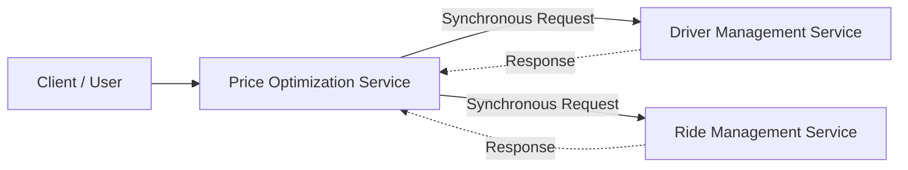

#### A. So Sánh Phong Cách Giao Tiếp: REST vs. RPC / gRPC

| Tiêu chí | REST (Representational State Transfer) | RPC / gRPC (Remote Procedure Call) |
| :--- | :--- | :--- |
| **Bản chất triết lý** | Hướng tài nguyên (Resource-oriented). Thao tác với tài nguyên thông qua các động từ HTTP chuẩn (`GET`, `POST`, `PUT`, `DELETE`). | Hướng hành động (Action-oriented). Làm cho việc gọi một hàm trên server từ xa trông giống hệt như gọi một hàm nội bộ trong code. |
| **Giao thức vận chuyển** | HTTP/1.1 hoặc HTTP/2. Định dạng payload phổ biến nhất là JSON (Text). | HTTP/2 đa kênh (Multiplexing), streaming 2 chiều. Payload định dạng **Protobuf** (Binary). |
| **Hiệu năng & Độ trễ** | Chậm hơn do overhead của chuỗi JSON và header HTTP dạng văn bản. | **Cực nhanh, footprint nhỏ**: Nhị phân nén chặt, giải mã cực nhanh, tối ưu hóa triệt để độ trễ. |
| **Phạm vi áp dụng tối ưu** | Public APIs, giao tiếp giữa frontend (Web/Mobile) và backend services. | Giao tiếp nội bộ giữa các microservices (Internal backend-to-backend communication) trong cùng Data Center. |

#### B. Khủng Hoảng Của Request-Driven Trong Hệ Thống Lớn:
* **Giao tiếp đồng bộ (Synchronous Coupling)**: Tiến trình gửi phải chờ tiến trình nhận phản hồi. Nếu một dịch vụ bị chậm hoặc sập (crash), nó sẽ gây ra hiệu ứng sụp đổ dây chuyền (cascading failure) toàn bộ hệ thống.
* **Bùng nổ kết nối (Spaghetti Mesh Architecture)**: Nếu có $N$ microservices cần dữ liệu của nhau, số lượng kết nối trực tiếp cần duy trì sẽ tăng lên theo bậc $O(N^2)$, làm nghẽn toàn bộ hạ tầng mạng.

---

### 5.3. Chế Độ 3: Luân Chuyển Qua Real-Time Transport (Event-Driven / Pub-Sub)

Để khắc phục hoàn toàn nhược điểm của Request-Driven, hệ thống chuyển sang mô hình **hướng sự kiện (Event-driven Architecture)** sử dụng một tầng trung gian điều phối gọi là **Real-time Transport (Event Bus / Message Broker)**.

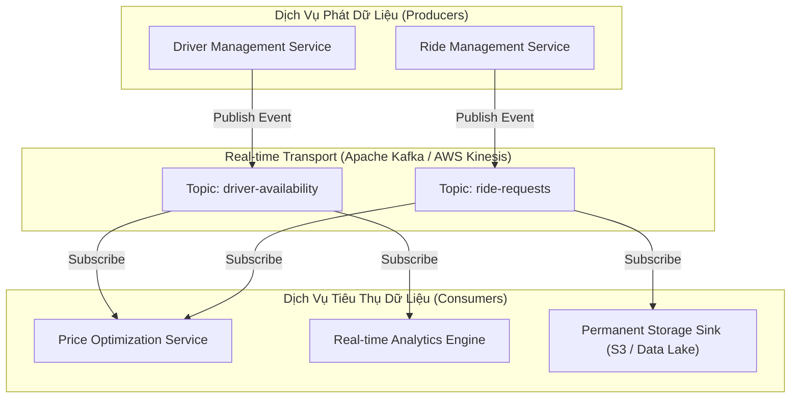

#### A. Bản Chất Kỹ Thuật Của Real-Time Transport
* **Bất đồng bộ hoàn toàn (Asynchronous Decoupling)**: Bên phát dữ liệu (Producer) chỉ việc bắn sự kiện (Event) lên Event Bus rồi tiếp tục công việc của mình mà không cần quan tâm ai sẽ đọc nó, khi nào đọc, hoặc có bao nhiêu dịch vụ đang lắng nghe.
* **Đệm dữ liệu trong bộ nhớ (In-memory Buffering & Distributed Commit Log)**: Sự kiện được ghi tuần tự vào append-only log trong bộ nhớ và phân vùng đĩa, đảm bảo thông lượng (throughput) hàng triệu sự kiện mỗi giây với độ trễ chỉ vài mili-giây.
* **Độ bền bỉ & Chống mất mát dữ liệu**: Nếu dịch vụ tiêu thụ (Consumer) bị sập, sự kiện vẫn nằm an toàn trên Broker theo chính sách lưu trữ (retention policy, ví dụ 7 ngày). Khi Consumer phục hồi, nó chỉ cần đọc tiếp từ vị trí offset đã ghi nhận trước đó.

#### B. Phân Biệt Hai Mô Hình: Publish-Subscribe (Pub/Sub) vs. Message Queue

| Tiêu chí | Publish-Subscribe (Pub/Sub) | Message Queue |
| :--- | :--- | :--- |
| **Công nghệ tiêu biểu** | **Apache Kafka**, **AWS Kinesis**, Google Pub/Sub. | **RabbitMQ**, **Apache RocketMQ**, ActiveMQ. |
| **Mô hình phân phối** | **One-to-Many**: Một sự kiện được bắn vào một Topic sẽ được nhân bản và gửi đến **tất cả** các nhóm đăng ký (Consumer Groups) quan tâm. | **Point-to-Point**: Một thông điệp (Message) gửi vào hàng đợi thường chỉ được xử lý bởi **duy nhất một** worker consumer trong nhóm. |
| **Trạng thái lưu trữ (Retention)** | **Log-centric**: Dữ liệu được lưu giữ cố định trên log theo thời gian cấu hình (retention period), bất kể đã có người đọc hay chưa. Người tiêu thụ có thể đọc lại dữ liệu lịch sử (Replay capability). | **Queue-centric**: Thông điệp thường bị xóa vĩnh viễn khỏi hàng đợi ngay sau khi consumer hoàn tất xử lý và gửi xác nhận (Acknowledgement - ACK). |
| **Phù hợp nhất cho ML** | Xây dựng Data Pipelines thời gian thực, truyền tải luồng feature, Event Sourcing, Replay log để train lại mô hình. | Phân phối các tác vụ tính toán nặng (Task Queuing), điều phối batch job workers (ví dụ Celery worker pool). |

---

## 6. Xử Lý Theo Lô (Batch) vs. Xử Lý Dòng (Stream)

Dữ liệu một khi đã nằm cố định trong các kho lưu trữ (Database, Data Lake) được định nghĩa là **Dữ liệu Lịch sử (Historical Data)**. Ngược lại, dữ liệu đang liên tục chuyển động trên các Real-time Transport được gọi là **Dữ liệu Dòng (Streaming Data)**.

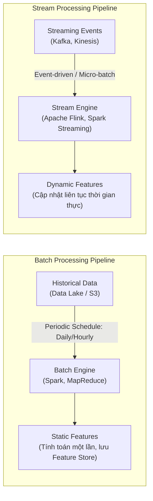

### 6.1. Bảng So Sánh Toàn Diện: Batch Processing vs. Stream Processing

| Tiêu chí | Batch Processing (Xử lý theo lô) | Stream Processing (Xử lý dòng) |
| :--- | :--- | :--- |
| **Bản chất tập dữ liệu** | **Tập hữu hạn (Bounded Dataset)**: Dữ liệu có điểm bắt đầu và điểm kết thúc rõ ràng tại thời điểm job khởi chạy. | **Tập vô hạn (Unbounded Dataset)**: Dữ liệu không bao giờ kết thúc, chảy liên tục 24/7 với tốc độ biến thiên. |
| **Tần suất kích hoạt** | Định kỳ theo lịch cố định (Cron schedule: mỗi ngày một lần, mỗi giờ một lần) hoặc kích hoạt thủ công. | Liên tục theo thời gian thực (Event-by-event) hoặc theo các chu kỳ siêu nhỏ (Micro-batching vài trăm mili-giây). |
| **Độ trễ xử lý (Latency)** | Cao: Hàng giờ đến hàng ngày. | Siêu thấp: Hàng mili-giây đến vài giây. |
| **Động cơ xử lý chuẩn** | **Apache Spark**, Apache Hadoop MapReduce, Presto/Trino, Snowflake. | **Apache Flink**, Spark Structured Streaming, Kafka Streams, Apache Samza. |
| **Độ phức tạp tính toán** | Thấp hơn: Dữ liệu đã cố định, dễ dàng tính toán song song, kiểm tra lỗi và chạy lại (retry) khi gặp sự cố. | Rất cao: Phải đối mặt với dữ liệu đến trễ (late-arriving data), mạng chập chờn, xáo trộn thứ tự sự kiện (out-of-order events). |

---

### 6.2. Ứng Dụng Trong Kỹ Thuật Đặc Trưng ML: Đặc Trưng Tĩnh vs. Đặc Trưng Động

Một hệ thống Machine Learning phục vụ trong production (như chống gian lận thẻ tín dụng, định giá động xe công nghệ) đòi hỏi sự kết hợp đồng thời của hai loại đặc trưng:

#### A. Static Features (Đặc trưng tĩnh / trích xuất theo Lô)
* Là các đặc trưng mang tính lịch sử dài hạn, có tần suất biến động chậm theo thời gian.
* *Ví dụ*: Ngày tài xế gia nhập hệ thống, đánh giá sao trung bình tích lũy trong 6 tháng qua của tài xế, độ tuổi của khách hàng.
* Được tính toán thông qua các batch jobs chạy định kỳ trên Data Lake/Warehouse và đẩy vào cơ sở dữ liệu để phục vụ tra cứu.

#### B. Dynamic Features (Đặc trưng động / trích xuất theo Luồng)
* Là các đặc trưng phản ánh trạng thái tức thời của hệ thống và thế giới thực tại thời điểm phát sinh yêu cầu dự đoán.
* *Ví dụ*: Số lượng cuốc xe được yêu cầu trong 5 phút vừa qua tại bán kính 1km, số lần nhập sai mã PIN trong 60 giây qua, giá cước trung bình của 10 cuốc xe gần nhất trong khu vực.
* Nếu dùng batch processing để tính toán các đặc trưng này, dữ liệu dự đoán sẽ luôn bị lỗi thời (stale), làm giảm độ chính xác của mô hình hoặc thậm chí gây thiệt hại kinh tế nặng nề.

#### C. Sức Mạnh Của Tính Toán Có Trạng Thái (Stateful Stream Processing)
* Nhiều người lầm tưởng xử lý dòng chỉ làm được các tác vụ lọc đơn giản. Trong thực tế, các engine xử lý dòng hiện đại (tiêu biểu là **Apache Flink**) cực kỳ mạnh mẽ nhờ cơ chế **Stateful Computation**:
  * *Ví dụ bài toán*: Theo dõi mức độ tương tác của người dùng trong giai đoạn 30 ngày dùng thử (trial).
  * Trong **Batch Processing**: Cứ mỗi ngày, batch job phải quét lại toàn bộ dữ liệu của 30 ngày trước đó $\rightarrow$ Lãng phí tài nguyên tính toán lặp lại khổng lồ.
  * Trong **Stateful Stream Processing**: Flink duy trì một trạng thái cục bộ (managed state) có checkpoint. Mỗi ngày trôi qua, hệ thống chỉ cần đẩy sự kiện mới vào, cập nhật gia tăng (incremental update) vào state hiện tại và loại bỏ ngày cũ nhất $\rightarrow$ Tiết kiệm tài nguyên và loại bỏ hoàn toàn tính toán dư thừa.

---

### 6.3. Kỹ Thuật Gom Cửa Sổ Trên Luồng Sự Kiện (Windowing Techniques)

Khi xử lý một dòng dữ liệu vô hạn, ta không thể thực hiện các phép toán tổng hợp (như `COUNT`, `AVG`, `SUM`) trên toàn bộ luồng mà bắt buộc phải cắt luồng thành các cửa sổ hữu hạn (**Windows**):

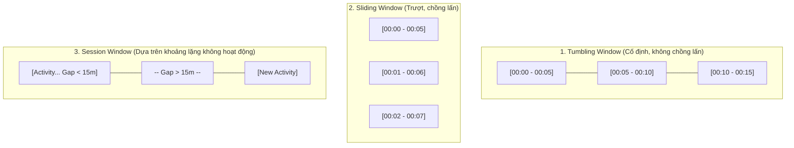

1. **Tumbling Window (Cửa sổ cố định không chồng lấn)**:
   * Có độ dài thời gian cố định. Mỗi sự kiện thuộc về duy nhất một cửa sổ.
   * *Ví dụ*: Đếm số lượng view trang web mỗi 5 phút một lần (`00:00-00:05`, `00:05-00:10`).
2. **Sliding Window (Cửa sổ trượt có chồng lấn)**:
   * Có độ dài cố định nhưng được trượt đi sau một khoảng thời gian nhỏ hơn độ dài cửa sổ (slide interval). Một sự kiện có thể thuộc về nhiều cửa sổ khác nhau.
   * *Ví dụ*: Tính giá trị giao dịch trung bình trong 10 phút gần nhất, cập nhật lại kết quả mỗi 1 phút một lần.
3. **Session Window (Cửa sổ phiên)**:
   * Không có độ dài cố định. Được định nghĩa bởi khoảng lặng thời gian (inactivity gap). Nếu không có sự kiện mới xuất hiện sau khoảng thời gian ngưỡng (ví dụ 15 phút), phiên hiện tại sẽ đóng lại và phiên mới được tạo ra khi có sự kiện kế tiếp.
4. **Xử lý Dữ liệu Đến Trễ: Watermarks**:
   * Trong thực tế, thời gian sự kiện phát sinh (**Event Time**) khác với thời gian hệ thống nhận được sự kiện (**Processing Time**) do độ trễ mạng.
   * Kỹ thuật **Watermark** cho phép hệ thống xác định điểm giới hạn: *"Hệ thống tin rằng mọi sự kiện có timestamp trước mốc Watermark này đã đến hết"*, từ đó quyết định đóng cửa sổ tính toán hoặc xử lý ngoại lệ cho các bản ghi trễ hạn nghiêm trọng (late data handling).

---

### 6.4. Kiến Trúc Hệ Thống: Lambda Architecture vs. Kappa Architecture

Để giải quyết bài toán dung hòa giữa dữ liệu lịch sử khổng lồ và luồng dữ liệu thời gian thực cho ML, hai mẫu kiến trúc tiêu biểu đã ra đời:

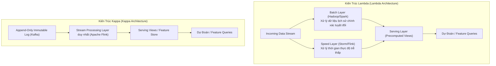

#### A. Lambda Architecture
* **Cơ chế**: Chia dữ liệu làm 2 luồng độc lập:
  * **Batch Layer**: Lưu trữ vĩnh viễn master dataset bất biến. Định kỳ chạy các job tính toán nặng để tạo ra các precomputed views với độ chính xác cao nhất.
  * **Speed Layer**: Xử lý dữ liệu mới phát sinh trong thời gian thực với độ trễ thấp để bù đắp khoảng trống dữ liệu mà Batch Layer chưa kịp xử lý.
  * **Serving Layer**: Hợp nhất (merge) kết quả từ cả Batch Views và Real-time Views để trả lời câu truy vấn của mô hình.
* **Tử huyệt của Lambda**: **Phải duy trì hai codebase song song** cho cùng một logic nghiệp vụ (ví dụ viết logic tính feature bằng Spark cho Batch và bằng Flink/Storm cho Speed). Việc bảo trì cực kỳ tốn kém và thường xuyên dẫn đến hiện tượng sai lệch logic giữa hai tầng (**Code Drift / Inconsistency**).

#### B. Kappa Architecture
* Được đề xuất bởi Jay Kreps (đồng sáng lập Apache Kafka).
* **Triết lý cốt lõi**: **"Batch processing thực chất chỉ là một trường hợp đặc biệt của Stream processing"** (Batch is a special case of streaming over bounded historical data).
* **Cơ chế**: Loại bỏ hoàn toàn Batch Layer. Toàn bộ pipeline chỉ sử dụng **DUY NHẤT MỘT** Stream Processing Engine (như Apache Flink).
  * Khi cần tính toán lại dữ liệu lịch sử (re-processing) do thuật toán feature thay đổi: Ta chỉ cần khởi tạo lại streaming job và cho đọc (replay) ngược lại luồng sự kiện bất biến từ Kafka/S3 từ mốc thời gian trong quá khứ.
* **Ưu thế**: Đảm bảo $100\%$ tính nhất quán về logic code trích xuất đặc trưng, tối giản hóa tối đa chi phí vận hành hạ tầng.

---

## 7. Checklist Kiến Trúc Kỹ Thuật Dữ Liệu Cho Kỹ Sư ML (Production Checklist)

Trước khi chuyển giao bất kỳ pipeline dữ liệu nào vào phục vụ huấn luyện hoặc inference cho mô hình Machine Learning, một Senior ML Systems Architect bắt buộc phải rà soát qua bảng checklist tiêu chuẩn sau:

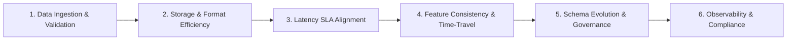

### Bảng Kiểm Tra Kỹ Thuật Sản Xuất (Production Verification Checklist)

| STT | Trụ Cột Đánh Giá | Chi Tiết Kỹ Thuật Cần Kiểm Tra | Trạng Thái Đạt Chuẩn (Definition of Done) |
| :---: | :--- | :--- | :--- |
| **1** | **Data Ingestion & Validation** | • Kiểm định dữ liệu đầu vào tại API Gateway. • Xử lý giá trị trống (`null`/`NaN`). • Ngưỡng giá trị bất thường (outliers/clipping). | [ ] Schema validation tự động kích hoạt. [ ] Không sử dụng giá trị mặc định gây hiểu nhầm (ví dụ: gán `Age = 0`). [ ] Có dead-letter queue (DLQ) cho dữ liệu hỏng. |
| **2** | **Storage & Format Efficiency** | • Lựa chọn định dạng tệp phù hợp với access patterns. • Phân vùng dữ liệu (Partitioning strategy). • Tỷ lệ nén dữ liệu (Compression codec). | [ ] Dữ liệu phân tích lưu trữ bằng Parquet/ORC (Columnar). [ ] Dữ liệu giao tiếp mạng tối ưu bằng Protobuf. [ ] Không sử dụng CSV/JSON cho các dataset quy mô lớn trong production. |
| **3** | **Latency SLA Alignment** | • Phân định rõ ràng thời gian cần thiết giữa Online, Nearline, và Offline. • Độ trễ truy vấn đặc trưng phục vụ real-time inference. | [ ] p99 latency của việc lấy feature đạt chuẩn yêu cầu (thường $< 20\text{ ms}$). [ ] Tách biệt rõ ràng giữa đường dẫn tính toán thời gian thực và batch. |
| **4** | **Feature Consistency & Time-Travel** | • Tính toán đặc trưng nhất quán giữa Training và Serving. • Tính đúng đắn tại thời điểm truy xuất (Point-in-Time Correctness). | [ ] Sử dụng chung một engine/codebase để trích xuất đặc trưng (Feature Store). [ ] Triệt tiêu hoàn toàn rủi ro rò rỉ dữ liệu tương lai (Data Leakage) khi join bảng lịch sử. |
| **5** | **Schema Evolution & Governance** | • Cơ chế tương thích ngược và tiến (Backward/Forward Compatibility). • Quản lý hợp đồng dữ liệu (Data Contracts). | [ ] Đăng ký Schema Registry (như Confluent Schema Registry). [ ] Cấm tuyệt đối các thay đổi schema phá vỡ hệ thống hạ nguồn (breaking changes) mà không có versioning. |
| **6** | **Observability, Lineage & Compliance** | • Truy vết nguồn gốc dữ liệu (Data Lineage). • Giám sát độ trệ dữ liệu (Data Freshness / SLA lag). • Tuân thủ quyền riêng tư (GDPR, CCPA). | [ ] Có thể tái tạo chính xác dataset đã dùng để train bất kỳ model version nào. [ ] Cảnh báo tự động kích hoạt khi luồng streaming bị chậm (consumer lag tăng cao). [ ] Sẵn sàng cơ chế xóa hoàn toàn dữ liệu người dùng khi có yêu cầu (Right to be Forgotten). |

---

## 8. Tóm Tắt & Kết Luận (Summary)

1. **Dữ liệu định hình hệ thống**: Hiệu năng của mô hình ML bị giới hạn bởi chất lượng và cấu trúc của dữ liệu đầu vào. Hiểu rõ nguồn dữ liệu (1st vs 3rd party, user vs system) giúp thiết kế chiến lược kiểm định và phòng ngừa rủi ro pháp lý.
2. **Định dạng dữ liệu là quyết định kiến trúc**: 
   * Tránh xa các định dạng văn bản (CSV, JSON) cho các tác vụ lưu trữ và tính toán phân tích quy mô lớn.
   * Ưu tiên **Column-major (Parquet)** cho truy vấn đọc phân tích/trích xuất đặc trưng và **Row-major (Avro/Protobuf)** cho ghi dữ liệu giao dịch hoặc truyền tải mạng.
3. **Mô hình dữ liệu phải phù hợp với bài toán**:
   * Mô hình quan hệ (SQL) đảm bảo tính toàn vẹn thông qua chuẩn hóa nhưng đánh đổi bằng chi phí JOIN lớn.
   * Mô hình NoSQL (Document) mang lại tính cục bộ dữ liệu cao nhưng khó join; Mô hình Graph tối ưu vượt trội cho các truy vấn quan hệ đa bậc.
   * Khái niệm "Schemaless" là ảo tưởng; thực chất là sự dịch chuyển từ **Schema-on-Write** sang **Schema-on-Read**.
4. **Kiến trúc luân chuyển dữ liệu**: Chuyển dịch từ liên kết đồng bộ hướng yêu cầu (Request-Driven) sang kiến trúc hướng sự kiện bất đồng bộ (**Event-Driven**) thông qua Real-time Transport (Apache Kafka) là chìa khóa để xây dựng hệ thống ML mở rộng quy mô lớn và khử phụ thuộc lẫn nhau.
5. **Hợp nhất Batch và Stream**: Batch processing chỉ là một trường hợp đặc biệt của Stream processing. Xây dựng nền tảng tính toán dòng (như Flink theo kiến trúc Kappa) cho phép hệ thống tạo ra cả đặc trưng tĩnh (static) và đặc trưng động (dynamic) thời gian thực mà không gặp phải rủi ro lệch chuẩn mã nguồn (code drift).
