# Chương 3: Dữ Liệu Huấn Luyện (Training Data)

> **Phạm vi tài liệu**: Kiến trúc, cơ chế toán học, thuật toán lấy mẫu (sampling), chiến lược gán nhãn (labeling), kỹ thuật xử lý mất cân bằng lớp (class imbalance), tăng cường dữ liệu (data augmentation) và khung quản trị dữ liệu huấn luyện trong môi trường sản xuất (production ML systems).

---

## 1. Bản Chất Của Training Data Trong Môi Trường Production

Trong môi trường học thuật, dữ liệu thường được đóng gói dưới dạng các **"Dataset"** tĩnh (stationary), cố định về kích thước (finite) và phân phối được xem như bất biến. Ngược lại, trong các hệ thống sản xuất (production ML), dữ liệu tồn tại dưới dạng các **"Dòng dữ liệu" (Data Streams)** động, mở, liên tục thay đổi (non-stationary) và không có ranh giới kết thúc.

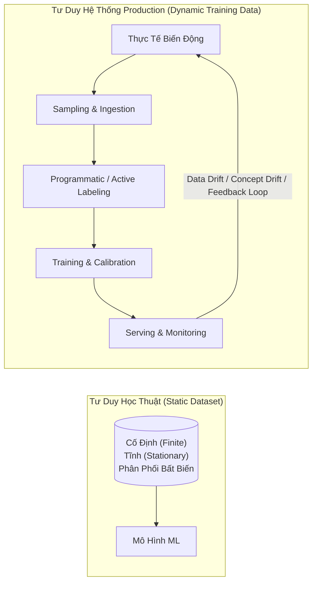

### 1.1. Các Loại Biases Tiềm Ẩn Trong Training Data
Dữ liệu lịch sử luôn chứa đựng các sai lệch (biases). Khi mô hình học từ dữ liệu này, nó không chỉ tái tạo mà còn có xu hướng khuếch đại (amplify) các sai lệch đó vào các quyết định tự động:
*   **Selection Bias (Sai lệch chọn mẫu)**: Dữ liệu thu thập được không đại diện cho phân phối thực tế của bài toán.
*   **Sampling Bias (Sai lệch lấy mẫu)**: Do thuật toán lấy mẫu ưu tiên các phân đoạn dữ liệu dễ thu thập.
*   **Labeling Bias (Sai lệch gán nhãn)**: Sinh ra từ định kiến chủ quan, sự thiếu hiểu biết hoặc không nhất quán giữa các annotators.
*   **Historical/Societal Bias (Sai lệch lịch sử)**: Phản ánh các bất bình đẳng đã có từ trước trong xã hội vốn được ghi nhận vào cơ sở dữ liệu.

---

## 2. Sampling (Kỹ Thuật Lấy Mẫu)

Lấy mẫu xuất hiện ở nhiều mắt xích trong vòng đời ML: trích xuất dữ liệu thô từ thế giới thực, chia tách các tập (Train/Validation/Test splits), và chọn lọc sự kiện để giám sát (monitoring).

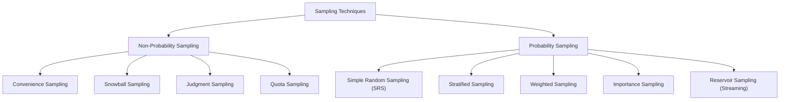

### 2.1. So Sánh Non-Probability Sampling vs. Probability Sampling

| Tiêu Chí | Non-Probability Sampling (Lấy Mẫu Phi Xác Suất) | Probability Sampling (Lấy Mẫu Xác Suất) |
| :--- | :--- | :--- |
| **Cơ chế chọn mẫu** | Không dựa trên tiêu chí ngẫu nhiên hay xác suất định lượng; dựa trên tính khả dụng, thuận tiện hoặc phán đoán chủ quan. | Mọi cá thể trong quần thể đều có một xác suất được chọn xác định ($P(x) > 0$). |
| **Độ đại diện (Representativeness)** | Kém; tiềm ẩn Selection Bias nghiêm trọng; không thể suy rộng thống kê cho toàn thể quần thể. | Cao; phản ánh trung thực phân phối của quần thể hoặc kiểm soát được sai số phân phối. |
| **Chi phí & Độ phức tạp** | Rất thấp, triển khai nhanh, dễ thu thập. | Yêu cầu định danh toàn bộ không gian mẫu hoặc thuật toán phân vùng phức tạp. |
| **Vị trí trong Pipeline ML** | Chỉ dùng để bootstrap thử nghiệm ban đầu (Proof-of-Concept) hoặc gán nhãn thăm dò sơ khởi. | Bắt buộc cho việc xây dựng Training Data chuẩn mực, Validation/Test splits và kiểm chuẩn mô hình. |

### 2.2. Các Phương Pháp Non-Probability Sampling
1.  **Convenience Sampling (Lấy mẫu thuận tiện)**: Chọn dữ liệu dựa trên sự sẵn có (ví dụ: scrape Wikipedia, Reddit, CommonCrawl để train Language Models; dùng IMDB/Amazon reviews để gán nhãn Sentiment Analysis).
    *   *Rủi ro*: Phân phối bị lệch về nhóm đối tượng chủ động tạo nội dung trực tuyến, hoàn toàn bỏ qua nhóm người dùng thụ động hoặc các điều kiện ngoại cảnh khác (ví dụ: xe tự hành chỉ train trên dữ liệu thời tiết nắng ráo tại Arizona/California).
2.  **Snowball Sampling (Lấy mẫu quả cầu tuyết)**: Mẫu tương lai được chọn dựa trên liên kết từ mẫu hiện tại (ví dụ: crawl follower của follower trên mạng xã hội). Dẫn đến hiện tượng bẫy vào các cụm mạng xã hội kín (echo chambers).
3.  **Judgment Sampling (Lấy mẫu theo phán đoán)**: Chuyên gia tự tay quyết định những mẫu nào được đưa vào tập dữ liệu. Dễ áp đặt định kiến cá nhân (confirmation bias).
4.  **Quota Sampling (Lấy mẫu theo chỉ tiêu định mức)**: Lấy mẫu theo các hạn ngạch cố định cho từng phân khúc (ví dụ: đúng 100 người nhóm tuổi <30, 100 người nhóm 30-60, 100 người nhóm >60) mà không quan tâm đến phân bổ tỷ lệ thực tế của các nhóm này trong thế giới thực.

---

### 2.3. Probability Sampling: Kỹ Thuật, Cơ Chế & Thuật Toán

#### 2.3.1. Simple Random Sampling (SRS - Lấy Mẫu Ngẫu Nhiên Đơn Giản)
Mọi mẫu trong quần thể kích thước $N$ đều có xác suất được chọn bằng nhau:
$$P(x_i) = \frac{k}{N}$$
*   **Ưu điểm**: Thuật toán đơn giản, không thiên vị phân phối tổng quát.
*   **Nhược điểm chí mạng**: Các nhóm thiểu số (rare classes / sub-populations) rất dễ bị biến mất trong mẫu. Ví dụ: Nếu một lớp gian lận chiếm $0.01\%$ quần thể, việc trích xuất $1\%$ mẫu ngẫu nhiên bằng SRS sẽ dẫn đến xác suất mẫu gian lận xuất hiện là cực kỳ thấp, khiến mô hình kết luận lớp thiểu số không tồn tại.

#### 2.3.2. Stratified Sampling (Lấy Mẫu Phân Tầng)
Chia toàn bộ quần thể thành các tầng (strata) riêng biệt không chồng lấn dựa trên các thuộc tính quan trọng (ví dụ: class label, phân khúc khách hàng). Sau đó thực hiện lấy mẫu độc lập từ từng tầng theo tỷ lệ mong muốn.
*   **Ưu điểm**: Đảm bảo các lớp thiểu số luôn có đại diện trong tập huấn luyện và tập kiểm chuẩn.
*   **Hạn chế kiến trúc**:
    *   Không áp dụng được nếu không thể phân chia ranh giới tầng rõ ràng.
    *   **Nhiệm vụ đa nhãn (Multi-label Classification)**: Khi một mẫu đồng thời thuộc nhiều nhãn khác nhau (ví dụ: ảnh chứa cả Car, Pedestrian, Traffic Light), việc phân tầng trở thành bài toán tối ưu tổ hợp NP-hard (cần các thuật toán xấp xỉ như Iterative Stratification).

#### 2.3.3. Weighted Sampling (Lấy Mẫu Có Trọng Số)
Mỗi mẫu $x_i$ được gán một trọng số $w_i$, xác định xác suất chọn:
$$P(x_i) = \frac{w_i}{\sum_{j=1}^N w_j}$$
*   **Ứng dụng**:
    *   **Leverage Domain Expertise**: Tăng xác suất chọn cho các mẫu có giá trị cao hơn, ví dụ: dữ liệu gần đây nhất (recency weighting) nhận trọng số lớn hơn để mô hình thích nghi nhanh với xu hướng mới.
    *   **Hiệu chỉnh phân phối lệch**: Nếu tập thu thập có tỷ lệ $25\%$ Đỏ, $75\%$ Xanh, nhưng phân phối thực tế là $50:50$, ta gán trọng số cho mẫu Đỏ gấp 3 lần mẫu Xanh để cân bằng phân phối khi rút mẫu.

```python
import random

# Weighted sampling với random.choices
population = [1, 2, 3, 4, 100, 1000]
weights = [0.2, 0.2, 0.2, 0.2, 0.1, 0.1]
sampled_data = random.choices(population=population, weights=weights, k=2)
```

> [!IMPORTANT]
> **Phân biệt Weighted Sampling vs. Sample Weights**:
> *   **Weighted Sampling**: Kỹ thuật chọn mẫu để quyết định mẫu nào được đi vào tập dữ liệu huấn luyện.
> *   **Sample Weights**: Trọng số gán trực tiếp vào hàm mất mát (loss function) trong quá trình huấn luyện: $L(\theta) = \sum_{i} w_i \cdot \ell(f(x_i; \theta), y_i)$. Mẫu có $w_i$ lớn sẽ tạo ra gradient cập nhật mạnh hơn, kéo biên quyết định (decision boundary) dịch chuyển để phân loại chính xác các mẫu đó.

#### 2.3.4. Importance Sampling (Lấy Mẫu Tầm Quan Trọng)
Kỹ thuật ước lượng kỳ vọng của một hàm $f(x)$ dưới phân phối mục tiêu $P(x)$, trong điều kiện ta chỉ có thể lấy mẫu từ phân phối đề xuất (proposal distribution) $Q(x)$.

*   **Điều kiện tiên quyết**: $Q(x) > 0$ tại mọi điểm mà $P(x) \neq 0$.
*   **Chứng minh toán học**:
    $$\mathbb{E}_{x \sim P}[f(x)] = \sum_{x} P(x) f(x) = \sum_{x} Q(x) f(x) \frac{P(x)}{Q(x)} = \mathbb{E}_{x \sim Q}\left[ f(x) \frac{P(x)}{Q(x)} \right]$$
    Trong đó, đại lượng $w(x) = \frac{P(x)}{Q(x)}$ được gọi là **Importance Weight** (Trọng số tầm quan trọng).
*   **Ứng dụng trong ML**:
    *   **Off-Policy Reinforcement Learning**: Ước lượng hàm giá trị (value function) của policy mới $\pi_{new}$ dựa trên dữ liệu quỹ đạo (trajectories) sinh ra từ policy cũ $\pi_{old}$ mà không cần tương tác lại với môi trường. Khi đó $P(x)$ là phân phối sinh bởi $\pi_{new}$, còn $Q(x)$ là phân phối của $\pi_{old}$.

---

#### 2.3.5. Reservoir Sampling (Lấy Mẫu Hồ Chứa Cho Dữ Liệu Dòng - Streaming Data)
Thuật toán giải quyết bài toán: Cho một dòng dữ liệu liên tục chảy qua với kích thước $N$ **chưa biết trước** (hoặc vô hạn) và không thể chứa hết trong bộ nhớ (RAM). Cần chọn ra chính xác $k$ phần tử ngẫu nhiên sao cho tại bất kỳ thời điểm nào khi thuật toán dừng lại, mọi phần tử đã đi qua đều có xác suất được chọn vào hồ chứa đúng bằng $\frac{k}{N}$.

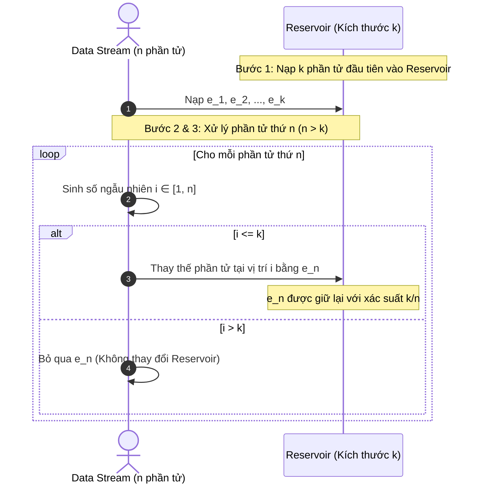

**Đặc tả thuật toán Reservoir Sampling:**
1. Khởi tạo mảng `reservoir` kích thước $k$. Đưa $k$ phần tử đầu tiên của stream vào mảng.
2. Với mỗi phần tử thứ $n$ tiếp theo ($n = k + 1, k + 2, \dots$):
   * Sinh một số nguyên ngẫu nhiên $i$ trong đoạn $[1, n]$.
   * Nếu $1 \le i \le k$: Thay thế phần tử tại vị trí $i$ trong `reservoir` bằng phần tử thứ $n$.
   * Nếu $i > k$: Bỏ qua phần tử thứ $n$.

**Chứng minh toán học bằng Quy nạp (Induction Proof):**
*   **Cơ sở quy nạp**: Tại bước $n = k$, mọi phần tử đều nằm trong hồ chứa với xác suất $\frac{k}{k} = 1$ (Hiển nhiên đúng).
*   **Bước quy nạp**: Giả sử thuật toán đúng tại bước $n - 1$, nghĩa là mọi phần tử từ $1$ đến $n-1$ đều có xác suất nằm trong hồ chứa là:
    $$P_{n-1} = \frac{k}{n - 1}$$
*   Xét tại bước thứ $n$:
    1.  Xác suất phần tử thứ $n$ được chọn vào hồ chứa: Theo thuật toán, nó được chọn nếu số ngẫu nhiên $i \le k$. Vì $i$ được chọn ngẫu nhiên đồng đều trong $\{1, \dots, n\}$, xác suất này là:
        $$P(\text{chọn } n) = \frac{k}{n}$$
    2.  Xác suất một phần tử $m$ bất kỳ ($m < n$) vốn đã có mặt trong hồ chứa ở bước $n-1$ tiếp tục tồn tại ở bước $n$:
        Phần tử $m$ bị loại bỏ khi và chỉ khi phần tử thứ $n$ được chọn VÀ vị trí thay thế ngẫu nhiên đúng vào vị trí của $m$.
        *   Xác suất $n$ được chọn: $\frac{k}{n}$.
        *   Xác suất $n$ thế chỗ đúng vị trí của $m$: $\frac{1}{k}$.
        *   Xác suất $m$ bị đẩy ra ngoài: $\frac{k}{n} \times \frac{1}{k} = \frac{1}{n}$.
        *   Xác suất $m$ được giữ lại:
            $$P(\text{giữ lại } m \mid m \in \text{reservoir}_{n-1}) = 1 - \frac{1}{n} = \frac{n - 1}{n}$$
    3.  Xác suất vô điều kiện để phần tử $m$ có mặt trong hồ chứa tại bước $n$:
        $$P_n(m) = P_{n-1}(m) \times P(\text{giữ lại } m \mid m \in \text{reservoir}_{n-1}) = \left(\frac{k}{n - 1}\right) \times \left(\frac{n - 1}{n}\right) = \frac{k}{n}$$
*   **Kết luận**: Mọi phần tử từ $1$ đến $n$ đều có xác suất hiện diện chính xác bằng $\frac{k}{n}$. Thuật toán đúng với mọi $n \ge k$.

---

## 3. Labeling (Chiến Lược Gán Nhãn Dữ Liệu)

Đa số các mô hình triển khai thực tế vận hành dưới cơ chế Học có giám sát (Supervised Learning), do đó hiệu năng của hệ thống bị giới hạn bởi chất lượng và số lượng nhãn.

### 3.1. Bốn Thách Thức Cốt Tử Của Hand Labels (Gán Nhãn Thủ Công)

```mermaid
mindmap
  root((Thách Thức Của Hand Labels))
    Chi Phí (Cost)
      Domain Expertise cao (Bác sĩ, Chuyên gia luật)
      Chi phí duy trì đội ngũ annotator nội bộ
    Quyền Riêng Tư (Privacy)
      Dữ liệu y tế (HIPAA), tài chính cá nhân
      Cấm gửi dữ liệu ra 3rd-party crowdsourcing
    Tốc Độ (Latency)
      Bóc tách âm thanh: 1h cần 400h dán nhãn
      Làm chậm chu kỳ phản hồi mô hình (Slow Feedback Loop)
    Nhập Nhằng Nhãn (Multiplicity)
      Bất đồng giữa các annotators (Disagreement)
      Ranh giới nhãn không đồng nhất
```

1.  **Chi phí (Cost)**: Gán nhãn dữ liệu phổ thông (ví dụ spam) có thể crowdsource rẻ, nhưng dữ liệu đặc thù (ảnh X-quang phổi, tài liệu tài chính) đòi hỏi chuyên gia có chứng chỉ (Board-certified Radiologists), chi phí theo giờ cực cao.
2.  **Quyền riêng tư (Privacy & Regulatory Compliance)**: Dữ liệu nhạy cảm không thể chuyển cho bên thứ ba do rào cản pháp lý (GDPR, HIPAA). Doanh nghiệp buộc phải thuê chuyên gia gắn nhãn tại chỗ (on-premise), làm tăng chi phí và rào cản vận hành.
3.  **Tốc độ (Labeling Speed & Latency)**: Gán nhãn thủ công tạo nút thắt cổ chai lớn nhất cho tốc độ lặp (iteration velocity).
    *   *Ví dụ*: Phiên âm chính xác ngữ âm mất thời gian gấp $400$ lần độ dài file ghi âm.
    *   Hậu quả: Khi yêu cầu nghiệp vụ thay đổi (ví dụ: bổ sung nhãn class `ANGRY` vào bài toán phân tích cảm xúc từ `POSITIVE`/`NEGATIVE`), hệ thống phải đình trệ toàn bộ để chờ gán nhãn lại.
4.  **Label Multiplicity & Ambiguity (Nhập nhằng và Bất đồng nhãn)**: Khi sử dụng nhiều annotators từ các nguồn khác nhau, sự bất đồng là tất yếu.
    *   *Nghịch lý "Human-level performance"*: Nếu ngay cả các chuyên gia hàng đầu cũng không thống nhất được một mẫu là Class A hay B, thì định nghĩa "Ground Truth" tuyệt đối không còn tồn tại.
    *   *Giải pháp khắc phục*: Xây dựng tài liệu hướng dẫn gán nhãn (Labeling Guidelines) cực kỳ chi tiết, có quy tắc phân giải ranh giới thực thể (ví dụ: trong Named Entity Recognition, luôn ưu tiên chuỗi dài nhất - Longest Substring Match).

### 3.2. Data Lineage (Truy Vết Dữ Liệu)
*   **Khái niệm**: Ghi nhận toàn bộ siêu dữ liệu (metadata) đi kèm với mỗi mẫu: Nguồn gốc thu thập (source), ID của annotator, phiên bản của guideline gán nhãn, timestamp, mô hình được dùng để pre-label (nếu có).
*   **Tầm quan trọng trong Production**: Khi bổ sung một tập dữ liệu mới khiến hiệu năng mô hình đột ngột sụt giảm (performance degradation), Data Lineage cho phép truy vết và cô lập chính xác lô dữ liệu (batch) có chất lượng nhãn kém hoặc annotator thiếu năng lực để rollback.

---

### 3.3. So Sánh Bốn Chiến Lược Khắc Phục Tình Trạng Thiếu Nhãn

| Phương Pháp | Cơ Chế Cốt Lõi | Nhu Cầu Ground Truth | Ưu Điểm Chính | Rủi Ro / Giới Hạn Kỹ Thuật |
| :--- | :--- | :--- | :--- | :--- |
| **Weak Supervision** (Snorkel) | Dùng các hàm heuristics (Labeling Functions - LF) để tự động sinh nhãn có nhiễu. | Không bắt buộc, nhưng cần một lượng nhỏ (~vài trăm mẫu) để hiệu chuẩn. | Tiết kiệm chi phí; bảo mật dữ liệu tuyệt đối; phiên bản hóa được tri thức; scale tức thì từ $1K \to 1M$ mẫu. | Nhãn sinh ra bị nhiễu; đòi hỏi chuyên gia viết rules; độ bao phủ (coverage) không đạt 100%. |
| **Semi-Supervised Learning** | Tận dụng giả định cấu trúc hình học của dữ liệu kết hợp tập nhãn hạt giống (seeds). | Bắt buộc một tập nhỏ nhãn ban đầu chất lượng cao. | Mở rộng tập nhãn tự động từ lượng dữ liệu unlabelled khổng lồ. | Lỗi lan truyền (error propagation) trong quá trình pseudo-labeling; dễ quá khớp (overfit). |
| **Transfer Learning** | Tái sử dụng trọng số mô hình đã được pre-train trên tác vụ cơ sở (Base Task) sang tác vụ đích (Downstream Task). | Không cần (với Zero-shot); Cần rất ít (với Fine-tuning). | Tận dụng được các mô hình khổng lồ (Foundation Models); giảm thời gian và chi phí train từ đầu. | Giới hạn domain shift; chi phí suy luận (inference cost) lớn nếu mô hình nền quá cồng kềnh. |
| **Active Learning** | Mô hình chủ động truy vấn chuyên gia gán nhãn cho các mẫu có giá trị thông tin cao nhất. | Có, gắn nhãn lũy tiến theo từng vòng lặp. | Tối đa hóa độ chính xác mô hình trên số lượng mẫu gán nhãn tối thiểu. | Vẫn phụ thuộc vào con người; chi phí điều phối pipeline vòng lặp phức tạp. |

---

### 3.4. Đi Sâu Vào Từng Chiến Lược Gán Nhãn

#### 3.4.1. Weak Supervision & Programmatic Labeling (Snorkel Architecture)
Weak Supervision xây dựng các **Labeling Functions (LF)** để mô hình hóa trực tiếp các heuristic của chuyên gia:
*   **Keyword / Heuristic rules**: Khớp chuỗi, regex, từ khóa chuyên môn.
*   **Database Lookup**: Tra cứu danh mục bệnh, blacklist từ vựng, danh sách thực thể có sẵn.
*   **External Models**: Sử dụng đầu ra của một hệ thống legacy hoặc mô hình phụ trợ đơn giản hơn.

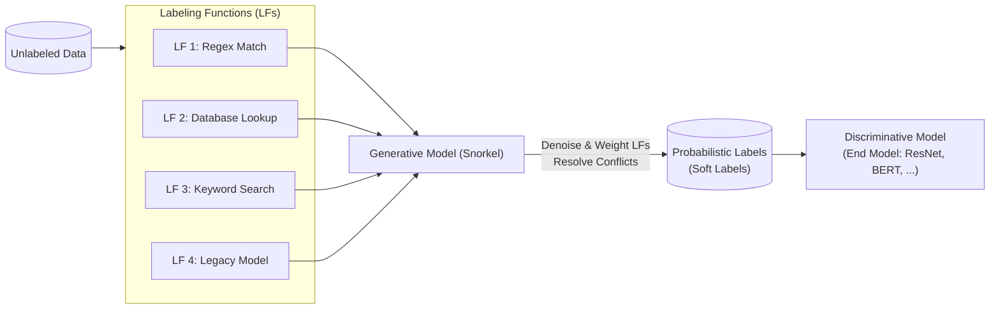

*   **Cơ chế khử nhiễu (Denoising mechanism)**:
    Vì các LF có thể xung đột (conflict) hoặc bao phủ chồng chéo (overlap), Snorkel sử dụng một mô hình sinh (Generative Model) để ước tính độ chính xác tiềm ẩn (latent accuracy) và sự tương quan giữa các LF **mà không cần biết ground truth**. Đầu ra là các nhãn xác suất mềm (probabilistic labels) để huấn luyện mô hình phân biệt cuối cùng (Discriminative Model).
*   **Tính chất công nghiệp**:
    *   *Tính thích ứng (Adaptability)*: Khi thêm nhãn mới, chỉ cần sửa logic hàm LF và chạy lại pipeline trong vài phút, thay vì chờ hàng tháng để gán nhãn lại.
    *   *Tính bảo mật (Privacy)*: Chuyên gia chỉ cần nhìn một tập nhỏ dữ liệu mẫu đã được phê duyệt an toàn để viết LF, sau đó thực thi LF trực tiếp trên toàn bộ dữ liệu nhạy cảm trong mạng nội bộ.

#### 3.4.2. Semi-Supervised Learning
*   **Self-Training / Pseudo-Labeling**:
    1. Huấn luyện mô hình ban đầu $\mathcal{M}$ trên tập có nhãn $D_L$.
    2. Dùng $\mathcal{M}$ để dự đoán xác suất trên tập không có nhãn $D_U$.
    3. Trích xuất các mẫu có độ tin cậy vượt ngưỡng $\tau$ (confidence threshold, ví dụ $P(y|x) > 0.95$), gán pseudo-labels cho chúng và bổ sung vào $D_L$.
    4. Huấn luyện lại $\mathcal{M}$ trên tập dữ liệu mở rộng. Lặp lại quá trình.
*   **Cluster & Smoothness Assumptions**: Các điểm dữ liệu nằm gần nhau trong không gian biểu diễn (feature space) hoặc nằm trên cùng một đa tạp (manifold) phải có cùng nhãn.
*   **Perturbation-based (Consistency Regularization)**: Một biến dạng nhỏ áp vào input $x$ hoặc representation của nó không được làm thay đổi nhãn dự đoán: $\arg\max f(x) = \arg\max f(x + \epsilon)$.
*   **Cạm bẫy đánh giá (Evaluation Hazard)**: Khi lượng dữ liệu có nhãn khan hiếm, việc chia một phần nhãn cho tập Validation/Test làm giảm lượng dữ liệu train quý giá; nhưng nếu tập Test quá nhỏ, việc chọn mô hình dựa trên Test set sẽ dẫn đến hiện tượng quá khớp (overfitting) trầm trọng trên tập Test.

#### 3.4.3. Transfer Learning
*   **Cơ chế**: Huấn luyện một Base Model trên nhiệm vụ cơ sở (thường là tự giám sát - Self-Supervised Learning trên dữ liệu khổng lồ không cần gán nhãn, như bài toán Next-Token Prediction trong NLP hoặc Masked Autoencoding trong Computer Vision), sau đó chuyển giao tri thức sang Downstream Task.
*   **Các phương thức khai thác**:
    *   *Zero-shot / Few-shot Learning*: Đưa context/prompt vào mô hình mà không cần cập nhật trọng số.
    *   *Feature Extraction (Freeze Base)*: Đóng băng toàn bộ backbone, chỉ huấn luyện một phân loại tuyến tính (linear classification head) ở lớp cuối.
    *   *Fine-tuning*: Cập nhật toàn bộ hoặc một số lớp trên cùng của mô hình với learning rate nhỏ.

#### 3.4.4. Active Learning
Mô hình (Active Learner) đóng vai trò bộ lọc thông minh, liên tục thẩm định mức độ hữu ích của các mẫu chưa gán nhãn và chỉ gửi các mẫu mang lại lượng thông tin lớn nhất về cho chuyên gia (Human Oracle) dán nhãn.

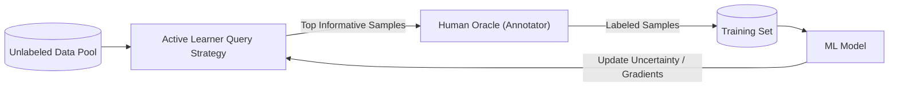

**Các Chiến lược Truy vấn (Query Strategies):**
1.  **Uncertainty Sampling (Lấy mẫu theo độ bất định)**:
    *   *Least Confidence*: Chọn mẫu mà xác suất dự đoán của lớp cao nhất là thấp nhất:
        $$x^* = \arg\min_x \max_y P(y \mid x; \theta)$$
    *   *Margin Sampling*: Chọn mẫu có khoảng cách giữa 2 lớp có xác suất cao nhất là nhỏ nhất (mẫu nằm sát ranh giới phân loại):
        $$x^* = \arg\min_x \left[ P(y_1^* \mid x; \theta) - P(y_2^* \mid x; \theta) \right]$$
    *   *Entropy Sampling*: Chọn mẫu có độ hỗn loạn thông tin Shannon cao nhất:
        $$x^* = \arg\max_x \left( -\sum_{i} P(y_i \mid x; \theta) \log P(y_i \mid x; \theta) \right)$$
2.  **Query-by-Committee (QBC - Bỏ phiếu hội đồng)**: Duy trì một tập hợp các mô hình (được train với các siêu tham số khác nhau hoặc các kiến trúc khác nhau). Mẫu nào gây ra sự bất đồng (disagreement) lớn nhất giữa các thành viên hội đồng sẽ được chọn để gán nhãn.
3.  **Expected Gradient Length (EGL)**: Chọn mẫu mà nếu được biết nhãn, nó sẽ tạo ra độ lớn gradient cập nhật trọng số $\|\nabla_\theta \mathcal{L}\|$ là lớn nhất.

---

## 4. Class Imbalance (Mất Cân Bằng Lớp)

### 4.1. Bản Chất và Thách Thức Kỹ Thuật

Mất cân bằng lớp xảy ra khi có sự chênh lệch áp đảo về số lượng mẫu giữa các lớp trong tập dữ liệu.
*   **Mất cân bằng trong phân loại**: Gian lận thẻ tín dụng (chỉ chiếm $0.068\%$ tổng giao dịch), chẩn đoán y tế (ảnh ung thư chiếm $0.01\%$), phát hiện đối tượng (hầu hết các bounding box là background).
*   **Mất cân bằng trong hồi quy (Continuous Class Imbalance)**: Dự đoán viện phí (phân phối đuôi nặng - heavy tail, giá trị tại phân vị thứ 95 cực lớn nhưng số lượng mẫu rất ít; lỗi dự đoán ở vùng này gây thiệt hại tài chính nặng nề hơn vùng trung vị).

**Ba nguyên nhân khiến Class Imbalance làm tê liệt thuật toán ML:**
1.  **Thiếu hụt tín hiệu học (Insufficient Signal)**: Lớp thiểu số có quá ít mẫu khiến bài toán biến thành Few-shot learning, gradient bị triệt tiêu bởi số lượng áp đảo của lớp đa số.
2.  **Bẫy tối ưu cục bộ (Trivial Heuristic Trap)**: Trong bài toán tỷ lệ $99.9\% : 0.1\%$, mô hình chỉ cần dự đoán tất cả là lớp đa số là đã đạt ngay Accuracy $99.9\%$. Gradient descent rất khó thoát khỏi điểm cực tiểu giả tạo này.
3.  **Chi phí sai số bất đối xứng (Asymmetric Cost of Error)**: Bỏ lọt một ca ung thư (False Negative) có thể dẫn tới tử vong, trong khi kết luận nhầm người khỏe mạnh là nghi nhiễm (False Positive) chỉ tốn thêm chi phí xét nghiệm lại. Hàm mất mát thông thường đối xử bình đẳng với mọi sai số, gây nguy hiểm cho ứng dụng thực tế.

---

### 4.2. Metric Đánh Giá: Vì Sao Accuracy Vô Dụng?

Xét hai mô hình trên tập dữ liệu $1000$ mẫu ($100$ ca CANCER, $900$ ca NORMAL):

| Model | Actual CANCER (1) | Actual NORMAL (0) | Accuracy | Precision | Recall | F1-Score |
| :--- | :---: | :---: | :---: | :---: | :---: | :---: |
| **Model A** | Bắt được **10**/100 | Bắt đúng 890/900 | **90.0%** | $0.50$ | **$0.10$** | **$0.17$** |
| **Model B** | Bắt được **90**/100 | Bắt đúng 810/900 | **90.0%** | $0.50$ | **$0.90$** | **$0.64$** |

*Cả hai mô hình có cùng Accuracy $90\%$, nhưng Model B có giá trị thực tiễn vượt trội vì phát hiện được $90\%$ ca bệnh, trong khi Model A bỏ lọt tới $90\%$ ca bệnh.*

#### So Sánh Chuyên Sâu: ROC-AUC vs. PR-AUC

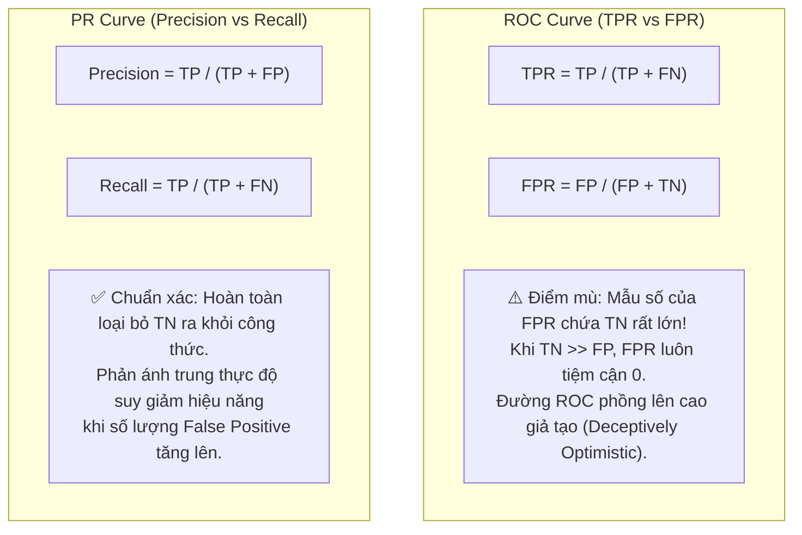

*   **ROC Curve (Receiver Operating Characteristic)**: Vẽ tương quan giữa True Positive Rate ($TPR = \text{Recall}$) và False Positive Rate ($FPR = \frac{FP}{FP + TN}$).
    *   *Điểm mù*: Khi dữ liệu mất cân bằng nghiêm trọng ($TN$ cực lớn so với $FP$), mẫu số $(FP + TN)$ bị áp đảo bởi $TN$. Kết quả là $FPR$ luôn giữ ở mức rất nhỏ ngay cả khi số lượng tuyệt đối của $FP$ tăng đột biến. Do đó, ROC-AUC cho một bức tranh lạc quan giả tạo.
*   **PR Curve (Precision-Recall Curve)**: Vẽ tương quan giữa Precision ($\frac{TP}{TP + FP}$) và Recall ($\frac{TP}{TP + FN}$).
    *   *Ưu điểm vượt trội*: Cả hai trục đều chỉ tập trung vào lớp thiểu số (Positive), hoàn toàn cô lập ảnh hưởng của $TN$. Khi bài toán mất cân bằng lớp nghiêm trọng, **PR-AUC là thước đo bắt buộc phải dùng**.

---

### 4.3. Kỹ Thuật Xử Lý Cấp Độ Dữ Liệu (Data-Level: Resampling)

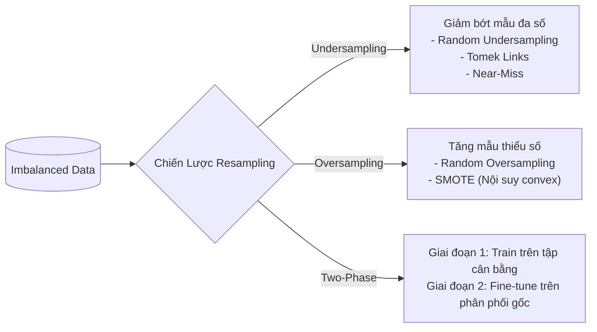

#### 4.3.1. Các Kỹ Thuật Resampling Chi Tiết
1.  **Random Undersampling (Rút mẫu thiểu hóa ngẫu nhiên)**: Loại bỏ ngẫu nhiên các mẫu của lớp đa số cho đến khi đạt tỷ lệ mong muốn.
    *   *Rủi ro*: Mất mát các thông tin cốt lõi (Information Loss) của lớp đa số, làm suy yếu năng lực tổng quát hóa của mô hình trên các phân vùng bị xóa.
2.  **Random Oversampling (Rút mẫu đa số hóa ngẫu nhiên)**: Sao chép ngẫu nhiên các mẫu hiện có của lớp thiểu số.
    *   *Rủi ro*: Làm mô hình bị quá khớp (Overfitting), vì mô hình chỉ học vẹt các bản sao giống hệt nhau, tạo ra các vùng quyết định quá hẹp xung quanh các điểm dữ liệu này.
3.  **Tomek Links (Undersampling)**:
    *   *Cơ chế*: Tìm các cặp mẫu $(x_i, x_j)$ thuộc hai lớp khác nhau sao cho khoảng cách giữa chúng là nhỏ nhất (nghĩa là không tồn tại mẫu thứ ba $x_k$ nào gần $x_i$ hơn $x_j$ hoặc gần $x_j$ hơn $x_i$). Khi đó, xóa mẫu thuộc lớp đa số trong cặp này.
    *   *Tác dụng*: Xóa bỏ các mẫu gây nhiễu nằm sát ranh giới, làm sạch đường biên quyết định.
    *   *Trade-off*: Việc làm ranh giới trở nên quá rõ ràng có thể làm mô hình mất đi tính bền bỉ trước các điểm ngoại lai thực tế.
4.  **SMOTE (Synthetic Minority Over-sampling Technique)**:
    *   *Cơ chế*: Không sao chép điểm cũ mà tổng hợp điểm mới bằng phép nội suy lồi (convex combination). Với mỗi điểm $x$ thuộc lớp thiểu số, tìm $k$ láng giềng gần nhất cũng thuộc lớp thiểu số. Chọn ngẫu nhiên một láng giềng $x_{zi}$ và tạo điểm mới $x_{new}$:
        $$x_{new} = x + \lambda (x_{zi} - x) \quad \text{với } \lambda \in [0, 1]$$
    *   *Giới hạn kỹ thuật*: SMOTE và các biến thể dựa trên khoảng cách (Near-Miss, One-Sided Selection) hoạt động tốt trên dữ liệu bảng (tabular) số chiều thấp. Trên không gian đặc trưng nhiều chiều (như embeddings của Deep Learning), khái niệm khoảng cách Euclidean bị suy biến (Curse of Dimensionality), khiến chi phí tính toán bùng nổ ($O(N^2)$) và các mẫu sinh ra không còn mang ý nghĩa ngữ nghĩa thực tế.

> [!CAUTION]
> **Quy Tắc Sống Còn Trong Đánh Giá (Evaluation Rule)**:
> Tuyệt đối **KHÔNG BAO GIỜ** thực hiện Resampling trên tập Validation hoặc Test. Tập kiểm chuẩn phải luôn giữ nguyên vẹn phân phối thực tế của bài toán. Mọi thao tác Resampling chỉ được phép áp dụng trên tập Training.

#### 4.3.2. Resampling Nâng Cao Cho Deep Learning
*   **Two-Phase Learning (Học Hai Giai Đoạn)**:
    *   *Pha 1*: Undersample lớp đa số để tạo ra một tập dữ liệu cân bằng nhân tạo ($50:50$). Huấn luyện mô hình học các biểu diễn cơ bản (representation learning) để phân biệt các lớp.
    *   *Pha 2*: Đóng băng các lớp trích xuất đặc trưng (feature extractors) hoặc giữ learning rate rất nhỏ, sau đó fine-tune lớp phân loại trên tập dữ liệu gốc mang phân phối mất cân bằng thực tế để mô hình hiệu chuẩn lại xác suất tiền nghiệm (prior probability calibration).
*   **Dynamic Sampling**: Điều chỉnh xác suất rút mẫu trong quá trình huấn luyện theo thời gian thực: Giảm tần suất xuất hiện của các lớp mô hình đã dự đoán tốt, và tăng tần suất xuất hiện của các lớp mô hình đang dự đoán sai nhiều.

---

### 4.4. Kỹ Thuật Xử Lý Cấp Độ Thuật Toán (Algorithm-Level Methods)

Giữ nguyên vẹn phân phối dữ liệu huấn luyện, thay đổi hàm mất mát $\mathcal{L}(\theta)$ để phạt nặng hơn các sai số trên lớp quan trọng.

#### 4.4.1. Cost-Sensitive Learning (Học Nhạy Chi Phí)
Sử dụng một **Ma trận chi phí (Cost Matrix)** định nghĩa $C_{ij}$: Chi phí khi một mẫu thuộc lớp thực tế $i$ bị mô hình phân loại nhầm thành lớp $j$ (mặc định $C_{ii} = 0$):

| Actual \ Predicted | Predicted NEGATIVE ($0$) | Predicted POSITIVE ($1$) |
| :--- | :---: | :---: |
| **Actual NEGATIVE ($0$)** | $C_{00} = 0$ | $C_{01}$ (Chi phí False Positive) |
| **Actual POSITIVE ($1$)** | $C_{10}$ (Chi phí False Negative) | $C_{11} = 0$ |

Hàm mất mát cho một mẫu $x$ thuộc lớp $i$ được định nghĩa bằng kỳ vọng chi phí:
$$\mathcal{L}(x; \theta) = \sum_{j} C_{ij} P(j \mid x; \theta)$$
Nếu việc bỏ sót ca ung thư tốn kém gấp 10 lần việc chẩn đoán nhầm, ta thiết lập $C_{10} = 10 \times C_{01}$.

#### 4.4.2. Class-Balanced Loss (Class-Weighted Cross Entropy)
Gán trọng số phạt tỉ lệ nghịch với tần suất xuất hiện của lớp đó trong tập dữ liệu:
$$W_i = \frac{N}{N_i} \quad \text{hoặc} \quad W_i = \frac{1 - \beta}{1 - \beta^{N_i}} \quad (\text{Effective Number of Samples, } \beta \in [0, 1))$$
Hàm mất mát có trọng số:
$$\mathcal{L}_{CB}(x, y; \theta) = - W_y \log P(y \mid x; \theta)$$

#### 4.4.3. Focal Loss (Lin et al., RetinaNet)
Được thiết kế để giải quyết tình trạng mất cân bằng cực đoan trong phát hiện đối tượng (hàng trăm nghìn background boxes so với vài foreground boxes).

*   **Hàm Cross Entropy (CE) thông thường cho bài toán nhị phân**:
    $$\text{CE}(p_t) = -\log(p_t) \quad \text{với } p_t = \begin{cases} p & \text{nếu } y = 1 \\ 1 - p & \text{nếu } y = 0 \end{cases}$$
    Khi một mẫu dễ phân loại có $p_t \ge 0.9$, nó vẫn tạo ra một lượng loss nhỏ ($-\log(0.9) \approx 0.1$). Nhưng khi nhân lên hàng trăm nghìn mẫu dễ, tổng loss của chúng sẽ áp đảo hoàn toàn tín hiệu gradient của các mẫu khó hiếm hoi.
*   **Công thức Focal Loss (FL)**:
    $$\text{FL}(p_t) = -\alpha_t (1 - p_t)^\gamma \log(p_t)$$
    *   $\alpha_t \in [0, 1]$: Trọng số cân bằng tỷ lệ lớp.
    *   $\gamma \ge 0$: Tham số tập trung (focusing parameter).
*   **Cơ chế hoạt động của Modulation Factor $(1 - p_t)^\gamma$**:
    *   Khi một mẫu bị phân loại sai và $p_t$ nhỏ (mẫu khó): $(1 - p_t)^\gamma \approx 1$, loss hầu như không bị ảnh hưởng.
    *   Khi một mẫu đã được phân loại đúng với độ tự tin cao và $p_t \to 1$ (mẫu dễ): Hệ số $(1 - p_t)^\gamma \to 0$, dìm mạnh giá trị loss của mẫu đó xuống mức gần bằng 0.
    *   *Hiệu quả*: Triệt tiêu gradient từ hàng triệu mẫu dễ, buộc mô hình tập trung cập nhật tham số dựa trên các mẫu khó.

---

## 5. Data Augmentation (Kỹ Thuật Tăng Cường Dữ Liệu)

Tăng cường dữ liệu là tập hợp các phương pháp nhằm mở rộng quy mô và sự đa dạng của tập huấn luyện một cách nhân tạo, giúp mô hình xây dựng tính bất biến (invariance) và tăng cường độ vững chắc (robustness) trước nhiễu.

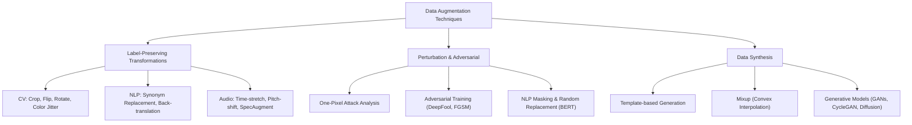

### 5.1. Simple Label-Preserving Transformations
Các phép biến đổi làm thay đổi diện mạo vật lý của mẫu nhưng bảo toàn nguyên vẹn ngữ nghĩa và nhãn của mẫu.

#### 5.1.1. Trong Computer Vision
*   **Các phép biến đổi**: Random Crop, Horizontal/Vertical Flip, Rotation, Color Jittering, Random Erasing / Cutout.
*   **Kiến trúc Pipeline Production**:
    Thực hiện biến đổi dữ liệu trực tiếp trên CPU theo cơ chế bất đồng bộ (asynchronous data loader) trong khi GPU đang thực hiện lan truyền xuôi/ngược (forward/backward passes) cho batch trước. Cơ chế này giúp quá trình tăng cường dữ liệu đạt trạng thái **"Computationally Free"** (không làm tăng thêm thời gian huấn luyện tổng thể).

#### 5.1.2. Trong Natural Language Processing (NLP)
*   **Thay thế từ đồng nghĩa (Synonym Replacement)**: Thay thế ngẫu nhiên các từ không mang tính quyết định bằng từ đồng nghĩa lấy từ từ điển (WordNet) hoặc các từ có khoảng cách Cosine gần nhất trong không gian vector nhúng (Embedding space).
*   **Back-Translation (Dịch ngược)**: Dịch câu từ ngôn ngữ nguồn sang ngôn ngữ trung gian (ví dụ: Anh $\to$ Pháp) rồi dịch ngược lại về ngôn ngữ nguồn (Pháp $\to$ Anh). Kỹ thuật này tái cấu trúc câu mà vẫn bảo tồn ý nghĩa ngữ nghĩa ban đầu.
*   **Contextual Word Replacement**: Dùng mô hình ngôn ngữ che dấu (Masked LM) để dự đoán từ thay thế hợp ngữ cảnh.

---

### 5.2. Perturbation & Adversarial Augmentation (Gây Nhiễu & Đối Kháng)

Mạng nơ-ron rất nhạy cảm với các nhiễu loạn nhỏ. Su et al. (2017) đã chứng minh kỹ thuật **One-Pixel Attack**: Thay đổi giá trị của đúng 1 pixel duy nhất có thể đánh lừa mạng nơ-ron phân loại sai $67.97\%$ ảnh CIFAR-10 và $16.04\%$ ảnh ImageNet với độ tự tin cao.

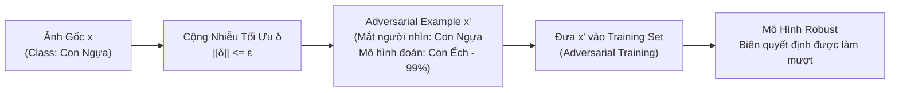

*   **Adversarial Training (Huấn luyện đối kháng)**:
    Tìm kiếm vector nhiễu $\delta$ có độ lớn giới hạn $\|\delta\| \le \epsilon$ sao cho nó tối đa hóa hàm mất mát của mô hình:
    $$\max_{\|\delta\| \le \epsilon} \mathcal{L}(f(x + \delta; \theta), y)$$
    Các thuật toán sinh mẫu đối kháng nổi tiếng: **FGSM (Fast Gradient Sign Method)**, **DeepFool**, **PGD (Projected Gradient Descent)**. Đưa các mẫu đối kháng này vào tập huấn luyện giúp siết chặt và làm phẳng ranh giới quyết định (decision boundary regularization), tăng khả năng chống chịu trước các cuộc tấn công có chủ đích.
*   **Perturbation trong NLP (Ví dụ từ kiến trúc BERT)**:
    BERT áp dụng cơ chế gây nhiễu trên chuỗi token: Chọn ngẫu nhiên $15\%$ tổng số token, trong đó $80\%$ được thay bằng token đặc biệt `[MASK]`, $10\%$ giữ nguyên và $10\%$ bị thay thế bằng một từ ngẫu nhiên trong từ điển. Thực nghiệm chứng minh việc cố tình tiêm một tỷ lệ nhỏ từ vô nghĩa ($1.5\%$ tổng số từ) đóng vai trò như một cơ chế điều chuẩn (regularization), giúp mô hình tăng độ bền bỉ khi biểu diễn ngữ nghĩa.

---

### 5.3. Data Synthesis (Tổng Hợp Dữ Liệu)

#### 5.3.1. Template-Based Generation
Áp dụng phổ biến trong các hệ thống xử lý ngôn ngữ tự nhiên, trợ lý ảo (Conversational AI) để bootstrap dữ liệu intent/slot-filling ban đầu:
*   *Template*: `"Tìm cho tôi nhà hàng món [ẨM_THỰC] trong bán kính [KHOẢNG_CÁCH] km quanh [ĐỊA_ĐIỂM]."`
*   Bằng cách kết hợp danh mục các món ăn, các con số thực tế và địa danh cụ thể, hệ thống có thể tổng hợp hàng trăm nghìn câu truy vấn mẫu mà không tốn chi phí thu thập.

#### 5.3.2. Mixup (Zhang et al., 2017)
Kỹ thuật tổng hợp dữ liệu dựa trên phép nội suy lồi (convex interpolation) giữa hai mẫu dữ liệu ngẫu nhiên $(x_i, y_i)$ và $(x_j, y_j)$:
$$\tilde{x} = \lambda x_i + (1 - \lambda) x_j$$
$$\tilde{y} = \lambda y_i + (1 - \lambda) y_j$$
Trong đó $\lambda \sim \text{Beta}(\alpha, \alpha)$ với $\alpha \in (0, \infty)$ (thường chọn $\alpha \in [0.1, 0.4]$).

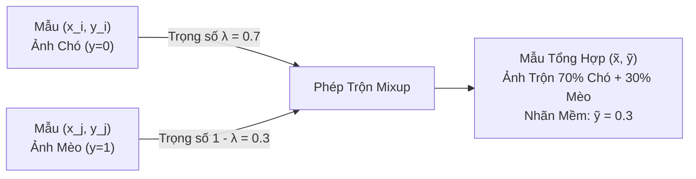

*   **Giá trị kỹ thuật của Mixup**:
    *   Chuyển bài toán từ nhãn cứng (discrete one-hot labels) sang nhãn mềm (probabilistic soft targets).
    *   Ngăn chặn mô hình đưa ra các dự đoán quá tự tin (overconfident predictions) ở các vùng dữ liệu nằm ngoài phân phối huấn luyện.
    *   Giảm thiểu khả năng ghi nhớ nhãn sai (memorization of corrupt labels) và ổn định quá trình huấn luyện mạng GAN.

#### 5.3.3. Deep Generative Models
*   Sử dụng **Generative Adversarial Networks (GANs)**, **CycleGAN** hoặc **Diffusion Models** để sinh dữ liệu nhân tạo cho các miền dữ liệu cực hiếm (ví dụ: tổng hợp ảnh cắt lớp CT-scan các khối u hiếm từ ảnh bình thường).
*   *Rủi ro Production*: Hiện tượng suy sụp mode (Mode Collapse - GAN chỉ sinh ra một vài biến thể cố định) hoặc sinh ra các tạo tác nhân tạo (artifacts) không có trong thực tế, khiến mô hình học phải các mẫu giả mạo.

---

## 6. Production Training Data Preparation Checklist

Bảng kiểm duyệt tiêu chuẩn công nghiệp (Production Readiness Checklist) trước khi đưa dữ liệu vào huấn luyện mô hình:

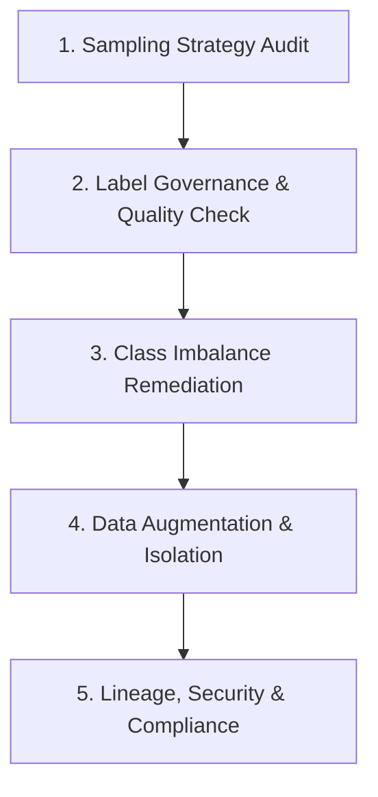

| Hạng Mục | Các Điểm Kiểm Tra Bắt Buộc (Checkpoints) | Mức Độ |
| :--- | :--- | :---: |
| **1. Sampling Strategy** | [ ] Thuật toán lấy mẫu có bảo toàn tỷ lệ các lớp thiểu số không? (Ưu tiên Stratified Sampling).<br>[ ] Dữ liệu streaming có sử dụng Reservoir Sampling để đảm bảo tính ngẫu nhiên vô thiên vị không?<br>[ ] Đã kiểm tra và loại trừ rủi ro Selection Bias từ các phương pháp Convenience Sampling chưa? | Nghiêm ngặt (P0) |
| **2. Label Governance** | [ ] Tài liệu Labeling Guidelines có quy tắc giải quyết nhập nhằng rõ ràng không (ví dụ longest match)?<br>[ ] Độ đồng thuận giữa các chuyên gia (Inter-annotator Agreement - Fleiss' Kappa) có đạt ngưỡng an toàn (>0.75)?<br>[ ] Nếu dùng Weak Supervision (Snorkel), các hàm LFs đã được ước lượng độ phủ (coverage) và khử nhiễu chưa? | Nghiêm ngặt (P0) |
| **3. Imbalance Mitigation** | [ ] Đã thay thế Accuracy bằng PR-AUC, F1-Score (theo từng lớp) và Confusion Matrix chưa?<br>[ ] **Tập Validation và Test có được giữ nguyên vẹn phân phối thực tế (Tuyệt đối không resample) không?**<br>[ ] Đã cấu hình Cost-Sensitive Loss hoặc Focal Loss thay vì Cross-Entropy tiêu chuẩn chưa? | Tối quan trọng (P0) |
| **4. Augmentation Pipeline** | [ ] Quá trình Augmentation CV có được thực thi bất đồng bộ trên CPU để tránh nghẽn GPU không?<br>[ ] Các phép biến đổi có đảm bảo bảo tồn nguyên vẹn ngữ nghĩa của nhãn (Label-preserving) không?<br>[ ] Có áp dụng các kỹ thuật chính quy hóa như Mixup hoặc Adversarial Training để chống overconfidence không? | Khuyến nghị (P1) |
| **5. Lineage & Compliance** | [ ] Mỗi mẫu dữ liệu có gắn thẻ Metadata: Nguồn gốc, ID người gán nhãn, Phiên bản pipeline, Timestamp không?<br>[ ] Dữ liệu nhạy cảm đã được ẩn danh hóa (Anonymization) và tuân thủ các quy định bảo mật (GDPR, HIPAA)?<br>[ ] Đã xây dựng cơ chế phát hiện Data Drift và Concept Drift định kỳ trên dữ liệu đầu vào chưa? | Nghiêm ngặt (P0) |
