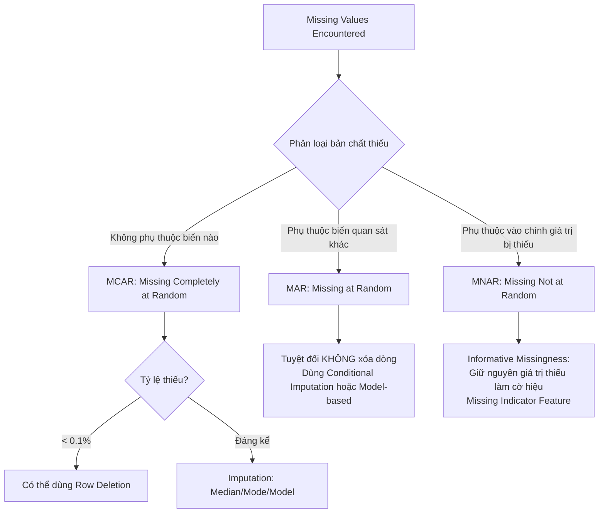
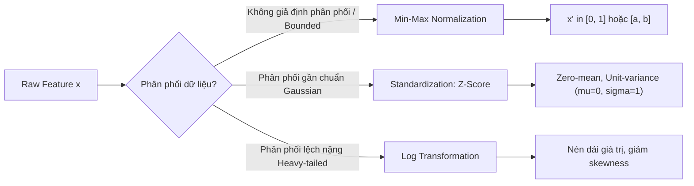
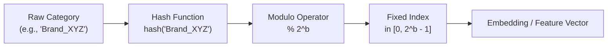
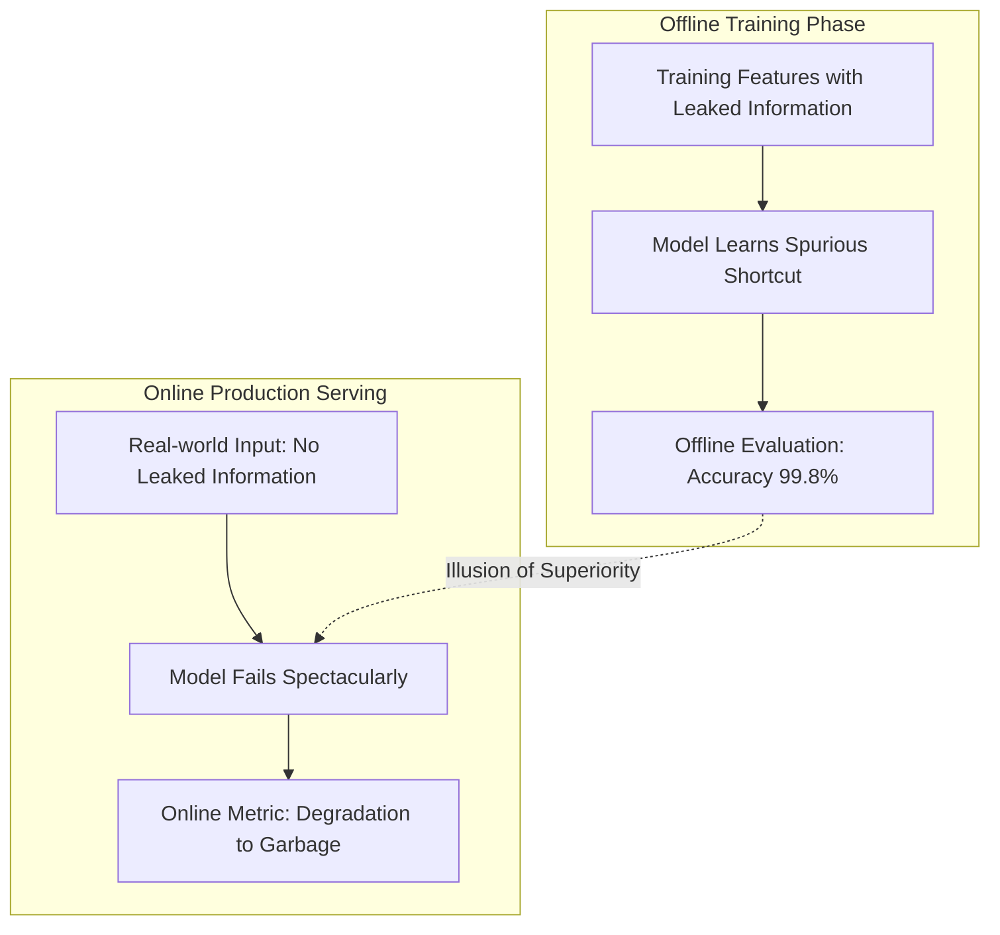
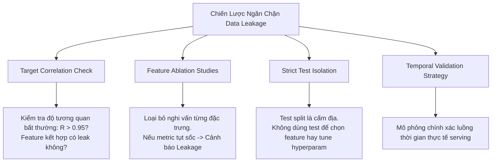
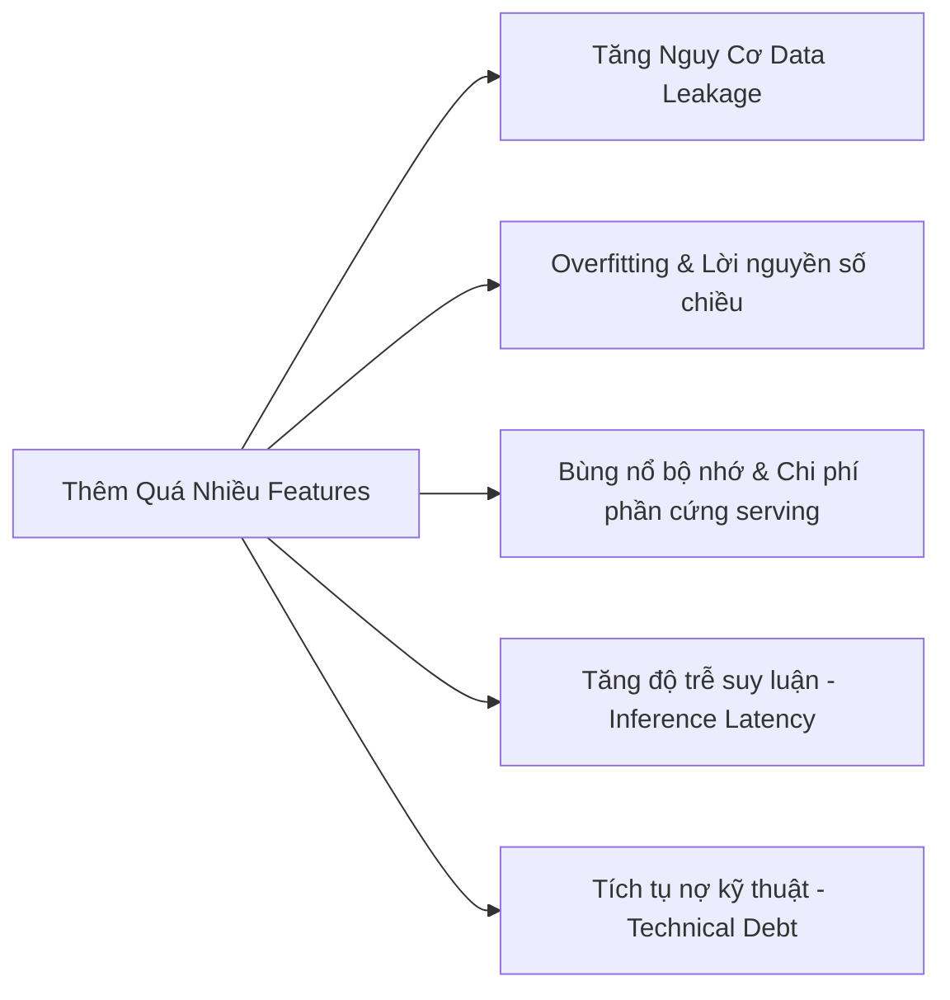
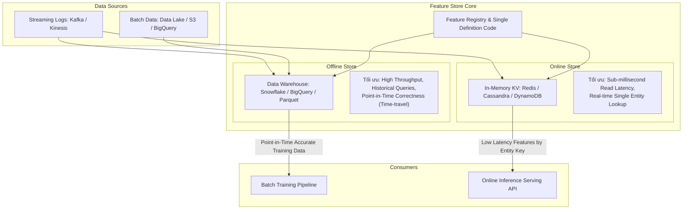

# Chương 04: Feature Engineering — Kỹ Nghệ Đặc Trưng trong Hệ Thống ML Production

> **Tóm tắt chuyên sâu (Distilled Master Notes)**:  
> Trong chu trình phát triển hệ thống Machine Learning thực tế, việc sở hữu bộ đặc trưng (features) phù hợp và chất lượng cao mang lại mức tăng trưởng hiệu năng (performance boost) vượt trội hơn nhiều so với việc tinh chỉnh siêu tham số (hyperparameter tuning) hay thay đổi thuật toán. Feature Engineering không chỉ là bước biến đổi toán học đơn thuần mà là giao điểm sống còn giữa **tri thức nghiệp vụ (domain expertise)**, **toán học thống kê (statistical rigor)** và **kỹ thuật hệ thống phân tán (systems engineering)**.

---

## 1. Learned Features vs. Engineered Features: Bản Chất & Sự Tiến Hóa

### 1.1. Sự Chuyển Dịch Từ Classical ML Sang Deep Learning (Feature Learning)

Trong kỷ nguyên Machine Learning cổ điển (Classical ML), dữ liệu thô (raw data) hiếm khi có thể đưa trực tiếp vào mô hình (như Logistic Regression, SVM, Random Forest). Kỹ sư phải dùng các kỹ thuật thủ công để trích xuất đặc trưng:

* **Xử lý ngôn ngữ tự nhiên (NLP) cổ điển**: 
  * Áp dụng chuỗi biến đổi: *Lemmatization* (đưa từ về dạng gốc), *Stemming*, *Expanding Contractions* (mở rộng từ viết tắt), *Punctuation Removal* (xóa dấu câu), *Lowercasing*.
  * Tạo chuỗi $n$-gram: Một chuỗi $n$ phần tử liên tiếp từ văn bản (từ, âm tiết hoặc ký tự). Với câu `"I like food"`, bộ 1-gram và 2-gram là `["I", "like", "food", "I like", "like food"]`.
  * Xây dựng từ điển cố định (vocabulary) ánh xạ mỗi $n$-gram thành một chỉ số (index). Văn bản được mã hóa thành vector dựa trên tần suất xuất hiện (Bag of Words / TF-IDF).
* **Thị giác máy tính (Computer Vision) cổ điển**:
  * Trích xuất thủ công các đặc trưng cạnh (edges), góc (corners), kết cấu (textures) bằng các thuật toán như SIFT (Scale-Invariant Feature Transform), HOG (Histogram of Oriented Gradients), hoặc Haar Cascades.

```
[Raw Data] ---> [Thủ công: Lemmatization / SIFT / N-grams] ---> [Feature Vectors] ---> [Classical ML Model]
```

**Sự trỗi dậy của Deep Learning (Feature Learning)**:
Deep Learning thay đổi căn bản quy trình này bằng cơ chế trích xuất đặc trưng tự động qua nhiều tầng biểu diễn phân cấp (hierarchical representations):
* Văn bản thô chỉ cần phân tách thành tokens (words/subwords), tra cứu bảng vector nhúng (embedding matrix), mạng nơ-ron sâu sẽ tự học cách kết hợp ngữ cảnh.
* Ảnh thô (ma trận pixel) được nạp trực tiếp qua các lớp tích chập (Convolutional Layers), tự động học từ các cạnh thô sơ ở tầng thấp đến các cấu trúc ngữ nghĩa phức tạp ở tầng cao.

```
[Raw Data: Pixels / Tokens] ---> [Deep Neural Network (Feature Learning Layers)] ---> [Task Output]
```

### 1.2. Bảng So Sánh Toàn Diện: Learned Features vs. Engineered Features

| Chiều Đánh Đổi (Trade-off) | Engineered Features (Kỹ nghệ thủ công) | Learned Features (Học tự động qua Deep Learning) |
| :--- | :--- | :--- |
| **Bản chất trích xuất** | Dựa trên tri thức chuyên gia (Domain Expertise) và logic nghiệp vụ định sẵn. | Tối ưu hóa tự động dựa trên hàm mất mát (Loss Function) và Gradient Descent. |
| **Độ phụ thuộc thuật toán** | Mô hình đơn giản (Linear, Tree-based) nhưng yêu cầu tiền xử lý dữ liệu phức tạp. | Đòi hỏi kiến trúc mạng sâu (Transformers, CNNs) và khối lượng tính toán lớn (GPU/TPU). |
| **Dữ liệu dạng bảng (Tabular Data)** | **Ưu thế tuyệt đối**: Dữ liệu có cấu trúc yêu cầu tổng hợp logic, tỷ lệ, ngưỡng kinh doanh. | Hiệu quả kém hơn hoặc chi phí tính toán không tương xứng so với GBDT (XGBoost, LightGBM). |
| **Tính giải thích (Interpretability)** | Cao. Kỹ sư hiểu chính xác ý nghĩa vật lý/nghiệp vụ của từng biến số. | Thấp (Black box). Biểu diễn tiềm ẩn (embeddings) khó diễn giải trực tiếp. |
| **Tính giòn (Brittleness) & Bảo trì** | Quy trình lặp thủ công dễ lỗi; thay đổi upstream logic làm gãy toàn bộ pipeline. | Tự thích ứng tốt hơn với dữ liệu phi cấu trúc phức tạp khi kích thước dữ liệu tăng. |
| **Khả năng tổng quát hóa** | Phụ thuộc vào độ chính xác của các giả định từ chuyên gia domain. | Tổng quát hóa cao trên dữ liệu tương tự tập huấn luyện; dễ sụp đổ khi gặp distribution shift ngoài domain. |

### 1.3. Giới Hạn Của Deep Learning Trong Production Thực Tế

Nhiều kỹ sư nhầm tưởng Deep Learning sẽ xóa sổ hoàn toàn Feature Engineering. Trên thực tế trong môi trường sản xuất:

1. **Sự thống trị của dữ liệu dạng bảng (Tabular Data)**: Hầu hết các bài toán sinh doanh thu cốt lõi của doanh nghiệp (dự báo churn, phát hiện gian lận thanh toán, chấm điểm tín dụng, định giá động) nằm ở cơ sở dữ liệu quan hệ. Các mô hình Gradient Boosted Trees (XGBoost, LightGBM, CatBoost) vẫn áp đảo các mô hình Deep Learning dạng bảng về độ chính xác lẫn hiệu năng tài nguyên.
2. **Ngữ cảnh đa phương thức kết hợp siêu dữ liệu (Contextual Metadata)**:
   * Khi phát hiện bình luận rác (spam comment), mô hình không thể chỉ đọc nội dung văn bản (learned features).
   * Hệ thống bắt buộc phải kết hợp các đặc trưng hệ thống (engineered features):
     * *Về bình luận*: Số lượt upvote/downvote, độ dài văn bản, số lượng link ra ngoài.
     * *Về tài khoản đăng*: Thời gian tạo tài khoản (account age), tần suất đăng bài/phút, tỷ lệ bài viết bị gắn cờ trong quá khứ.
     * *Về luồng thảo luận (thread)*: Số lượng view, mức độ thảo luận sôi nổi của thread (luồng hot thường hút spammer).
3. **Quy mô không gian đặc trưng công nghiệp**:
   * Hệ thống gợi ý video TikTok hay quảng cáo Facebook xử lý hàng triệu đến hàng trăm triệu đặc trưng hỗn hợp.
   * Bài toán phát hiện gian lận ngân hàng đòi hỏi tri thức sâu về quy định thanh toán quốc tế và hành vi rửa tiền để tạo ra các đặc trưng tổng hợp thời gian thực (ví dụ: *số lần quẹt thẻ tại 2 vị trí địa lý cách nhau > 500km trong vòng 30 phút*).

---

## 2. Common Feature Engineering Operations: Các Kỹ Thuật Đặc Trưng Thực Chiến

### 2.1. Xử Lý Giá Trị Thiếu (Handling Missing Values)

Trong môi trường production, dữ liệu thiếu xuất hiện liên tục do lỗi cảm biến, rớt kết nối mạng, người dùng bỏ qua form hoặc luồng nghiệp vụ thay đổi. Tuy nhiên, **bản chất thống kê của giá trị thiếu** quyết định trực tiếp chiến lược xử lý.



#### 2.1.1. Ba Cơ Chế Thiếu Theo Thống Kê Học (Rubin's Classification)

1. **MCAR (Missing Completely at Random — Thiếu hoàn toàn ngẫu nhiên)**:
   * **Định nghĩa toán học**: Xác suất một quan sát bị thiếu $M$ độc lập hoàn toàn với cả biến quan sát được $X$ lẫn biến chưa quan sát $Y$:
     $$P(M \mid X, Y) = P(M)$$
   * **Bản chất**: Sự thiếu hụt không tuân theo bất kỳ quy luật nào (ví dụ: người dùng vô tình bấm trượt một ô khảo sát mà không có chủ đích, hoặc vài gói tin mạng bị drop ngẫu nhiên).
   * **Thực tế**: MCAR **rất hiếm** trong production. Hầu hết các trường hợp thiếu đều có nguyên nhân tiềm ẩn.
2. **MAR (Missing at Random — Thiếu ngẫu nhiên có điều kiện)**:
   * **Định nghĩa toán học**: Xác suất bị thiếu $M$ không phụ thuộc vào chính giá trị bị thiếu $Y$, nhưng phụ thuộc vào một biến quan sát khác $X$:
     $$P(M \mid X, Y) = P(M \mid X)$$
   * **Ví dụ thực tế**: Biến "Tuổi" thường xuyên bị bỏ trống ở những người thuộc nhóm "Giới tính A", vì nhóm nhân khẩu học này có xu hướng từ chối tiết lộ tuổi. Nếu ta biết giá trị "Giới tính A", xác suất thiếu biến "Tuổi" được giải thích hoàn toàn.
3. **MNAR (Missing Not at Random — Thiếu không ngẫu nhiên / Informative Missingness)**:
   * **Định nghĩa toán học**: Xác suất bị thiếu phụ thuộc trực tiếp vào chính giá trị của biến đó:
     $$P(M \mid X, Y) = P(M \mid Y)$$
   * **Ví dụ thực tế**: Những người có mức "Thu nhập" cực cao thường từ chối điền thu nhập vào khảo sát. Bản thân hành vi không điền mang thông tin dự báo mạnh mẽ (missingness itself is a strong predictor).

#### 2.1.2. Phương Pháp Xóa Dữ Liệu (Deletion) & Phân Tích Rủi Ro

* **Xóa cột (Column Deletion)**:
  * Loại bỏ biến nếu tỷ lệ thiếu vượt quá ngưỡng (ví dụ: > 50%).
  * **Cạm bẫy**: Có thể triệt tiêu đặc trưng mang tính quyết định. Ví dụ: biến `Tình trạng hôn nhân` bị thiếu 60%, nhưng những người kết hôn có tỷ lệ mua nhà cao gấp 3 lần người độc thân. Xóa cột này làm suy giảm nghiêm trọng độ chính xác của mô hình dự đoán mua nhà.
* **Xóa dòng (Row Deletion / Listwise Deletion)**:
  * Loại bỏ bản ghi nếu chứa bất kỳ giá trị thiếu nào.
  * **Điều kiện áp dụng**: Chỉ an toàn khi dữ liệu là **MCAR** và tỷ lệ dòng bị thiếu cực thấp ($< 0.1\%$).
  * **Thảm họa production**:
    * Nếu áp dụng trên **MAR**: Khi xóa toàn bộ dòng thiếu `Tuổi` (vốn tập trung ở Giới tính A), mô hình bị lệch phân phối hoàn toàn và mất khả năng suy luận cho nhóm Giới tính A.
    * Nếu áp dụng trên **MNAR**: Xóa dòng thiếu `Thu nhập` sẽ loại bỏ toàn bộ tập khách hàng thu nhập cao, khiến mô hình đánh giá sai rủi ro tín dụng.

#### 2.1.3. Phương Pháp Điền Khuyết (Imputation) & Cạm Bẫy Production

* **Điền giá trị mặc định / Thống kê mô tả (Default / Descriptive Statistics)**:
  * Điền chuỗi rỗng `""` cho text, hoặc Mean / Median / Mode.
  * *Conditional Imputation*: Điền theo nhóm phân cấp (ví dụ: nếu thiếu nhiệt độ tháng 7, điền bằng Median nhiệt độ của riêng tháng 7 thay vì cả năm).
* **Cạm bẫy "Lỗi ngầm" (Silent Failure / Ghost Bugs)**:
  * Điền số `0` cho biến `Số con cái`: Không thể phân biệt giữa *người thực sự có 0 con* và *người không cung cấp thông tin*.
  * Điền số `0` cho biến `Tuổi`: Khi giao diện ứng dụng (Frontend) cập nhật bỏ ô nhập tuổi, dữ liệu đẩy về backend bị thiếu và được code tự động điền `0`. Mô hình chưa từng thấy tuổi `0` trong tập huấn luyện sẽ trả ra kết quả dự báo hoàn toàn sai lệch mà không phát sinh bất kỳ exception nào.
* **Kỹ thuật tối ưu**:
  * Tạo thêm đặc trưng cờ hiệu (Missing Indicator): Ví dụ `is_income_missing = 1`. Điều này giúp mô hình khai thác thông tin từ chính cơ chế thiếu (MNAR) đồng thời cho phép điền giá trị ước lượng an toàn vào biến gốc.

---

### 2.2. Co Giãn Đặc Trưng (Feature Scaling)

#### 2.2.1. Động Lực Toán Học

Xét mô hình nhận 2 đặc trưng: `Tuổi` ($x_1 \in [20, 40]$) và `Thu nhập hàng năm` ($x_2 \in [10\,000, 150\,000]$).
* Trong các mô hình tuyến tính ($y = w_1 x_1 + w_2 x_2 + b$), trọng số $w_2$ sẽ nhận các gradient cực nhỏ trong khi $w_1$ nhận gradient lớn, làm mặt cầu hàm mất mát (loss surface) bị kéo dài thành elip dẹt. Quá trình tối ưu bằng Gradient Descent sẽ dao động mạnh và hội tụ cực kỳ chậm.
* Trong các thuật toán dựa trên khoảng cách (k-NN, SVM, K-Means), khoảng cách Euclidean $\|x_a - x_b\| = \sqrt{\sum (x_{ai} - x_{bi})^2}$ sẽ bị chi phối hoàn toàn bởi $x_2$, biến $x_1$ trở nên vô nghĩa.
* Mặc dù các mô hình dạng cây (Decision Trees, GBDT) có tính bất biến với phép biến đổi đơn điệu (monotonic transformations), việc chuẩn hóa vẫn mang lại sự ổn định tính toán (numerical stability) cho toàn bộ pipeline dữ liệu.

#### 2.2.2. Các Kỹ Thuật Scaling Cốt Lõi



1. **Min-Max Normalization (Rescaling)**:
   * Ánh xạ dữ liệu về khoảng cố định $[0, 1]$:
     $$x' = \frac{x - \min(x)}{\max(x) - \min(x)}$$
   * Ánh xạ về khoảng tùy ý $[a, b]$ (thực nghiệm chứng minh dải $[-1, 1]$ thường giúp mạng nơ-ron hội tụ ổn định hơn $[0, 1]$ do có tâm đối xứng quanh 0):
     $$x' = a + \frac{(x - \min(x))(b - a)}{\max(x) - \min(x)}$$
   * *Nhược điểm chí mạng*: Cực kỳ nhạy cảm với ngoại lai (outliers). Nếu xuất hiện một giá trị cực đại bất thường, toàn bộ các điểm dữ liệu bình thường sẽ bị nén lại thành một cụm siêu nhỏ gần 0.
2. **Standardization (Z-score Normalization)**:
   * Chuyển đổi dữ liệu về phân phối có kỳ vọng bằng 0 và phương sai bằng 1:
     $$x' = \frac{x - \mu}{\sigma}$$
     Trong đó $\mu = \frac{1}{N}\sum_{i=1}^N x_i$ là giá trị trung bình, và $\sigma = \sqrt{\frac{1}{N}\sum_{i=1}^N (x_i - \mu)^2}$ là độ lệch chuẩn.
   * *Ưu điểm*: Ít bị phá hủy bởi outliers hơn Min-Max, phù hợp với hầu hết các bộ tối ưu hóa dựa trên gradient trong Deep Learning.
3. **Log Transformation (Biến đổi Logarit)**:
   * Áp dụng khi đặc trưng tuân theo phân phối lệch nặng (skewed / power-law / heavy-tailed distribution) như giá nhà, doanh thu, số lượt click:
     $$x' = \log(x) \quad \text{hoặc} \quad x' = \log(1 + x) \quad (\text{khi } x \ge 0)$$
   * *Tác dụng*: Kéo dài đuôi ngắn, thu hẹp đuôi dài, đưa phân phối về gần chuẩn hơn, giúp mô hình học các quan hệ theo cấp số nhân dễ dàng hơn.

#### 2.2.3. Quy Tắc Vàng Trong Production (Production Invariant)

> [!CAUTION]
> **Ranh giới tính toán thống kê (Global Statistics Boundary)**:
> Mọi tham số thống kê $(\min, \max, \mu, \sigma)$ **chỉ được phép tính toán trên tập Train (Training Split)**.
> Tuyệt đối không tính toán trên toàn bộ tập dữ liệu hoặc tính lại riêng rẽ trên tập Validation/Test.
> Trong giai đoạn Inference (Serving), hệ thống bắt buộc phải tái sử dụng chính xác các giá trị $(\mu_{\text{train}}, \sigma_{\text{train}})$ đã đóng băng từ quá trình huấn luyện. Nếu phân phối production trôi dạt (Data Drift), ta phải kích hoạt quy trình tái huấn luyện (Retraining) thay vì tính lại thống kê trên cửa sổ inference ngắn hạn.

---

### 2.3. Rời Rạc Hóa (Discretization / Bucketing / Quantization)

#### 2.3.1. Bản Chất Kỹ Thuật

Rời rạc hóa là quá trình chuyển đổi một biến liên tục (continuous feature) thành biến rời rạc/danh mục (discrete/categorical feature) thông qua việc phân chia miền giá trị thành các "thùng" (buckets/bins).

* **Động lực thực tế**: Mô hình học máy rất dễ bị phân tâm bởi các biến động số học nhỏ nhưng vô nghĩa về mặt nghiệp vụ. Ví dụ: một người có thu nhập $\$9\,000.50$/năm không khác biệt đáng kể so với $\$10\,000$/năm. Tuy nhiên, mô hình có thể đối xử với hai con số này hoàn toàn khác nhau.
* Bằng cách nhóm thu nhập thành 3 nhóm:
  * Thu nhập thấp: $< \$35\,000$/năm
  * Thu nhập trung bình: $\$35\,000 - \$100\,000$/năm
  * Thu nhập cao: $> \$100\,000$/năm
  Mô hình chuyển từ việc phải học một không gian liên tục vô hạn sang một không gian chỉ có 3 trạng thái rõ ràng, giúp tăng tính tổng quát hóa và giảm thiểu overfitting.

#### 2.3.2. Các Kỹ Thuật Phân Nhóm

1. **Uniform Width Binning (Phân khoảng đều)**: Chia dải giá trị $[\min, \max]$ thành $k$ khoảng có độ dài bằng nhau:
   $$\Delta = \frac{\max(x) - \min(x)}{k}$$
   *Rủi ro*: Nếu phân phối dữ liệu bị lệch, phần lớn mẫu sẽ dồn vào một thùng duy nhất, trong khi các thùng khác hoàn toàn rỗng.
2. **Quantile Binning (Phân vị tương đương — Equal Frequency)**: Sử dụng các ngưỡng phân vị ($q$-quantiles như quartiles, deciles) để đảm bảo mỗi thùng chứa số lượng mẫu bằng nhau.
   *Ưu thế*: Phân bổ đều dữ liệu huấn luyện, triệt tiêu tác động tiêu cực của outliers.
3. **Domain-Specific / Rule-Based Bucketing**: Sử dụng tri thức ngành để chia ngưỡng (ví dụ: nhóm tuổi theo pháp lý: $<18$ tuổi vị thành niên, $18-22$ sinh viên, $22-60$ độ tuổi lao động, $>60$ nghỉ hưu).

---

### 2.4. Mã Hóa Biến Danh Mục (Encoding Categorical Features)

#### 2.4.1. Thách Thức Về Biến Danh Mục Động Trong Production

Trong môi trường lý thuyết hoặc các cuộc thi học thuật, danh mục thường cố định (ví dụ: nhóm máu, giới tính). Tuy nhiên, trong production, các tập danh mục luôn **biến động không ngừng (Dynamic Categories)**:
* Nền tảng thương mại điện tử (Amazon) có hơn 2 triệu thương hiệu (brands), mỗi ngày có hàng trăm thương hiệu mới gia nhập.
* Các biến như `user_id`, `merchant_id`, `domain_name`, `ip_address` liên tục sinh mới theo thời gian thực.

**Cạm bẫy của các giải pháp ngây thơ (Naive Approaches)**:
1. *Mã hóa số cố định (Static Label Assignment)*: Gán mỗi thương hiệu một số nguyên từ 0 đến $1\,999\,999$. Khi ra production, hệ thống gặp một thương hiệu mới chưa từng thấy $\rightarrow$ Hệ thống crash do lỗi Out-of-Vocabulary (OOV).
2. *Thêm nhãn `UNKNOWN`*: Khi gặp danh mục mới, gán vào nhóm `UNKNOWN` (chỉ số $2\,000\,000$).
   * *Hậu quả 1*: Vì tập train không có dữ liệu cho `UNKNOWN`, mô hình không bao giờ đề xuất sản phẩm của các thương hiệu mới.
   * *Hậu quả 2*: Nếu cố gắng gộp 1% thương hiệu ít phổ biến nhất trong tập train vào `UNKNOWN` để mô hình học, khi ra production, mọi thương hiệu mới (bao gồm cả thương hiệu cao cấp vừa ra mắt) đều bị đối xử giống hệt các thương hiệu kém chất lượng, rác hoặc ít người quan tâm $\rightarrow$ Tỷ lệ Click-Through Rate (CTR) sụp đổ nghiêm trọng.

#### 2.4.2. Kỹ Thuật Băm Đặc Trưng (The Hashing Trick / Feature Hashing)

Được phổ biến bởi gói thư viện mã nguồn mở *Vowpal Wabbit* (Microsoft Research), Hashing Trick là giải pháp chuẩn công nghiệp để xử lý không gian danh mục khổng lồ và không giới hạn.



* **Cơ chế hoạt động**:
  Sử dụng một hàm băm xác định (deterministic hash function) để ánh xạ trực tiếp một danh mục bất kỳ thành một chỉ số trong một không gian băm có kích thước định trước $2^b$:
  $$\text{Index} = \text{hash}(\text{category}) \pmod{2^b}$$
  Ví dụ chọn không gian băm 18-bit ($b = 18$), không gian chỉ số được cố định ở $2^{18} = 262\,144$ giá trị ($0$ đến $262\,143$). Bất kể có bao nhiêu triệu thương hiệu mới xuất hiện, chúng đều được ánh xạ vào không gian này mà không cần mở rộng bảng từ điển.
* **Ưu điểm vượt trội**:
  * **Bộ nhớ cố định**: Không cần duy trì bảng tra cứu từ điển khổng lồ trong RAM khi serving.
  * **Hỗ trợ Streaming / Continual Learning**: Dữ liệu mới đến đâu có thể mã hóa ngay lập tức đến đó mà không cần retrain toàn bộ vocabulary.
* **Hiện tượng va chạm (Collisions) & Thực tế thực nghiệm**:
  * Hai danh mục khác nhau có thể bị băm vào cùng một chỉ số. Tuy nhiên, các hàm băm phân phối va chạm một cách ngẫu nhiên.
  * Nghiên cứu từ **Booking.com**: Ngay cả khi tỷ lệ va chạm đặc trưng lên tới **50%**, mức độ suy giảm hiệu năng (Log-loss tăng) chỉ **dưới 0.5%** (Hình minh họa trong báo cáo của Lucas Bernardi). Mô hình vẫn có thể học được các tín hiệu thống kê mạnh mẽ bất chấp nhiễu va chạm ngẫu nhiên.
* **Locality-Sensitive Hashing (LSH)**: Có thể sử dụng các hàm băm bảo toàn khoảng cách để ánh xạ các thực thể tương tự nhau (ví dụ: các URL hoặc domain tương đồng) vào các chỉ số lân cận nhau.

---

### 2.5. Tổ Hợp Đặc Trưng (Feature Crossing)

#### 2.5.1. Bản Chất Toán Học

Feature Crossing là kỹ thuật kết hợp hai hoặc nhiều đặc trưng riêng lẻ để tạo ra một đặc trưng mới phản ánh mối quan hệ tương tác phi tuyến (non-linear interactions). Phổ biến nhất là tích Descartes giữa hai biến danh mục:
$$\text{Feature}_{\text{cross}} = \text{Feature}_A \times \text{Feature}_B$$

*Ví dụ*: Trong bài toán dự báo khả năng mua nhà:
* Biến đơn lẻ: `Tình trạng hôn nhân` $\in \{\text{Độc thân}, \text{Kết hôn}\}$
* Biến đơn lẻ: `Số con cái` $\in \{0, 1, 2, \dots\}$
* Feature Cross: `Hôn nhân & Con cái` $\in \{(\text{Độc thân, 0}), (\text{Kết hôn, 2}), (\text{Độc thân, 1}), \dots\}$

#### 2.5.2. Khi Nào Cần Dùng & Đánh Đổi Trong Production

* **Tính cấp thiết**:
  * Các mô hình tuyến tính ($y = w^T x$) hoặc hồi quy Logistic hoàn toàn bất lực trong việc tự học mối tương tác nếu không có feature crossing (vấn đề hàm XOR kinh điển).
  * Mô hình cây (GBDT) có thể học được tương tác thông qua các nhánh rẽ liên tiếp, nhưng đòi hỏi độ sâu cây lớn hơn và nhiều mẫu hơn.
  * Mạng nơ-ron sâu (Deep Learning) về lý thuyết có thể xấp xỉ mối quan hệ phi tuyến, nhưng việc cung cấp explicit feature crosses (như trong kiến trúc **Wide & Deep**, **DeepFM**, **xDeepFM**) giúp mô hình hội tụ nhanh hơn nhiều bậc và cải thiện đáng kể độ chính xác trong các bài toán CTR/Recommender Systems.
* **Cạm bẫy bùng nổ không gian chiều (Curse of Dimensionality)**:
  * Nếu biến $A$ có $1\,000$ giá trị và biến $B$ có $1\,000$ giá trị, biến cross $A \times B$ sẽ tạo ra $1\,000\,000$ chiều phân loại mới.
  * Hệ quả: Không gian dữ liệu trở nên cực kỳ thưa thớt (sparse), đòi hỏi khối lượng dữ liệu huấn luyện khổng lồ để tránh hiện tượng ghi nhớ vẹt (memorization) và overfitting.

---

### 2.6. Nhúng Vị Trí (Positional Embeddings: Discrete vs. Continuous)

#### 2.6.1. Tại Sao Mạng Transformer Cần Positional Embeddings?

Trong các mô hình tuần tự như RNN hoặc LSTM, dữ liệu văn bản được nạp tuần tự từng bước một ($t_1, t_2, \dots$), do đó trật tự từ ngữ được lưu giữ một cách tự nhiên. Ngược lại, kiến trúc **Transformer** xử lý toàn bộ các token trong câu một cách **song song hoàn toàn** qua cơ chế Self-Attention.
* Do Self-Attention có tính chất hoán vị bất biến (permutation invariant), nếu không có cơ chế chỉ định vị trí, mô hình sẽ coi hai câu sau là hoàn toàn giống hệt nhau:
  * *"A dog bites a child"* (Chó cắn trẻ em)
  * *"A child bites a dog"* (Trẻ em cắn chó)
* **Tại sao không đưa vị trí số nguyên ($0, 1, 2, \dots, N$) vào mô hình?**
  * Mạng nơ-ron tối ưu kém với các đầu vào không có phương sai đơn vị (unit-variance).
* **Tại sao không chuẩn hóa tuyến tính vị trí về $[0, 1]$ ($0, \frac{1}{N-1}, \dots, 1$)?**
  * Khi độ dài chuỗi $N$ thay đổi, khoảng cách giữa hai bước liên tiếp $\frac{1}{N-1}$ sẽ co giãn theo độ dài văn bản, khiến mô hình không học được khái niệm "bước nhảy cố định".

#### 2.6.2. Discrete Positional Embeddings (Nhúng Vị Trí Rời Rạc)

1. **Learned Positional Embeddings (Nhúng vị trí học được)**:
   * Khởi tạo một ma trận nhúng vị trí $P \in \mathbb{R}^{L_{\max} \times d_{\text{model}}}$, trong đó mỗi dòng là một vector đại diện cho chỉ số vị trí $0, 1, \dots, L_{\max}-1$.
   * Vector biểu diễn cuối cùng của một token là tổng trực tiếp: $\mathbf{e}_{\text{final}} = \mathbf{e}_{\text{token}} + \mathbf{e}_{\text{pos}}$.
   * Vector vị trí này được cập nhật trọng số trong quá trình huấn luyện bằng Gradient Descent (đây là cách BERT nguyên bản triển khai). Giới hạn: Không thể ngoại suy cho các chuỗi dài hơn $L_{\max}$.
2. **Fixed Sinusoidal Positional Embeddings (Nhúng vị trí hình sin cố định)**:
   * Giới thiệu trong bài báo *Attention Is All You Need* (Vaswani et al., 2017). Tọa độ vị trí được mã hóa bằng hàm sin và cosin ở các tần số khác nhau:
     $$PE_{(pos, 2i)} = \sin\left(\frac{pos}{10000^{2i/d_{\text{model}}}}\right)$$
     $$PE_{(pos, 2i+1)} = \cos\left(\frac{pos}{10000^{2i/d_{\text{model}}}}\right)$$
     Trong đó $pos$ là vị trí trong chuỗi, $i$ là chỉ số chiều trong vector nhúng ($i \in [0, d_{\text{model}}/2)$).
   * Cơ chế này cho phép mô hình dễ dàng học cách chú ý vào các vị trí tương đối thông qua phép biến đổi tuyến tính: $PE_{pos + k}$ có thể biểu diễn như một phép xoay tuyến tính của $PE_{pos}$.

#### 2.6.3. Continuous Positional Embeddings (Fourier Features)

Khi bài toán mở rộng sang không gian liên tục (như tọa độ 3D của đám mây điểm, xử lý bề mặt vật thể trong đồ họa máy tính NeRF, hoặc tọa độ địa lý kinh độ/vĩ độ GPS), các vị trí không còn là các chỉ số rời rạc $0, 1, 2$. Ta không thể lập ma trận nhúng với các chỉ số cột liên tục.

* **Fourier Features** (Tancik et al., 2020) là dạng tổng quát hóa của positional embeddings cho không gian tọa độ liên tục đa chiều $\mathbf{v} \in \mathbb{R}^d$:
  $$\gamma(\mathbf{v}) = \left[ a_1 \cos(2\pi \mathbf{b}_1^T \mathbf{v}),\; a_1 \sin(2\pi \mathbf{b}_1^T \mathbf{v}),\; \dots,\; a_m \cos(2\pi \mathbf{b}_m^T \mathbf{v}),\; a_m \sin(2\pi \mathbf{b}_m^T \mathbf{v}) \right]^T$$
  Trong đó các vector tần số $\mathbf{b}_j$ được chọn ngẫu nhiên từ phân phối Gaussian (Random Fourier Features) hoặc học được.
* Kỹ thuật này phá vỡ hiện tượng "Spectral Bias" của mạng nơ-ron (xu hướng mạng nơ-ron chỉ học các hàm tần số thấp trơn tru), cho phép mô hình học được các chi tiết hình học tần số cao trong không gian vật lý liên tục.

---

## 3. Rò Rỉ Dữ Liệu (Data Leakage): Thảm Họa Ngầm Trong Production

### 3.1. Bản Chất Học Thuật & Tác Động Hệ Thống

**Định nghĩa chuẩn xác**:  
Data Leakage (Rò rỉ dữ liệu) là hiện tượng thông tin về nhãn mục tiêu (ground truth label) hoặc thông tin chỉ xuất hiện trong tương lai vô tình thâm nhập vào tập đặc trưng huấn luyện của mô hình, trong khi nguồn thông tin này **hoàn toàn không khả dụng** tại thời điểm suy luận thực tế (inference time).



* **Mức độ nguy hiểm**: Data leakage là nguyên nhân phổ biến nhất khiến các mô hình đạt điểm số tuyệt đối trong môi trường thử nghiệm (offline validation) nhưng sụp đổ thảm hại khi vừa đưa ra production. 
* **Bản chất tinh vi**: Không có ngoại lệ hay lỗi crash nào xuất hiện. Mô hình chỉ đơn giản tìm ra con đường tắt dễ dãi nhất (cheating shortcut) để tối thiểu hóa loss function mà không thực sự học được bản chất quy luật.

> [!NOTE]
> **Điển hình thực tế: Vụ án ảnh chụp CT ngực (Lung CT Scan Cancer Detection)**  
> Mô hình phân loại ung thư phổi được huấn luyện trên dữ liệu Bệnh viện A đạt độ chính xác gần như hoàn hảo. Khi chuyển giao sang thử nghiệm tại Bệnh viện B, độ chính xác sụt giảm về mức đoán ngẫu nhiên.  
> **Nguyên nhân rò rỉ ngầm**: Tại Bệnh viện A, các bác sĩ chỉ chuyển những bệnh nhân có triệu chứng ung thư nghiêm trọng sang một dòng máy quét CT cao cấp chuyên dụng, trong khi bệnh nhân nhẹ dùng máy thông thường. Dòng máy cao cấp tạo ra ảnh có độ phân giải và viền tương phản khác biệt đôi chút. Mô hình không hề học nhận diện khối u ung thư; nó học cách **phân loại ảnh chụp từ máy quét nào**! Tại Bệnh viện B, bệnh nhân được chỉ định máy quét ngẫu nhiên, khiến "con đường tắt" của mô hình hoàn toàn sụp đổ.

---

### 3.2. 6 Nguyên Nhân Phổ Biến & Cơ Chế Rò Rỉ

#### 1. Chia Dữ Liệu Chuỗi Thời Gian Ngẫu Nhiên (Splitting Time-Correlated Data Randomly)
* **Cơ chế**: Trong các bài toán có tính phụ thuộc thời gian (giá cổ phiếu, dự đoán click quảng cáo, phát hiện xu hướng âm nhạc), hành vi của hệ thống ở ngày $T$ chịu tác động của bối cảnh toàn cục của ngày $T$.
* Nếu chia ngẫu nhiên (Random Split) 80% train / 20% test: Các bản ghi của cùng ngày $T$ sẽ xuất hiện ở cả hai tập. Dữ liệu từ tương lai (ngày thứ 7) lọt vào tập train, mô hình chỉ cần "nhớ" bối cảnh thị trường của ngày đó là có thể dự đoán chính xác tập test.
* **Biện pháp khắc phục**: Luôn áp dụng **Time-Based Splitting** (ví dụ: huấn luyện trên dữ liệu 4 tuần đầu, kiểm tra trên tuần thứ 5).

```
Random Split (SAI):
[W1, W2, W3, W4, W5] ---> Trộn ngẫu nhiên ---> [Train: Chứa mẫu W5] & [Test: Chứa mẫu W1-W5] (RÒ RỈ TƯƠNG LAI)

Time-Based Split (ĐÚNG):
[W1 ---- W4: QUÁ KHỨ] = Train Split  =======>  [W5: TƯƠNG LAI] = Test Split
```

#### 2. Scaling Trước Khi Chia Tập Dữ Liệu (Scaling Before Splitting)
* **Cơ chế**: Kỹ sư tính toán $\mu$ và $\sigma$ trên toàn bộ tập dữ liệu thô trước khi gọi hàm chia train/test.
* Thông tin về giá trị trung bình và phân phối của tập test đã bị "thấm" vào việc chuẩn hóa tập train. Khi mô hình chạy trên production với dữ liệu hoàn toàn mới, phân phối thực tế có thể khác biệt, dẫn đến suy thoái hiệu năng.
* **Biện pháp**: Chia tập dữ liệu TRƯỚC, sau đó chỉ dùng dữ liệu của `Train Split` để fit bộ scaler.

#### 3. Điền Khuyết Bằng Thống Kê Toàn Cục (Imputation Leakage)
* Tương tự như lỗi scaling: Việc lấy Mean/Median của toàn bộ dataset để điền vào các ô trống trước khi phân chia tập dữ liệu sẽ làm rò rỉ nhãn hoặc phân phối của tập kiểm thử vào tập huấn luyện.

#### 4. Xử Lý Trùng Lặp Dữ Liệu Kém Trước Khi Chia (Poor Handling of Data Duplication)
* Dữ liệu thu thập từ nhiều nguồn thường chứa các bản ghi trùng lặp (ví dụ: bộ dữ liệu CIFAR-10 và CIFAR-100 chứa từ 3.3% đến 10% ảnh trùng giữa train và test).
* Kỹ thuật nhân bản mẫu để cân bằng dữ liệu (**Oversampling** như SMOTE) nếu thực hiện **trước khi chia tập**, các mẫu giống hệt nhau sẽ rơi đồng thời vào cả tập train lẫn test.
* **Biện pháp**: Deduplication toàn diện trước khi chia; Mọi kỹ thuật oversampling/undersampling chỉ được thực hiện **sau khi đã phân chia tập dữ liệu** và chỉ áp dụng duy nhất trên tập Train.

#### 5. Rò Rỉ Cụm / Nhóm (Group Leakage)
* Một bệnh nhân chụp 3 phim CT trong cùng một tuần. Dù 3 tấm ảnh có góc chụp khác nhau đôi chút, chúng đều phản ánh cùng một bệnh nhân với cùng một tình trạng bệnh lý.
* Nếu chia ngẫu nhiên theo từng tấm ảnh, 2 tấm rơi vào train và 1 tấm rơi vào test. Mô hình chỉ cần ghi nhớ các đặc trưng cá nhân của bệnh nhân đó để dự đoán tấm ảnh thứ 3.
* **Biện pháp**: Phải phân chia theo nhóm đối tượng (**Group-Based Splitting / GroupKFold**), đảm bảo toàn bộ dữ liệu của một bệnh nhân (hoặc một người dùng) chỉ nằm trọn vẹn trong một tập duy nhất.

#### 6. Rò Rỉ Từ Quy Trình Thu Thập Dữ Liệu (Data Collection Pipeline Leakage)
* Thông tin thu thập được vô tình bị gán ghép bởi các hệ thống thứ ba (như ví dụ máy quét CT nêu trên, hoặc trường dữ liệu `timestamp_confirmed` chỉ được hệ thống ghi nhận SAU KHI giao dịch gian lận bị phát hiện).

---

### 3.3. Phương Pháp Phát Hiện & Ngăn Chặn Data Leakage



1. **Kiểm tra tương quan mục tiêu (Target Correlation Check)**:
   * Tính toán tương quan giữa từng đặc trưng với nhãn mục tiêu ($Y$). Nếu một đặc trưng có tương quan cao bất thường (ví dụ: correlation $> 0.9$ hoặc mang lại ROC-AUC $> 0.95$ đơn lẻ), cần điều tra ngay lập tức quy trình tạo ra đặc trưng đó.
   * Cảnh giác với **Tổ hợp rò rỉ**: Từng đặc trưng đứng riêng có vẻ bình thường, nhưng khi kết hợp lại tạo thành nhãn. Ví dụ: dự đoán thâm niên nhân viên, biến `start_date` và `end_date` đứng riêng không lộ nhãn, nhưng khi mô hình lấy `end_date - start_date`, nó tính trực tiếp ra nhãn `tenure`.
2. **Nghiên cứu triệt tiêu đặc trưng (Feature Ablation Studies)**:
   * Thử nghiệm loại bỏ một đặc trưng ra khỏi mô hình. Nếu việc loại bỏ một đặc trưng duy nhất khiến toàn bộ hiệu năng hệ thống tụt dốc thảm hại, đặc trưng đó có khả năng rất cao là nguồn chứa leaked label.
3. **Bảo vệ tính bất khả xâm phạm của Test Split (Strict Test Isolation)**:
   * Tập kiểm thử chỉ được dùng đúng một lần duy nhất để báo cáo hiệu năng cuối cùng. Bất kỳ hành động nhìn vào tập test để nảy sinh ý tưởng thiết kế đặc trưng, chọn ngưỡng lọc hay điều chỉnh siêu tham số đều cấu thành hành vi rò rỉ dữ liệu tương lai vào chu trình phát triển.

---

## 4. Thiết Kế Đặc Trưng Tốt (Engineering Good Features)

### 4.1. Sự Đánh Đổi Giữa Số Lượng Và Chất Lượng Features

Trong thực tế, danh sách đặc trưng của một hệ thống ML sản xuất có xu hướng tăng dần theo thời gian. Tuy nhiên, việc bổ sung bừa bãi các đặc trưng không có chọn lọc dẫn đến **5 chi phí ngầm (Hidden Costs)**:



1. **Tăng rủi ro Data Leakage**: Càng nhiều đặc trưng từ các nguồn dữ liệu ngoài, xác suất rò rỉ thông tin tương lai càng cao.
2. **Overfitting**: Số chiều quá lớn khiến mô hình dễ ghi nhớ nhiễu trong tập train thay vì học quy luật tổng quát.
3. **Chi phí bộ nhớ và phần cứng serving**: Vector đặc trưng quá lớn đòi hỏi máy chủ serving cấu hình RAM cao hơn, tốn kém chi phí hạ tầng cloud.
4. **Độ trễ suy luận (Inference Latency)**: Đối với các bài toán Online Prediction, việc truy vấn và tính toán hàng nghìn đặc trưng từ raw logs theo thời gian thực sẽ vi phạm SLA (Service Level Agreement) về độ trễ (ví dụ: yêu cầu phản hồi $< 50$ms).
5. **Nợ kỹ thuật (Technical Debt)**: Nếu upstream data schema thay đổi (ví dụ: app ngừng thu thập một trường dữ liệu), tất cả các đặc trưng phái sinh liên quan đều bị lỗi và đòi hỏi bảo trì khẩn cấp.

---

### 4.2. Đo Lường Tầm Quan Trọng Của Đặc Trưng (Feature Importance)

Để loại bỏ các đặc trưng rác và tối ưu hóa hệ thống, ta cần các phương pháp định lượng giá trị đóng góp của từng đặc trưng.

| Kỹ thuật | Bản chất toán học | Ưu điểm | Nhược điểm / Rủi ro |
| :--- | :--- | :--- | :--- |
| **Mean Decrease Impurity (MDI / Gini Importance)** | Tính toán tổng mức giảm độ tinh khiết (Gini/Variance) tại tất cả các node phân chia bởi đặc trưng đó trong cây. | Cực nhanh, được tích hợp sẵn mặc định trong XGBoost, LightGBM, Random Forest. | **Thiên vị nặng nề**: Đánh giá quá cao các biến có cardinality cao (biến số liên tục hoặc ID có nhiều giá trị duy nhất). |
| **Permutation Feature Importance** | Xáo trộn ngẫu nhiên (shuffle) giá trị của một cột trên tập validation và đo lường mức độ suy giảm metric của mô hình. | Bất biến với mô hình (Model-agnostic), phản ánh chính xác tác động thực tế lên metric đánh giá cuối cùng. | Tốn kém tính toán; có thể đưa ra kết luận sai lệch nếu các đặc trưng có hiện tượng đa cộng tuyến cao (collinear features). |
| **SHAP (SHapley Additive exPlanations)** | Dựa trên **Lý thuyết trò chơi hợp tác (Cooperative Game Theory)**, tính toán đóng góp biên trung bình (marginal contribution) của đặc trưng qua mọi tập con kết hợp. | **Tiêu chuẩn vàng**: Thỏa mãn các tiên đề toán học khắt khe (Efficiency, Symmetry, Additivity). Cung cấp cả Local Attribution lẫn Global Importance. | Đòi hỏi chi phí tính toán rất lớn (dù TreeSHAP đã tối ưu hóa mạnh cho mô hình cây). |

#### Quy Luật Pareto Trong Feature Importance (Facebook Ads Case Study)
Trong bài báo kinh điển *Practical Lessons from Predicting Clicks on Ads at Facebook* (He et al., 2014):
* Khi đo lường tầm quan trọng đặc trưng trong mô hình dự đoán CTR, đội ngũ kỹ sư phát hiện ra rằng: **Chỉ top 10 đặc trưng hàng đầu đã đóng góp tới gần 50% tổng tầm quan trọng của toàn bộ mô hình**.
* Ngược lại, **hơn 300 đặc trưng ở đuôi chỉ đóng góp chưa đầy 1%** giá trị.
* **Bài học kiến trúc**: Việc mạnh dạn cắt bỏ 300 đặc trưng đuôi giúp giảm hơn một nửa độ trễ tính toán phục vụ và bộ nhớ serving mà hiệu năng dự đoán thực tế gần như không suy chuyển.

---

### 4.3. Khả Năng Tổng Quát Hóa vs. Ghi Nhớ (Generalization vs. Memorization)

Mục tiêu tối thượng của Machine Learning là suy luận trên dữ liệu chưa từng thấy (unseen data). Do đó, đặc trưng tốt phải có năng lực tổng quát hóa cao.

```
[Identifier thuần túy: Comment_ID]  ---> Chỉ ghi nhớ vẹt (Zero Generalization) ---> NGUY HẠI
[Recurring Entity: User_ID / Domain] ---> Có thể học hành vi lặp lại              ---> DÙNG ĐƯỢC KHI BĂM/EMBEDDING
[Aggregated Signal: User_Post_Freq] ---> Tổng quát hóa bản chất hành vi           ---> TỐI ƯU NHẤT
```

1. **Độ bao phủ đặc trưng (Feature Coverage)**:
   * Khái niệm: Tỷ lệ phần trăm các mẫu trong tập dữ liệu thực sự có giá trị cho đặc trưng này.
   * *Quy tắc kinh nghiệm*: Một đặc trưng chỉ xuất hiện ở $1\%$ dữ liệu thường không đem lại nhiều giá trị.
   * *Ngoại lệ (Informative Sparse Features)*: Nếu một đặc trưng chỉ xuất hiện trong $1\%$ dữ liệu, nhưng **$99\%$ các mẫu chứa nó đều mang nhãn POSITIVE**, đây là một đặc trưng cực kỳ giá trị (High Precision Indicator) bắt buộc phải giữ lại.
2. **Sự trùng lặp phân phối giữa Train và Test (Distribution Overlap)**:
   * **Nghiên cứu điển hình: Mô hình dự báo thời gian di chuyển Taxi (ETA)**:
     * Kỹ sư huấn luyện mô hình dự báo từ dữ liệu 6 ngày (Thứ Hai đến Thứ Bảy) để phục vụ suy luận cho ngày hôm nay (Chủ Nhật).
     * Đặc trưng `DAY_OF_THE_WEEK`: Có coverage 100% trong tập train. Tuy nhiên, tập train chỉ chứa các giá trị từ `Monday` đến `Saturday`, trong khi tập test production chỉ chứa giá trị `Sunday`. Độ trùng lặp phân phối bằng **0%**. Đặc trưng này phá hủy hoàn toàn khả năng suy luận của mô hình vào Chủ Nhật!
     * Ngược lại, đặc trưng `HOUR_OF_THE_DAY`: Có độ trùng lặp 100% giữa các ngày trong tuần và Chủ Nhật, mang lại khả năng tổng quát hóa hoàn hảo.
3. **Đánh đổi giữa Tính Tổng Quát và Tính Cụ Thể (Generalization vs. Specificity)**:
   * Tạo đặc trưng cờ hiệu `IS_RUSH_HOUR` (bằng 1 nếu từ 7h-9h sáng hoặc 16h-18h chiều): Có tính tổng quát hóa cao, nhưng làm mất đi tính chi tiết vi mô của từng giờ lẻ so với `HOUR_OF_THE_DAY`. Việc lựa chọn cần cân nhắc dựa trên kích thước dữ liệu và độ phức tạp của mô hình.

---

### 4.4. Feature Store Trong Kiến Trúc Production Hiện Đại

#### 4.4.1. Vấn Đề Train-Serve Skew

Một trong những nguyên nhân phổ biến nhất khiến hệ thống ML thất bại khi đưa vào vận hành là **Train-Serve Skew** (sự sai lệch giữa huấn luyện và phục vụ):
* Trong giai đoạn Huấn luyện (Offline Training): Nhà khoa học dữ liệu viết code trích xuất đặc trưng bằng SQL hoặc Python Pandas trên Data Warehouse.
* Trong giai đoạn Phục vụ (Online Serving): Kỹ sư backend viết lại logic tính toán đặc trưng đó bằng Java/C++/Go để tích hợp vào API sản xuất nhằm đạt độ trễ thấp.
* Sự bất đồng bộ về mã nguồn, logic làm tròn toán học, hoặc sự khác biệt múi giờ giữa hai môi trường dẫn đến việc mô hình nhận đầu vào sai lệch so với lúc học.

#### 4.4.2. Kiến Trúc Dual-Storage Của Feature Store (Feast, Hopsworks, Tecton)

Feature Store giải quyết triệt để bài toán này bằng cách đóng gói định nghĩa đặc trưng thành một nguồn chân lý duy nhất (Single Source of Truth) kết hợp hạ tầng lưu trữ kép:



* **Offline Feature Store**:
  * Công nghệ: BigQuery, Snowflake, AWS S3 / Delta Lake.
  * Tối ưu hóa cho việc xử lý hàng tỷ bản ghi với thông lượng lớn (high throughput).
  * Cung cấp khả năng **Time-Travel (Point-in-time Correctness)**: Khi huấn luyện mô hình trên một sự kiện xảy ra lúc 14:00 ngày $T$, Feature Store sẽ chỉ truy xuất chính xác giá trị của các đặc trưng tại thời điểm 13:59 ngày $T$, triệt tiêu hoàn toàn rủi ro rò rỉ dữ liệu tương lai (Data Leakage).
* **Online Feature Store**:
  * Công nghệ: Redis, Apache Cassandra, Amazon DynamoDB.
  * Tối ưu hóa cho việc đọc bản ghi đơn lẻ theo khóa thực thể (`user_id`, `device_id`) với độ trễ cực thấp (p99 latency $< 10$ms).
  * Liên tục đồng bộ các đặc trưng mới nhất từ luồng dữ liệu streaming để phục vụ mô hình suy luận thời gian thực.

---

## 5. Checklist Feature Engineering Thực Chiến (Production-Ready Checklist)

Bảng kiểm định chuẩn hóa quy trình Feature Engineering cho kỹ sư hệ thống Machine Learning trước khi triển khai production:

| Giai đoạn | Hạng mục kiểm tra (Inspection Item) | Yêu cầu kỹ thuật & Ngưỡng chấp thuận | Trạng thái |
| :--- | :--- | :--- | :---: |
| **1. Data Splitting** | Chiến lược phân chia theo thời gian | Dữ liệu chuỗi thời gian/hành vi người dùng **bắt buộc dùng Time-based split**. Không dùng random split. | [ ] |
| | Nhóm đối tượng (Group Isolation) | Đảm bảo cùng một thực thể (User/Patient) chỉ xuất hiện trong 1 tập duy nhất (dùng `GroupKFold`). | [ ] |
| | Kiểm soát trùng lặp (Deduplication) | Khử trùng lặp trên toàn bộ raw data trước khi chia. Thực hiện oversampling **chỉ sau khi chia** và chỉ trên train split. | [ ] |
| **2. Missing Values** | Xác định cơ chế thiếu | Phân loại rõ MCAR, MAR hay MNAR. Tuyệt đối không dùng Row Deletion khi tỷ lệ thiếu $> 0.1\%$ hoặc là MNAR. | [ ] |
| | Nguy cơ "Lỗi ngầm" (Silent Bug) | Không điền giá trị thuộc miền khả dĩ (như điền 0 cho tuổi/số con) trừ khi có cờ hiệu phân biệt (`is_missing_indicator`). | [ ] |
| **3. Scaling & Normalization** | Giới hạn ranh giới thống kê | Chỉ fit Scaler $(\mu, \sigma, \min, \max)$ trên Train split. Đóng băng tham số và tái sử dụng nguyên vẹn khi Serving. | [ ] |
| | Xử lý Outliers & Skewness | Kiểm tra skewness của dữ liệu; áp dụng Log Transform cho heavy-tailed data; ưu tiên Standardization hơn Min-Max nếu có outliers. | [ ] |
| **4. Categorical Encoding** | Xử lý Out-of-Vocabulary (OOV) | Thiết kế cơ chế phòng thủ cho danh mục mới: Dùng **Hashing Trick** hoặc xử lý nhóm `UNKNOWN` có kiểm soát. | [ ] |
| | Bùng nổ số chiều | Đánh giá số lượng tham số sinh ra từ One-hot Encoding hoặc Feature Crossing. Đảm bảo dữ liệu đủ dày để tránh overfit. | [ ] |
| **5. Leakage Auditing** | Kiểm tra tương quan mục tiêu | Rà soát mọi feature có $|R| > 0.9$ hoặc ROC-AUC đơn lẻ $> 0.95$. Tiến hành điều tra nguồn gốc dữ liệu. | [ ] |
| | Kiểm tra Feature Ablation | Đo lường mức độ sụt giảm hiệu năng khi loại bỏ feature nghi vấn; xác minh không có trường dữ liệu tương lai. | [ ] |
| | Cách ly hoàn toàn tập Test | Đảm bảo không sử dụng tập Test để thiết kế quy tắc feature, chọn ngưỡng bucketing hay điều chỉnh siêu tham số. | [ ] |
| **6. Serving Readiness** | Nhất quán Train-Serve logic | Đồng bộ hóa code trích xuất feature giữa offline và online (khuyến nghị dùng Feature Store như Feast/Tecton). | [ ] |
| | Rà soát SLA độ trễ suy luận | Đảm bảo thời gian trích xuất và tính toán feature tại bước Online Serving đáp ứng ngân sách độ trễ hệ thống (ví dụ: $< 50$ms). | [ ] |
| | Giám sát trôi dạt đặc trưng (Drift) | Thiết lập pipeline theo dõi phân phối (PSI / KL-Divergence) của các đặc trưng cốt lõi trên môi trường sản xuất. | [ ] |

---

## 6. Tổng Kết Chương (Architectural Takeaways)

1. **Feature Engineering là đòn bẩy hiệu năng lớn nhất**: Trong hầu hết các hệ thống ML công nghiệp, chất lượng đặc trưng quyết định trần hiệu năng của mô hình. Thuật toán cao cấp không thể bù đắp cho bộ đặc trưng nghèo nàn hoặc sai lệch.
2. **Deep Learning tự động hóa nhưng không xóa sổ Feature Engineering**: Dữ liệu phi cấu trúc (ảnh, văn bản) được hưởng lợi từ Feature Learning, nhưng dữ liệu dạng bảng (tabular), siêu dữ liệu quan hệ, và các bài toán nghiệp vụ đặc thù vẫn phụ thuộc tuyệt đối vào kỹ nghệ đặc trưng thủ công.
3. **Data Leakage là kẻ thù số một của kỹ sư ML**: Rò rỉ dữ liệu diễn ra âm thầm, không để lại vết lỗi kỹ thuật nhưng phá hủy hoàn toàn giá trị thực tế của hệ thống. Luôn ghi nhớ quy tắc: *Chia dữ liệu theo thời gian, tính toán thống kê sau khi chia, và cô lập tuyệt đối tập kiểm thử*.
4. **Ít hơn nhưng chất lượng hơn**: Tránh việc tích tụ vô tội vạ các đặc trưng. Sử dụng các kỹ thuật đo lường tầm quan trọng (SHAP, Permutation Importance) để loại bỏ các đặc trưng đuôi, giảm thiểu nợ kỹ thuật, tối ưu hóa bộ nhớ và độ trễ phục vụ.
5. **Chuẩn hóa hạ tầng bằng Feature Store**: Đầu tư vào Feature Store là giải pháp bền vững để giải quyết triệt để Train-Serve Skew, bảo đảm tính đúng đắn theo thời gian (Point-in-time Correctness) và tái sử dụng tài nguyên đặc trưng trên toàn tổ chức.
