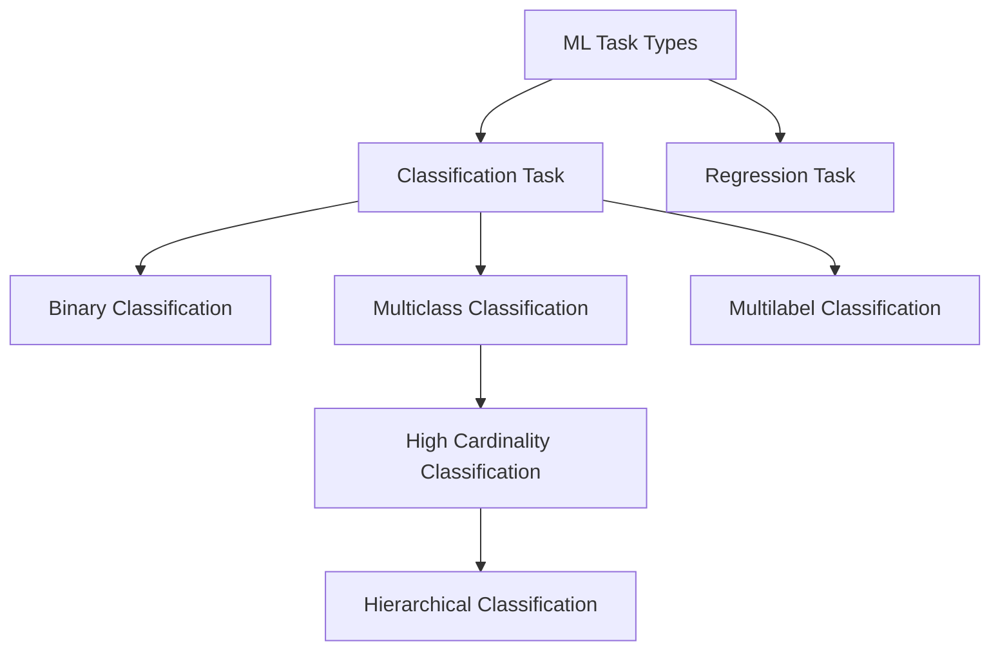
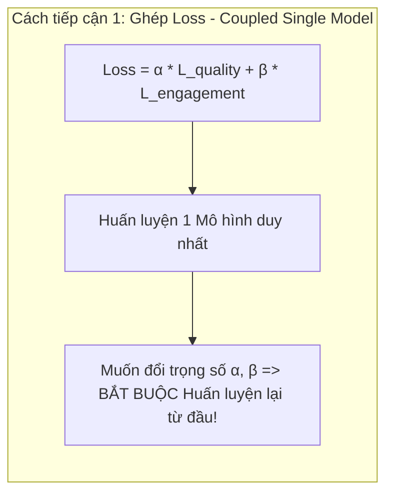
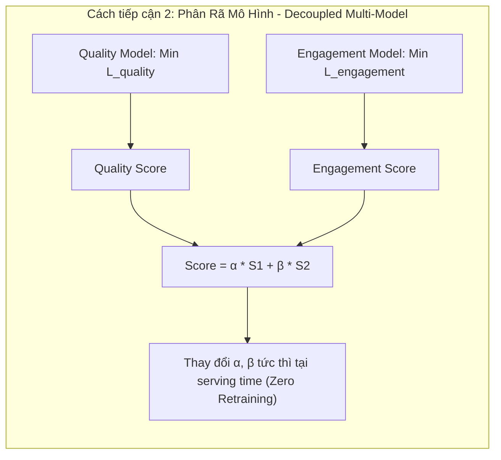
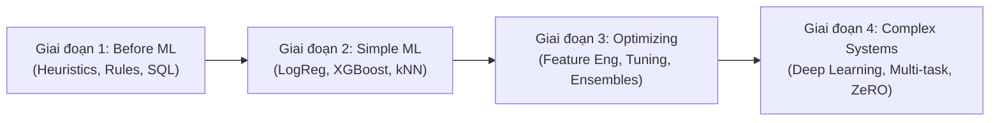
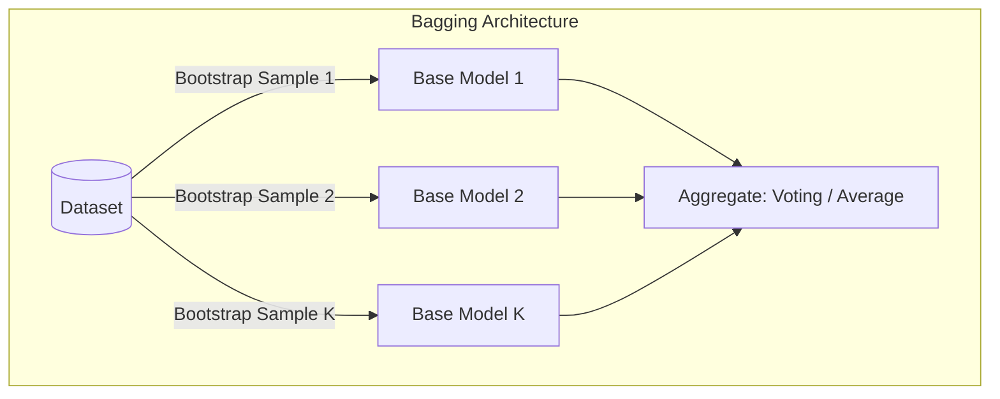
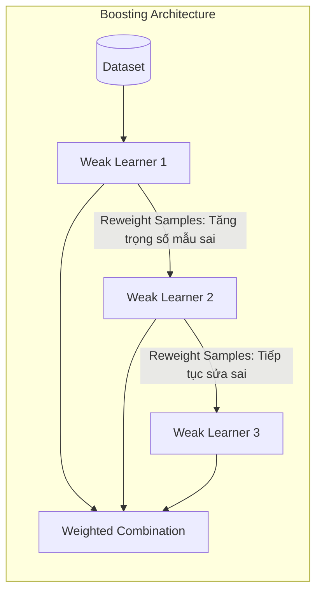
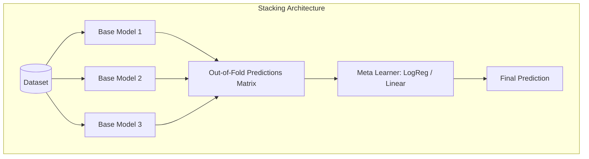
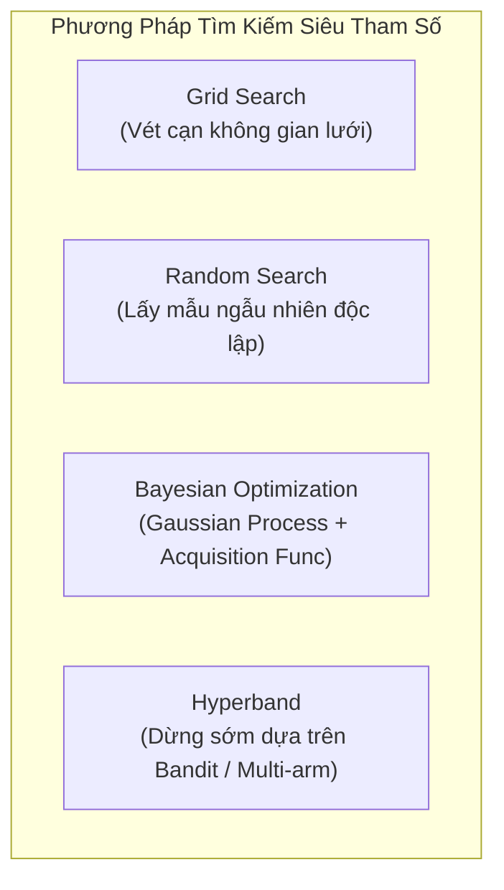
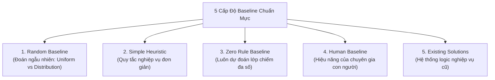
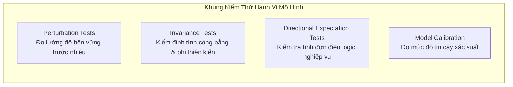

# Chương 5: Phát Triển Mô Hình & Đánh Giá Ngoại Tuyến (Model Development & Offline Evaluation)

> **Tóm tắt chuyên sâu (Executive Summary)**:  
> Chương 5 tập trung vào giai đoạn cốt lõi của chu trình phát triển hệ thống Machine Learning (ML): chuyển hóa bài toán nghiệp vụ thành bài toán ML, lựa chọn và tối ưu hóa thuật toán, theo dõi thí nghiệm, mở rộng quy mô huấn luyện phân tán, và thiết lập khung đánh giá ngoại tuyến (offline evaluation) toàn diện trước khi triển khai thực tế. Khác với tư duy học thuật thuần túy chỉ tối ưu hóa các độ đo tổng thể (overall metrics) trên tập dữ liệu tĩnh, kỹ sư ML trong môi trường production phải liên tục cân nhắc các ràng buộc thực tế: độ trễ suy diễn (inference latency), chi phí tính toán, độ ổn định của hệ thống, độ bền vững trước nhiễu dữ liệu, tính công bằng trên từng phân khúc dữ liệu (data slices), và khả năng bảo trì lâu dài.

---

## 1. Đóng Khung Bài Toán ML (Framing ML Problems)

### 1.1. Từ Vấn Đề Nghiệp Vụ Đến Bài Toán Học Máy
Một vấn đề kinh doanh (business problem) không đồng nhất với một bài toán ML.
* **Vấn đề nghiệp vụ**: Thường định tính, mơ hồ (ví dụ: *"Tăng tốc độ xử lý yêu cầu hỗ trợ khách hàng lên 2 lần"* hoặc *"Giảm tỷ lệ rời bỏ của người dùng"*).
* **Bài toán ML**: Phải được xác định rõ ràng bởi bộ ba thành phần toán học:
  1. **Đầu vào ($\mathbf{x}$)**: Vector không gian đặc trưng (Feature vector).
  2. **Đầu ra ($\mathbf{y}$)**: Nhãn mục tiêu rời rạc hoặc giá trị liên tục.
  3. **Hàm mục tiêu ($\mathcal{L}(\mathbf{w})$)**: Hàm mất mát toán học dẫn dắt quá trình tối ưu hóa trọng số mô hình.

```
+-----------------------------------+
|  Business Problem:                |
|  "Speed up customer support 2x"   |
+-----------------+-----------------+
                  |
                  v  [Problem Framing Process]
+-----------------+-----------------+
|  ML Problem: Multiclass Routing   |
|  - Input (x): Customer Request    |
|  - Output (y): Department ID      |
|  - Objective: Minimize Cross-Ent  |
+-----------------------------------+
```

---

### 1.2. Phân Loại Các Dạng Bài Toán ML (Types of ML Tasks)



#### A. Phân loại (Classification) vs. Hồi quy (Regression)
* **Classification**: Ánh xạ $\mathbf{x} \to y \in \{C_1, C_2, \dots, C_k\}$. Đầu ra là lớp rời rạc.
* **Regression**: Ánh xạ $\mathbf{x} \to y \in \mathbb{R}$. Đầu ra là giá trị số thực liên tục.
* **Chuyển đổi tương hỗ giữa hai bài toán**:
  * *Hồi quy $\to$ Phân loại*: Rời rạc hóa (quantization/bucketing) giá trị liên tục thành các khoảng (ví dụ: dự đoán giá nhà thành các khoảng: `<$100k`, `$100k-$200k`, `>$200k`).
  * *Phân loại $\to$ Hồi quy*: Xuất xác suất liên tục $P(y=1|\mathbf{x}) \in [0, 1]$, sau đó sử dụng ngưỡng động (dynamic threshold) để phân lớp nghiệp vụ.

#### B. Phân loại Nhị phân (Binary) vs. Đa lớp (Multiclass)
* **Binary Classification**: Chỉ gồm 2 lớp ($y \in \{0, 1\}$). Ma trận nhầm lẫn (Confusion Matrix), các chỉ số Precision, Recall, ROC-AUC, F1-Score trực quan và dễ giải thích.
* **Multiclass Classification**: Số lớp $K > 2$, mỗi mẫu thuộc duy nhất một lớp.
* **Thách thức Phân loại Có Lực lượng Lớn (High Cardinality)**:
  * Khi số lượng lớp lên tới hàng nghìn hoặc hàng chục nghìn (ví dụ: chẩn đoán mã bệnh quốc tế ICD-10, phân loại danh mục sản phẩm e-commerce).
  * *Data Sparsity*: Cần tối thiểu $\approx 100$ mẫu cho mỗi lớp để thuật toán học tốt; với 1.000 lớp cần ít nhất $100.000$ mẫu phân bổ đều. Các lớp hiếm (tail classes) thường bị suy kiệt dữ liệu.
  * *Giải pháp - Phân loại phân cấp (Hierarchical Classification)*: Xây dựng cây quyết định đa tầng. Tầng 1 phân loại vào nhóm danh mục lớn (Macro-group), Tầng 2 phân loại chi tiết trong từng nhóm nhỏ (Subgroup). Giúp giảm không gian tìm kiếm và cân bằng mẫu.

#### C. Phân loại Đa lớp (Multiclass) vs. Đa nhãn (Multilabel)
* **Multiclass**: Mỗi mẫu $\mathbf{x}$ chỉ nhận duy nhất một nhãn ($y \in \{1, \dots, K\}$). Vector nhãn dạng One-Hot: $\sum_{i=1}^K y_i = 1$.
* **Multilabel**: Mỗi mẫu $\mathbf{x}$ có thể đồng thời thuộc nhiều nhãn khác nhau. Vector nhãn dạng Binary Multi-hot: $y_i \in \{0, 1\}$, $\sum_{i=1}^K y_i \ge 0$.
* **Hai phương pháp tiếp cận**:
  1. *Binary Relevance (One-vs-Rest)*: Chia bài toán $K$ nhãn thành $K$ mô hình phân loại nhị phân độc lập. Ưu điểm: Đơn giản, dễ huấn luyện song song; Nhược điểm: Bỏ qua mối tương quan phụ thuộc giữa các nhãn (label correlation).
  2. *Joint Multilabel Modeling*: Huấn luyện một mô hình duy nhất sử dụng hàm mất mát Binary Cross-Entropy trên từng output neuron kết hợp hàm kích hoạt Sigmoid ở tầng cuối cùng.
* **Rủi ro trong Production**:
  * *Label multiplicity ambiguity*: Khó khăn trong việc gán nhãn dữ liệu (Annotator A gán 1 nhãn, Annotator B gán 3 nhãn).
  * *Khó xác định ngưỡng trích xuất (Thresholding ambiguity)*: Với phân phối xác suất đầu ra $[\hat{p}_1, \hat{p}_2, \hat{p}_3, \hat{p}_4] = [0.45, 0.20, 0.02, 0.33]$, trong thiết lập đa lớp chỉ cần chọn $\arg\max$, nhưng trong đa nhãn việc chọn ngưỡng cutoff hoặc số lượng nhãn động (k-top labels) rất phức tạp và dễ gây lỗi hệ thống.

---

### 1.3. Tính Đa Dạng Trong Thiết Kế Khung Bài Toán (Multiple Ways to Frame a Problem)
Cùng một mục tiêu nghiệp vụ, cách đóng khung bài toán (problem framing) sẽ quyết định trực tiếp độ phức tạp kiến trúc và chi phí vận hành.

**Case Study: Gợi ý ứng dụng người dùng sẽ mở tiếp theo (Next-App Prediction)**

```
Cách tiếp cận 1: Multiclass Classification
Input: [User Features, Context] ───────────► [ Model ] ───────────► Vector Output kích thước N (Xác suất cho N apps)
                                                ▲
                                                │ Bất lợi: Thêm app mới N+1 => Phải sửa output layer & Retrain từ đầu!

Cách tiếp cận 2: Binary Classification / Pointwise Regression (Ranking Formulation)
Input: [User Features, Context, App Features] ─► [ Model ] ────────► Score s in [0, 1] (Dự đoán cho từng app)
                                                ▲
                                                │ Ưu thế: Thêm app mới N+1 => Chỉ cần đưa features vào inference!
```

| Tiêu Chí So Sánh | Tiếp Cận Phân Loại Đa Lớp (Multiclass Framing) | Tiếp Cận Hồi Quy / Điểm Hạng (Regression/Ranking Framing) |
| :--- | :--- | :--- |
| **Đầu vào** | Đặc trưng người dùng $\mathbf{x}_{\text{user}}$ và ngữ cảnh $\mathbf{x}_{\text{context}}$. | Cặp đặc trưng: $\mathbf{x} = [\mathbf{x}_{\text{user}}, \mathbf{x}_{\text{context}}, \mathbf{x}_{\text{app}_i}]$. |
| **Đầu ra** | Vector xác suất phân phối kích thước $N$ (với $N$ là số lượng ứng dụng). | Một điểm số vô hướng (scalar score) $s_i \in [0, 1]$ cho từng ứng dụng. |
| **Số lần Inference** | 1 lần inference trả về toàn bộ $N$ giá trị. | $N$ lần inference (hoặc 1 batch inference gồm $N$ mẫu). |
| **Khả năng mở rộng (Scalability)** | **Kém**: Khi cài thêm ứng dụng mới ($N+1$), cấu trúc tầng cuối thay đổi $\to$ Bắt buộc phải thay đổi kiến trúc và huấn luyện lại toàn bộ mô hình. | **Xuất sắc**: Khi có ứng dụng mới, chỉ cần trích xuất vector đặc trưng $\mathbf{x}_{\text{app}_{N+1}}$ và đưa qua mô hình hiện tại $\to$ Không cần huấn luyện lại. |

---

### 1.4. Thiết Kế Hàm Mục Tiêu (Objective Functions)

#### A. Hàm Mất Mát (Loss Functions) vs. Chỉ Số Nghiệp Vụ (Business Metrics)
* **Loss Function**: Phải khả vi (differentiable) hoặc tiệm cận khả vi để giải thuật tối ưu (Gradient Descent) tính toán đạo hàm:
  $$\mathbf{w}^{(t+1)} = \mathbf{w}^{(t)} - \eta \nabla_{\mathbf{w}} \mathcal{L}(\mathbf{w})$$
  *Ví dụ*: Mean Squared Error (MSE), Cross-Entropy Loss, Hinge Loss.
* **Business Metrics**: Các chỉ số thực tế phản ánh giá trị doanh nghiệp, thường không khả vi (non-differentiable) và dạng hàm bậc thang (step functions):
  *Ví dụ*: Doanh thu (Revenue), Tỷ lệ nhấp chuột (Click-Through Rate - CTR), Tỷ lệ giữ chân (Retention Rate), Mean Reciprocal Rank (MRR), NDCG@K.
* **Khoảng cách mục tiêu (Objective Mismatch)**: Việc tối ưu hóa Loss Function không đảm bảo cải thiện Business Metrics tuyến tính. Kỹ sư hệ thống phải liên tục đo đạc mức độ tương quan (correlation) giữa offline loss và online KPIs.

**Công thức Cross-Entropy Loss (Đa lớp):**
Cho phân phối xác suất thực tế $p$ (Ground truth) và phân phối dự đoán $q$ qua hàm Softmax:
$$\mathcal{L}_{\text{CE}}(p, q) = -\sum_{c=1}^C p_c \log(q_c)$$

```python
import numpy as np

def cross_entropy(p: np.ndarray, q: np.ndarray, eps: float = 1e-15) -> float:
    """
    Tính toán Cross-Entropy Loss giữa phân phối thực tế p và dự đoán q.
    eps: Hệ số làm mịn tránh lỗi log(0).
    """
    q = np.clip(q, eps, 1 - eps)
    return -float(np.sum(p * np.log(q)))

# Ví dụ kiểm thử:
p = np.array([0, 0, 0, 1])            # One-hot: nhãn thực tế là class 4
q = np.array([0.45, 0.20, 0.02, 0.33]) # Xác suất dự đoán từ Softmax
loss = cross_entropy(p, q)            # loss ~ 1.1086
```

---

### 1.5. Phân Rã Mục Tiêu (Decoupling Objectives)

Trong thực tế, một hệ thống ML thường phải thỏa mãn nhiều mục tiêu nghiệp vụ xung đột nhau (Conflicting Objectives).
*Ví dụ*: Xếp hạng Bảng tin (Newsfeed Ranking):
1. Tối đa hóa mức độ tương tác (Engagement - Lượt Click, Share, Comment).
2. Tối đa hóa chất lượng nội dung (Quality, Wholesomeness).
3. Giảm thiểu nội dung cực đoan, tin giả, độc hại (Misinformation, Toxicity).

> **Nghịch lý tối ưu hóa đơn lẻ**: Các nội dung giật gân, cực đoan thường kích thích tương tác mạnh nhất. Nếu chỉ tối ưu hóa tương tác, mô hình sẽ vô tình khuếch đại nội dung độc hại.





#### So sánh hai kiến trúc phân rã mục tiêu:
1. **Tiếp cận Đơn mô hình ghép Loss (Coupled Loss Formulation)**:
   $$\mathcal{L}_{\text{total}} = \alpha \cdot \mathcal{L}_{\text{quality}} + \beta \cdot \mathcal{L}_{\text{engagement}}$$
   * *Nhược điểm chí mạng*: Mỗi khi thay đổi chiến lược kinh doanh (cần tăng chất lượng $\alpha$, giảm giật gân $\beta$), bắt buộc phải **huấn luyện lại toàn bộ mô hình (expensive retrain cycle)**. Việc điều chỉnh siêu tham số $\alpha, \beta$ bằng Pareto Optimization đòi hỏi tài nguyên tính toán khổng lồ.
2. **Tiếp cận Hệ thống Phân rã Đa mô hình (Decoupled System Architecture)**:
   * Xây dựng $\text{Model}_{\text{quality}}$ xuất điểm số $S_{\text{quality}}$ và $\text{Model}_{\text{engagement}}$ xuất điểm số $S_{\text{engagement}}$.
   * Điểm xếp hạng cuối cùng:
     $$S_{\text{final}} = \alpha \cdot S_{\text{quality}} + \beta \cdot S_{\text{engagement}}$$
   * **Lợi ích vận hành**:
     * **Dynamic Tuning**: Có thể tinh chỉnh trọng số $\alpha, \beta$ theo thời gian thực (real-time) hoặc A/B testing mà không tốn chi phí huấn luyện lại.
     * **Decoupled Maintenance Schedules**: Các mục tiêu có chu kỳ phân rã dữ liệu (data drift) khác nhau. Mô hình lọc spam/độc hại cần cập nhật hàng giờ/hàng ngày; mô hình đánh giá chất lượng có thể chỉ cần cập nhật hàng tháng. Phân rã giúp tách biệt chu kỳ CI/CD của từng thành phần.

---

## 2. Phát Triển & Huấn Luyện Mô Hình (Model Development & Training)

### 2.1. Bốn Giai Đoạn Phát Triển Hệ Thống ML (Four Phases of ML Model Development)

Quy trình chuẩn hóa để đưa ML vào giải quyết vấn đề thực tế:



1. **Giai đoạn 1: Trước khi dùng ML (Before Machine Learning)**:
   * Giải quyết bài toán bằng logic luật cứng (Heuristics, Business Rules, Hardcoded Logic).
   * *Mục tiêu*: Thiết lập ngưỡng sàn hiệu năng (Benchmark Baseline) và kiểm chứng tính khả thi của quy trình thu thập dữ liệu với chi phí tối thiểu.
2. **Giai đoạn 2: Các mô hình ML đơn giản nhất (Simplest Machine Learning Models)**:
   * Thử nghiệm các thuật toán cơ bản: Logistic Regression, k-Nearest Neighbors, Decision Trees.
   * *Mục tiêu*: Kiểm tra tính đúng đắn của pipeline dữ liệu (Data Pipeline Verification), phát hiện rò rỉ dữ liệu (Data Leakage) và đo lường giá trị gia tăng của ML so với luật cứng.
3. **Giai đoạn 3: Tối ưu hóa mô hình đơn giản (Optimizing Simple Models)**:
   * Tập trung vào kỹ nghệ đặc trưng (Feature Engineering), tinh chỉnh siêu tham số (Hyperparameter Tuning), thu thập thêm dữ liệu gán nhãn, và thử nghiệm mô hình kết hợp (Ensemble nhẹ).
   * *Mục tiêu*: Khai thác tối đa hiệu năng của các mô hình có độ trễ thấp và độ giải thích cao.
4. **Giai đoạn 4: Hệ thống phức tạp (Complex Systems)**:
   * Chỉ triển khai khi giai đoạn 3 đạt giới hạn hiệu năng và bài toán có tác động tài chính đủ lớn để bù đắp chi phí hạ tầng. Áp dụng Deep Learning sâu, Transformer, Multi-task Learning, Distributed Scaling.

---

### 2.2. Chiến Lược Lựa Chọn Mô Hình (Model Selection)

#### A. Classical ML vs. Deep Learning trong Production
* **Deep Learning** vượt trội trong xử lý dữ liệu phi cấu trúc (Unstructured Data: Text, Audio, Vision) và học biểu diễn (Representation Learning).
* **Classical ML (đặc biệt là Gradient Boosted Trees: XGBoost, LightGBM, CatBoost)**:
  * Vẫn chiếm ưu thế áp đảo trên dữ liệu dạng bảng (Tabular Data).
  * Đạt độ trễ suy diễn cực thấp (Inference latency $< 10\text{ms}$ trên CPU).
  * Yêu cầu tài nguyên phần cứng và kích thước mẫu huấn luyện nhỏ hơn nhiều so với Deep Learning.
  * Trong thực tế, các hệ thống công nghiệp thường kết hợp song song: Dùng Classical ML để lọc ứng viên nhanh (Candidate Retrieval / Filtering) và Deep Learning để chấm điểm chi tiết (Heavy Ranking).

#### B. Sáu Nguyên Tắc Lựa Chọn Mô Hình (Six Tips for Model Selection)

| # | Nguyên Tắc | Cơ Chế Phân Tích & Rủi Ro Tiềm Ẩn |
| :---: | :--- | :--- |
| **1** | **Tránh bẫy SOTA (Avoid the State-of-the-Art Trap)** | Mô hình đạt đỉnh SOTA trên các tập dữ liệu học thuật tĩnh (như ImageNet, SQuAD) thường được tối ưu bằng kỹ thuật phức tạp, độ trễ suy diễn cao và chi phí phần cứng đắt đỏ. Trong thực tế, tính ổn định, độ trễ và khả năng gỡ lỗi quan trọng hơn 0.5% độ chính xác danh nghĩa. |
| **2** | **Bắt đầu với mô hình đơn giản nhất (Start with the Simplest Models)** | Mô hình đơn giản đóng vai trò kiểm chứng hạ tầng (End-to-End Pipeline Validation), cung cấp baseline cứng, giúp dễ dàng cô lập lỗi hệ thống trước khi tăng độ phức tạp thuật toán. |
| **3** | **Loại bỏ định kiến con người (Avoid Human Biases)** | Kỹ sư thường có xu hướng dành nhiều thời gian tinh chỉnh (tune) kiến trúc mới ưa thích hơn kiến trúc cũ. Cần đảm bảo môi trường đánh giá công bằng: số lượng thử nghiệm tìm kiếm siêu tham số và ngân sách tính toán phải tương đương giữa các mô hình. |
| **4** | **Đo lường hiệu năng Hiện tại vs. Tương lai (Performance Now vs. Later)** | Dùng **Đường cong học tập (Learning Curves)** để dự đoán: Mô hình dạng cây có thể vượt trội khi tập dữ liệu nhỏ ($N < 10^5$), nhưng Neural Networks có tiềm năng mở rộng (scaling capacity) tốt hơn nhiều khi kích thước dữ liệu tăng gấp 10 lần trong 6 tháng tới. |
| **5** | **Đánh giá toàn diện các Đánh đổi (Evaluate Trade-offs)** | Đánh đổi giữa False Positives vs. False Negatives (tùy thuộc bài toán: phát hiện gian lận cần Recall cao, mở khóa vân tay cần Precision cao); đánh đổi giữa Tốc độ suy diễn (Latency/Throughput) vs. Độ chính xác; đánh đổi giữa Khả năng giải thích (Interpretability) vs. Độ phức tạp mô hình. |
| **6** | **Hiểu rõ các Giả định của Mô hình (Model Assumptions)** | Mọi mô hình toán học đều được xây dựng trên các giả định. Nếu dữ liệu vi phạm giả định, mô hình sẽ thất bại. |

#### Bảng Kiểm Định Các Giả Định Mô Hình Thường Gặp:
* **Prediction Assumption**: Giả định rằng tồn tại mối quan hệ toán học để dự đoán $Y$ từ không gian đặc trưng $X$.
* **IID Assumption**: Các mẫu dữ liệu độc lập và cùng phân phối (Independent and Identically Distributed). Giả định này thường bị vi phạm nghiêm trọng trong chuỗi thời gian (Time-series) hoặc dữ liệu đồ thị (Graph data).
* **Smoothness Assumption**: Giả định hàm mục tiêu liên tục, mượt mà: nếu $\mathbf{x}_1 \approx \mathbf{x}_2$ thì $f(\mathbf{x}_1) \approx f(\mathbf{x}_2)$.
* **Tractability**: Phân phối xác suất tiềm ẩn (Latent representations) $P(Z|X)$ có thể tính toán hoặc xấp xỉ được.
* **Linear Decision Boundaries**: Ranh giới phân chia lớp là siêu phẳng tuyến tính (Linear Regression, Logistic Regression, Linear SVM).
* **Conditional Independence**: Các đặc trưng độc lập với nhau khi biết nhãn phân lớp (Naive Bayes Classifier).
* **Normal Distribution**: Dữ liệu đầu vào hoặc phần dư (residuals) tuân theo phân phối chuẩn Gaussian (LDA, Linear Regression OLS).

---

### 2.3. Các Phương Pháp Kết Hợp Mô Hình (Ensembles)

Kỹ thuật Ensemble kết hợp nhiều mô hình cơ sở (base learners) để tạo ra một mô hình tổng hợp có năng lực dự đoán vượt trội.

#### A. Trực Giác Toán Học Về Sức Mạnh Của Ensemble
Xét bài toán phân loại nhị phân. Giả sử ta có $N = 3$ bộ phân loại cơ sở hoàn toàn độc lập (Uncorrelated Classifiers), mỗi mô hình có độ chính xác độc lập $p = 0.7$ (xác suất lỗi $\epsilon = 1 - p = 0.3$).  
Quyết định cuối cùng được đưa ra theo cơ chế **Bỏ phiếu đa số (Majority Voting)**: Hệ thống dự đoán đúng nếu có ít nhất 2 trong 3 mô hình dự đoán đúng.

Xác suất để hệ thống kết hợp dự đoán đúng:
$$P(\text{Correct}) = P(\text{Cả 3 đúng}) + P(\text{Đúng 2 trong 3})$$
$$P(\text{Correct}) = p^3 + \binom{3}{2} p^2 (1 - p)$$
$$P(\text{Correct}) = (0.7)^3 + 3 \times (0.7)^2 \times (0.3) = 0.343 + 0.441 = \mathbf{0.784} \quad (\mathbf{78.4\%})$$

> **Kết luận**: Nhờ cơ chế bỏ phiếu, độ chính xác tăng từ $70\%$ lên $78.4\%$.  
> **Điều kiện tiên quyết**: Các mô hình thành phần phải **có độ tương quan thấp (Uncorrelated Errors)**. Nếu các mô hình có tương quan tuyệt đối ($\rho = 1$), độ chính xác tổng hợp vẫn chỉ dừng lại ở $70\%$. Do đó, trong thực tế cần kết hợp các kiến trúc khác nhau (ví dụ: 1 Gradient Boosted Tree + 1 Transformer + 1 Logistic Regression).

```
Xác Suất Phân Phối Của Hệ Thống Ensemble 3 Base Learners (p = 0.7):
┌───────────────────────────┬───────────────────────────────────────────┬──────────────────┐
│ Trạng Thái                │ Xác Suất Biến Cố                          │ Kết Quả Ensemble │
├───────────────────────────┼───────────────────────────────────────────┼──────────────────┤
│ Cả 3 mô hình cùng ĐÚNG    │ 0.7 * 0.7 * 0.7 = 0.343                   │ ĐÚNG             │
│ Đúng 2 mô hình, Sai 1     │ 3 * (0.7 * 0.7 * 0.3) = 0.441             │ ĐÚNG             │
│ Đúng 1 mô hình, Sai 2     │ 3 * (0.7 * 0.3 * 0.3) = 0.189             │ SAI              │
│ Cả 3 mô hình cùng SAI     │ 0.3 * 0.3 * 0.3 = 0.027                   │ SAI              │
└───────────────────────────┴───────────────────────────────────────────┴──────────────────┘
Tổng xác suất Ensemble dự đoán chính xác: 0.343 + 0.441 = 0.784 (78.4%)
```

---

#### B. So Sánh Chi Tiết: Bagging, Boosting và Stacking







| Tiêu Chí Kỹ Thuật | Bagging (Bootstrap Aggregating) | Boosting | Stacking |
| :--- | :--- | :--- | :--- |
| **Mục tiêu chính** | **Giảm Phương sai (Variance Reduction)**, chống Overfitting, ổn định hóa mô hình. | **Giảm Độ chệch (Bias Reduction)**, biến các mô hình yếu (Weak Learners) thành mô hình mạnh. | **Tăng Cường Tính Tổng Quát (Generalization)**, tối ưu hóa sự kết hợp đa kiến trúc. |
| **Phương pháp lấy mẫu** | Lấy mẫu có hoàn lại (Sampling with replacement) tạo ra các tập con độc lập (bootstraps). | Sử dụng toàn bộ dữ liệu, nhưng gán lại trọng số mẫu qua từng vòng lặp (Sample Reweighting). | Sử dụng kỹ thuật K-Fold Cross Validation để sinh dự đoán Out-of-Fold (OOF). |
| **Cơ chế huấn luyện** | **Song song (Parallel)** hoàn toàn độc lập giữa các base learners. | **Tuần tự (Sequential)**: Mô hình sau tập trung tối ưu phần dư (residuals) của mô hình trước. | Hai tầng: Huấn luyện tầng Base song song, sau đó đóng băng và huấn luyện tầng Meta-Learner. |
| **Thuật toán tiêu biểu** | Random Forest, Bagged Decision Trees. | AdaBoost, Gradient Boosting Machine (GBM), XGBoost, LightGBM, CatBoost. | StackingClassifier, Super Learner (kết hợp Tree + Neural Net + Linear). |
| **Tác động dữ liệu mất cân bằng** | Cải thiện tốt khi kết hợp Balanced Random Forest (Downsampling đa số trên từng bootstrap). | Rất mạnh: Thuật toán tự động tăng trọng số của các mẫu thuộc lớp thiểu số bị phân loại sai. | Phụ thuộc vào năng lực của Meta-Learner trong việc cân chỉnh xác suất. |
| **Trade-offs trong Production** | Yêu cầu bộ nhớ lưu trữ nhiều mô hình, nhưng dễ mở rộng tính toán song song. | **Độ trễ suy diễn tích lũy tuyến tính** theo số lượng cây (Trees); nhạy cảm với dữ liệu nhiễu (outliers). | **Độ phức tạp triển khai rất cao**, rủi ro rò rỉ dữ liệu (Data Leakage) giữa tầng Base và Meta. |

---

### 2.4. Theo Dõi Thí Nghiệm & Quản Lý Phiên Bản (Experiment Tracking & Versioning)

#### A. Các Chỉ Số Cần Giám Sát Trong Experiment Tracking
Theo dõi thí nghiệm không chỉ dừng lại ở việc quan sát hàm Loss:
1. **Đường cong hàm mất mát (Loss Curves)**: Đo lường đồng thời trên tập `train` và các tập `validation splits` để phát hiện Overfitting/Underfitting.
2. **Chỉ số hiệu năng mục tiêu**: Tracking liên tục Accuracy, F1-Score, ROC-AUC, Perplexity, BLEU score theo từng epoch.
3. **Tốc độ tính toán**: Đo lường Throughput (Steps/giây, Mẫu/giây, Tokens/giây) để kịp thời phát hiện hiện tượng nghẽn I/O dữ liệu.
4. **Tài nguyên hệ thống (Resource Utilization)**: Tỷ lệ sử dụng GPU/CPU, băng thông bộ nhớ GPU VRAM, nhiệt độ phần cứng để tối ưu hóa chi phí đám mây.
5. **Động lực học của tham số (Parameter Dynamics)**:
   * Learning Rate Schedule qua từng bước cập nhật.
   * Gradient Norms (Global norm & Layer-wise norms) để phát hiện hiện tượng Bùng nổ đạo hàm (Exploding Gradients) hoặc Biến mất đạo hàm (Vanishing Gradients).
   * Weight Norms để giám sát hiệu quả của kỹ thuật Weight Decay / Regularization.

#### B. Thách Thức Trong Quản Lý Phiên Bản Dữ Liệu (Data Versioning)
Code Versioning (Git) đã trở thành tiêu chuẩn công nghiệp, nhưng **Data Versioning** gặp phải các rào cản vật lý và pháp lý phức tạp:
* **Bản chất của "Diff"**: Git so sánh từng dòng ký tự text. Dữ liệu công nghiệp thường ở định dạng nhị phân lớn (Parquet, TFRecords, HDF5, Audio/Video files). Một dòng dữ liệu nhị phân hàng triệu ký tự không thể hiển thị diff có ý nghĩa. Các công cụ như DVC (Data Version Control) chỉ có thể tạo mã băm kiểm tra (Checksum / Hash) của tệp.
* **Quy mô lưu trữ**: Nhân bản một kho mã nguồn $50\text{MB}$ trên máy cục bộ là khả thi, nhưng không thể nhân bản một tập dữ liệu $50\text{TB}$ cho từng kỹ sư ML.
* **Xung đột hợp nhất (Merge Conflicts)**: Nếu Developer 1 dùng Data $V_1$ để huấn luyện Model A, Developer 2 dùng Data $V_2$ để huấn luyện Model B, việc hợp nhất (Merge) $V_1$ và $V_2$ thành $V_3$ là phi logic vì không có mô hình nào tương ứng với trạng thái dữ liệu hỗn hợp đó.
* **Ràng buộc pháp lý (Regulatory Constraints - GDPR / CCPA)**: Luật "Quyền được lãng quên" (Right to be Forgotten) yêu cầu xóa vĩnh viễn dữ liệu người dùng khi có yêu cầu. Nếu xóa dữ liệu trong quá khứ, toàn bộ tính toàn vẹn của các phiên bản lịch sử (Immutable History) bị phá vỡ, khiến việc tái lập thí nghiệm cũ trở nên bất khả thi về mặt pháp lý.

#### C. Tính Bất Định Của Phần Cứng & Framework (Non-Determinism)
Ngay cả khi cố định toàn bộ Source Code, Data Checksum, và Hyperparameters, việc tái lặp 100% kết quả vẫn có thể thất bại do:
* Các phép toán nguyên tử bất đồng bộ trong CUDA (CUDA Atomic Operations). Thứ tự cộng dồn dấu phẩy động (Floating-point addition non-associativity: $(a + b) + c \neq a + (b + c)$ trong chuẩn IEEE 754) gây ra sai số làm tròn số học khác nhau giữa các lần chạy.

---

### 2.5. Gỡ Lỗi Mô Hình ML (Debugging ML Models)

#### A. Ba Thách Thức Đặc Thù Khi Debug ML
1. **Thất bại trong câm lặng (Silent Failures)**: Phần mềm truyền thống khi có lỗi sẽ ném ngoại lệ (Crash, Syntax Error, NullPointer, 404). Mô hình ML có thể biên dịch hoàn hảo, Loss giảm đều, gọi đúng API, nhưng kết quả đầu ra hoàn toàn sai lệch hoặc suy diễn ngẫu nhiên mà không hề báo lỗi hệ thống.
2. **Chu kỳ kiểm chứng cực kỳ chậm (Slow Validation Cycle)**: Để kiểm tra một bản vá lỗi mã nguồn, kỹ sư có thể mất vài giờ đến vài ngày để huấn luyện lại mô hình cho đến khi hội tụ.
3. **Độ phức tạp đa chức năng (Cross-Functional Complexity)**: Lỗi có thể xuất phát từ: Dữ liệu (Data Team), Nhãn (Annotation Team), Thuật toán (ML Team), hoặc Hạ tầng phần cứng (DevOps). Rất khó cô lập nguyên nhân gốc rễ (Root Cause).

#### B. Ba Kỹ Thuật Gỡ Lỗi Thực Chiến Cốt Lõi
1. **Khởi đầu tối giản và tăng dần từng thành phần (Start Simple & Gradually Add Components)**:
   * Bắt đầu với một lớp đơn giản (ví dụ: 1 cell RNN hoặc 1 linear layer), không regularization, không scheduler.
   * Xác nhận mô hình cơ sở hoạt động ổn định trước khi thêm cơ chế phức tạp (như Dropout, Attention, Skip Connections, Multi-loss).
2. **Ép mô hình Overfit trên một Batch nhỏ duy nhất (Overfit a Single Batch)**:
   * Lấy một tập dữ liệu siêu nhỏ (ví dụ: $10$ hình ảnh hoặc $100$ cặp câu dịch thuật).
   * Huấn luyện mô hình trên tập nhỏ này. **Tiêu chí thành công**: Loss phải tiệm cận $0$, Accuracy hoặc BLEU score phải đạt xấp xỉ $100\%$.
   * *Ý nghĩa chẩn đoán*: Nếu mô hình không thể ghi nhớ hoàn hảo một batch dữ liệu nhỏ, chắc chắn có lỗi logic trong việc tính toán đạo hàm, cài đặt hàm Loss, hoặc tiền xử lý dữ liệu.
3. **Cố định hạt giống ngẫu nhiên (Set Random Seeds)**:
   * Khởi tạo cố định giá trị seed cho toàn bộ môi trường: `numpy`, `torch`, `random`, `cuda`.
   ```python
   import random, os, numpy as np, torch

   def seed_everything(seed: int = 42):
       random.seed(seed)
       os.environ['PYTHONHASHSEED'] = str(seed)
       np.random.seed(seed)
       torch.manual_seed(seed)
       torch.cuda.manual_seed_all(seed)
       torch.backends.cudnn.deterministic = True
   ```

---

### 2.6. Huấn Luyện Phân Tán (Distributed Training)

Khi kích thước mô hình vượt quá dung lượng bộ nhớ thiết bị phần cứng (VRAM GPU), cần áp dụng các kỹ thuật phân tán chuyên sâu.

#### A. Điểm Nghẽn Bộ Nhớ & Kỹ Thuật Gradient Checkpointing
* Trong quá trình tính toán xuôi (Forward Pass), tất cả các giá trị kích hoạt (Activations) ở từng tầng được lưu trong VRAM để phục vụ tính đạo hàm trong quá trình tính toán ngược (Backward Pass). Với mô hình sâu, Activations chiếm tới $70-80\%$ dung lượng VRAM.
* **Gradient Checkpointing (Activation Recomputation)**: Chỉ lưu lại các activation tại một số tầng mốc (checkpoints). Trong quá trình Backward Pass, hệ thống sẽ thực hiện lại Forward Pass cục bộ để tính toán lại các activation bị thiếu khi cần.
  * **Trade-off**: Giảm bộ nhớ tiêu thụ lên tới $10\times$, cho phép tăng batch size lớn hơn, đánh đổi lại chi phí tính toán tăng thêm khoảng $20-30\%$ thời gian xử lý.

```
Chu trình Forward & Backward với Gradient Checkpointing:
[Input] -> [Layer 1]* -> [Layer 2] -> [Layer 3]* -> [Layer 4] -> [Loss]
           (Checkpoint)                (Checkpoint)
* Chỉ lưu Activations tại Layer 1 và Layer 3.
  Khi Backward Pass đến Layer 4, hệ thống tính lại Forward Pass từ Layer 3 -> 4 rồi giải phóng ngay.
```

---

#### B. Song Song Hóa Dữ Liệu (Data Parallelism)
Mỗi thiết bị tính toán (Worker/GPU) giữ một bản sao hoàn chỉnh của mô hình, nhưng xử lý một phần khác nhau của mini-batch dữ liệu. Sau mỗi bước forward, các gradient được tổng hợp lại để cập nhật trọng số.

```
Synchronous SGD (SSGD):
Worker 1: [Compute Grad 1] ───┐
Worker 2: [Compute Grad 2] ───┼─► [AllReduce Barrier] ─► [Update Weights] (Bị nghẽn bởi Straggler)
Worker 3: [Straggler: Chậm] ──┘

Asynchronous SGD (ASGD):
Worker 1: [Compute Grad] ────► [Update Parameter Server]
Worker 2: [Compute Grad] ────► [Update Parameter Server] (Gặp lỗi Gradient Staleness)
```

1. **Synchronous Stochastic Gradient Descent (SSGD)**:
   * Tất cả workers chờ nhau hoàn thành backward pass rồi thực hiện đồng bộ gradient qua giao thức `AllReduce`.
   * **Vấn đề Worker Chậm Chạp (Straggler Problem)**: Tốc độ toàn hệ thống bị kéo chậm bởi worker có tốc độ xử lý thấp nhất trong cụm.
2. **Asynchronous SGD (ASGD)**:
   * Mỗi worker độc lập gửi gradient lên Parameter Server và tự cập nhật trọng số mà không chờ các workers khác.
   * **Vấn đề Gradient Lỗi Thời (Gradient Staleness)**: Worker tính toán gradient dựa trên bộ trọng số $\mathbf{w}^{(t)}$, nhưng khi gửi lên server thì bộ trọng số đã bị các worker khác cập nhật thành $\mathbf{w}^{(t+k)}$. Cập nhật gradient cũ có thể gây mất ổn định và khiến mô hình phân kỳ (diverge).
3. **Thách thức khi Huấn luyện Mini-batch Cực Lớn (Large-Batch Training)**:
   * Khi phân tán trên hàng nghìn GPU, kích thước batch size tổng ($B = K \times b_{\text{local}}$) có thể lên tới hàng triệu mẫu.
   * **Hệ quả**: Kích thước batch quá lớn làm giảm nhiễu ngẫu nhiên vốn có của SGD, khiến mô hình dễ rơi vào các điểm cực tiểu sắc nhọn (Sharp Minima), làm suy giảm nghiêm trọng khả năng tổng quát hóa trên tập kiểm thử.
   * **Giải pháp**: Áp dụng quy tắc co giãn tốc độ học tuyến tính (Linear Learning Rate Scaling Rule: khi batch size tăng $k$ lần, $\eta$ tăng $k$ lần) kết hợp giai đoạn khởi động tốc độ học (Learning Rate Warmup). Tuy nhiên, vượt qua một ngưỡng tới hạn (Critical Batch Size), lợi ích tính toán sẽ suy giảm dần (Diminishing Returns).

---

#### C. Song Song Hóa Mô Hình (Model Parallelism) & Song Song Tuyến Tính (Pipeline Parallelism)

Khi kích thước tham số mô hình lớn hơn dung lượng bộ nhớ của 1 GPU duy nhất (ví dụ: mô hình LLM hàng trăm tỷ tham số), không thể sử dụng Data Parallelism thuần túy.

* **Tensor / Intra-layer Model Parallelism (Megatron-LM)**: Cắt nhỏ các ma trận trọng số (Weight Matrices) của từng tầng qua nhiều GPU. Đòi hỏi truyền thông liên tục qua mạng băng thông cực cao (NVLink).
* **Pipeline Parallelism (GPipe, PipeDream)**: Chia các tầng mạng liên tiếp cho các GPU khác nhau (GPU 0 giữ Layer 1-4, GPU 1 giữ Layer 5-8...).
  * **Vấn đề "Bong bóng" tính toán (Pipeline Bubble)**: GPU sau phải chờ GPU trước hoàn thành forward pass, dẫn đến lãng phí tài nguyên GPU nhàn rỗi.
  * **Giải pháp chia nhỏ Micro-batches**: Chia mini-batch thành $M$ micro-batches. GPU 0 xử lý micro-batch 1 rồi chuyển ngay cho GPU 1, đồng thời tiếp tục nhận micro-batch 2 để xử lý.

```
Lịch biểu Pipeline Parallelism với 4 Micro-batches (F: Forward, B: Backward):
GPU 3:             [F1]  [F2]  [F3]  [F4]  [B1]  [B2]  [B3]  [B4]
GPU 2:       [F1]  [F2]  [F3]  [F4]        [B1]  [B2]  [B3]  [B4]
GPU 1: [F1]  [F2]  [F3]  [F4]              [B1]  [B2]  [B3]  [B4]
GPU 0: [F1]  [F2]  [F3]  [F4]                    [B1]  [B2]  [B3]  [B4]
       |<- Bubble ->|                                      |<- Bubble ->|
```

---

#### D. Kiến Trúc Tối Ưu Hóa ZeRO (Zero Redundancy Optimizer)
Kiến trúc ZeRO (nền tảng của thư viện Microsoft DeepSpeed) loại bỏ hoàn toàn sự dư thừa bộ nhớ trong Data Parallelism bằng cách phân mảnh bộ nhớ qua các thiết bị:

```
Phân Rã Bộ Nhớ Theo Các Giai Đoạn Của ZeRO:
┌────────────────────────┬──────────────────────────────────────────────────────────────────┐
│ Giai Đoạn (Stage)      │ Cơ Chế Phân Mảnh Bộ Nhớ                                          │
├────────────────────────┼──────────────────────────────────────────────────────────────────┤
│ **ZeRO-Stage 1**       │ **Partition Optimizer States ($P_{os}$)**:                        │
│                        │ Phân mảnh trạng thái của bộ tối ưu (ví dụ: FP32 momentum và      │
│                        │ variance của Adam) qua các GPU. Giảm ~4x bộ nhớ, zero communication│
│                        │ overhead.                                                        │
├────────────────────────┼──────────────────────────────────────────────────────────────────┤
│ **ZeRO-Stage 2**       │ **Partition Gradients ($P_g$)**:                                  │
│                        │ Phân mảnh cả Gradients song song với Optimizer States.           │
│                        │ Mỗi GPU chỉ lưu gradient ứng với phần tham số nó quản lý.        │
│                        │ Giảm thêm ~2x bộ nhớ.                                            │
├────────────────────────┼──────────────────────────────────────────────────────────────────┤
│ **ZeRO-Stage 3**       │ **Partition Model Parameters ($P_p$)**:                          │
│                        │ Phân mảnh toàn bộ Trọng số mô hình qua các GPU.                  │
│                        │ Thu thập trọng số on-the-fly qua AllGather trong forward/backward│
│                        │ pass. Bộ nhớ giảm tỷ lệ tuyến tính theo số lượng GPU ($N$).      │
└────────────────────────┴──────────────────────────────────────────────────────────────────┘
```

---

### 2.7. Tự Động Hóa Học Máy (AutoML) & Tinh Chỉnh Siêu Tham Số

#### A. Soft AutoML: Tinh Chỉnh Siêu Tham Số (Hyperparameter Tuning)
Siêu tham số (Hyperparameters) điều khiển trực tiếp động lực học của quá trình huấn luyện: Learning Rate, Batch Size, Dropout, Weight Decay, Layer Dimensions...



1. **Grid Search (Tìm kiếm lưới)**: Thử nghiệm toàn bộ tổ hợp khả dĩ trên một lưới định trước. Bị ảnh hưởng nặng nề bởi "Lời nguyền số chiều" (Curse of Dimensionality), lãng phí tài nguyên vào các siêu tham số ít quan trọng.
2. **Random Search (Tìm kiếm ngẫu nhiên)**: Lấy mẫu ngẫu nhiên từ phân phối xác suất của từng siêu tham số.
   * *Nghiên cứu kinh điển (Bergstra & Bengio, 2012)*: Random Search vượt trội hoàn toàn so với Grid Search vì hầu hết các mô hình chỉ nhạy cảm với một tập nhỏ các siêu tham số quan trọng (Low Effective Dimensionality). Random Search khám phá được nhiều giá trị phân biệt hơn trên các chiều quan trọng này.
3. **Bayesian Optimization**: Xây dựng mô hình đại diện xác suất (Surrogate Model - thường là Gaussian Process) để mô hình hóa hàm mục tiêu chưa biết, kết hợp Hàm thu nạp (Acquisition Function - như Expected Improvement) để cân bằng giữa Thăm dò (Exploration) và Khai thác (Exploitation).
4. **Hyperband**: Tiếp cận dựa trên thuật toán Multi-armed Bandit kết hợp kỹ thuật Dừng sớm (Early Stopping / Successive Halving). Phân bổ tài nguyên nhỏ cho hàng loạt cấu hình, nhanh chóng loại bỏ các cấu hình kém hiệu quả sau vài epoch đầu tiên và dồn tài nguyên huấn luyện cho các cấu hình hứa hẹn nhất.

> [!CAUTION]
> **Quy Tắc Bất Di Bất Dịch Về Tập Dữ Liệu**: Tuyệt đối **KHÔNG BAO GIỜ** sử dụng tập kiểm thử (Test Split) để tinh chỉnh siêu tham số! Mọi quyết định lựa chọn tham số phải dựa hoàn toàn trên tập thẩm định (Validation Split). Việc dùng Test Split để chọn tham số sẽ gây rò rỉ thông tin (Data Leakage) và khiến mô hình bị Overfitting vào tập Test.

---

#### B. Hard AutoML: Tìm Kiếm Kiến Trúc Mạng (Neural Architecture Search - NAS)
Tự động hóa quá trình thiết kế cấu trúc mạng nơ-ron thay vì dùng kỹ sư thiết kế thủ công.
* **Ba thành phần cốt lõi của NAS**:
  1. **Không gian tìm kiếm (Search Space)**: Định nghĩa tập hợp các khối xây dựng khả dĩ (Conv kernels, Pooling, Attention heads, Skip connections) và ràng buộc kết nối.
  2. **Chiến lược tìm kiếm (Search Strategy)**: Thuật toán điều hướng không gian tìm kiếm (Reinforcement Learning - coi kiến trúc là hành động, phần thưởng là validation accuracy; hoặc Evolutionary Algorithms - đột biến và lai ghép kiến trúc; hoặc Differentiable NAS - DARTS giúp tính toán đạo hàm liên tục).
  3. **Chiến lược ước lượng hiệu năng (Performance Estimation Strategy)**: Đánh giá nhanh chất lượng của một kiến trúc ứng viên mà không cần huấn luyện lại từ đầu (sử dụng Early Stopping, Proxy Tasks, hoặc Weight Sharing / One-Shot Models).
* **Bộ tối ưu học được (Learned Optimizers)**: Thay thế các giải thuật tối ưu thiết kế thủ công (như Adam, Momentum) bằng một mạng nơ-ron hồi quy (RNN) để tự động xuất ra độ lớn cập nhật trọng số $\Delta \mathbf{w}$.

---

## 3. Đánh Giá Mô Hình Ngoại Tuyến (Model Offline Evaluation)

Đánh giá ngoại tuyến là hàng rào kỹ thuật kiểm định chất lượng mô hình trên dữ liệu lịch sử trước khi đưa vào luồng phục vụ người dùng thực tế.

### 3.1. Thiết Lập Hệ Thống Đường Cơ Sở (Baselines)

Một con số đo lường hiệu năng (ví dụ: $F_1 = 0.90$) hoàn toàn vô nghĩa nếu không đặt trong mối tương quan so sánh với các Baselines.



#### Phân Tích Chuyên Sâu: Random Baseline Trên Tập Mất Cân Bằng Dữ Liệu
Xét bài toán phân loại nhị phân mất cân bằng nghiêm trọng: Lớp `NEGATIVE` chiếm $90\%$, Lớp `POSITIVE` chiếm $10\%$.

```
Bảng Chỉ Số Đánh Giá Của Các Mô Hình Random Baseline:
┌──────────────────────────────┬──────────────────────────────────────────┬──────────┬──────────┐
│ Phân Phối Dự Đoán Ngẫu Nhiên │ Cơ Chế Hoạt Động                         │ F1-Score │ Accuracy │
├──────────────────────────────┼──────────────────────────────────────────┼──────────┼──────────┤
│ **Uniform Random**           │ Dự đoán ngẫu nhiên mỗi lớp với xác suất  │ 0.167    │ 0.500    │
│                              │ đồng đều $50\%$                          │          │          │
├──────────────────────────────┼──────────────────────────────────────────┼──────────┼──────────┤
│ **Label Distribution Random**│ Dự đoán lớp NEGATIVE với xác suất $90\%$,│ 0.100    │ 0.820    │
│                              │ POSITIVE với xác suất $10\%$             │          │          │
└──────────────────────────────┴──────────────────────────────────────────┴──────────┴──────────┘
```

* **Chứng minh toán học cho Label Distribution Random**:
  * Giả sử tập kiểm thử có $N$ mẫu ($0.9N$ âm tính, $0.1N$ dương tính).
  * Mô hình dự đoán dương tính với xác suất $0.1$.
  * Số lượng True Positives ($TP$) kỳ vọng: $0.1N \times 0.1 = 0.01N$.
  * Số lượng False Positives ($FP$) kỳ vọng: $0.9N \times 0.1 = 0.09N$.
  * Số lượng False Negatives ($FN$) kỳ vọng: $0.1N \times 0.9 = 0.09N$.
  * Precision = $\frac{TP}{TP + FP} = \frac{0.01N}{0.01N + 0.09N} = 0.10$.
  * Recall = $\frac{TP}{TP + FN} = \frac{0.01N}{0.01N + 0.09N} = 0.10$.
  * $$F_1 = 2 \times \frac{\text{Precision} \times \text{Recall}}{\text{Precision} + \text{Recall}} = 2 \times \frac{0.1 \times 0.1}{0.1 + 0.1} = \mathbf{0.10}$$
  * Accuracy = $\frac{TP + TN}{N} = \frac{0.01N + (0.9N \times 0.9)}{N} = 0.01 + 0.81 = \mathbf{0.82} \quad (\mathbf{82\%})$.

> [!NOTE]
> Một mô hình đạt $82\%$ Accuracy và $0.10$ $F_1$ hoàn toàn tương đương với việc tung đồng xu dự đoán ngẫu nhiên theo phân phối nhãn!

---

### 3.2. Các Phương Pháp Đánh Giá Chuyên Sâu (Behavioral & Diagnostic Evaluation)

Không thể chỉ dựa vào một chỉ số trung bình tổng thể (Aggregate Metric). Cần kiểm thử hành vi mô hình theo các nguyên tắc kiểm thử phần mềm:



#### 1. Kiểm Thử Nhiễu (Perturbation Tests / Robustness Testing)
* **Bản chất**: Dữ liệu môi trường thực tế luôn có nhiễu (tạp âm môi trường, chất lượng micro kém, lỗi chính tả, thay đổi độ sáng camera) so với dữ liệu huấn luyện sạch trong phòng thí nghiệm.
* **Phương pháp**: Chủ động thêm nhiễu nhân tạo (Gaussian noise, Dropout nhiễu từ, nén ảnh JPEG) vào tập Test và đo lường độ suy giảm hiệu năng.
* **Mục tiêu**: Đảm bảo mô hình có tính bền vững (Robustness) cao và không dễ bị tấn công đối kháng (Adversarial Attacks).

#### 2. Kiểm Thử Tính Bất Biến (Invariance Tests / Fairness Testing)
* **Bản chất**: Đầu ra của mô hình **không được phép thay đổi** khi thay đổi các thuộc tính nhạy cảm không liên quan đến năng lực dự đoán.
* **Ví dụ thực tế**:
  * Đổi tên ứng viên từ nam sang nữ trên CV tuyển dụng $\to$ Điểm sàng lọc hồ sơ phải giữ nguyên.
  * Thay đổi thông tin chủng tộc hoặc tôn giáo trên hồ sơ vay tín dụng $\to$ Xác suất duyệt vay phải bất biến.
* **Ý nghĩa**: Phát hiện và ngăn chặn thiên vị thuật toán (Algorithmic Bias).

#### 3. Kiểm Thử Kỳ Vọng Có Hướng (Directional Expectation Tests / Monotonicity Tests)
* **Bản chất**: Khi một biến đầu vào thay đổi theo một hướng xác định, đầu ra của mô hình **phải biến thiên theo chiều hướng logic nghiệp vụ bắt buộc**.
* **Ví dụ thực tế**:
  * Trong mô hình định giá bất động sản: Giữ nguyên tất cả các đặc trưng khác, chỉ tăng diện tích sàn $\to$ Giá nhà dự đoán **không được phép giảm**.
  * Trong mô hình chấm điểm tín dụng: Tăng thu nhập khả dụng và giảm nợ xấu $\to$ Điểm tín nhiệm **không được phép giảm**.
* **Ý nghĩa**: Nếu vi phạm tính kỳ vọng có hướng, mô hình đã học phải các mối tương quan giả mạo (Spurious Correlations) trong dữ liệu.

---

### 3.3. Hiệu Chuẩn Mô Hình (Model Calibration)

#### A. Định Nghĩa & Tầm Quan Trọng
Một mô hình được gọi là **Hiệu chuẩn hoàn hảo (Well-Calibrated)** nếu xác suất đầu ra phản ánh chính xác tần suất xuất hiện thực tế của sự kiện:
$$P(\text{Sự kiện xảy ra} \mid \hat{p} = p) = p, \quad \forall p \in [0, 1]$$
*Ví dụ*: Trong tất cả các trận đấu mà mô hình dự đoán Đội A có xác suất thắng là $70\%$, thì trên thực tế Đội A phải thắng đúng $70\%$ số trận đó.

```
Biểu Đồ Hiệu Chuẩn (Calibration Curve / Reliability Diagram):
Độ Chính Xác Thực Tế (Observed Frequency)
  1.0 |                                     / (Đường Hiệu Chuẩn Hoàn Hảo)
      |                                   /
      |                         [x]     /    <-- Under-confident Model
      |                               /
  0.5 |                             /
      |                           /    [o]   <-- Over-confident Model
      |                         /
  0.0 └────────────────────────/───────────
     0.0                      0.5        1.0
             Xác Suất Dự Đoán (Predicted Probability)
```

#### B. Khi Nào Cần Model Calibration?
1. **Bài toán Xếp hạng (Pure Ranking)**: **Không bắt buộc**. Nếu chỉ cần sắp xếp top $K$ bài viết hoặc sản phẩm, mô hình chỉ cần bảo toàn thứ tự đơn điệu (Monotonic Ordering).
2. **Bài toán Dự báo Rủi ro & Doanh thu**: **BẮT BUỘC**.
   * *Đấu giá quảng cáo (Ad CTR Prediction)*: Giá thầu kỳ vọng được tính theo công thức:
     $$\text{Expected Cost Per Mille (eCPM)} = \text{Bid} \times P(\text{Click}) \times 1000$$
     Nếu mô hình dự đoán $P(\text{Click}) = 10\%$ nhưng thực tế chỉ đạt $5\%$, doanh nghiệp sẽ tính toán sai lệch gấp đôi doanh thu và chi phí quảng cáo.
   * *Hệ thống Gợi ý Phim (Calibrated Recommendations)*: Nếu người dùng xem $80\%$ phim Hành động và $20\%$ phim Tài liệu, mô hình hiệu chuẩn phải trả về danh sách gợi ý phản ánh đúng tỷ lệ này thay vì chiếm $100\%$ phim Hành động.

#### C. Kỹ Thuật Hiệu Chuẩn
* **Platt Scaling**: Huấn luyện một mô hình Logistic Regression phụ trợ một biến trên logits đầu ra của mô hình:
  $$\hat{p}_{\text{calibrated}} = \frac{1}{1 + \exp(A \cdot z + B)}$$
* **Isotonic Regression**: Phương pháp phi tham số (Non-parametric) khớp một hàm bậc thang tăng đơn điệu. Linh hoạt hơn Platt Scaling nhưng yêu cầu tập dữ liệu thẩm định lớn hơn để tránh overfitting.

---

### 3.4. Đo Lường Độ Tin Cậy (Confidence Measurement)
Đo lường độ chắc chắn của mô hình trên từng điểm dữ liệu cá thể (Instance-level Metric):
* **Ngưỡng quyết định (Decision Thresholding)**:
  * Nếu $\hat{p} \ge \tau_{\text{high}}$: Trả kết quả tự động cho người dùng.
  * Nếu $\tau_{\text{low}} < \hat{p} < \tau_{\text{high}}$: Mô hình không chắc chắn $\to$ Kích hoạt cơ chế Fallback (chuyển sang hệ thống luật cũ) hoặc chuyển tiếp cho chuyên gia con người thẩm định (Human-in-the-Loop).
  * Nếu $\hat{p} \le \tau_{\text{low}}$: Từ chối dự đoán hoặc yêu cầu người dùng cung cấp thêm thông tin đầu vào.

---

### 3.5. Đánh Giá Theo Phân Khúc (Slice-Based Evaluation) & Nghịch Lý Simpson

#### A. Hiểm Họa Từ Độ Đo Tổng Thể (Aggregate Metrics Trap)
Độ chính xác trung bình cao trên toàn bộ tập dữ liệu có thể che giấu sự thất bại thảm hại trên các phân khúc dữ liệu quan trọng.

```
Bảng So Sánh Hiệu Năng Giữa Model A và Model B:
┌──────────┬─────────────────────────────┬────────────────────────────┬──────────────────┐
│ Mô Hình  │ Nhóm Đa Số (Majority - 90%) │ Nhóm Thiểu Số (Minority-10%)│ Toàn Bộ (Overall)│
├──────────┼─────────────────────────────┼────────────────────────────┼──────────────────┤
│ Model A  │ **98.0%**                   │ 80.0%                      │ **96.2%**        │
│ Model B  │ 95.0%                       │ **95.0%**                  │ 95.0%            │
└──────────┴─────────────────────────────┴────────────────────────────┴──────────────────┘
```

> **Phân tích quyết định**: Nếu chỉ nhìn vào điểm tổng thể, nhóm kỹ sư sẽ chọn **Model A ($96.2\%$)**. Tuy nhiên, nếu nhóm thiểu số đại diện cho một nhóm nhân khẩu học yếu thế, Model A sẽ gây ra sự kỳ thị thuật toán nghiêm trọng. Hoặc nếu nhóm thiểu số là nhóm khách hàng trả phí VIP, Model A sẽ trực tiếp phá hủy doanh thu doanh nghiệp.

---

#### B. Nghịch Lý Simpson (Simpson's Paradox)
Hiện tượng thống kê trong đó một xu hướng xuất hiện trong từng nhóm con độc lập nhưng lại biến mất hoặc **bị đảo ngược hoàn toàn** khi gộp chung các nhóm lại với nhau.

**Nghiên cứu kinh điển: So sánh Phương pháp Điều trị Sỏi Thận (Charig et al., 1986)**

```
Bảng Tỷ Lệ Thành Công (Thành công / Tổng số ca điều trị):
┌──────────┬──────────────────────────┬──────────────────────────┬──────────────────────────┐
│ Mô Hình  │ Nhóm A (Sỏi Nhỏ)         │ Nhóm B (Sỏi Lớn)         │ Tổng Thể Gộp (Combined)  │
├──────────┼──────────────────────────┼──────────────────────────┼──────────────────────────┤
│ Thuốc A  │ **93%** (81 / 87)        │ **73%** (192 / 263)      │ 78% (273 / 350)          │
│ Thuốc B  │ 87% (234 / 270)          │ 69% (55 / 80)            │ **83%** (289 / 350)      │
└──────────┴──────────────────────────┴──────────────────────────┴──────────────────────────┘
```

* **Nghịch lý rõ ràng**:
  * Khi xét trên nhóm Sỏi Nhỏ: **Thuốc A ($93\%$) thắng Thuốc B ($87\%$)**.
  * Khi xét trên nhóm Sỏi Lớn: **Thuốc A ($73\%$) thắng Thuốc B ($69\%$)**.
  * Nhưng khi gộp chung toàn bộ dữ liệu: **Thuốc B ($83\%$) lại thắng Thuốc A ($78\%$)**!
* **Nguyên nhân gốc rễ**: Tồn tại biến gây nhiễu tiềm ẩn (Confounding Variable - Mức độ nghiêm trọng của ca bệnh). Bác sĩ có xu hướng chỉ định Thuốc A cho các ca sỏi lớn nguy hiểm ($263/350$ ca là sỏi lớn) và chỉ định Thuốc B cho các ca sỏi nhỏ dễ chữa ($270/350$ ca là sỏi nhỏ).
* **Bài học hệ thống ML**: Việc gộp dữ liệu đánh giá chung (Data Aggregation) có thể bóp méo hoàn toàn sự thật. Phân tích trên từng phân khúc (Data Slicing) là bắt buộc để phát hiện hành vi thực tế của mô hình.

---

#### C. Ba Phương Pháp Khám Phá Critical Slices
1. **Phương pháp dựa trên tri thức chuyên gia (Heuristics-Based Slicing)**:
   * Phân chia tập dữ liệu dựa trên hiểu biết nghiệp vụ: Thiết bị truy cập (Mobile vs. Desktop), Vị trí địa lý, Loại trình duyệt, Phân khúc tài khoản (Free vs. Premium).
2. **Phương pháp phân tích lỗi (Error Analysis)**:
   * Trích xuất toàn bộ các mẫu bị mô hình dự đoán sai nghiêm trọng trên tập validation.
   * Chạy thống kê mô tả hoặc gom cụm để tìm mẫu chung (Common patterns) giữa các mẫu sai này.
3. **Thuật toán tự động tìm phân khúc (Slice Finder)**:
   * Sử dụng thuật toán Beam Search, Decision Tree surrogate, hoặc Subgroup Discovery để tự động quét qua các tổ hợp thuộc tính đặc trưng, phát hiện các phân khúc con mà tại đó hiệu năng mô hình giảm sút đột biến so với trung bình hệ thống.

---

## 4. Bảng Kiểm Tra Sẵn Sàng Triển Khai Production (Production Readiness Checklist)

Bảng kiểm tra toàn diện dành cho Senior ML Engineer và System Architect trước khi phê duyệt đưa mô hình vào phục vụ thực tế:

| Nhóm Kiểm Định | Hạng Mục Kiểm Tra Cốt Lõi | Tiêu Chí Đạt Chuẩn (Pass Criteria) |
| :--- | :--- | :--- |
| **1. Problem & Objective** | Sự tương thích giữa Loss và Business KPI | Chứng minh được hàm Loss offline có hệ số tương quan đồng biến (positive correlation) với KPI kinh doanh. |
| | Kiến trúc phân rã mục tiêu (Decoupling) | Các mục tiêu nghiệp vụ xung đột (Quality vs. Engagement) đã được tách thành các module điểm số độc lập để tinh chỉnh động. |
| **2. Baselines & Benchmarks**| Đánh bại Random Baseline | Vượt trội hoàn toàn so với Uniform Random và Label Distribution Random baseline trên các chỉ số $F_1$, PR-AUC. |
| | Đánh bại Heuristic & Existing System | Hiệu năng mô hình vượt qua logic luật cứng nghiệp vụ cũ với khoảng cách ý nghĩa thống kê ($p < 0.01$). |
| **3. Behavioral & Robustness**| Robustness / Perturbation Tests | Hiệu năng suy giảm không quá $5\%$ khi thêm nhiễu nhân tạo (Noise, typos, blur) vào tập dữ liệu kiểm thử. |
| | Invariance Tests (Fairness) | Không có sự sai khác về nhãn đầu ra ($0\%$ variance) khi thay đổi các trường dữ liệu nhạy cảm (Tên, Giới tính, Chủng tộc). |
| | Directional Expectation Tests | Đạt $100\%$ tính đúng đắn về mặt logic toán học đối với các thuộc tính đơn điệu (Monotonicity constraints). |
| **4. Calibration & Confidence**| Độ tin cậy xác suất (Calibration Curve) | Biểu đồ Calibration bám sát đường lý tưởng; Brier Score tiệm cận 0; áp dụng Platt scaling nếu là hệ thống đấu giá/rủi ro. |
| | Cơ chế định tuyến ngưỡng tin cậy | Thiết lập rõ ràng ngưỡng $\tau$ để tự động kích hoạt fallback sang Rule-based hoặc gửi chuyên gia thẩm định (Human-in-the-loop). |
| **5. Slice & Fairness Audit**| Đánh giá phân khúc trọng yếu (Slices) | Đã phân tích chi tiết hiệu năng trên các nhóm nhân khẩu học, nhóm người dùng VIP, nhóm thiết bị phần cứng khác nhau. |
| | Kiểm soát Nghịch lý Simpson | Xác nhận xu hướng hiệu năng đồng nhất trên từng phân khúc con trước khi tính chỉ số gộp chung. |
| **6. Distributed & Serving** | Độ trễ suy diễn (Inference Latency) | P99 Latency đáp ứng Service Level Agreement (SLA) sản phẩm ($< 50\text{ms}$ đối với real-time serving). |
| | Phân tích chi phí Ensemble | Nếu sử dụng Ensemble, mức tăng hiệu năng phải đủ lớn để bù đắp chi phí tăng thêm về hạ tầng tính toán và độ trễ. |
| **7. Reproducibility & Lineage**| Khả năng tái lập thí nghiệm | Đã cố định Random Seeds; lưu trữ mã băm dữ liệu (Data checksum/DVC commit), mã nguồn (Git commit), và môi trường (Docker image). |
