# Chương 6: Triển Khai Mô Hình (Model Deployment & Serving)

> **Tóm tắt cốt lõi**: Triển khai mô hình Machine Learning (ML) vào thực tế không chỉ dừng lại ở việc đóng gói mô hình thành một REST API đơn giản, mà là bài toán kỹ thuật hệ thống quy mô lớn: đảm bảo thỏa mãn ràng buộc chất lượng dịch vụ (Service Level Agreements - SLA) về độ trễ mili-giây (latency), băng thông (throughput), tính sẵn sàng cao (high availability), tối ưu chi phí hạ tầng và kiểm soát sự trôi dạt hiệu năng (performance degradation/concept drift). Chương này phân tích chi tiết các mô hình kiến trúc dự đoán (Batch vs. Online/Streaming Prediction), kỹ thuật nén mô hình chuyên sâu (Low-rank Factorization, Knowledge Distillation, Pruning, Quantization), tối ưu hóa biên dịch phần cứng (Edge Compilers, Intermediate Representations, AutoTVM), tính toán trên trình duyệt (WASM, WebGPU) và các chiến lược phát hành an toàn trong production.

---

## 1. Bản Chất của Triển Khai Mô Hình trong Production

### 1.1. Phổ Triển Khai (The Production Spectrum)
Khái niệm "Production" trong kỹ nghệ ML là một dải phổ rộng (spectrum) tùy thuộc vào mục tiêu vận hành và đối tượng phục vụ:
- **Mức độ sơ cấp (Exploratory / Ad-hoc)**: Tạo biểu đồ, xuất báo cáo từ Jupyter Notebook để trình bày cho ban lãnh đạo. Môi trường production ở mức này thực chất tương đồng với môi trường phát triển (development environment).
- **Mức độ tiêu chuẩn (Internal / Staging Tools)**: Đóng gói mô hình thành API qua Flask/FastAPI/Streamlit/Dash phục vụ một nhóm nội bộ hoặc vài chục người dùng thử nghiệm.
- **Mức độ cao cấp (Mission-Critical Industrial Scale)**: Vận hành hệ thống phục vụ hàng triệu người dùng đồng thời, xử lý hàng chục nghìn truy vấn mỗi giây (Queries Per Second - QPS), cam kết độ trễ ở phân vị thứ 99 ($P_{99} < 20\text{ms}$), độ sẵn sàng (uptime) $99.99\%$, cùng cơ sở hạ tầng tự động hóa giám sát lỗi và cập nhật liên tục (Continuous Delivery for ML - CD4ML).

### 1.2. Rào Cản Phân Tách Trách Nhiệm (The Separation of Concerns Fallacy)
Trong nhiều doanh nghiệp truyền thống, quy trình phát triển và triển khai bị phân tách thành hai silo tách biệt:
- **ML / Data Science Team**: Nghiên cứu dữ liệu, trích xuất đặc trưng, huấn luyện mô hình trong môi trường thử nghiệm (Python, Notebook, GPU clusters). Sau khi đạt chỉ số offline mong muốn, mô hình được tuần tự hóa (serialized) và bàn giao sang đội khác.
- **Deployment / Engineering Team**: Tiếp nhận file artifact của mô hình, viết lại mã nguồn sang ngôn ngữ hiệu năng cao (C++, Java, Go), dựng hạ tầng serving và tích hợp vào hệ thống backend.

**Hậu quả kỹ thuật**:
1. **Communication Overhead**: Chu kỳ phát hành bị kéo dài hàng tháng.
2. **Training-Serving Skew**: Khác biệt logic tiền xử lý và trích xuất đặc trưng giữa môi trường Python (offline) và C++/Java (online) gây ra lỗi nghiêm trọng ngầm định (silent bugs).
3. **Debug Paralysis**: Khi mô hình sinh dự đoán sai lệch hoặc gặp sự cố hiệu năng trong production, kỹ sư hệ thống không hiểu sâu về toán của mô hình, còn data scientist lại không có quyền truy cập hay kiến thức về hạ tầng serving.

*Xu hướng hiện đại*: Chuyển dịch sang mô hình **End-to-End Ownership** (MLOps), nơi đội ngũ phát triển sở hữu toàn bộ vòng đời của mô hình từ tiền xử lý, huấn luyện đến triển khai và giám sát.

### 1.3. Tuần Tự Hóa và Xuất Mô Hình (Model Export & Serialization)
Xuất mô hình (exporting) là quá trình chuyển đổi trạng thái của mô hình từ bộ nhớ runtime (in-memory objects) thành định dạng có thể lưu trữ và tái nạp bởi các ứng dụng khác:
- **Model Definition (Cấu trúc đồ thị tính toán)**: Định nghĩa topo mạng nơ-ron, số lượng lớp, kích thước tensor, toán tử liên kết.
- **Model Parameters (Trọng số & Bias)**: Giá trị số học của các tham số đã qua huấn luyện (weights, biases, batch normalization running mean/variance).

Các định dạng lưu trữ chuẩn công nghiệp:
- **TensorFlow SavedModel**: Đóng gói hoàn chỉnh cả `GraphDef` và checkpoint trọng số, hỗ trợ triển khai trực tiếp lên TensorFlow Serving.
- **PyTorch TorchScript / ONNX**: 
  - `torch.jit.trace` / `torch.jit.script`: Chuyển đổi mã Python linh hoạt thành biểu diễn đồ thị TorchScript chạy độc lập không phụ thuộc vào Python runtime C++ engine.
  - `torch.onnx.export()`: Xuất sang chuẩn **Open Neural Network Exchange (ONNX)**, đóng vai trò cầu nối trung gian để tương thích với nhiều runtime tối ưu khác nhau (TensorRT, OpenVINO, DirectML).

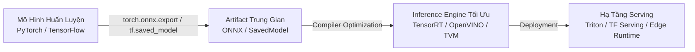

---

## 2. Các Lầm Tưởng Phổ Biến trong Triển Khai ML (ML Deployment Myths)

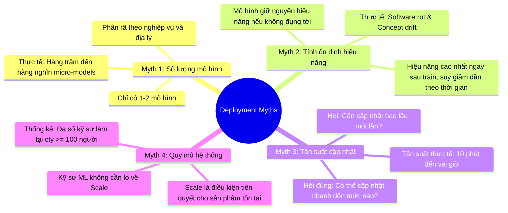

### 2.1. Myth 1: Doanh nghiệp chỉ triển khai 1 hoặc 2 mô hình cùng lúc
- **Lầm tưởng**: Hệ thống ML production chỉ gồm một mô hình đơn lẻ giải quyết một bài toán duy nhất.
- **Thực tế kỹ thuật**: Một ứng dụng thương mại hoàn chỉnh là tập hợp của hàng trăm đến hàng nghìn micro-models phối hợp:
  - **Phân rã theo chức năng (Task Decomposition)**: Một ứng dụng gọi xe như Uber cần các mô hình độc lập cho: Dự báo nhu cầu khách đặt xe, ước tính tài xế khả dụng, tính toán thời gian đến (ETA), định giá động (dynamic pricing), phát hiện gian lận thẻ, dự báo tỷ lệ rời bỏ (customer churn), và xếp hạng tìm kiếm.
  - **Phân rã theo phân khúc (Geographic & Demographic Partitioning)**: Khi mở rộng ra 20 quốc gia, văn hóa giao thông, mật độ đường phố và hành vi khách hàng rất khác biệt. Thay vì dùng một "monolithic model", hệ thống thường chia thành 20 bộ mô hình riêng biệt (20 quốc gia $\times$ 10 tính năng = 200 models).
- **Dữ liệu thực chứng**:
  - **Uber**: Vận hành hàng nghìn mô hình đồng thời trên nền tảng Michelangelo.
  - **Google**: Huấn luyện và phục vụ hàng nghìn mô hình song song với kích thước hàng trăm tỷ tham số.
  - **Booking.com**: Hơn 150 mô hình ML hoạt động đồng thời phục vụ các tính năng đặt phòng.
  - **Algorithmia (2021)**: $41\%$ các doanh nghiệp trên 25,000 nhân viên có trên 100 mô hình đang chạy trong production.

### 2.2. Myth 2: Nếu không can thiệp, hiệu năng mô hình sẽ giữ nguyên theo thời gian
- **Lầm tưởng**: Mô hình sau khi đạt độ chính xác $95\%$ trong tập test sẽ duy trì độ chính xác đó vĩnh viễn trên production nếu code không thay đổi.
- **Thực tế kỹ thuật**:
  - **Software Rot / Bit Rot**: Các phụ thuộc phần mềm, thư viện runtime, định dạng dữ liệu đầu vào biến đổi theo thời gian dẫn đến lỗi tương thích.
  - **Concept Drift & Data Drift**: Dữ liệu ngoài môi trường thực luôn biến động. Phân phối dữ liệu đầu vào $P(X)$ hoặc mối quan hệ giữa đặc trưng và nhãn $P(Y|X)$ thay đổi liên tục so với tập dữ liệu huấn luyện $P_{train}$.
  - **Quy luật suy thoái**: Mô hình ML đạt hiệu năng cao nhất **ngay tại thời điểm hoàn tất huấn luyện** và liên tục suy giảm (decay) kể từ giây phút đầu tiên tiếp xúc với dữ liệu production thực tế.

### 2.3. Myth 3: Không cần phải cập nhật mô hình thường xuyên
- **Lầm tưởng**: Mô hình chỉ cần retrain và cập nhật mỗi tháng một lần hoặc mỗi quý một lần.
- **Thực tế kỹ thuật**:
  - Đặt sai câu hỏi: *"Chúng ta NÊN cập nhật mô hình bao lâu một lần?"* $\rightarrow$ Đặt lại câu hỏi chuẩn kỹ thuật: *"Hạ tầng của chúng ta CÓ THỂ cập nhật mô hình nhanh đến mức nào?" (How often CAN we update our models?)*.
  - Tốc độ suy thoái của mô hình tỷ lệ thuận với tốc độ biến đổi của bài toán nghiệp vụ. Trong các hệ thống bảng tin (recommendation feed), phát hiện gian lận (fraud detection), giá trị của mô hình phụ thuộc chặt chẽ vào độ tươi (freshness).
  - Tần suất thực tế trong ngành:
    - **Etsy**: Triển khai phần mềm ~50 lần/ngày; **Netflix**: Hàng nghìn lần/ngày; **AWS**: Mỗi 11.7 giây.
    - **Weibo / TikTok (ByteDance) / Alibaba**: Chu kỳ cập nhật mô hình phân hạng chỉ từ **10 phút** đến vài chục phút bằng các đường ống học liên tục (continual learning/streaming training).

### 2.4. Myth 4: Kỹ sư Machine Learning không cần bận tâm về bài toán quy mô (Scale)
- **Lầm tưởng**: Bài toán Scale (hàng nghìn QPS, petabytes dữ liệu) chỉ là đặc quyền của các gã khổng lồ công nghệ (Google, Meta, Amazon). Kỹ sư ML bình thường chỉ cần tập trung chỉnh kiến trúc mạng và siêu tham số.
- **Thực tế kỹ thuật**:
  - Khảo sát StackOverflow: Hơn $50\%$ kỹ sư phần mềm và khoa học dữ liệu làm việc tại các công ty có quy mô từ **100 nhân viên trở lên**.
  - Tại quy mô này, một ứng dụng tiêu dùng dễ dàng chạm ngưỡng hàng trăm nghìn người dùng hoạt động hàng ngày (DAU), đòi hỏi phục vụ hàng trăm QPS với độ trễ tính bằng mili-giây.
  - Một mô hình có độ chính xác cao nhưng độ trễ inference 2000ms hoặc sập hệ thống khi traffic tăng đột biến sẽ không bao giờ được phép đưa vào production. Scale là yêu cầu bắt buộc, không phải tính năng tùy chọn.

---

## 3. Batch Prediction vs. Online Prediction

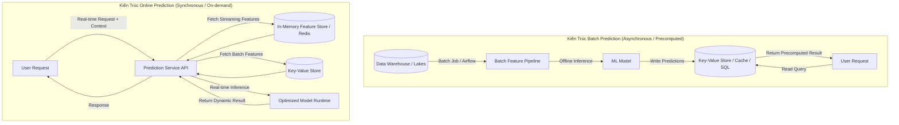

### 3.1. Bản Chất Kỹ Thuật

| Chiều Không Gian So Sánh | Batch Prediction (Asynchronous) | Online Prediction (Synchronous) |
| :--- | :--- | :--- |
| **Bản chất vận hành** | Dự đoán được tính toán trước định kỳ (theo lịch trình cron/orchestrator) và lưu trữ vào cơ sở dữ liệu. | Dự đoán được tính toán tức thời (on-demand) ngay khi có yêu cầu (request) gửi tới endpoint. |
| **Giao thức kết nối** | Offline batch jobs (Spark, SQL queries, Celery tasks). | Synchronous RPC / RESTful API (HTTP, gRPC). |
| **Độ trễ phục vụ (Serving Latency)** | Rất thấp: Thời gian thực hiện một phép tra cứu cơ sở dữ liệu ($O(1)$ key-value lookup, $\approx 2 - 5\text{ms}$). | Phụ thuộc tổng thời gian: Trích xuất đặc trưng + Suy luận mô hình ($\approx 20 - 200\text{ms}$). |
| **Băng thông (Throughput)** | Tối ưu hóa cực đại thông qua xử lý song song phân tán (Vectorization, Distributed Batching). | Bị giới hạn bởi khả năng chịu tải tức thời của runtime engine và tài nguyên GPU/CPU. |
| **Độ tươi của dự đoán (Freshness)** | Thấp: Bị trễ từ vài giờ đến vài ngày (bằng khoảng thời gian giữa hai chu kỳ chạy batch). | Rất cao: Phản ánh ngay lập tức trạng thái và hành vi người dùng tại thời điểm hiện tại. |
| **Không gian truy vấn (Query Space)** | Hữu hạn và biết trước: Phải biết trước tập hợp các khóa định danh (User ID, Item ID) để tính toán trước. | Vô hạn: Xử lý được các truy vấn động, chưa từng xuất hiện (Dynamic/Ad-hoc inputs). |
| **Hiệu quả sử dụng tài nguyên** | Thấp nếu tỷ lệ người dùng hoạt động thấp (lãng phí phần lớn tính toán cho người không truy cập). | Cao: Chỉ tiêu tốn tài nguyên tính toán khi và chỉ khi có yêu cầu thực tế phát sinh. |

### 3.2. Vấn Đề Lãng Phí Tài Nguyên Trong Batch Prediction
- Giả sử một ứng dụng như GrubHub có 31 triệu người dùng đã đăng ký, nhưng trung bình mỗi ngày chỉ có 622,000 người đặt món ($\approx 2\%$ DAU).
- Nếu áp dụng **Batch Prediction** để gợi ý nhà hàng cho toàn bộ người dùng mỗi đêm:
  $$\text{Wasted Compute Ratio} = \frac{31,000,000 - 622,000}{31,000,000} \approx 98\%$$
  $\rightarrow$ Doanh nghiệp phải chi trả $98\%$ chi phí điện toán máy chủ chỉ để tính toán các kết quả không bao giờ được xem tới.
- Trái lại, **Online Prediction** chỉ tính toán cho đúng 622,000 người dùng khi họ mở ứng dụng, tiết kiệm $98\%$ lượng tài nguyên tính toán lãng phí.

### 3.3. Quá Trình Chuyển Dịch từ Batch sang Online
Batch prediction thực chất là một giải pháp tình thế (workaround) trong giai đoạn sơ khai của ML khi năng lực tính toán và thuật toán chưa đủ nhanh để suy luận trong thời gian thực.
Khi chuyển đổi, hệ thống thường đi qua các nấc thang kiến trúc:

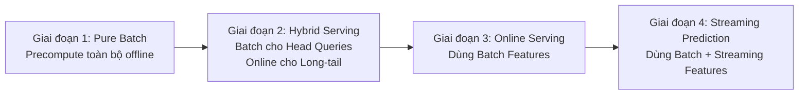

#### Chiến Lược Lai (Hybrid Approach)
1. **Precompute Head Queries (Phần đầu phân phối)**: Tính toán trước dự đoán cho các thực thể phổ biến nhất (Top $10\%$ sản phẩm bán chạy, video thịnh hành) và lưu vào In-Memory Cache (Redis/Memcached).
2. **Compute Online for Long-Tail Queries (Phần đuôi phân phối)**: Với $90\%$ các truy vấn ít phổ biến hoặc người dùng mới, hệ thống kích hoạt mô hình online prediction để sinh kết quả trực tiếp.
3. **Ví dụ thực tế DoorDash & UberEats**:
   - Khuyến nghị danh mục nhà hàng: Dùng **Batch Prediction** tính toán định kỳ 4 tiếng/lần (vì catalog nhà hàng ít biến động trong ngày).
   - Khuyến nghị món ăn cụ thể và dự báo thời gian giao hàng (ETA): Dùng **Online Prediction** (phụ thuộc giỏ hàng hiện tại, tình trạng kẹt xe tức thời và số lượng tài xế khả dụng quanh khu vực).

### 3.4. Streaming Prediction: Kết Hợp Đặc Trưng Thời Gian Thực
Trong mô hình trực tuyến đầy đủ, đặc trưng đầu vào của mô hình được chia thành 2 loại:
1. **Batch Features (Đặc trưng tĩnh/lịch sử)**: Trích xuất từ Data Warehouse / Data Lake (ví dụ: Tỷ lệ hoàn thành đơn của nhà hàng trong 30 ngày qua, điểm đánh giá trung bình).
2. **Streaming Features (Đặc trưng luồng/động)**: Trích xuất từ các Real-time Message Bus như Apache Kafka / AWS Kinesis (ví dụ: Số lượng đơn hàng nhà hàng nhận trong 10 phút qua, vị trí GPS tài xế trong 30 giây gần nhất).

### 3.5. Thống Nhất Batch Pipeline và Streaming Pipeline

#### Nguyên nhân gây lỗi Training-Serving Skew
Trong kiến trúc truyền thống, hai pipeline riêng biệt xử lý dữ liệu:
- **Batch Pipeline (Offline Training)**: Do ML Engineers viết bằng Python/Pandas/Spark để xử lý dữ liệu lịch sử.
- **Streaming Pipeline (Online Inference)**: Do Infrastructure Engineers viết lại bằng Java/Scala/Flink/Go để xử lý luồng dữ liệu thời gian thực.

> [!WARNING] **Bẫy Ngầm Triển Khai (Training-Serving Skew)**
> Việc viết lại logic tiền xử lý đặc trưng trên hai ngôn ngữ và hai hệ thống tính toán khác nhau dẫn đến sai lệch logic số học:
> - Định dạng xử lý Null/NaN khác nhau.
> - Cách tính trung vị (median) trên cửa sổ thời gian (windowing) trôi dạt giữa micro-batch và sliding window.
> - Sai khác múi giờ (Timezone handling) và độ trễ clock skew giữa các node.

#### Giải Pháp Kiến Trúc: Lambda vs. Kappa

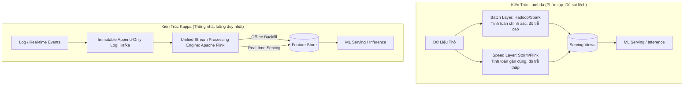

- **Kiến trúc Lambda**: Vận hành song song hai lớp: Batch Layer (chính xác tuyệt đối nhưng trễ) và Speed Layer (nhanh nhưng xấp xỉ). Nhược điểm: Phải duy trì hai cơ sở mã nguồn (codebases) khác nhau, chi phí vận hành gấp đôi và cực kỳ dễ sinh sai lệch đặc trưng.
- **Kiến trúc Kappa**: Loại bỏ hoàn toàn Batch Layer. Toàn bộ dữ liệu được lưu trữ dưới dạng hàng đợi nhật ký bất biến (immutable append-only log, ví dụ Kafka/Pulsar). Sử dụng một **công cụ xử lý luồng duy nhất** (ví dụ **Apache Flink**) cho cả:
  - *Dữ liệu lịch sử*: Đọc tuần tự từ đầu stream (Backfill / Replay).
  - *Dữ liệu thời gian thực*: Đọc tại tail của stream.
  $\rightarrow$ Đảm bảo nguyên tắc: **Một codebase duy nhất cho trích xuất đặc trưng** (Write once, run everywhere).

---

## 4. Kỹ Thuật Nén Mô Hình (Model Compression)

Để chuyển dịch thành công sang Online Prediction và Edge Computing, bài toán cốt tử là giảm độ trễ suy luận (Inference Latency).
Ba trụ cột tối ưu độ trễ:
1. **Tối ưu suy luận (Inference Optimization)**: Sử dụng các runtime chuyên dụng.
2. **Nén mô hình (Model Compression)**: Giảm kích thước vật lý và số lượng tham số của mô hình.
3. **Nâng cấp phần cứng (Hardware Acceleration)**: Chạy trên các chip chuyên dụng (ASIC, GPU, TPU).

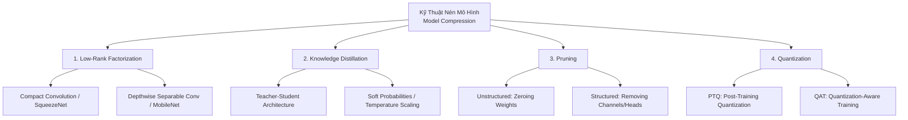

### 4.1. Phân Rã Ma Trận Hạng Thấp (Low-Rank Factorization)

#### Nguyên lý Toán học
Thay thế các tensor tích chập hoặc tensor tuyến tính chiều cao bằng tích của các tensor chiều thấp hơn, khai thác tính dư thừa tham số trong không gian tiềm ẩn (latent subspace).

#### Compact Convolutional Filters: Trường Hợp SqueezeNet
- Thay thế các lớp tích chập chuẩn $3 \times 3$ bằng các lớp tích chập $1 \times 1$ thông qua kiến trúc **Fire Module**:
  - *Squeeze Layer*: Dùng filter $1 \times 1$ để nén số chiều kênh (channel dimension).
  - *Expand Layer*: Trộn giữa filter $1 \times 1$ và $3 \times 3$.
- Kết quả: SqueezeNet đạt độ chính xác tương đương AlexNet trên ImageNet nhưng **giảm 50 lần số lượng tham số** và kích thước file $< 0.5\text{MB}$.

#### Depthwise Separable Convolution: Trường Hợp MobileNets
Một phép tích chập chuẩn nhận đầu vào có kích thước $D_F \times D_F \times C_{in}$, sử dụng $C_{out}$ bộ lọc kích thước $K \times K \times C_{in}$ ($K$ là kích thước kernel).
- Chi phí tính toán chuẩn:
  $$\text{Cost}_{standard} = D_F \cdot D_F \cdot K \cdot K \cdot C_{in} \cdot C_{out} = D_F^2 \cdot K^2 \cdot C_{in} \cdot C_{out}$$
  Số lượng tham số: $K^2 \cdot C_{in} \cdot C_{out}$.

MobileNets phân rã phép tích chập này thành hai bước độc lập:
1. **Depthwise Convolution**: Áp dụng 1 bộ lọc $K \times K \times 1$ riêng biệt cho từng kênh đầu vào ($C_{in}$ kênh).
   $$\text{Cost}_{depthwise} = D_F \cdot D_F \cdot K \cdot K \cdot C_{in} = D_F^2 \cdot K^2 \cdot C_{in}$$
2. **Pointwise Convolution**: Dùng bộ lọc $1 \times 1 \times C_{in} \times C_{out}$ để kết hợp tuyến tính các kênh từ bước trước.
   $$\text{Cost}_{pointwise} = D_F \cdot D_F \cdot 1 \cdot 1 \cdot C_{in} \cdot C_{out} = D_F^2 \cdot C_{in} \cdot C_{out}$$

**Tổng chi phí tính toán mới**:
$$\text{Cost}_{separable} = D_F^2 \cdot K^2 \cdot C_{in} + D_F^2 \cdot C_{in} \cdot C_{out}$$

**Tỷ lệ suy giảm chi phí tính toán và tham số**:
$$\text{Reduction Ratio} = \frac{D_F^2 \cdot K^2 \cdot C_{in} + D_F^2 \cdot C_{in} \cdot C_{out}}{D_F^2 \cdot K^2 \cdot C_{in} \cdot C_{out}} = \frac{1}{C_{out}} + \frac{1}{K^2}$$

Với bộ lọc thông dụng $K = 3$ ($3 \times 3$ conv):
$$\text{Reduction Ratio} \approx \frac{1}{3^2} = \frac{1}{9}$$
$\rightarrow$ Giảm chi phí tính toán và số tham số từ **8 đến 9 lần** với mức độ suy giảm độ chính xác tối thiểu.

- **Đánh giá Trade-off**:
  - *Ưu điểm*: Tăng tốc rõ rệt, tích hợp trực tiếp vào thiết kế kiến trúc.
  - *Nhược điểm*: Phụ thuộc vào kiến trúc mạng cụ thể (chủ yếu là CNN), đòi hỏi chuyên môn sâu về thiết kế mạng nơ-ron, khó áp dụng tổng quát cho mọi bài toán.

---

### 4.2. Chưng Cất Tri Thức (Knowledge Distillation)

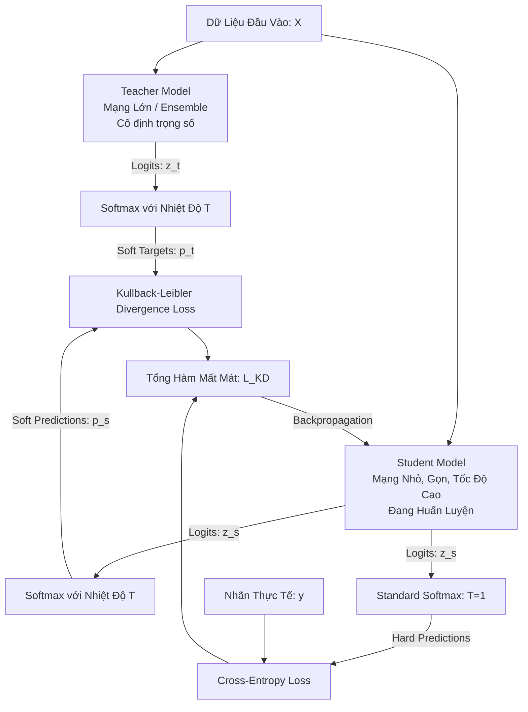

#### Nguyên lý "Dark Knowledge"
Trong huấn luyện thông thường, nhãn mục tiêu là vector one-hot (ví dụ: `[0, 1, 0]`). Cách biểu diễn này triệt tiêu toàn bộ thông tin về độ tương đồng giữa các lớp.
Ví dụ: Một bức ảnh con chó BMW có thể có xác suất dự đoán từ mô hình lớn là: Chó: $0.85$, Mèo: $0.14$, Xe hơi: $0.01$. Tỷ lệ $0.14$ cho Mèo thể hiện thông tin cấu trúc tiềm ẩn ("chó có nhiều đặc điểm hình học giống mèo hơn xe hơi") - đây chính là **Dark Knowledge**.

#### Công thức Toán học
Để khai thác Dark Knowledge, hàm Softmax được điều chỉnh với tham số **Nhiệt độ (Temperature $T$)**:
$$p_i(z, T) = \frac{\exp(z_i / T)}{\sum_j \exp(z_j / T)}$$
- Khi $T = 1$: Trở về Softmax tiêu chuẩn.
- Khi $T > 1$: Phân phối xác suất trở nên "mềm" hơn (softer probability distribution), làm nổi bật xác suất của các lớp có giá trị logit nhỏ.

**Hàm mất mát tổng thể của quá trình chưng cất ($\mathcal{L}_{KD}$)**:
$$\mathcal{L}_{KD} = (1 - \alpha) \mathcal{L}_{CE}(y, \sigma(z_s)) + \alpha T^2 \mathcal{D}_{KL}\left(\sigma\left(\frac{z_t}{T}\right) \,\middle\|\, \sigma\left(\frac{z_s}{T}\right)\right)$$
Trong đó:
- $z_t, z_s$: Vector logits của Teacher và Student.
- $\sigma$: Hàm Softmax.
- $y$: Vector nhãn thực tế (ground truth one-hot).
- $\mathcal{L}_{CE}$: Cross-Entropy Loss tiêu chuẩn giữa nhãn thực và dự đoán của Student ($T=1$).
- $\mathcal{D}_{KL}$: Kullback-Leibler Divergence đo khoảng cách phân phối xác suất giữa Teacher và Student.
- $\alpha \in [0, 1]$: Trọng số cân bằng hai thành phần loss.
- Hệ số $T^2$: Cần thiết để đảm bảo độ lớn của gradient sinh ra từ $\mathcal{D}_{KL}$ không bị suy giảm theo hệ số $1/T^2$ khi lấy đạo hàm theo logit $z_s$.

#### Điển hình Công Nghiệp: DistilBERT
- **Teacher**: $\text{BERT-base}$ (110M tham số).
- **Student**: $\text{DistilBERT}$ (66M tham số, giảm số lớp Transformer từ 12 xuống 6).
- **Kết quả**: Giảm $40\%$ số lượng tham số, tăng tốc độ suy luận lên **$60\%$**, trong khi bảo lưu tới **$97\%$** năng lực hiểu ngôn ngữ tự nhiên trên benchmark GLUE.

#### Đánh giá Trade-off
- *Ưu điểm*: Độc lập với kiến trúc mô hình (Teacher có thể là Transformer, Student có thể là ResNet hoặc MLP).
- *Nhược điểm*: Phụ thuộc vào việc có sẵn Teacher model chất lượng cao. Nếu phải huấn luyện Teacher từ đầu, chi phí tính toán và thời gian sẽ tăng gấp đôi.

---

### 4.3. Cắt Tỉa (Pruning)

#### Cắt Tỉa Phi Cấu Trúc (Unstructured Pruning) vs. Có Cấu Trúc (Structured Pruning)

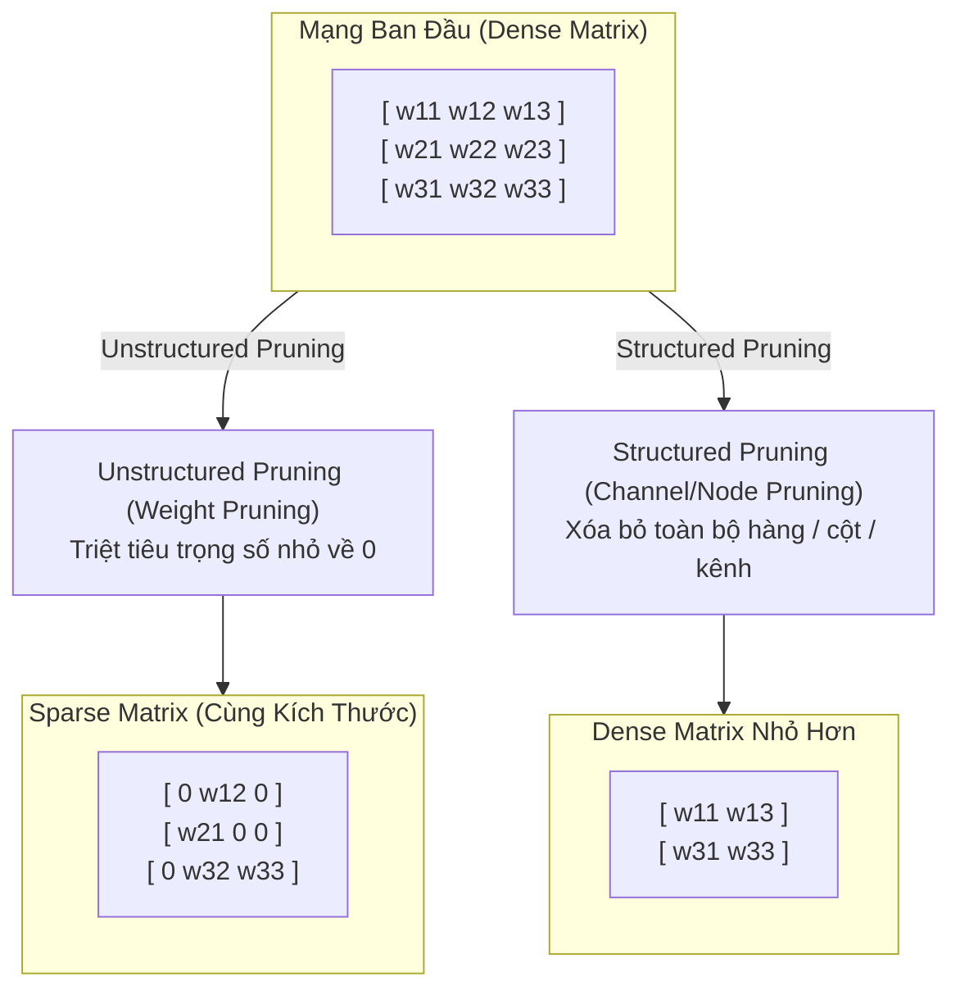

| Tiêu Chí Kỹ Thuật | Unstructured Pruning (Phi cấu trúc) | Structured Pruning (Có cấu trúc) |
| :--- | :--- | :--- |
| **Cơ chế thực hiện** | Tìm các trọng số riêng lẻ có giá trị tuyệt đối nhỏ ($|w| < \epsilon$) và gán bằng $0$. | Xóa bỏ toàn bộ các đơn vị cấu trúc: nơ-ron, hàng ma trận, bộ lọc (channels), hoặc attention heads. |
| **Kích thước ma trận** | Giữ nguyên kích thước ban đầu ($M \times N$). Ma trận trở thành dạng thưa (Sparse). | Kích thước ma trận bị thu nhỏ thực sự ($M' \times N'$, trong đó $M' < M, N' < N$). |
| **Dung lượng lưu trữ** | Giảm đáng kể trên đĩa khi nén dưới dạng Compressed Sparse Row (CSR/CSC) hoặc ZIP. | Giảm trực tiếp dung lượng bộ nhớ vật lý mà không cần định dạng lưu trữ thưa. |
| **Tăng tốc trên phần cứng tiêu chuẩn** | **Hầu như không tăng tốc** trên CPU/GPU thông thường trừ khi độ thưa cực cao ($>90\%$) hoặc có phần cứng hỗ trợ chuyên biệt (NVIDIA Ampere Sparse Tensor Cores). | **Tăng tốc tức thì** trên mọi phần cứng (CPU, GPU tiêu chuẩn) vì ma trận sau cắt tỉa vẫn là Dense. |
| **Tác động tới độ chính xác** | Ít làm suy giảm độ chính xác hơn ở cùng tỷ lệ phần trăm tham số bị loại bỏ. | Dễ làm tụt độ chính xác hơn, đòi hỏi fine-tuning kỹ lưỡng sau khi cắt tỉa. |

#### Giả Thuyết Vé Số Trúng Thưởng (The Lottery Ticket Hypothesis)
Frankle & Carbin (ICLR 2019) chứng minh rằng:
> Trong một mạng nơ-ron ngẫu nhiên dày đặc, luôn tồn tại một mạng con thưa (subnetwork - "winning ticket") mà khi được huấn luyện độc lập từ giá trị khởi tạo ban đầu, có thể đạt độ chính xác tương đương mạng ban đầu với số epoch huấn luyện tương đương.

Tuy nhiên, việc tìm kiếm "winning ticket" này đòi hỏi thuật toán **Iterative Magnitude Pruning (IMP)** tốn kém:
1. Huấn luyện mạng dense đến hội tụ.
2. Cắt tỉa $p\%$ trọng số nhỏ nhất.
3. Reset trọng số còn lại về **đúng giá trị khởi tạo ban đầu ($W_0$)**.
4. Lặp lại chu trình nhiều lần.

---

### 4.4. Lượng Tử Hóa (Quantization)

Lượng tử hóa là phương pháp nén mô hình hiệu quả, phổ biến và có tính tổng quát cao nhất trong công nghiệp.

#### Biểu Diễn Số Học và Chi Phí Bộ Nhớ
- **FP32 (Single Precision)**: 1 bit dấu, 8 bits mũ (exponent), 23 bits định trị (mantissa). Chiếm 4 bytes/tham số.
- **FP16 (Half Precision)**: 1 bit dấu, 5 bits mũ, 10 bits định trị. Chiếm 2 bytes/tham số.
- **BF16 (Bfloat16 - Brain Floating Point)**: 1 bit dấu, 8 bits mũ, 7 bits định trị (giữ nguyên dải động như FP32 nhưng giảm độ chính xác số lẻ).
- **INT8 (8-bit Integer)**: Dạng số nguyên có dấu $[-128, 127]$ hoặc không dấu $[0, 255]$. Chiếm 1 byte/tham số.

```
Kích thước mô hình 100M tham số:
- Ở chuẩn FP32: 100M x 4 bytes = 400 MB
- Ở chuẩn FP16: 100M x 2 bytes = 200 MB (Giảm 2x)
- Ở chuẩn INT8: 100M x 1 byte  = 100 MB (Giảm 4x)
```

#### Công Thức Lượng Tử Hóa Đồng Nhất (Uniform Affine Quantization)
Chuyển đổi số thực $r \in [\alpha, \beta]$ (dải giá trị thực của trọng số hoặc activation) sang số nguyên lượng tử $q \in [q_{min}, q_{max}]$ (ví dụ $[-128, 127]$ với INT8 có dấu):

$$q = \text{round}\left(\frac{r}{S}\right) + Z$$

Trong đó:
- **Scale Factor ($S$)**: Tỷ lệ co giãn biểu diễn bước nhảy của mỗi đơn vị lượng tử (là số thực FP32):
  $$S = \frac{\beta - \alpha}{q_{max} - q_{min}}$$
- **Zero-Point ($Z$)**: Giá trị nguyên đại diện cho số thực $0.0$ trong không gian lượng tử (đảm bảo giá trị $0.0$ thực tế được ánh xạ chính xác không có sai số):
  $$Z = \text{round}\left(-\frac{\alpha}{S}\right) + q_{min}$$

**Phép khôi phục (Dequantization)**:
$$r \approx \hat{r} = S \cdot (q - Z)$$

#### Post-Training Quantization (PTQ) vs. Quantization-Aware Training (QAT)

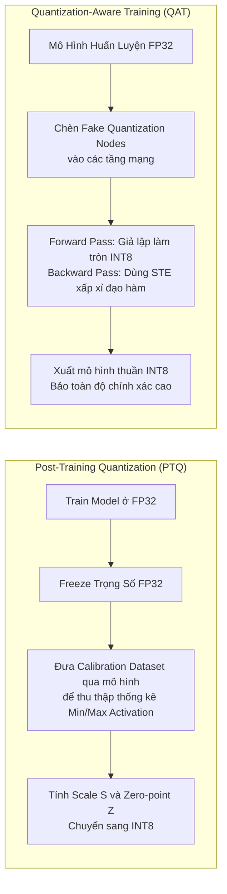

1. **Post-Training Quantization (PTQ)**:
   - Mô hình được huấn luyện hoàn chỉnh ở định dạng FP32. Sau đó, trọng số và activations được lượng tử hóa trực tiếp sang INT8.
   - Để xác định dải động $[\alpha, \beta]$ của activations, cần một tập dữ liệu nhỏ gọi là **Calibration Dataset** chạy qua mô hình để lấy thống kê phân phối.
   - *Ưu điểm*: Cực kỳ nhanh, không cần huấn luyện lại, được hỗ trợ sẵn bởi TensorFlow Lite, TensorRT, ONNX Runtime.
   - *Nhược điểm*: Có thể làm tụt giảm độ chính xác rõ rệt với các mô hình nhạy cảm hoặc dải kích hoạt rộng.

2. **Quantization-Aware Training (QAT)**:
   - Đưa nhiễu lượng tử hóa vào ngay trong quá trình huấn luyện hoặc fine-tuning.
   - **Forward Pass**: Sử dụng các node lượng tử hóa giả định (**Fake Quantization Nodes**). Giá trị số thực được làm tròn về các bước rời rạc tương đương INT8, giúp mô hình học cách thích ứng với sai số làm tròn.
   - **Backward Pass**: Do phép làm tròn `round(x)` có đạo hàm bằng 0 ở khắp mọi nơi (triệt tiêu gradient), QAT sử dụng kỹ thuật **Straight-Through Estimator (STE)**:
     $$\frac{\partial \text{round}(x)}{\partial x} \approx 1$$
   - *Ưu điểm*: Giữ nguyên độ chính xác tương đương FP32 ngay cả khi lượng tử hóa xuống INT8 hoặc INT4.
   - *Nhược điểm*: Đòi hỏi thời gian huấn luyện lại và hạ tầng hỗ trợ QAT phức tạp hơn.

#### Nghiên Cứu Điển Hình: Roblox BERT Scaling trên CPU
- **Bài toán**: Roblox cần phục vụ các tác vụ NLP với hơn **1 tỷ yêu cầu mỗi ngày**, đòi hỏi băng thông xử lý $> 25,000\text{ inferences/s}$ với độ trễ mỗi truy vấn $< 20\text{ms}$ chạy hoàn toàn trên hạ tầng CPU (để tối ưu chi phí).
- **Lộ trình tối ưu**:
  1. Thay thế mô hình $\text{BERT-base}$ bằng $\text{DistilBERT}$ (giảm độ trễ ban đầu).
  2. Chuyển đổi định dạng tensor đầu vào từ cố định (fixed shape: pad độ dài 128) sang **dynamic shape** (độ dài theo đúng kích thước câu thực tế).
  3. Áp dụng **Lượng tử hóa INT8 (8-bit quantization)**.
- **Kết quả**:
  - Chuyển đổi từ FP32 sang INT8 mang lại bước nhảy vọt lớn nhất: **Giảm 7 lần độ trễ** và **tăng 8 lần throughput**.
  - Cho phép Roblox đáp ứng toàn bộ SLA khắt khe trên cụm máy chủ CPU giá rẻ mà không cần đầu tư dàn GPU đắt đỏ.

---

## 5. ML trên Cloud vs. ML trên Edge

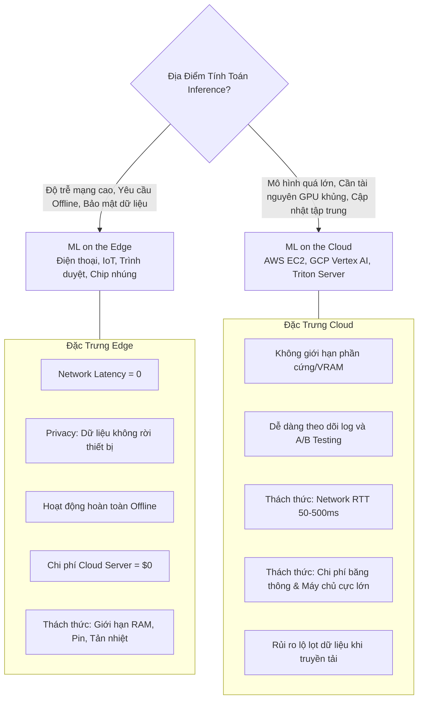

### 5.1. Bảng Phân Tích Trade-Offs Kỹ Thuật

| Chiều Đo Lường | Cloud Computing (Điện Toán Đám Mây) | Edge Computing (Điện Toán Biên) |
| :--- | :--- | :--- |
| **Độ trễ mạng (Network Latency)** | Phụ thuộc đường truyền Internet: Thường mất từ $50\text{ms} - 1000\text{ms}$ chỉ riêng cho thời gian truyền tải gói tin (Network Round-Trip Time - RTT). Thường là nút thắt cổ chai lớn nhất. | **Bằng 0**: Dữ liệu được xử lý trực tiếp tại bộ nhớ cục bộ của thiết bị. |
| **Khả năng hoạt động ngoại tuyến** | **Không thể**: Mất kết nối mạng đồng nghĩa với việc ứng dụng ngừng hoạt động hoàn toàn. | **Hoàn hảo**: Vận hành trơn tru tại vùng sâu vùng xa, trên máy bay hoặc các cơ sở có chính sách cấm kết nối mạng (Air-gapped security). |
| **Bảo mật và Quyền riêng tư (Privacy)** | Dữ liệu cá nhân nhạy cảm (khuôn mặt, giọng nói, vị trí) phải gửi qua mạng internet tới máy chủ tập trung. Dễ bị tấn công trung gian (man-in-the-middle) và chịu ràng buộc khắt khe từ GDPR/HIPAA. | Dữ liệu không bao giờ rời khỏi thiết bị người dùng. Giảm thiểu triệt để rủi ro rò rỉ dữ liệu diện rộng. |
| **Chi phí vận hành hạ tầng** | Tỷ lệ thuận với số lượng người dùng: Hàng chục triệu USD mỗi năm cho chi phí thuê server GPU/CPU và băng thông mạng (Egress bandwidth). | Chi phí máy chủ bằng $0$: Tận dụng năng lực tính toán phân tán miễn phí từ chip của người dùng. |
| **Ràng buộc tài nguyên thiết bị** | Gần như không giới hạn: Dễ dàng mở rộng ngang (Horizontal Scaling) với các cụm GPU H100/A100 nhiều Terabytes VRAM. | Cực kỳ khắt khe: Bị giới hạn bởi dung lượng RAM thiết bị, tuổi thọ pin, nhiệt lượng tỏa ra và năng lực xử lý của SoC. |

### 5.2. Vấn Đề $M \times N$ và Biên Dịch Cho Thiết Bị Biên (Compilers & IR)

#### Thách thức kỹ thuật: Bài toán $M \times N$
- Sự bùng nổ của $M$ frameworks phát triển mô hình (PyTorch, TensorFlow, JAX, Scikit-learn).
- Sự đa dạng của $N$ kiến trúc phần cứng đích (Intel x86 CPU, ARM Cortex, NVIDIA GPU, Apple Neural Engine, Qualcomm NPU, Google Edge TPU, FPGAs, ASICs).
- Nếu không có giải pháp trung gian, cộng đồng kỹ sư cần viết:
  $$\text{Số lượng cầu nối} = M \times N$$
  mã nguồn tương thích độc lập $\rightarrow$ Bế tắc kỹ thuật và lãng phí nhân lực khổng lồ.

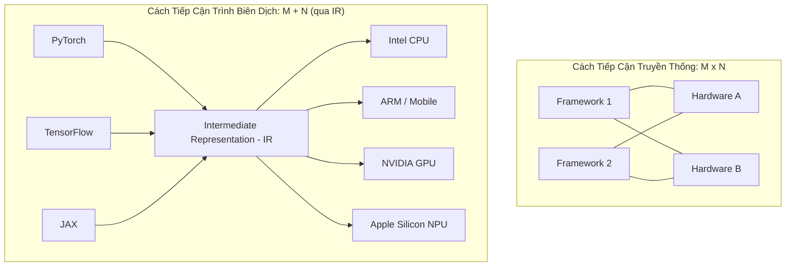

#### Intermediate Representation (IR) và Cơ Chế Hạ Cấp (Lowering)
- **Intermediate Representation (IR)** đóng vai trò ngôn ngữ trung gian trừu tượng hóa:
  - **High-Level IR (Computation Graph)**: Biểu diễn đồ thị có hướng (DAG) của mô hình. Tại tầng này, trình biên dịch nắm được ngữ nghĩa của toán tử (ví dụ: tầng Convolution nối với BatchNorm và ReLU) để thực hiện tối ưu hóa cấu trúc đồ thị.
  - **Low-Level IR**: Biểu diễn gần sát phần cứng, quản lý chi tiết về bố cục bộ nhớ (memory layout), thanh ghi (registers), và các vòng lặp tính toán (ví dụ LLVM IR, TVM TIR).
- **Quá trình Lowering (Hạ cấp mã nguồn)**: Trình biên dịch chuyển đổi từng bước từ High-level IR $\rightarrow$ Low-level IR $\rightarrow$ Mã máy nhị phân (Machine code) tương thích tối ưu cho chip đích.

### 5.3. Các Kỹ Thuật Tối Ưu Hóa Mô Hình Của Trình Biên Dịch

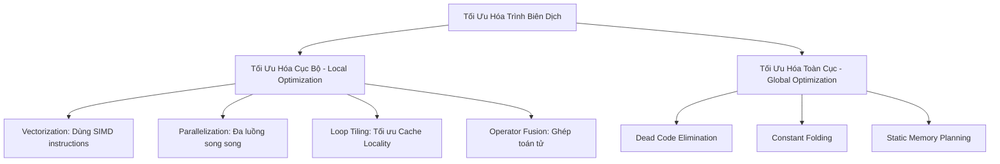

1. **Vectorization (Vector hóa)**:
   Thay vì chạy vòng lặp tuần tự từng phần tử scalar, trình biên dịch tận dụng các tập lệnh phần cứng SIMD (Single Instruction, Multiple Data - ví dụ Intel AVX-512, ARM Neon) để xử lý đồng thời 4, 8, hoặc 16 phần tử float liền kề trong bộ nhớ trong một chu kỳ xung nhịp.
2. **Parallelization (Song song hóa)**:
   Phân chia các mảng nhiều chiều thành các khối độc lập (work chunks) và phân phối cho nhiều lõi CPU/GPU tính toán song song.
3. **Loop Tiling (Lát vòng lặp)**:
   Tái sắp xếp thứ tự truy cập dữ liệu trong các vòng lặp lồng nhau thành các khối nhỏ (tiles) vừa khít với kích thước bộ nhớ đệm L1/L2/L3 Cache. Giúp tái sử dụng dữ liệu trong cache tối đa và hạn chế tình trạng trễ đọc dữ liệu từ bộ nhớ chính DRAM (**Cache Miss Penalty**).
4. **Operator Fusion (Hợp nhất toán tử)**:
   - Kỹ thuật tối ưu hóa mang lại hiệu quả cao nhất.
   - *Vấn đề khi chưa fuse*: Toán tử Conv tính xong ghi kết quả ra DRAM; Toán tử Bias đọc từ DRAM về tính rồi lại ghi ra DRAM; Toán tử ReLU đọc lại từ DRAM. Chi phí truyền tải qua băng thông bộ nhớ (Memory Bandwidth Bottleneck) lấn át thời gian tính toán thực tế của chip.
   - *Sau khi fuse (Fused Kernel CBR)*: Conv + Bias + ReLU được gộp thành một hàm tính toán duy nhất. Dữ liệu trung gian được giữ nguyên trên các thanh ghi (registers) của chip, triệt tiêu hoàn toàn các lượt truy xuất DRAM dư thừa.

### 5.4. Tối Ưu Hóa Tự Động Bằng Machine Learning (AutoTVM & Ansor)
- **Hạn chế của Heuristics thủ công**: Trước đây, các hãng chip phải thuê đội ngũ kỹ sư tối ưu hóa (optimization engineers) giàu kinh nghiệm viết các luật thủ công (handcrafted heuristics) cho từng mô hình trên từng đời chip (ví dụ tối ưu ResNet-50 cho DGX A100). Cách làm này không tối ưu tuyệt đối và không thích ứng kịp với tốc độ ra đời của các kiến trúc mạng mới.
- **Giải pháp ML-Powered Compiler (AutoTVM / Apache TVM)**:
  1. Trình biên dịch phân rã đồ thị tính toán thành hàng trăm đồ thị con (subgraphs).
  2. Không gian cấu hình thực thi (search space - cách unroll loop, tile size, thread binding) có độ phức tạp tổ hợp khổng lồ.
  3. TVM sử dụng một **Cost Model học máy** (thường là Gradient Boosted Trees hoặc Tree-GRU) để dự đoán thời gian chạy của một phương án cấu hình mà không cần chạy thử toàn bộ.
  4. Thực hiện thử nghiệm trên phần cứng thật cho các cấu hình hứa hẹn nhất để lấy nhãn thời gian thực (ground truth), sau đó cập nhật ngược lại Cost Model.
  5. Sau vài chục đến vài trăm vòng lặp thử nghiệm, AutoTVM tìm ra phương án tối ưu vượt trội so với các thư viện viết tay của nhà sản xuất (nhanh hơn cả cuDNN trên một số tác vụ chuyên biệt).

### 5.5. Máy Học Trong Trình Duyệt Web (ML in Browsers)
Triển khai mô hình chạy trực tiếp trên trình duyệt mang lại khả năng phân phối phổ quát: Ứng dụng chạy được trên mọi thiết bị có trình duyệt web (Windows, Mac, iPhone, Android, Linux) mà không cần cài đặt phần mềm.

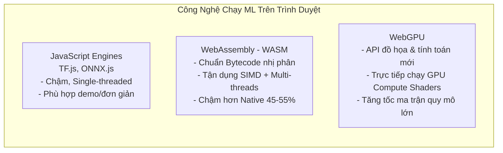

1. **JavaScript Engines (TensorFlow.js, ONNX.js)**:
   - Dễ tích hợp nhưng hiệu năng kém nhất.
   - Hạn chế: Cơ chế quản lý bộ nhớ tự động (Garbage Collection) gây hiện tượng giật khung hình; mô hình chạy đơn luồng (single-thread), khả năng tối ưu tính toán vector hạn chế.
2. **WebAssembly (WASM)**:
   - Định dạng mã nhị phân cấp thấp chạy trong môi trường sandbox của trình duyệt với tốc độ tiệm cận mã máy gốc.
   - Cho phép biên dịch mã nguồn C++/Rust/Go chứa logic tiền xử lý và inference engine của mô hình trực tiếp sang file `.wasm`.
   - Được hỗ trợ bởi $> 93\%$ thiết bị trên toàn cầu. Hỗ trợ SIMD và đa luồng thông qua Web Workers.
   - *Hiệu năng*: Các nghiên cứu đo đạc cho thấy WASM chỉ chạy chậm hơn mã máy gốc (native native C++) trung bình khoảng **$45\% - 55\%$**.
3. **WebGPU**:
   - Tiêu chuẩn web mới thay thế WebGL, cung cấp quyền truy cập trực tiếp ở mức thấp vào năng lực tính toán của GPU thông qua **Compute Shaders**.
   - Cho phép thực hiện các phép nhân ma trận song song khổng lồ của mô hình Deep Learning/LLM ngay trong tab trình duyệt với tốc độ vượt trội so với WebGL và WASM.

---

## 6. Chiến Lược Triển Khai và Vận Hành Thực Tế (Deployment Strategies & Operational Checklist)

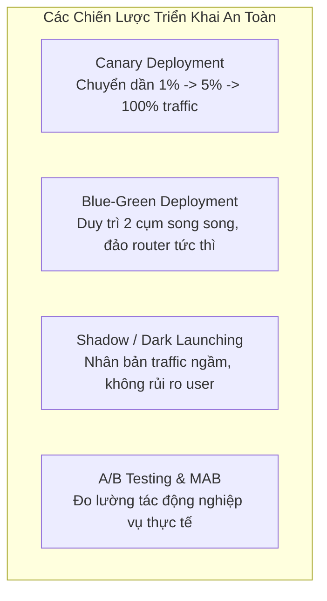

### 6.1. Chi Tiết Các Chiến Lược Triển Khai (Deployment Strategies)

#### 1. Canary Deployment
- **Cơ chế**: Định tuyến một tỷ lệ phần trăm traffic rất nhỏ (ví dụ $1\% - 2\%$) của người dùng thật sang mô hình mới (Canary version), trong khi $98\%$ traffic còn lại vẫn đi qua mô hình hiện tại (Stable version).
- **Quy trình scale**: Nếu sau một khoảng thời gian giám sát (vài giờ hoặc vài ngày), các chỉ số kỹ thuật (latency, error rate) và chỉ số nghiệp vụ (click-through rate, conversion) ổn định, tăng dần lưu lượng: $1\% \rightarrow 5\% \rightarrow 25\% \rightarrow 100\%$.
- **Lợi ích**: Giới hạn tối đa phạm vi ảnh hưởng (blast radius) nếu mô hình mới gặp lỗi nghiêm trọng ngầm.

#### 2. Blue-Green Deployment
- **Cơ chế**: Vận hành đồng thời hai cụm môi trường sản xuất có cấu hình y hệt nhau:
  - Cụm **Blue**: Đang chạy mô hình cũ và xử lý $100\%$ production traffic.
  - Cụm **Green**: Đang chứa mô hình mới vừa được deploy, đã hoàn tất kiểm thử nội bộ.
- **Chuyển giao**: Sử dụng Load Balancer hoặc API Gateway để đảo chiều toàn bộ traffic từ Blue sang Green tức thì.
- **Lợi ích**: Thời gian downtime bằng $0$. Nếu phát sinh sự cố, có thể **Rollback tức thời** chỉ bằng thao tác gạt router chuyển ngược traffic về Blue trong vài giây.

#### 3. Shadow Deployment (Dark Launching)
- **Cơ chế**: Traffic của người dùng gửi tới hệ thống sẽ được nhân bản (traffic shadowing/mirroring).
  - Yêu cầu vẫn được gửi tới mô hình hiện tại để tính toán và trả kết quả về cho người dùng bình thường.
  - Đồng thời, một bản sao của yêu cầu được gửi ngầm tới mô hình mới (Shadow model). Kết quả dự đoán của Shadow model được ghi vào log để phân tích, đối soát offline chứ không gửi cho người dùng.
- **Lợi ích**: **Rủi ro người dùng bằng 0**. Cho phép kiểm tra độ ổn định, độ trễ và độ chính xác của mô hình mới dưới áp lực tải thật $100\%$ trước khi chính thức phục vụ.
- **Hạn chế**: Chi phí hạ tầng tăng gấp đôi do phải chạy song song hai cụm tính toán.

#### 4. A/B Testing và Multi-Armed Bandits (MAB)
- **A/B Testing**: Chia ngẫu nhiên người dùng thành hai nhóm $A$ và $B$ để đo lường sự khác biệt về chỉ số nghiệp vụ (ví dụ doanh thu, thời gian xem video). Mang tính tĩnh và cần đủ kích thước mẫu (sample size) để đạt ý nghĩa thống kê (statistical significance).
- **Multi-Armed Bandits (MAB)**: Thuật toán thích ứng động (Dynamic adaptive routing) dựa trên nguyên lý cân bằng giữa Khai phá (Exploration) và Khai thác (Exploitation). Thuật toán tự động chuyển dần traffic sang phiên bản mô hình đem lại kết quả tốt nhất theo thời gian thực, giảm thiểu tổn thất doanh thu do phục vụ mô hình kém hiệu quả.

---

### 6.2. Bảng Kiểm Tra Sẵn Sàng Vận Hành (Production Deployment Checklist)

| Hạng Mục Kiểm Tra | Nội Dung Kỹ Thuật Chi Tiết | Tiêu Chuẩn Nghiệm Thu |
| :--- | :--- | :--- |
| **1. Baseline Performance** | Đo đạc độ trễ tại các phân vị: $P_{50}, P_{95}, P_{99}$ và Throughput cực đại (QPS) dưới tải giả lập (Load Testing). | $P_{99} \le \text{SLA}$ thỏa thuận; không rò rỉ bộ nhớ (Memory Leaks) sau 24h chạy liên tục. |
| **2. Fallback Mechanism** | Kịch bản xử lý khi Inference Service bị sập, timeout, hoặc input bất thường. | Tự động trả về kết quả dự phòng: Rule-based heuristics, giá trị mặc định an toàn, hoặc kết quả cache gần nhất. |
| **3. Schema Validation** | Kiểm định tính toàn vẹn của payload đầu vào (kiểu dữ liệu, kích thước tensor, khoảng giá trị). | Chặn đứng các payload sai định dạng tại API Gateway; có bộ quy tắc điền khuyết (Imputation) cho missing features. |
| **4. Telemetry & Audit Log** | Ghi log bất đồng bộ (Asynchronous Logging) cặp đôi: `(Request_ID, Input_Features, Model_Version, Prediction, Latency)`. | Ghi log vào Data Stream mà không làm tăng độ trễ serving của luồng chính; đảm bảo ẩn danh hóa thông tin PII. |
| **5. Rollback Automation** | Kịch bản tự động lùi phiên bản (Automated Rollback Trigger). | Hệ thống tự động chuyển traffic về phiên bản trước nếu tỷ lệ lỗi HTTP 5xx vượt quá $1\%$ trong 3 phút. |
| **6. Skew Detection Hooks** | Cơ chế so sánh phân phối đặc trưng phục vụ thực tế (serving distribution) với phân phối tập huấn luyện. | Tích hợp công cụ giám sát drift (ví dụ Evidently AI, Great Expectations) để cảnh báo suy giảm chất lượng dữ liệu. |

---

## 7. Tổng Kết Kiến Trúc & Xu Hướng Tương Lai

1. **Từ Batch sang Streaming**: Batch prediction là tàn dư của thời kỳ hạ tầng dữ liệu cũ. Tương lai của ML phục vụ người dùng là **Online Prediction** được nuôi dưỡng bởi hạ tầng luồng thời gian thực (Streaming Pipelines / Kappa Architecture) với các công cụ như Apache Flink và Feature Store.
2. **Nén mô hình là điều kiện tiên quyết**: Nén mô hình (Quantization INT8, Knowledge Distillation, Pruning, Compact Convolutions) không chỉ để nhét mô hình vào chip biên mà còn là phương pháp then chốt để cắt giảm $70\% - 90\%$ chi phí máy chủ đám mây và đưa độ trễ về dưới $20\text{ms}$.
3. **Sự trỗi dậy của ML trên Edge**: Sự kết hợp giữa các trình biên dịch tối ưu tự động (Apache TVM, TensorRT) và các tiêu chuẩn web thế hệ mới (WASM, WebGPU) đang đưa năng lực suy luận trực tiếp lên hàng tỷ thiết bị biên, giúp bảo toàn tính riêng tư tuyệt đối, loại bỏ độ trễ mạng và giảm gánh nặng hóa đơn điện toán đám mây cho doanh nghiệp.
