# Chương 7: Nguyên Nhân Khiến Hệ Thống Machine Learning Thất Bại Trong Production (Why ML Systems Fail in Production)

> **Bản Tinh Gọn Kỹ Thuật Chuyên Sâu (Distilled Master Notes)**
> Dành cho Senior ML Systems Architects, Tech Leads và MLOps Engineers.
> Bảo tồn 100% bản chất toán học, kiểm định thống kê, phân tích trade-off và cơ chế chống sập hệ thống ML trong thực tế.

---

## 1. Bản Chất Của Thất Bại Trong Hệ Thống ML: Software vs. ML-Specific Failures

Hệ thống Machine Learning (ML) được định nghĩa là **thất bại (failure)** khi nó vi phạm ít nhất một trong các kỳ vọng thiết kế. Trong khi phần mềm truyền thống chủ yếu tập trung vào các kỳ vọng vận hành, hệ thống ML đòi hỏi sự đáp ứng đồng thời ở cả hai khía cạnh: **Kỳ vọng Vận hành (Operational Expectations)** và **Kỳ vọng Hiệu năng ML (ML Performance Expectations)**.

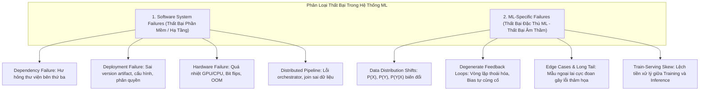

### 1.1. So Sánh Hai Mô Thức Thất Bại

| Tiêu Chí Đánh Giá | Software System Failures (Hạ Tầng / Phần Mềm) | ML-Specific Failures (Đặc Thù Học Máy) |
| :--- | :--- | :--- |
| **Bản chất lỗi** | Lỗi logic mã nguồn, hạ tầng mạng, bộ nhớ, phân quyền, tiến trình phân tán. | Suy giảm chất lượng dự đoán do dữ liệu biến động hoặc vòng lặp phản hồi tiêu cực. |
| **Cơ chế biểu hiện** | **Ồn ào (Loud / Explicit Failures)**: Crash tiến trình, trả về mã lỗi HTTP 500, Segmentation fault, Timeout, OOM. | **Âm thầm (Silent Failures)**: HTTP 200 OK, độ trễ đạt chuẩn (<50ms), nhưng giá trị dự đoán sai lệch hoàn toàn so với thực tế. |
| **Độ phức tạp phát hiện** | Dễ phát hiện ngay lập tức qua telemetry chuẩn (APM, Prometheus, Grafana, ELK stack). | Khó phát hiện; phụ thuộc vào độ trễ của nhãn thực tế (ground truth delay) và các kiểm định thống kê phân phối. |
| **Kỹ năng khắc phục** | Kỹ nghệ phần mềm truyền thống (Software Engineering, SRE, DevOps). | Khoa học dữ liệu, Thống kê toán, MLOps, Thiết kế thuật toán học liên tục (Continual Learning). |

### 1.2. Phát Hiện Thực Nghiệm Từ Google Về Nguyên Nhân Gây Sự Cố ML
Nghiên cứu của Daniel Papasian và Todd Underwood (Google, 2020) khi khảo sát **96 sự cố nghiêm trọng của các pipeline ML lớn tại Google trong suốt 15 năm**:
* **62.5% (60/96 sự cố)** bắt nguồn từ lỗi hệ thống phần mềm và hạ tầng truyền thống, hoàn toàn không liên quan trực tiếp đến thuật toán ML.
* Hai nguồn gốc lỗi hạ tầng lớn nhất:
  1. **Hệ thống phân tán (Distributed Systems)**: Scheduler/Orchestrator bị nghẽn, race conditions giữa các worker, deadlocks.
  2. **Pipeline dữ liệu (Data Pipeline)**: Lỗi join dữ liệu không đồng nhất giữa nhiều nguồn, lỗi ép kiểu dữ liệu ngầm định (type casting), lỗi định dạng cấu trúc dữ liệu.
* **Quy luật sản xuất**: Đa số công việc của một Kỹ sư Machine Learning trong thực tế là Kỹ nghệ Phần mềm (*The majority of ML engineering is software engineering*). Tuy nhiên, các lỗi đặc thù ML (ML-specific failures) nguy hiểm hơn vì tính chất **thất bại âm thầm (silent failures)**, có thể gây thiệt hại tài chính và uy tín thương hiệu kéo dài hàng tháng trước khi bị phát hiện.

---

## 2. Nhãn Tự Nhiên Và Vòng Lặp Phản Hồi (Natural Labels & Feedback Loops)

### 2.1. Bản Chất Của Nhãn Tự Nhiên (Natural Ground Truth Labels)
Một tác vụ sở hữu **Nhãn Tự Nhiên (Natural Labels)** khi các dự đoán của mô hình có thể được hệ thống tự động hoặc bán tự động đối chiếu, đánh giá trực tiếp dựa trên hành vi tiếp theo của người dùng hoặc phản hồi từ môi trường.

* **Ví dụ điển hình**:
  * *Google Maps ETA*: Thời gian dự kiến đến (Estimated Time of Arrival - ETA) được đối chiếu tự động khi chuyến đi kết thúc (thời gian thực tế của hành trình).
  * *Recommender Systems*: Gợi ý video/sản phẩm được đánh giá qua hành động click, xem hết (watch time) hoặc mua hàng.
  * *Facebook Newsfeed Ranking*: Được gián tiếp gán nhãn qua tương tác like, share, comment.
  * *Google Translate*: Thu thập nhãn bán tự động qua cơ chế cho phép cộng đồng đề xuất bản dịch hiệu chỉnh (alternative translation).

### 2.2. Chiều Dài Vòng Lặp Phản Hồi (Feedback Loop Length)
**Độ dài vòng lặp phản hồi** là khoảng thời gian tính từ thời điểm mô hình đưa ra dự đoán và phục vụ người dùng ($t_{\text{serve}}$) cho đến thời điểm hệ thống thu nhận được nhãn thực tế ($t_{\text{ground\_truth}}$):

$$\Delta t_{\text{feedback}} = t_{\text{ground\_truth}} - t_{\text{serve}}$$

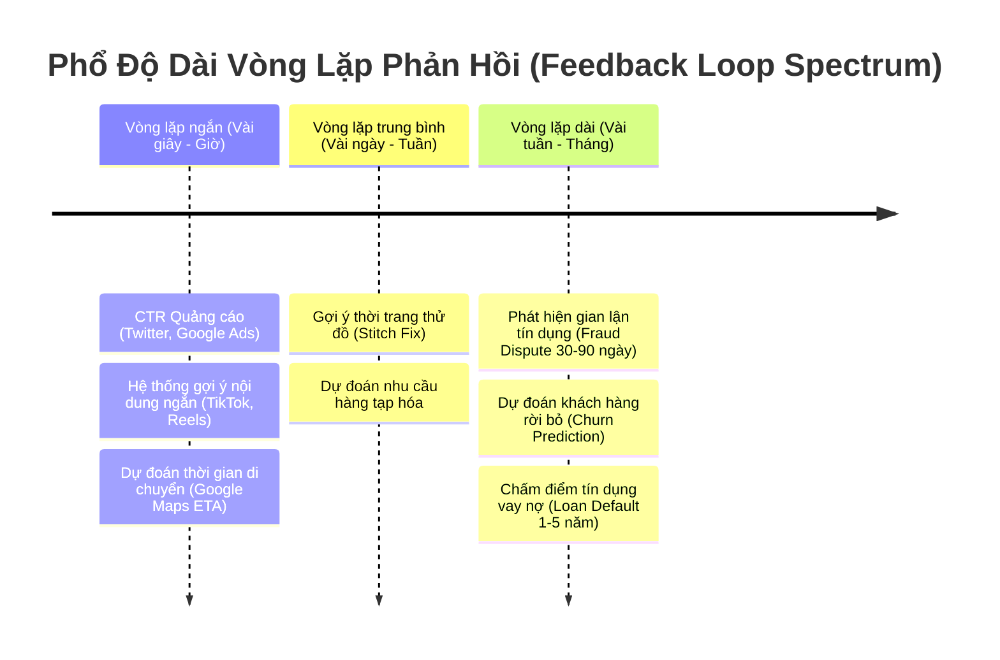

#### Implicit Feedback và Cạm Bẫy Nhãn Âm Giả Định (Premature Negative Labels)
Trong các bài toán có vòng lặp ngắn như Recommender Systems hoặc Click-Through Rate (CTR) Prediction:
* **Tính bất đối xứng của phản hồi**: Hệ thống chỉ nhận được **phản hồi tích cực tường minh** (Explicit/Implicit Positive: User click/mua). Không có sự kiện "Người dùng không thích" xuất hiện rõ ràng.
* **Quy ước nhãn âm**: Một đề xuất được giả định là tiêu cực (Negative Label: click = 0) nếu sau một cửa sổ thời gian $W$ mà người dùng không tương tác.
* **Trade-off cốt lõi trong việc chọn độ dài cửa sổ $W$**:
  * **Nếu $W$ quá ngắn**: Thu nhận nhãn nhanh, cho phép cập nhật mô hình liên tục (continual learning) và phát hiện drift tức thời; nhưng dẫn đến hiện tượng **nhãn âm sớm (premature negative labels)**, làm chệch phân phối và đánh giá thấp CTR thực tế (underestimate CTR).
  * **Nếu $W$ quá dài**: Nhãn chính xác hơn nhưng độ trễ dữ liệu tăng cao, làm tê liệt khả năng cảnh báo sớm của hệ thống giám sát.
  * *Dữ liệu thực tế từ Twitter Ads (2021)*: Mặc dù phần lớn lượt click quảng cáo diễn ra trong 5 phút đầu tiên, vẫn có một tỷ lệ click xuất hiện rải rác sau nhiều giờ.

---

## 3. Vòng Lặp Thoái Hóa (Degenerate Feedback Loops)

### 3.1. Cơ Chế Hoạt Động & Biểu Hiện Hệ Thống
**Vòng lặp thoái hóa (Degenerate Feedback Loop)** hình thành khi đầu ra dự đoán của hệ thống ML ảnh hưởng trực tiếp đến hành vi của người dùng, và hành vi này sau đó lại được trích xuất thành dữ liệu huấn luyện cho thế hệ mô hình tiếp theo.

$$Predictions_{t} \xrightarrow{\text{ảnh hưởng}} User\ Interactions_{t} \xrightarrow{\text{thu thập}} Data_{t+1} \xrightarrow{\text{huấn luyện}} Model_{t+1} \xrightarrow{\text{khuếch đại}} Predictions_{t+1}$$

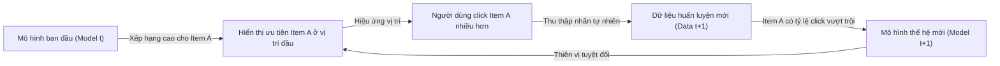

#### Các hệ quả nguy hiểm trong thực tế:
1. **Thiên vị phổ biến (Popularity Bias / Exposure Bias)**: Các sản phẩm/bài hát vốn dĩ chỉ nhỉnh hơn một chút ở thời điểm đầu sẽ liên tục được hiển thị -> nhận toàn bộ tương tác -> điểm số tăng vọt. Các item mới hoặc nằm ở phần đuôi phân phối (long-tail items) không bao giờ có cơ hội xuất hiện (*Rich-get-richer phenomenon*).
2. **Bong bóng lọc thông tin & Phòng vang (Filter Bubbles & Echo Chambers)**: Người dùng chỉ được tiếp cận các quan điểm cực đoan hoặc nội dung tương tự lịch sử xem, làm suy giảm tính đa dạng và giam lỏng trải nghiệm người dùng.
3. **Khuếch đại định kiến xã hội (Systemic Bias Amplification)**:
   * *Ví dụ bài toán lọc hồ sơ tuyển dụng (Resume Screening)*: Mô hình phát hiện đặc trưng $X$ (e.g., "Tốt nghiệp Stanford", "Giới tính Nam") có tương quan cao với nhãn trúng tuyển trong quá khứ -> Đề xuất ưu tiên hồ sơ có $X$ -> Nhà tuyển dụng chỉ phỏng vấn ứng viên có $X$ -> Công ty chỉ tuyển người có $X$ -> Tập dữ liệu mới củng cố trọng số của $X$ lên mức tuyệt đối.

### 3.2. Kỹ Thuật Phát Hiện Vòng Lặp Thoái Hóa

#### A. Đo lường ngoại tuyến (Offline Metrics)
Vòng lặp thoái hóa khó phát hiện khi offline vì chưa có tương tác người dùng mới. Tuy nhiên, ta có thể đo **độ suy giảm đa dạng (Diversity Degradation)** trên tập dữ liệu lịch sử:
1. **Aggregate Diversity & Long-Tail Coverage**:
   * Tính tỷ lệ phần trăm các item duy nhất xuất hiện trong top-$K$ dự đoán trên toàn bộ tập người dùng:
     $$\text{Coverage@K} = \frac{|\bigcup_{u \in U} \text{TopK}(u)|}{|\mathcal{I}|}$$
     Trong đó $\mathcal{I}$ là toàn bộ kho item, $U$ là tập người dùng. Nếu chỉ số này sụt giảm theo thời gian huấn luyện, mô hình đang hội tụ về một tập con item phổ biến.
2. **Hit Rate Against Popularity Buckets (Chia et al., 2021)**:
   * Chia toàn bộ kho items thành các nhóm phân vị theo số lượng tương tác lịch sử: Bucket 1 ($<10^2$ tương tác), Bucket 2 ($10^2 - 10^3$), Bucket 3 ($>10^3$).
   * Đo lường độ chính xác dự đoán (Hit Rate / NDCG) riêng biệt trên từng bucket.
   * **Chẩn đoán**: Nếu mô hình đạt độ chính xác cực cao trên Bucket 3 nhưng sụp đổ hoàn toàn trên Bucket 1, hệ thống đang chịu ảnh hưởng nặng nề của Popularity Bias.

#### B. Đo lường trực tuyến (Online Metrics)
* Giám sát **Độ thuần nhất của dự đoán (Prediction Homogeneity)** qua các ngày: Đo lường entropy phân phối dự đoán hoặc hệ số Gini của số lượt hiển thị item.

### 3.3. Kỹ Thuật Khắc Phục Vòng Lặp Thoái Hóa

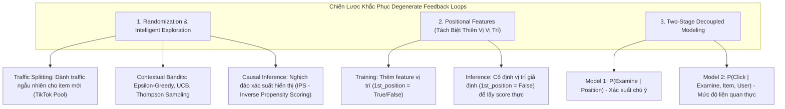

#### 1. Ngẫu Nhiên Hóa & Thăm Dò Thông Minh (Randomization & Exploration)
* **Cơ chế phân bổ traffic khởi tạo (Cold-Start Traffic Pool - Chiến lược TikTok)**: Mỗi video mới tải lên được cấp phát ngẫu nhiên một hạn mức hiển thị nhất định (vài trăm lượt impressions). Dữ liệu tương tác từ nhóm người dùng này được dùng để tính toán điểm chất lượng không thiên vị (*unbiased quality score*) trước khi quyết định mở rộng phân phối hay dừng hiển thị.
* **Contextual Bandits (Đánh đổi Exploration vs. Exploitation)**: Thay vì chọn tham lam item có điểm số cao nhất ($\text{argmax}$), áp dụng các thuật toán như Upper Confidence Bound (UCB) hoặc Thompson Sampling để cấp cơ hội hiển thị cho các item có độ bất định cao (high variance).
* **Hiệu chỉnh Causal Inference (Inverse Propensity Scoring - IPS)**:
  Trọng số mẫu được điều chỉnh dựa trên nghịch đảo xác suất được hiển thị để triệt tiêu thiên vị lựa chọn:
  $$w_i = \frac{1}{P(\text{Exposed} \mid \text{Context}_i)}$$

#### 2. Đặc Trưng Vị Trí (Positional Features)
* **Vấn đề**: Người dùng click vào item ở vị trí đầu tiên thường do thói quen chú ý (Position Bias), không phản ánh chất lượng nội dung.
* **Phương pháp triển khai**:
  1. **Khi Huấn Luyện (Training Time)**: Bổ sung đặc trưng vị trí (ví dụ: `position_index` hoặc cờ boolean `is_rank_1`) vào vector đầu vào $X$. Mô hình học được mức độ đóng góp của vị trí vào xác suất click.
  2. **Khi Dự Đoán (Inference Time)**: Để xếp hạng khách quan mọi ứng viên, cố định giá trị đặc trưng vị trí thành giá trị trung lập (ví dụ: gán `is_rank_1 = False` hoặc `position = median` cho tất cả items). Khi đó, điểm dự đoán chỉ phản ánh mức độ phù hợp nội tại của item.
* **Kiến trúc tách rời hai giai đoạn (Two-Stage Decoupled Modeling)**:
  Phân rã xác suất click thành tích của hai biến cố độc lập:
  $$P(\text{Click} = 1 \mid \text{Item}, \text{Position}) = P(\text{Examine} = 1 \mid \text{Position}) \times P(\text{Click} = 1 \mid \text{Item}, \text{Examine} = 1)$$
  * **Model 1 (Position Bias Model)**: Học xác suất người dùng quan sát vị trí $P(\text{Examine} \mid \text{Position})$.
  * **Model 2 (Relevance Model)**: Học xác suất người dùng click khi đã thực sự xem item $P(\text{Click} \mid \text{Item}, \text{User})$.

---

## 4. Dữ Liệu Production Phân Kỳ & Hiện Tượng Dịch Chuyển Phân Phối (Data Distribution Shifts)

### 4.1. Sự Phá Vỡ Giả Định Dừng (Stationary Assumption)
Toàn bộ nền tảng của Học Máy thống kê cổ điển dựa trên giả định: Dữ liệu huấn luyện ($D_{\text{train}}$) và dữ liệu thực tế ($D_{\text{unseen}}$) được rút ra độc lập từ **cùng một phân phối xác suất dừng (stationary distribution)**:

$$P_{\text{train}}(X, Y) = P_{\text{production}}(X, Y)$$

Trong môi trường production thực tế, giả định này **luôn luôn bị vi phạm** vì hai nguyên nhân căn bản:
1. **Sai lệch chọn mẫu (Sample / Selection Bias)**: Tập huấn luyện là tập con hữu hạn, bị giới hạn bởi thời gian, tài nguyên tính toán và chi phí gán nhãn, trong khi thế giới thực là vô hạn và đa chiều. Điều này dẫn tới hiện tượng **Train-Serving Skew**.
2. **Tính chất phi dừng của thế giới thực (Non-Stationary Reality)**: Hành vi người dùng, quy chuẩn xã hội, bối cảnh kinh tế, luật pháp và sự kiện toàn cầu liên tục biến động (ví dụ: trước dịch COVID-19, từ khóa "Wuhan" gắn liền với thông tin du lịch; sau khi dịch bùng phát, từ khóa này gắn với nguồn gốc virus).

### 4.2. Lỗi Nội Bộ (Internal Errors) vs. Biến Động Khách Quan (External Shifts)
> **Thực tế kỹ thuật then chốt**: Khoảng **80%** các cảnh báo dịch chuyển dữ liệu (drift alerts) hiển thị trên dashboard giám sát trong công nghiệp bắt nguồn từ **lỗi phần mềm nội bộ**, không phải do người dùng thay đổi hành vi:

* Lỗi pipeline ETL chuyển đổi sai định dạng timestamp hoặc timezone.
* Giá trị missing values bị điền sai ngầm định (ví dụ: thay vì `NaN`, pipeline gán về giá trị `0` hoặc `-1`).
* Chuẩn hóa dữ liệu (Standardization/Scaling) sử dụng Mean và Variance tính toán trên sai tập dữ liệu con.
* Bất đồng bộ trong mã nguồn trích xuất đặc trưng giữa môi trường Python (Training) và C++/Java/Go (Serving).
* Lỗi phiên bản ứng dụng phía client khiến giao diện bị vỡ, buộc người dùng phải thay đổi thao tác.

### 4.3. Trường Hợp Ngoại Lệ (Edge Cases) và Phân Phối Đuôi Dài (Long-Tail Distribution)

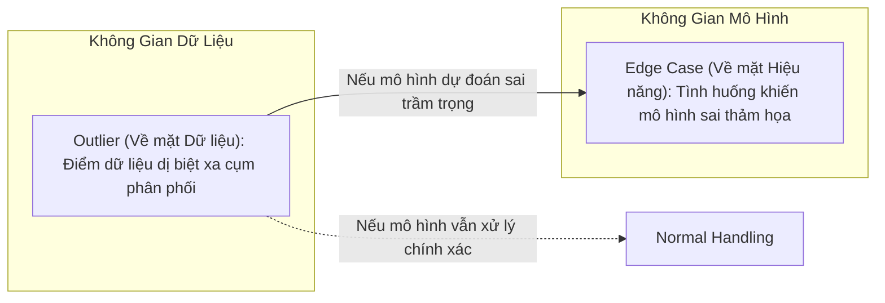

* **Phân biệt Outlier và Edge Case**:
  * **Outlier**: Khái niệm thuộc về **không gian dữ liệu**. Là một điểm dữ liệu khác biệt đáng kể so với phần lớn các điểm dữ liệu khác trong phân phối.
  * **Edge Case**: Khái niệm thuộc về **hiệu năng mô hình**. Là một mẫu dữ liệu (có thể là outlier hoặc không) khiến mô hình đưa ra dự đoán sai lệch với mức độ nghiêm trọng thảm họa (catastrophic failure).
  * *Ví dụ*: Người đi bộ sang đường sai luật trên đường cao tốc là một **outlier**. Nếu hệ thống xe tự hành phát hiện chính xác và dừng xe an toàn, đó **không phải là edge case**. Nếu hệ thống nhận diện nhầm là bóng cây và tăng tốc đâm vào, đó là **edge case**.
* **Thách thức của Phân phối Đuôi Dài (The Long-Tail Problem)**:
  * Trong các hệ thống an toàn sinh mạng (Autonomous Vehicles, Medical Diagnosis, Chống gian lận tài chính), độ chính xác $99.9\%$ trên tập dữ liệu phổ quát là vô nghĩa nếu $0.1\%$ còn lại là các edge cases gây tai nạn chết người.
  * Việc loại bỏ outlier trong quá trình huấn luyện giúp đường phân chia quyết định (decision boundary) mượt mà hơn; tuy nhiên ở pha inference, hệ thống không thể từ chối phục vụ các truy vấn ngoại lai mà bắt buộc phải có cơ chế xử lý dự phòng an toàn (safe fallback).

---

## 5. Phân Loại Toán Học Các Dạng Dịch Chuyển Dữ Liệu (Types of Data Shifts)

Trong học có giám sát, dữ liệu quan sát được coi là các mẫu rút ra từ phân phối xác suất đồng thời $P(X, Y)$. Phân phối này được phân rã theo hai cách tiếp cận xác suất:
1. **Phân rã theo mô hình phân biệt (Discriminative Decomposition)**:
   $$P(X, Y) = P(Y \mid X) P(X)$$
2. **Phân rã theo mô hình sinh (Generative Decomposition)**:
   $$P(X, Y) = P(X \mid Y) P(Y)$$

Trong đó:
* $P(X)$: Phân phối mật độ xác suất của không gian đặc trưng đầu vào (Input distribution).
* $P(Y)$: Phân phối xác suất của nhãn mục tiêu (Prior / Target distribution).
* $P(Y \mid X)$: Phân phối điều kiện của đầu ra dựa trên đầu vào (Posterior probability).
* $P(X \mid Y)$: Phân phối điều kiện của đầu vào khi biết trước nhãn (Class-conditional distribution).

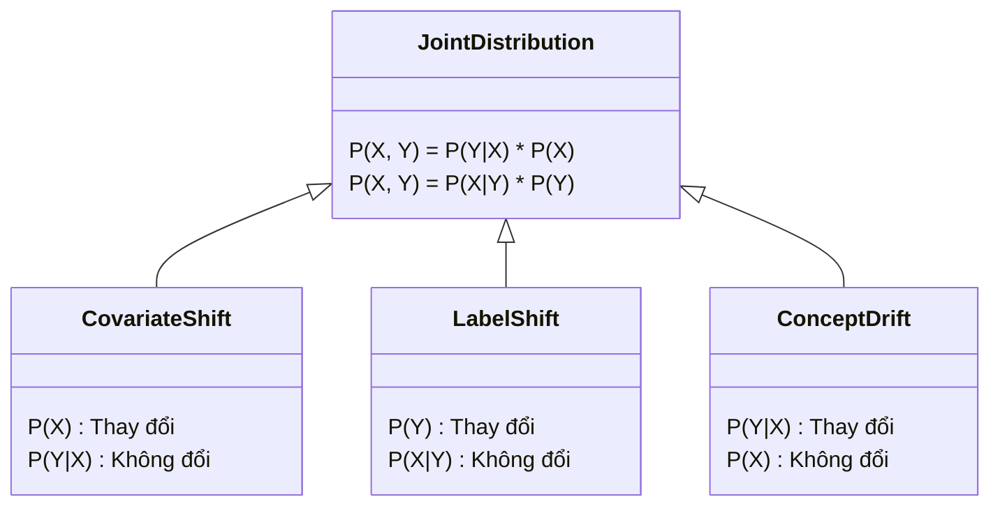

---

### 5.1. Covariate Shift (Dịch Chuyển Biến Phụ Thuộc)
* **Định nghĩa toán học**:
  $$\begin{cases} P_{\text{target}}(X) \neq P_{\text{source}}(X) \\ P_{\text{target}}(Y \mid X) = P_{\text{source}}(Y \mid X) \end{cases}$$
  *Phân phối của các biến đầu vào thay đổi, nhưng cơ chế sinh nhãn từ đầu vào hoàn toàn không đổi.*
* **Nguồn gốc phát sinh**:
  * **Sample Selection Bias**: Dữ liệu train thu thập từ tệp bệnh nhân tại một phòng khám chuyên sâu (chủ yếu phụ nữ trên 40 tuổi), trong khi dữ liệu production áp dụng cho toàn dân. Xác suất một người 45 tuổi bị ung thư $P(Y \mid X=45)$ không đổi, nhưng tỷ lệ người 45 tuổi trong dữ liệu $P(X)$ thay đổi.
  * **Active Learning / Subsampling**: Cố tình lấy mẫu không đồng đều để tăng cường các ca hiếm trong quá trình train.
  * **Môi trường sử dụng thay đổi**: Chuyển mô hình nhận diện giọng nói từ dữ liệu phòng thu cách âm sang ứng dụng điện thoại có lẫn tiếng ồn giao thông.
* **Giải pháp thích ứng: Trọng số quan trọng (Importance Weighting)**:
  * Tính toán tỷ số mật độ xác suất giữa tập đích (target/production) và tập nguồn (source/training):
    $$w(x) = \frac{P_{\text{target}}(x)}{P_{\text{source}}(x)}$$
  * Tối thiểu hóa hàm mất mát kỳ vọng có trọng số trên tập nguồn:
    $$\theta^* = \arg\min_\theta \sum_{i=1}^{N_{\text{source}}} w(x_i) \cdot \mathcal{L}\left(f_\theta(x_i), y_i\right)$$
  * *Các kỹ thuật ước lượng tỷ số $w(x)$ trực tiếp không qua mật độ*: Kernel Mean Matching (KMM), Kullback-Leibler Importance Estimation Procedure (KLIEP), Least-Squares Density Difference (LSDD).

---

### 5.2. Label Shift (Prior Probability Shift / Target Shift)
* **Định nghĩa toán học**:
  $$\begin{cases} P_{\text{target}}(Y) \neq P_{\text{source}}(Y) \\ P_{\text{target}}(X \mid Y) = P_{\text{source}}(X \mid Y) \end{cases}$$
  *Phân phối xác suất biên duyên của nhãn $P(Y)$ thay đổi, nhưng phân phối của đặc trưng với điều kiện nhãn đã cho $P(X \mid Y)$ giữ nguyên.*
* **Nguồn gốc phát sinh**:
  * Khi bùng phát dịch cúm mùa, xác suất một người bất kỳ trong xã hội mắc cúm $P(Y=1)$ tăng vọt. Tuy nhiên, với một người đã được xác định mắc cúm ($Y=1$), phân phối các triệu chứng như thân nhiệt, mức độ ho $P(X \mid Y=1)$ vẫn tuân theo quy luật sinh học thông thường.
  * Sự xuất hiện của thuốc phòng bệnh hiệu quả làm giảm tỷ lệ người mắc bệnh $P(Y=1)$ trên toàn bộ các nhóm tuổi, làm dịch chuyển phân phối nhãn.
* **Kỹ thuật phát hiện & Hiệu chỉnh**:
  * **Black Box Shift Estimation (BBSE - Lipton et al., 2018)**: Ước lượng tỷ số trọng số nhãn $w(y) = \frac{P_{\text{target}}(y)}{P_{\text{source}}(y)}$ mà **không cần nhãn thực tế** trên tập target. Phương pháp này đảo ngược ma trận nhầm lẫn (confusion matrix) của mô hình dự đoán thu được trên tập validation để tái cấu trúc lại phân phối $P_{\text{target}}(Y)$.

---

### 5.3. Concept Drift (Posterior Drift)
* **Định nghĩa toán học**:
  $$\begin{cases} P_{\text{target}}(Y \mid X) \neq P_{\text{source}}(Y \mid X) \\ P_{\text{target}}(X) = P_{\text{source}}(X) \end{cases}$$
  *Bản chất khái niệm bị thay đổi: Cùng một vector đặc trưng đầu vào $X$, nhưng phân phối xác suất của nhãn đầu ra $Y$ đã biến đổi.*
* **Nguồn gốc phát sinh**:
  * **Biến động vĩ mô**: Trước đại dịch, một căn hộ 3 phòng ngủ tại San Francisco ($X$) có giá trị thị trường trung bình là 2,000,000 USD ($Y$). Sau dịch, làn sóng làm việc từ xa khiến nhu cầu giảm mạnh, cùng căn hộ đó chỉ còn giá 1,500,000 USD.
  * **Hành vi gian lận tiến hóa (Adversarial Concept Drift)**: Kẻ gian thay đổi thủ đoạn rửa tiền hoặc vượt rào kiểm duyệt để vượt qua bộ lọc của mô hình.
  * **Tính chu kỳ và mùa vụ (Cyclic / Seasonal Drift)**: Giá phòng khách sạn hoặc cước phí gọi xe công nghệ thay đổi hoàn toàn giữa ngày làm việc và cuối tuần, hoặc dịp lễ Tết dù các thông số quãng đường và loại xe giữ nguyên.

---

### 5.4. Dịch Chuyển Phân Phối Tổng Quát (General Distribution Shifts)

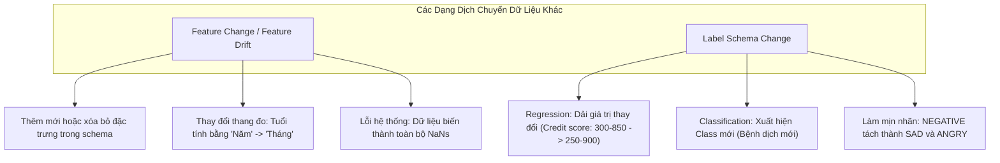

#### Label Schema Change (Biến Đổi Cấu Trúc Nhãn):
Hiện tượng này phá vỡ cấu trúc không gian đầu ra $\mathcal{Y}$, dẫn đến cả $P(Y)$ và $P(X \mid Y)$ đều bị phá vỡ hoàn toàn:
* **Hậu quả kiến trúc sâu sắc**:
  Trong mạng Neural Network phân loại đa lớp, tầng đầu ra Softmax có ma trận trọng số kích thước:
  $$W_{\text{out}} \in \mathbb{R}^{d_{\text{hidden}} \times C}$$
  Khi bài toán xuất hiện lớp mới ($C \rightarrow C+1$) hoặc chia nhỏ lớp (Fine-grained classification), số lượng tham số của tầng Softmax thay đổi. Điều này làm vô hiệu hóa ma trận trọng số cũ, **buộc toàn bộ hệ thống phải gán nhãn lại dữ liệu lịch sử (re-labeling) và huấn luyện lại từ đầu (retrain from scratch)**.

---

### 5.5. Bảng Tổng Hợp So Sánh Toàn Bộ Các Dạng Shift

| Dạng Shift | Biểu Thức Toán Học Cốt Lõi | $P(X)$ | $P(Y)$ | $P(Y \mid X)$ | $P(X \mid Y)$ | Tác Động Hạ Tầng & Thuật Toán |
| :--- | :--- | :---: | :---: | :---: | :---: | :--- |
| **Covariate Shift** | $P(X)$ đổi, $P(Y \mid X)$ giữ nguyên | **Đổi** | Thường đổi | **Cố định** | Đổi | Áp dụng Importance Weighting; retrain mô hình với mẫu mới. |
| **Label Shift** | $P(Y)$ đổi, $P(X \mid Y)$ giữ nguyên | Thường đổi | **Đổi** | Đổi | **Cố định** | Ước lượng BBSE, cân bằng lại trọng số lớp (class re-weighting). |
| **Concept Drift** | $P(Y \mid X)$ đổi, $P(X)$ giữ nguyên | **Cố định** | Thường đổi | **Đổi** | Đổi | Dữ liệu cũ bị lỗi thời; bắt buộc huấn luyện lại trên dữ liệu mới. |
| **Feature Change** | Không gian $\mathcal{X}$ thay đổi cấu trúc | **Đổi** | Bất kỳ | **Đổi** | **Đổi** | Cập nhật Feature Store, xử lý backward compatibility cho model pipeline. |
| **Label Schema Change** | Không gian $\mathcal{Y}$ thay đổi kích thước/dải đo | Bất kỳ | **Đổi** | **Đổi** | **Đổi** | Phá vỡ cấu trúc mạng (Softmax layer); bắt buộc relabel & train lại từ đầu. |

---

## 6. Phương Pháp Luận Phát Hiện Dịch Chuyển Dữ Liệu (Shift Detection Methodologies)

Việc chỉ giám sát các chỉ số hiệu năng phụ thuộc nhãn (Accuracy, F1-Score, MAE) là **không đủ** vì trong thực tế, nhãn tự nhiên thường bị trễ hàng tuần/tháng hoặc không bao giờ xuất hiện. Do đó, hệ thống buộc phải triển khai giám sát trực tiếp trên phân phối đầu vào $P(X)$ và phân phối dự đoán $P(\hat{Y})$.

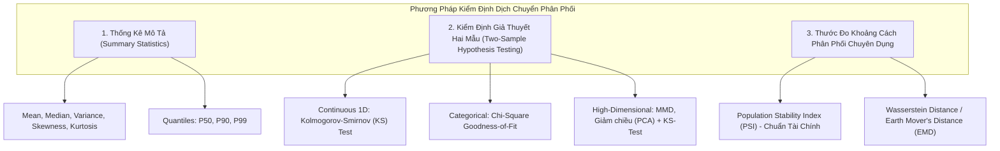

---

### 6.1. Giới Hạn Của Thống Kê Mô Tả (Summary Statistics)
Nhiều công cụ công nghiệp (như bản chuẩn ban đầu của TensorFlow Data Validation - TFDV) dựa vào việc so sánh Mean, Median, Variance, Min, Max, Quantiles giữa tập Serving và tập Baseline:
* **Ưu điểm**: Chi phí tính toán cực thấp $O(N)$, xử lý streaming mượt mà.
* **Lỗ hổng chết người**: Các thống kê tóm tắt chỉ có ý nghĩa đối với các phân phối đơn mode, đối xứng (như Gaussian). Hai phân phối hoàn toàn khác nhau (ví dụ: một phân phối đều $U[-1, 1]$ và một phân phối nhị thức đối xứng) có thể có cùng Mean ($0$) và cùng Variance ($1/3$), khiến hệ thống bỏ sót drift nghiêm trọng.

---

### 6.2. Kiểm Định Giả Thuyết Hai Mẫu (Two-Sample Hypothesis Testing)
Kiểm định hai mẫu kiểm tra xem liệu hai tập hợp dữ liệu $S_1 \sim P_{\text{baseline}}$ và $S_2 \sim P_{\text{production}}$ có được rút ra từ cùng một phân phối hay không:
* **Giả thuyết Không ($H_0$)**: $P_{\text{baseline}} = P_{\text{production}}$
* **Giả thuyết Đối ($H_1$)**: $P_{\text{baseline}} \neq P_{\text{production}}$
* **Ngưỡng quyết định**: Nếu $p\text{-value} < \alpha$ (thường chọn mức ý nghĩa $\alpha = 0.05$ hoặc $0.01$), ta bác bỏ $H_0$ và kết luận xuất hiện phân phối dịch chuyển có ý nghĩa thống kê.

> **Cạm bẫy kích thước mẫu (Sample Size Caveat)**:
> Khi kích thước mẫu $N$ trong môi trường production cực lớn (hàng triệu requests), hầu như **mọi sai lệch vi mô ngẫu nhiên không đáng kể về mặt nghiệp vụ đều đạt được mức ý nghĩa thống kê ($p < 0.05$)**, gây ra tình trạng bão cảnh báo giả (false alarm fatigue).
> * **Nguyên tắc kỹ thuật**: Nếu ta phát hiện được sự khác biệt trên một **kích thước mẫu nhỏ**, đó chắc chắn là một dịch chuyển nghiêm trọng cần can thiệp. Nếu chỉ phát hiện được khi mẫu cực lớn, sai lệch đó thường không đáng lo ngại.

---

### 6.3. Chi Tiết Các Thuật Toán Kiểm Định Thực Nghiệm

#### 1. Kolmogorov-Smirnov Test (KS-Test)
* **Bản chất**: Kiểm định phi tham số (non-parametric), so sánh trực tiếp khoảng cách cực đại giữa hai Hàm phân phối tích lũy thực nghiệm (Empirical Cumulative Distribution Functions - ECDF):
  $$D = \sup_x \left| F_1(x) - F_2(x) \right|$$
* **Phạm vi ứng dụng**: Dữ liệu liên tục 1 chiều (1D Continuous features). Thích hợp theo dõi trôi dạt điểm số xác suất đầu ra $P(\hat{Y})$ hoặc từng biến độc lập.
* **Hạn chế**: Không áp dụng được trực tiếp cho dữ liệu đa chiều (multi-dimensional space) và dữ liệu phân loại (categorical).

#### 2. Chi-Square ($\chi^2$) Goodness-of-Fit Test
* **Bản chất**: So sánh tần số quan sát ($O_i$) trong production với tần số kỳ vọng ($E_i$) suy ra từ baseline cho các biến rời rạc:
  $$\chi^2 = \sum_{i=1}^k \frac{(O_i - E_i)^2}{E_i}$$
* **Phạm vi ứng dụng**: Dữ liệu phân loại (Categorical features).

#### 3. Population Stability Index (PSI) - Chuẩn Mực Trong Ngành Tài Chính / Ngân Hàng
PSI đo lường mức độ biến đổi của một phân phối liên tục được chia thành $B$ bins (thường là 10 phân vị bằng nhau dựa trên tập baseline):

$$\text{PSI} = \sum_{b=1}^B \left( \% \text{Actual}_b - \% \text{Expected}_b \right) \times \ln\left( \frac{\% \text{Actual}_b}{\% \text{Expected}_b} \right)$$

Trong đó:
* $\% \text{Expected}_b$: Tỷ lệ phần trăm mẫu thuộc bin $b$ trong tập Baseline (Training data).
* $\% \text{Actual}_b$: Tỷ lệ phần trăm mẫu thuộc bin $b$ trong tập Production thực tế.

##### Bảng Quy Chuẩn Hành Động Thực Tế Của PSI:
| Giá Trị PSI | Mức Độ Dịch Chuyển | Hành Động Vận Hành Tương Ứng |
| :--- | :--- | :--- |
| $\mathbf{\text{PSI} < 0.10}$ | Không có dịch chuyển đáng kể (Negligible Shift) | Giữ nguyên hệ thống; không cần can thiệp. |
| $\mathbf{0.10 \le \text{PSI} < 0.25}$ | Dịch chuyển mức độ vừa phải (Moderate Shift) | Bật chế độ cảnh báo vàng; tăng tần suất theo dõi; chuẩn bị pipeline retraining. |
| $\mathbf{\text{PSI} \ge 0.25}$ | Dịch chuyển nghiêm trọng (Significant Drift) | **Cảnh báo đỏ**: Kích hoạt tự động huấn luyện lại hoặc chuyển sang mô hình fallback/rules. |

#### 4. Wasserstein Distance (Earth Mover's Distance - EMD)
* **Bản chất**: Đo lường lượng "công" tối thiểu cần thiết để biến đổi phân phối xác suất này thành phân phối xác suất khác:
  $$W_1(P, Q) = \inf_{\gamma \in \Pi(P, Q)} \mathbb{E}_{(x, y) \sim \gamma}[\|x - y\|]$$
* **Ưu điểm vượt trội**: Khác với KL-Divergence (tiến tới vô cùng nếu hai phân phối không giao thoa nhau hoàn toàn - zero overlap), Wasserstein distance luôn hữu hạn, liên tục và phản ánh chính xác khoảng cách hình học giữa hai phân phối.

#### 5. Kiểm Định Hai Mẫu Đa Chiều (Multivariate Drift Detection)
Để kiểm định toàn bộ vector đặc trưng $X \in \mathbb{R}^d$ cùng lúc:
* **Maximum Mean Discrepancy (MMD - Gretton et al.)**: Ánh xạ dữ liệu vào Không gian Hilbert Tái tạo (Reproducing Kernel Hilbert Space - RKHS) và đo khoảng cách giữa các vector kỳ vọng.
* **Chiến lược Thực chiến trong Công nghiệp**: Sử dụng kỹ thuật Giảm chiều dữ liệu không giám sát (PCA, Autoencoders) để nén vector đặc trưng về không gian tiềm ẩn (Latent space) số chiều thấp, sau đó áp dụng KS-Test hoặc Wasserstein Distance trên từng chiều tiềm ẩn.

---

### 6.4. Khung Cửa Sổ Thời Gian Giám Sát (Time Scale Windows)

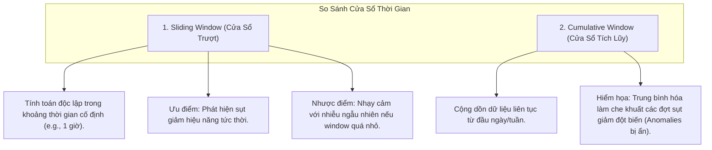

#### Các lưu ý thiết kế hạ tầng quan sát:
1. **Phân biệt Spatial Shift vs. Temporal Shift**:
   * *Spatial Shift*: Xuất hiện tức thì giữa các phân khúc người dùng, các điểm truy cập mạng, hoặc phiên bản hệ điều hành khác nhau.
   * *Temporal Shift*: Biến thiên theo chuỗi thời gian, bị nhiễu loạn bởi tính chu kỳ (Seasonality - chu kỳ ngày đêm, ngày làm việc vs. cuối tuần).
2. **Cạm bẫy che lấp của Thống kê Tích lũy (Cumulative Distortion)**:
   Nếu vẽ biểu đồ độ chính xác theo phương pháp tích lũy từ đầu ngày, một đợt sụp đổ hiệu năng nghiêm trọng kéo dài 2 tiếng (ví dụ từ 16h đến 18h) sẽ bị "pha loãng" bởi dữ liệu ổn định của 16 tiếng trước đó, khiến hệ thống không kích hoạt cảnh báo kịp thời. Bắt buộc phải sử dụng **Sliding Windows (Cửa sổ trượt)** cho real-time alerts.
3. **Thao tác Hợp nhất Cửa sổ (Merge Operations)**:
   Các công cụ phân tích hiện đại lưu trữ thống kê dưới dạng tóm tắt đại số (sketches / t-digest) theo các block nhỏ (1 giờ), sau đó cho phép gộp (merge) linh hoạt thành góc nhìn 24 giờ hoặc 7 ngày mà không cần quét lại toàn bộ dữ liệu thô.
4. **Phân tích Nguyên nhân Gốc rễ Tự động (Root Cause Analysis - RCA)**:
   Hệ thống giám sát quét đồng thời trên nhiều quy mô thời gian (multi-scale time windows) để tự động cô lập chính xác thời điểm bắt đầu xảy ra phân kỳ dữ liệu.

---

## 7. Chiến Lược Ứng Phó Với Dịch Chuyển Phân Phối Dữ Liệu

Khi hệ thống phát hiện drift vượt ngưỡng cảnh báo, có 3 trường phái xử lý kiến trúc:

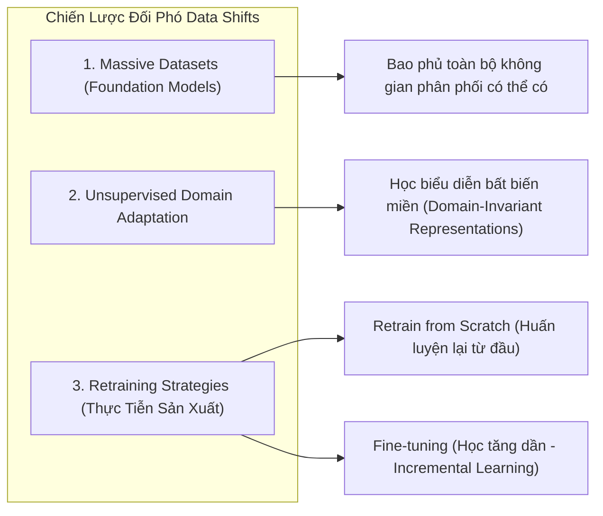

### 7.1. Huấn Luyện Lại Từ Đầu (From Scratch) vs. Tinh Chỉnh (Fine-Tuning)

| Tiêu Chí | Retraining From Scratch (Toàn Bộ) | Fine-Tuning / Continual Learning (Gia Tăng) |
| :--- | :--- | :--- |
| **Bản chất kỹ thuật** | Khởi tạo lại ngẫu nhiên trọng số; huấn luyện mô hình trên toàn bộ tập dữ liệu cũ + mới hợp nhất. | Giữ nguyên trọng số hiện tại; tiếp tục chạy gradient descent trên batch dữ liệu mới thu thập. |
| **Chi phí tính toán** | Cực kỳ tốn kém tài nguyên CPU/GPU và thời gian; độ trễ cập nhật cao. | Nhẹ, chi phí thấp, hoàn tất nhanh chóng; cho phép cập nhật real-time. |
| **Rủi ro thuật toán** | Không có rủi ro quên kiến thức cũ. | Nguy cơ **Quên lãng thảm họa (Catastrophic Forgetting)**: mô hình tối ưu cho mẫu mới nhưng mất khả năng xử lý mẫu cũ. |
| **Sự lựa chọn công nghiệp** | Được ưu tiên khi mô hình có kích thước vừa phải và tính ổn định được đặt lên hàng đầu. | Áp dụng cho các mô hình khổng lồ hoặc hệ thống cần độ tươi dữ liệu cực cao (TikTok, Ads CTR). |

### 7.2. Lựa Chọn Dữ Liệu Huấn Luyện Lại
* **Dữ liệu từ điểm bẻ gãy (Drift Point)**: Chỉ sử dụng dữ liệu phát sinh từ thời điểm bắt đầu phát hiện phân phối bị dịch chuyển.
* **Cửa sổ dữ liệu trượt (Sliding Data Window)**: Huấn luyện trên dữ liệu của $N$ ngày gần nhất (ví dụ: luôn dùng dữ liệu 30 ngày qua).
* **Vùng đệm phát lại (Replay Buffer)**: Pha trộn một tỷ lệ cố định (ví dụ: $20\%$) dữ liệu lịch sử cốt lõi vào batch dữ liệu mới để chống hiện tượng catastrophic forgetting.

### 7.3. Thiết Kế Kiến Trúc Chủ Động Phòng Ngừa Phân Kỳ (Proactive System Design)
Không đợi đến khi drift xảy ra mới xử lý, kiến trúc hệ thống cần tích hợp sẵn cơ chế giảm thiểu độ nhạy cảm với drift:

1. **Đánh đổi giữa Hiệu Năng và Độ Bền Vững Của Đặc Trưng (Performance vs. Stability Trade-off)**:
   * *Trường hợp điển hình*: Đặc trưng `app_store_ranking` có tương quan dự đoán rất mạnh với tỷ lệ tải app, nhưng thay đổi liên tục theo từng giờ, buộc mô hình phải retrain liên tục.
   * *Giải pháp làm mịn (Feature Coarsening / Bucketing)*: Gom cụm thứ hạng thành các khoảng tĩnh: `Top 1-10`, `Top 11-100`, `Top 101-1000`. Độ chính xác có thể giảm nhẹ nhưng tính ổn định của đặc trưng tăng vọt, kéo dài chu kỳ sống của mô hình.
2. **Kiến Trúc Tách Rời Mô Hình Theo Phân Khúc (Decoupled Segmented Architecture)**:
   * Giá bất động sản tại đô thị lớn (San Francisco) biến động nhanh gấp 10 lần tại các vùng nông thôn (Arizona).
   * Thay vì sử dụng một mô hình monolithic phục vụ toàn quốc (buộc phải retrain toàn bộ hệ thống theo tốc độ biến động của SF), hãy **tách thành các mô hình chuyên biệt theo từng thị trường**. Mô hình SF được cập nhật hàng tuần, mô hình vùng nông thôn chỉ cần cập nhật mỗi quý một lần.

---

## 8. Kiến Trúc Giám Sát Và Khả Năng Quan Sát 3 Tầng (3-Tier ML Observability Framework)

Để loại bỏ các "thất bại âm thầm", kiến trúc hệ thống ML production tiêu chuẩn bắt buộc phải duy trì hạ tầng quan sát chia làm 3 tầng độc lập:

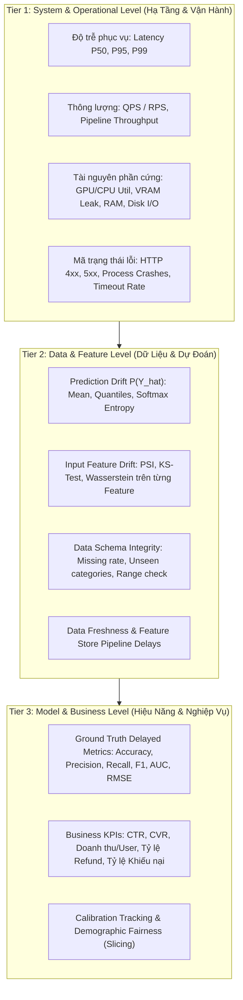

### Chi Tiết Giám Sát Từng Tầng:

#### Tầng 1: Hạ Tầng Vận Hành (Operational / System Metrics)
* **Chỉ số trọng yếu**: P99 Latency (độ trễ tại phân vị 99), Throughput (Requests/sec), Tỷ lệ lỗi mạng, GPU Memory Throttling, OOM crash logs.
* **Ý nghĩa**: Đảm bảo hệ thống tuân thủ cam kết chất lượng dịch vụ (SLA/SLO).

#### Tầng 2: Dữ Liệu & Phân Phối Dự Đoán (Data & Prediction Metrics) - *Tuyến phòng thủ sớm nhất*
* **Giám sát Phân phối Dự đoán $P(\hat{Y})$**:
  * Khi chưa có nhãn thực tế $Y$, phân phối đầu ra của mô hình $\hat{Y}$ là chiếc gương phản chiếu trung thực nhất.
  * Nếu phân phối xác suất dự đoán (Predicted Probability Distribution) của tuần này lệch khỏi tuần trước (đo bằng PSI hoặc KS-test), chắc chắn hệ thống đang gặp biến động (Covariate Shift hoặc Data Bug) mà không cần đợi nhãn ground truth.
* **Giám sát Tính toàn vẹn của Dữ liệu (Schema Validation)**:
  * Kiểm tra tỷ lệ giá trị rỗng (Null/NaN rate), phát hiện các giá trị phân loại chưa từng xuất hiện (unseen categorical levels), kiểm tra vi phạm min-max.

#### Tầng 3: Hiệu Năng ML & Chỉ Số Kinh Doanh (Model Performance & Business KPIs)
* **Chỉ số ML**: Tính toán ngay khi nhãn tự nhiên quay về (Accuracy, Log-loss, Calibration curves).
* **Slice-based Evaluation (Đánh giá theo lát cắt)**: Mô hình có thể duy trì F1-score tổng thể ổn định nhưng lại sụp đổ hiệu năng trên một phân khúc thiểu số người dùng nhạy cảm. Bắt buộc phải chia lát dữ liệu theo độ tuổi, vị trí địa lý, thiết bị.
* **Chỉ số nghiệp vụ**: Tỷ lệ chuyển đổi mua hàng (CVR), thời gian lưu lại ứng dụng, số lượng tranh chấp khiếu nại (fraud disputes).

---

## 9. Bảng Kiểm Phòng Chống Sụp Đổ Hệ Thống ML Trong Thực Tế (Production Readiness Checklist)

Trước khi kích hoạt đưa bất kỳ mô hình ML nào vào phục vụ traffic thực tế, Senior Architect phải xác thực đầy đủ các điều kiện trong Checklist sau:

### 1. Kiểm Soát Dữ Liệu & Pipeline (Data Pipeline Guards)
- [ ] **Feature Store Consistency**: Đảm bảo logic tính toán đặc trưng ở môi trường Training và Inference là hoàn toàn đồng nhất (dùng chung định nghĩa code hoặc chia sẻ chung Feature Store engine).
- [ ] **Schema & Type Enforcement**: Đã cấu hình bộ lọc kiểm tra kiểu dữ liệu, chặn đứng tình trạng cast sai kiểu ngầm định.
- [ ] **Imputation Guard**: Xác nhận không có giá trị missing nào bị điền ngầm định bằng các giá trị mang ý nghĩa đặc biệt (`0`, `-1`, `9999`) mà không được đánh dấu flag.
- [ ] **Feature Freshness Monitoring**: Thiết lập cảnh báo độ trễ đẩy dữ liệu từ ETL pipeline vào Feature Store.

### 2. Phòng Ngừa Vòng Lặp Phản Hồi (Feedback Loop Mitigations)
- [ ] **Position Bias Decoupling**: Đã bổ sung Positional Feature trong quá trình train và cố định vị trí trung lập khi chạy inference, hoặc sử dụng kiến trúc hai mô hình độc lập (Examination vs. Relevance).
- [ ] **Exploration Budget**: Dành tối thiểu $1\% - 5\%$ lưu lượng traffic ngẫu nhiên (hoặc bandit-based) để cấp phát cơ hội hiển thị cho các item long-tail và nội dung mới.
- [ ] **Diversity Metrics Tracking**: Dashboard đã cấu hình biểu đồ theo dõi chỉ số Coverage@K và Hit Rate trên các Popularity Buckets theo chu kỳ ngày.

### 3. Hệ Thống Phát Hiện Dịch Chuyển (Drift Detection Engine)
- [ ] **Target Baseline Freezing**: Đã lưu trữ cố định phân phối chuẩn (Baseline Reference Distribution) trích xuất từ tập kiểm thử chuẩn hoặc dữ liệu phục vụ ổn định của 14 ngày gần nhất.
- [ ] **Early-Warning on Predictions**: Đã thiết lập kiểm định PSI hoặc KS-test chạy định kỳ mỗi giờ trên phân phối đầu ra $P(\hat{Y})$.
- [ ] **Sample Size Throttling**: Đã hiệu chỉnh ngưỡng $p\text{-value}$ hoặc kích thước mẫu phụ phục vụ kiểm định hai mẫu để triệt tiêu hiện tượng báo động giả do mẫu quá lớn.
- [ ] **Sliding Window Alerts**: Đã phân tách rõ ràng giữa metrics cửa sổ trượt (dùng để bắn alert) và metrics tích lũy (dùng để báo cáo kinh doanh).

### 4. Cơ Chế Chịu Lỗi & Phòng Thủ An Toàn (Failover & Safe Fallback)
- [ ] **Heuristic / Rule-based Fallback**: Khi latency vượt ngưỡng timeout hoặc tỷ lệ lỗi HTTP 5xx tăng vọt, hệ thống tự động chuyển mạch (circuit breaker) sang trả về kết quả dựa trên luật tĩnh hoặc danh sách phổ biến mặc định.
- [ ] **Shadow Deployment / Canary Verification**: Mô hình mới luôn được chạy ở chế độ Shadow (nhận traffic thực nhưng không trả kết quả cho user) tối thiểu 48 giờ để so sánh phân phối $P(\hat{Y})$ với mô hình hiện tại trước khi switch traffic.
- [ ] **Circuit Breakers for Catastrophic Drift**: Tự động chặn quyền dự đoán của mô hình và thông báo khẩn cấp cho On-call Engineer nếu chỉ số PSI của các đặc trưng cốt lõi vượt ngưỡng $0.25$.
- [ ] **Data Retraining Trigger**: Pipeline tái huấn luyện tự động đã được kiểm thử end-to-end, có cơ chế rollback phiên bản mô hình tức thì nếu mô hình mới huấn luyện có hiệu năng validation thấp hơn mô hình đang chạy.
