# Chapter 1: Machine Learning Systems in Production

---

## 1. Foundations & Scope: When to Use Machine Learning

### 1.1. Formal Definition of Machine Learning
Machine Learning (ML) is neither an all-purpose optimization engine nor an infallible heuristic. Formally, Machine Learning is defined as:

$$\text{An engineering approach to } \underbrace{\textbf{learn}}_{(1)} \underbrace{\textbf{complex}}_{(2)} \underbrace{\textbf{patterns}}_{(3)} \text{ from } \underbrace{\textbf{existing data}}_{(4)} \text{ and use these patterns to make } \underbrace{\textbf{predictions}}_{(5)} \text{ on } \underbrace{\textbf{unseen data}}_{(6)}.$$

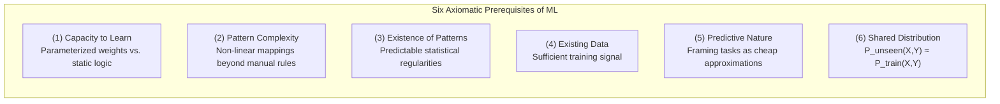

A rigorous analysis of each constituent phrase dictates whether an engineering problem warrants an ML solution:

1. **Capacity to Learn**:
   - The system must feature an internal statistical optimization mechanism that updates parameter weights based on error gradients or loss functions.
   - *Counter-example*: A Relational Database Management System (RDBMS) contains data relationships defined via rigid schemas and foreign keys. It cannot infer implicit relational dependencies between unlinked attributes without explicit queries or schema migrations written by human engineers.
2. **Complex Patterns**:
   - ML is economically and computationally justified only when the mapping function $f: X \to Y$ is too complex, high-dimensional, or non-linear for software engineers to hand-craft using deterministic control structures (`if-else` branching).
   - *Lookup vs. Approximation*: Mapping a 5-digit US Postal ZIP code to its corresponding state requires a simple hash table or lookup table ($O(1)$ complexity). Conversely, estimating the market rental price of an Airbnb listing given dynamic temporal demand, location embeddings, seasonal trends, and amenity matrices requires approximating a complex multi-dimensional hypersurface.
   - *Moravec's Paradox in Computing*: Tasks that humans find computationally demanding (e.g., calculating $10^{10}$ or sorting a billion numbers) are trivial for traditional deterministic algorithms. Conversely, tasks that humans execute effortlessly and subconsciously (e.g., speech parsing, visual scene segmentation, identifying a feline in an image) exhibit immense mathematical complexity that defies manual rule formulation.
3. **Existence of Patterns**:
   - The data generation process must exhibit underlying mathematical, structural, or statistical regularity.
   - *Distribution vs. Pattern*: Rolling a fair six-sided die exhibits a known uniform discrete probability distribution:
     $$P(X = k) = \frac{1}{6}, \quad \forall k \in \{1, 2, 3, 4, 5, 6\}$$
     However, consecutive rolls are mutually independent: $P(X_t \mid X_{t-1}, \dots, X_1) = P(X_t)$. There is zero temporal or sequential pattern across independent trials. Deploying an ML algorithm to predict the next roll of a fair die is theoretically futile. In contrast, financial equities or macroeconomic indicators exhibit non-stationary but structured autoregressive patterns driven by latent causal factors.
4. **Existing Data**:
   - Statistical learning cannot operate in a data vacuum. Data must either exist in accessible repositories or be continuously capturable via instrumentation.
   - *Zero-shot Learning*: Models generate predictions on novel classes without prior target-class training samples; however, this capability strictly relies on foundational pre-training across massive multi-modal corpora capturing generalized semantic representations.
   - *Online Learning*: Deploying an uninitialized or minimally trained model to update weights dynamically from live production streams introduces acute cold-start instability, suboptimal initial predictions, and elevated operational risk.
   - *The "Fake-It-Till-You-Make-It" Cold-Start Strategy*: Bootstrapping an application via human-in-the-loop expert decisions, serving heuristic fallbacks, and recording input-output pairs to accumulate the minimum viable training dataset before deploying an ML model.
5. **Predictive Problem**:
   - ML models output approximations of unknown states: $\hat{y} = f_\theta(x) \approx y$. They are viable when an enterprise benefits from high-volume, low-latency, low-marginal-cost approximations over slow, computationally expensive exact analytical solutions.
   - *Reframing Compute-Intensive Computations*: Physically based graphics rendering (e.g., Monte Carlo path tracing) requires evaluating billions of light ray intersections, consuming minutes to hours per frame. Modern graphics architectures reframe this as a predictive regression problem: deploying Convolutional Neural Networks (CNNs) for screen-space shading or real-time Monte Carlo denoising, trading bounded numerical error for orders-of-magnitude faster inference.
6. **Unseen Data Shares Distribution with Training Data**:
   - The fundamental generalization postulate requires that unseen inference data and training data originate from identical or closely aligned distributions:
     $$P_{\text{unseen}}(X, Y) \approx P_{\text{train}}(X, Y)$$
   - If environmental dynamics breach this invariant (e.g., training a mobile application ranking engine on 2008 App Store logs and serving it to 2026 smartphone users), the model degrades completely due to severe covariate shift and concept drift.

---

### 1.2. The Four Architectural Sweet Spots of Machine Learning

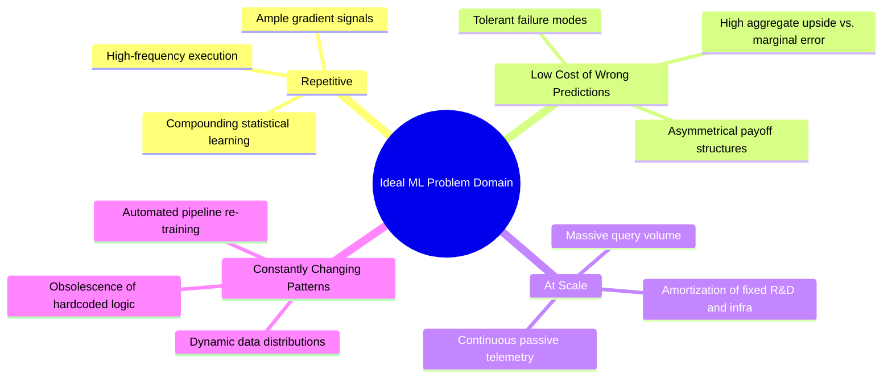

1. **Repetitive Nature**:
   - While biological intelligence excels at few-shot induction from minimal samples, modern deep statistical architectures require thousands to millions of supervised gradients to establish robust decision boundaries. High-frequency repetitive operational tasks provide the necessary empirical volume to train and refine parametric models.
2. **Low Cost of Incorrect Predictions**:
   - No production ML system guarantees 100% deterministic precision. The optimal production environment is one where individual errors carry negligible negative utility. In algorithmic recommender engines (e.g., Netflix, YouTube, Spotify), an erroneous prediction merely results in a skipped item or missed click.
   - *High-Stakes Asymmetry*: In safety-critical applications (e.g., level 4/5 autonomous vehicles, surgical robotics, oncological diagnosis), an erroneous inference can lead to catastrophic system failure or loss of life. ML is deployed in these domains only when its aggregate statistical safety margin decisively surpasses human baselines ($\text{MTBF}_{\text{ML}} \gg \text{MTBF}_{\text{Human}}$) or when deployed as an advisory secondary system with human oversight.
3. **Massive Operational Scale**:
   - Developing, productionizing, and maintaining production ML pipelines incurs substantial upfront capital expenditures (compute clusters, specialized accelerators, feature stores, data engineering pipelines, talent).
   - High operational query volumes (e.g., classifying hundreds of millions of incoming emails or routing millions of customer service tickets daily) amortize these fixed engineering costs, driving the marginal cost per inference toward zero.
   - Apparent single-event predictions (such as forecasting quadrennial presidential election outcomes) are in practice high-frequency time-series re-estimations updated hourly over thousands of volatile polling, demographic, and sentiment signals.
4. **Constantly Changing Patterns**:
   - In dynamic domains—such as adversarial fraud detection, cybersecurity malware analysis, and consumer trend forecasting—patterns mutate continuously. Static rule-based engines decay rapidly, demanding costly, continuous manual refactoring by software engineers. ML pipelines ingest new ground-truth logs to retrain model weights automatically without architectural code modifications.

---

### 1.3. Anti-Patterns: When NOT to Use Machine Learning

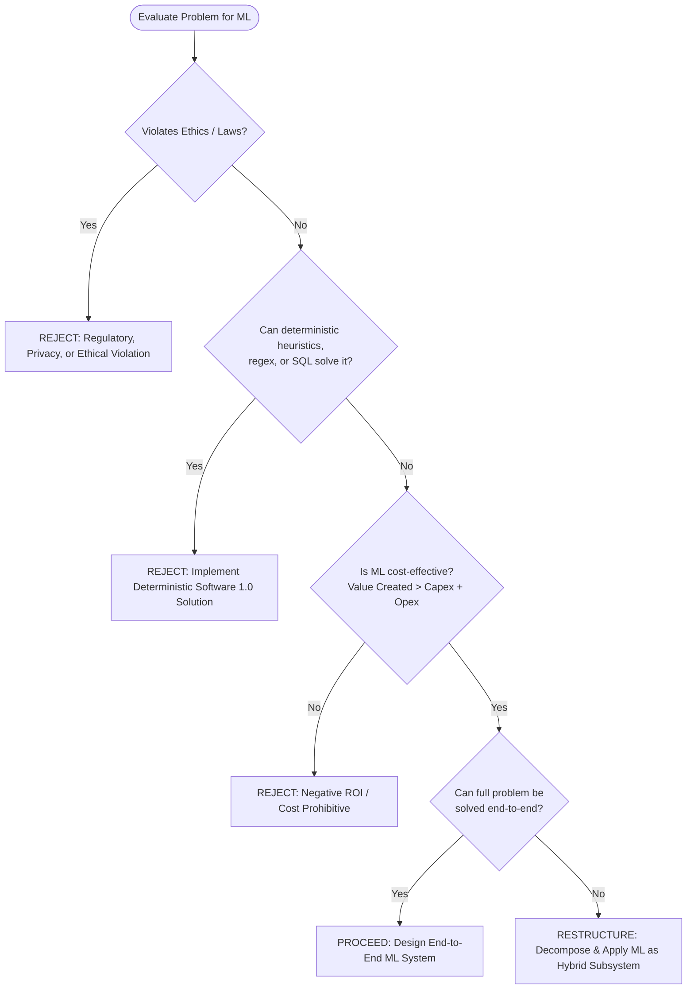

Production architects must reject ML implementations under three operational conditions:
1. **Ethical & Legal Violations**: Algorithmic profiling that violates statutory compliance (e.g., GDPR Article 22 restrictions on automated profiling, FCRA lending discrimination, HIPAA patient privacy mandates).
2. **Deterministic Sufficiency**: If a deterministic algorithm, business rule set, relational lookup table, or regular expression resolves the objective with satisfactory precision, deploying ML introduces needless technical debt, latency, and non-deterministic fragility.
3. **Economic Non-Viability**: When the projected economic return fails to offset the Total Cost of Ownership (TCO), including dataset curation, compute infrastructure (training/inference GPUs), monitoring telemetry, and operational maintenance.

> **Problem Decoupling / Hybrid Fallback Architecture**:
> When an end-to-end ML model is intractable (e.g., an autonomous agent capable of resolving arbitrary open-ended enterprise customer support queries), system architects decouple the problem into bounded components:
> - Deploy an ML text-classifier to predict whether an incoming ticket matches known canonical FAQs ($P(\text{FAQ} \mid \text{text}) \ge \tau$).
> - If above threshold $\tau$, serve verified static template responses deterministically.
> - If below threshold $\tau$, gracefully fall back to human agent routing queues.

---

## 2. Taxonomy of Production ML Use Cases

### 2.1. Architectural Divergence: Consumer vs. Enterprise ML

| Evaluation Dimension | Consumer-Facing ML Applications | Enterprise-Facing ML Applications |
| :--- | :--- | :--- |
| **Accuracy / Precision SLA** | Moderately forgiving. Perceptual gains plateau early (e.g., voice-to-text accuracy going from 95.0% to 95.5% yields marginal consumer utility). | **Hyper-stringent**. Marginal fractional gains yield millions in operational savings (e.g., 0.1% resource scheduling efficiency across data centers saves millions in infrastructure cost). |
| **Latency Constraints** | **Sub-second hard real-time SLAs**. Tail latency degrades conversion directly (latencies $> 100\text{ ms}$ drop engagement; $> 3\text{ s}$ causes session abandonment). | **Tolerant of latency variations**. Many workflows execute via scheduled offline batch pipelines (overnight ETL/inference) with relaxed SLAs. |
| **Distribution & Economics** | High distribution velocity via mobile app stores and web portals; notoriously difficult monetization and high churn rates. | Long enterprise sales cycles and complex compliance onboarding; highly defensible margins, multi-year contracts, and high customer lifetime value (LTV). |
| **Problem Modality** | Perceptual and interactive: Next-token prediction, visual face unlock, feed recommendation, computational photography. | Operational and financial: Tabular forecasting, operational anomaly detection, resource allocation, risk underwriting. |

---

### 2.2. Enterprise ML Workloads & Structural Archetypes

Enterprise ML workloads decompose into two structural vectors: **Internal Operational Optimization** (cost minimization, throughput maximization) and **External Customer-Facing Value** (revenue enhancement, retention optimization).

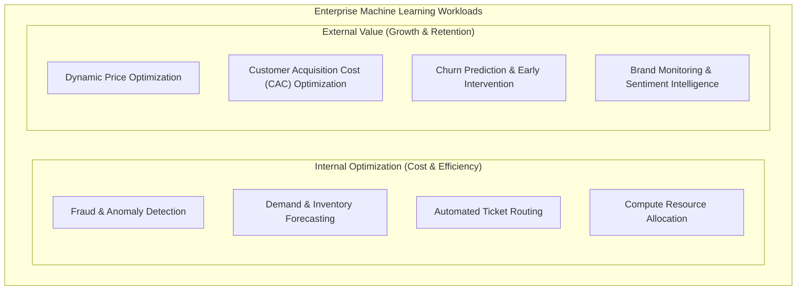

#### Detailed Breakdown of Core Enterprise Archetypes:

1. **Fraud & Anomaly Detection**:
   - Universal across digital transactional systems. Characterized by **extreme class imbalance** (e.g., fraud instances represent $\le 0.01\%$ of total volume) and an actively evasive, adversarial environment. Demands low false-positive rates to prevent friction for legitimate users.
2. **Dynamic Price Optimization**:
   - Formulated as optimizing an objective function subject to supply, market demand elasticity, and competitor signals:
     $$\max_{P_t} \quad \mathcal{J}(P_t) \in \{\text{Margin}, \text{Gross Revenue}, \text{Market Share}\}$$
   - Prevalent in high-liquidity, high-frequency environments where consumers accept variable pricing (ride-hailing surge multipliers, airline seat allocation, programmatic ad exchanges).
3. **Customer Demand & Inventory Forecasting**:
   - Resolves the operational trade-off between **Stockout Costs** (lost revenue, customer churn) and **Holding/Spoilage Costs** (warehousing overhead, perishable inventory depreciation). Operates via hierarchical multivariate time-series forecasting.
4. **Customer Acquisition Cost (CAC) Reduction**:
   - Benchmarks indicate steep baseline customer acquisition costs across commercial verticals: average mobile app in-app purchaser acquisition sits at $\approx \$86.61$, while enterprise SaaS and consumer mobility (e.g., Lyft at $\approx \$158/\text{rider}$) scale significantly higher.
   - ML optimizes conversion funnels via lookalike audience modeling, real-time bid pricing for programmatic ad impressions, and personalized dynamic discount dispatching.
5. **Churn Prediction & Prevention**:
   - The economic imperative is clear: acquiring a new enterprise or consumer customer costs **$5\times$ to $25\times$ more** than retaining an existing customer.
   - Models predict the survival probability $S(t) = P(T > t \mid X)$ of an account to trigger automated retention incentives prior to contractual or behavioral attrition.
6. **Support Ticket Triage & NLP Routing**:
   - Multi-class classification models categorize customer inquiry semantics, extracting named entities and sentiment to route requests to specialized personnel, minimizing Mean Time to Resolution (MTTR).
7. **Brand Intelligence & Implicit Sentiment Mining**:
   - Real-time NLP pipelines ingest streaming social and news firehoses, tracking explicit brand tokens ("Google") alongside implicit semantic references ("the Mountain View search company"), alerting leadership to anomalous spikes in negative sentiment.
8. **Clinical Decision Support (Healthcare)**:
   - Automated screening for diabetic retinopathy, pulmonary nodules, and histopathological anomalies. ML functions as an assistive tier under strict regulatory standards (FDA SaMD, HIPAA compliance) with mandatory human-in-the-loop sign-off.

---

## 3. Understanding ML Systems: Mind vs. Data & Structural Comparisons

### 3.1. System Anatomy: What Constitutes an ML System?

Deploying machine learning in production requires far more than mathematical algorithms. An algorithm (e.g., a neural network architecture, gradient boosted tree, or loss formulation) represents only a fraction of the total operational codebase.

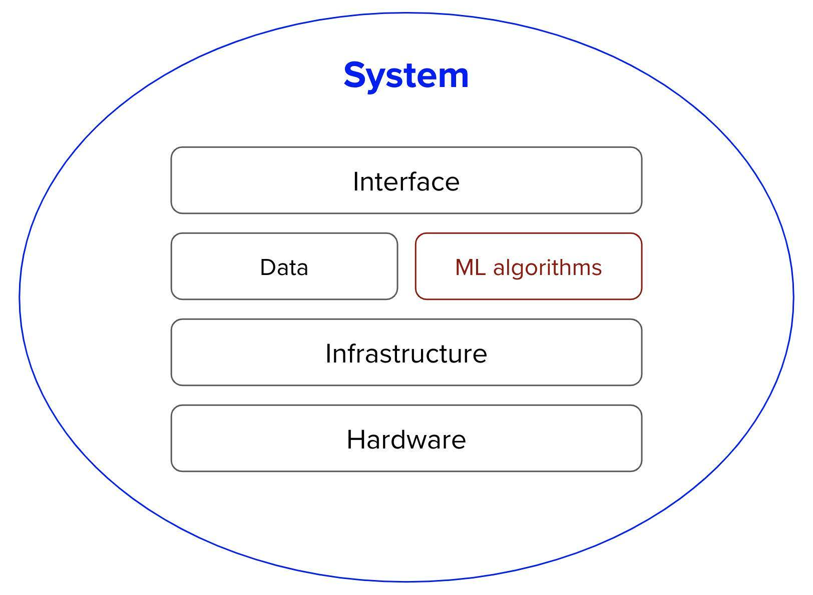

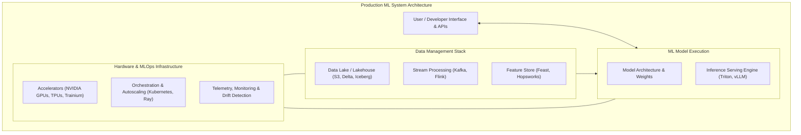

A production ML system encapsulates:
- **Serving Interfaces**: Client SDKs, REST/gRPC endpoints, schema validation layers.
- **Data Infrastructure**: Storage tiers, distributed streaming platforms, and feature stores.
- **Compute Backends**: Hardware accelerators optimized for tensor operations, managed via distributed orchestration systems.
- **Operational Infrastructure**: Continuous deployment pipelines, model registries, telemetry logging, and automated drift detection.

---

### 3.2. Mind vs. Data: The Philosophical Divergence

The historical trajectory of machine learning is defined by an ongoing debate between two distinct schools of thought regarding the primary driver of artificial intelligence:

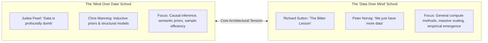

- **The "Mind Over Data" Paradigm**:
  - **Dr. Judea Pearl** (Turing Award laureate, pioneer of Causal Networks): Characterizes raw empirical data as *"profoundly dumb"*. Observational data solely captures static associations:
    $$P(Y \mid X)$$
    It is mathematically incapable of answering interventional queries ($P(Y \mid \text{do}(X))$) or evaluating counterfactual scenarios without structural causal models. Heavy reliance on raw correlation leaves systems vulnerable when environmental distributions shift.
  - **Prof. Christopher Manning** (Director, Stanford AI Lab): Demonstrates that combining generic learning algorithms with massive data without domain priors produces *"incredibly bad learners"*. Incorporating structured inductive biases allows systems to learn richer representations from orders-of-magnitude fewer training examples.
- **The "Data Over Mind" Paradigm**:
  - **Prof. Richard Sutton** (*The Bitter Lesson*, 2019): AI's 70-year history proves that general-purpose methods leveraging raw computation consistently outperform human domain heuristics over long horizons. Manual inductive biases yield short-term gains but eventually form performance bottlenecks that are overturned by massive compute and data scaling.
  - **Peter Norvig** (Google Director of Search): *"We don’t have better algorithms. We just have more data."*

#### The Data Science Hierarchy of Needs
Dr. Monica Rogati formalized this data-first imperative by adapting Maslow's hierarchy of needs to enterprise artificial intelligence. Without foundational layers of data acquisition and reliable storage, advanced machine learning initiatives inevitably collapse.

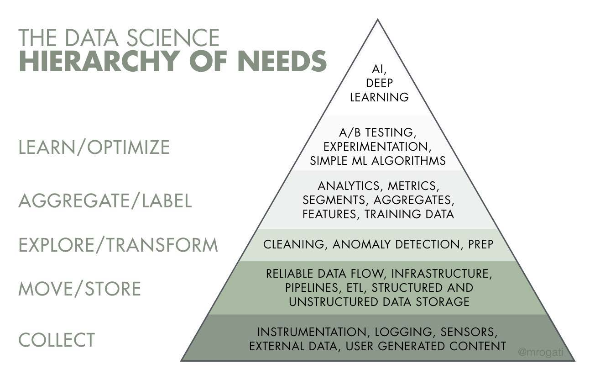

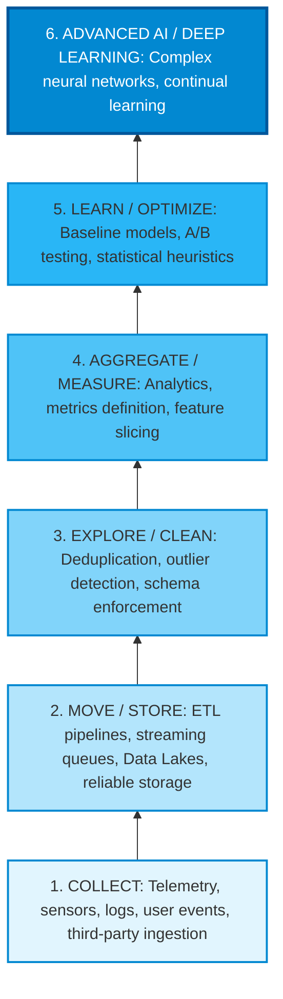

#### Finite vs. Infinite Data Realities
- **The Infinite Data Paradox**: If an engineering system possessed access to infinite, fully representative data, machine learning would become obsolete; decision-making would reduce to a deterministic $O(1)$ memory lookup.
- **The Empirical Reality**: Production ML operates strictly in the regime of **finite data**. The dataset tokens required to train modern language representations have scaled exponentially:
  - 2013 (*One Billion Word Benchmark*): $0.8 \times 10^9$ tokens.
  - 2019 (OpenAI GPT-2): $10 \times 10^9$ tokens ($12.5\times$ growth).
  - 2020 (OpenAI GPT-3): $500 \times 10^9$ tokens ($625\times$ growth over 2013).

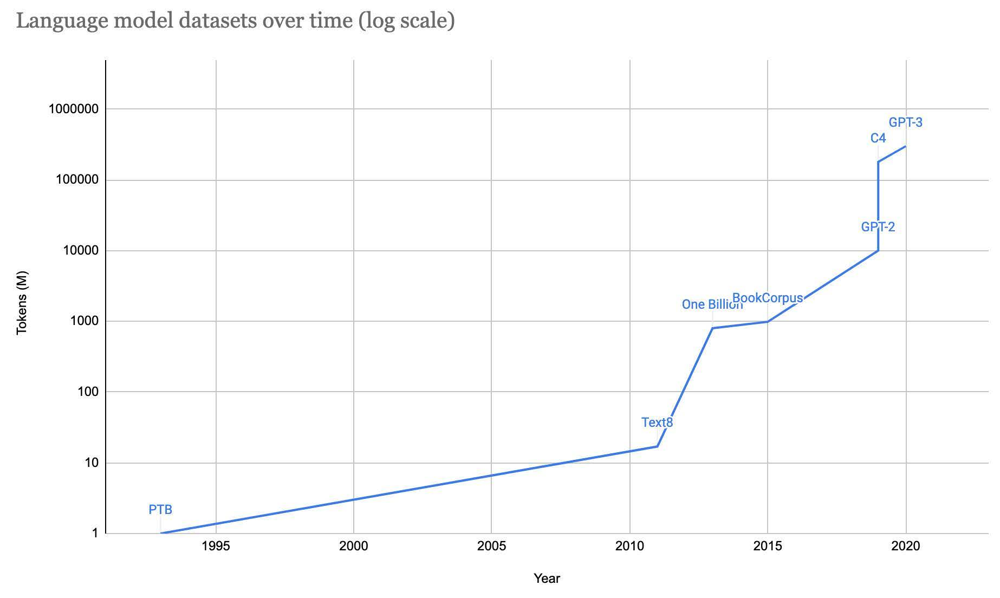

> **Quality Dominates Volume**: Indiscriminately ingesting low-quality data (e.g., mislabeled instances, stale logs, or unvetted web crawls) degrades decision boundaries. In high-stakes regimes, curated high-signal datasets consistently outperform noisy, uncurated corpora.

---

## 4. Research ML vs. Production ML: Technical Comparison

Moving from academic or research environments into production reveals deep structural misalignments across priorities, constraints, and operational metrics.

### 4.1. Comparative Matrix

| Evaluation Dimension | Machine Learning in Research | Machine Learning in Production |
| :--- | :--- | :--- |
| **Primary Objective** | Maximize benchmark performance metrics (SOTA on GLUE, ImageNet, SuperGLUE). Single scalar objective. | **Multi-stakeholder, multi-objective optimization**: Balancing business KPIs, inference latency, hardware footprint, and explainability. |
| **Computational Priority** | **Fast Training & High Throughput**. Training is the bottleneck; inference runs once over a fixed test set. | **Fast Inference & Low Latency**. Inference runs continuously under strict SLA thresholds; training is periodic. |
| **Data Characteristics** | Static, clean, pre-tokenized, curated historical benchmarks with established baselines. | **Dynamic, noisy, shifting distributions**, uncurated streaming inputs, missing labels, regulatory constraints. |
| **Fairness & Bias** | Often treated as a secondary metric; absent from most competitive leaderboards. | **Mission-critical invariant**. Algorithmic bias introduces legal liabilities, regulatory penalties, and brand erosion. |
| **Interpretability** | Optional ("Nice to have"); complex black-box architectures are favored if they improve metrics. | **Mandatory requirement**. Essential for regulatory auditing, operational debugging, and establishing operational trust. |

---

### 4.2. Deep Dive: Key Technical Differences

#### 1. Stakeholder Divergence & Decoupling Conflicting Objectives
In research, alignment centers on a single objective function (e.g., cross-entropy loss or top-1 accuracy). In production, an ML application operates within a web of competing stakeholder objectives:

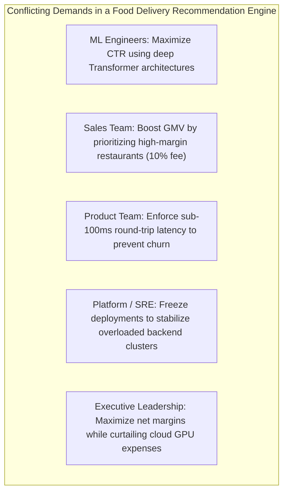

If the ML engineering team builds an ensembled model that maximizes Click-Through Rate ($P(\text{click})$) while ignoring restaurant check sizes, gross transaction value drops. If they build a model that exclusively surfaces luxury restaurants to maximize fees, user click-through and order conversion plummet. Furthermore, neither model satisfies the product team's $< 100\text{ ms}$ latency requirement.

> **Architectural Solution: Decoupling Objectives via Multi-Model Ranking**:
> Instead of forcing a single model to optimize multiple conflicting objectives simultaneously, architects decouple the tasks into distinct sub-models and unify them via a configurable parametric policy:
> 
> $$\text{Final Rank Score} = f\Big(P(\text{click}), \; \mathbb{E}[\text{Order Value}], \; \text{Service Fee Ratio}\Big) = P(\text{click})^\alpha \times \Big(\mathbb{E}[\text{Order Value}] \times \text{Fee}\Big)^\beta$$
> 
> *Architectural Advantages*:
> 1. Decoupled training pipelines: The CTR model ($M_A$) and transaction value regressor ($M_B$) train on dedicated signals without gradient interference.
> 2. Real-time business agility: Business teams can shift operational posture (e.g., trading margins for transaction volume during user acquisition campaigns) by tuning $\alpha$ and $\beta$ in a lightweight serving layer without retraining underlying neural models.

#### 2. The Ensembling Paradox & The Leaderboard Trap
- **The Ensembling Paradox**: In machine learning competitions (such as the \$1M Netflix Prize or Kaggle leaderboards), winning submissions routinely deploy stacked ensembles combining dozens of heterogeneous models (GBDTs, RNNs, Matrix Factorization, Deep Autoencoders). Despite winning the competition, Netflix famously never deployed the full ensemble to production. The modest uplift in Root Mean Squared Error (RMSE) failed to justify the engineering overhead, linear explosion in inference latency, and high multi-model serving costs.
- **The Multiple-Hypothesis Testing Trap**: When hundreds of research teams evaluate model variants against the same fixed hold-out test set, performance improvements often stem from empirical variance and test-set overfitting rather than genuine architectural breakthroughs.

#### 3. Computational Priorities: Latency vs. Throughput
Academic research optimizes for **throughput** (samples processed per unit time) to accelerate experimental cycles across large static datasets. Production systems prioritize **latency** (time elapsed to process an individual request).

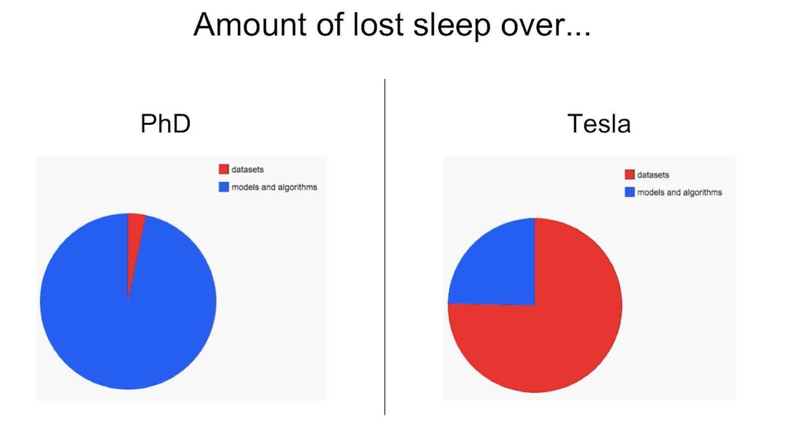

##### Definitional Precision (Systems Engineering Framework)
Following the formal systems architecture distinctions outlined by Martin Kleppmann (*Designing Data-Intensive Applications*):
- **Service Time**: The duration required by the processing unit (CPU/GPU) to execute computation on a request.
- **Queueing Delay**: The duration a request waits in ingress buffers before execution commences.
- **Response Time**: The total round-trip duration observed by the client application:
  $$\text{Response Time} = \text{Service Time} + \text{Queueing Delay} + \text{Network Delay}$$
- *ML Industry Convention*: In production ML literature, the term **Latency** is commonly used interchangeably with **Response Time**. **Throughput** denotes system query capacity, typically measured in Queries Per Second (QPS).

##### The Online Serving Batching Trade-off
To maximize throughput, modern tensor accelerators rely heavily on batching:

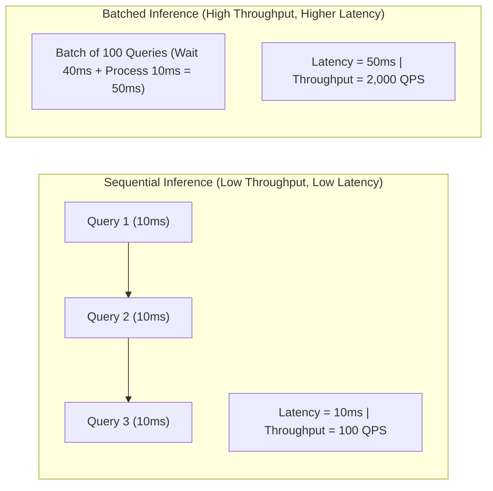

In offline batch processing, batching maximizes GPU utilization with no downside. In interactive online serving, batching introduces an operational penalty: the system must pause and buffer requests until either the target batch size $B$ is reached or a dynamic timeout $T_{\text{wait}}$ expires:

$$T_{\text{latency}} = T_{\text{wait}} + T_{\text{service}}(B)$$

While aggregate throughput increases, early-arriving individual queries incur significant queueing delays.

##### Empirical Business Impact of Latency
- **Akamai (2017)**: A $100\text{ ms}$ increase in latency reduces e-commerce conversion rates by **7%**.
- **Booking.com (2019)**: A $30\%$ increase in latency incurs an absolute **0.5%** decrease in overall conversion, generating significant lost revenue.
- **Google Research**: Latencies exceeding **3 seconds** cause more than **50%** of mobile sessions to bounce.

#### 4. Latency Distributions & The Perils of Arithmetic Means
Systems architects must never characterize operational latency using the arithmetic mean ($\mu = \frac{1}{N}\sum x_i$). Means obscure acute tail anomalies and multi-modal distribution profiles.

*Concrete Demonstration*: Consider ten consecutive inference queries returning latencies (in milliseconds):
$$\mathbf{L} = [100, 102, 100, 100, 99, 104, 110, 90, 3000, 95]$$
- **Arithmetic Mean**: $\bar{L} = 390\text{ ms}$. This figure misleadingly implies that the entire serving system is sluggish.
- **Median ($p50$)**: $100\text{ ms}$. Accurately characterizes the typical user experience.
- **90th Percentile ($p90$) / 99th Percentile ($p99$)**: $3000\text{ ms}$. Pinpoints an acute outlier event (e.g., an inference timeout, cold-start model load, or TCP retransmission).

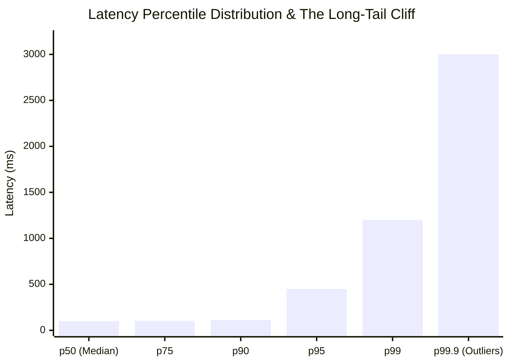

> **The Amazon Tail-Latency Effect**:
> Systems analysis at Amazon revealed that requests falling into the extreme 99th and 99.9th percentiles ($p99$, $p99.9$) are systematically generated by the platform's **most valuable customers**—power users whose accounts maintain massive order histories, expansive wishlists, and complex recommendation graphs. Neglecting tail latency disproportionately degrades the user experience for the highest-value accounts.

#### 5. Data Dynamics: The Andrej Karpathy Paradigm
The transition from academic PhD research to production systems engineering at industrial scale (e.g., Tesla Autopilot) reveals a major shift in focus:

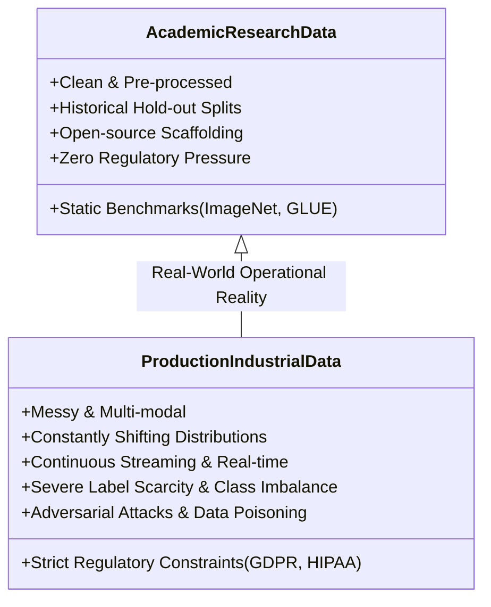

#### 6. Algorithmic Bias Amplification
- **Historical Encoding**: Machine learning algorithms do not forecast an enlightened future; they mathematically encode and extrapolate historical correlations. If historical datasets contain societal, systemic, or institutional biases, the model internalizes, amplifies, and scales these biases across automated operations.
- **Empirical Evidence**: A 2019 UC Berkeley study demonstrated that both traditional and automated algorithmic mortgage lending systems systematically rejected over **1.3 million creditworthy Black and Latino applicants** between 2008 and 2015. When researchers eliminated explicit racial markers while preserving credit scores and verified financial metrics, mortgage applications were approved at standard baseline rates.
- **Minority Representation Asymmetry**: In an objective function minimizing global loss ($\min_\theta \frac{1}{N}\sum \mathcal{L}(f_\theta(x_i), y_i)$), an error on a protected demographic group comprising 2% of the population contributes only 2% to the total loss penalty. A model can achieve 98% aggregate accuracy while misclassifying the minority cohort, creating substantial disparate impact.
- **Enterprise Gap**: According to McKinsey's 2019 State of AI report, only **13%** of large enterprises actively implement formal technical protocols to audit and mitigate algorithmic bias.

#### 7. Interpretability & The Geoffrey Hinton Dilemma
In 2020, Turing Award recipient Geoffrey Hinton proposed an ethical and technical thought experiment:
> *"Suppose you have cancer and you have to choose between a black-box AI surgeon that cannot explain how it works but has a 90% cure rate, and a human surgeon with an 80% cure rate. Do you want the AI surgeon to be illegal?"*

When presented to 30 technology executives at non-tech public enterprises, **50% chose the human surgeon**. Despite superior statistical performance, humans consistently hesitate to surrender high-consequence agency to uninterpretable systems.

##### The Two Engineering Dimensions of Interpretability
1. **User Trust & Statutory Compliance**: End users and enterprise operators require transparent rationales for high-stakes decisions (e.g., explaining credit application rejections under the Fair Credit Reporting Act and GDPR Article 13/22 "Right to Explanation").
2. **Developer Debuggability**: Complex architectures fail via hidden paths. Without interpretability tooling (feature attributions, SHAP values, Integrated Gradients, attention maps), engineers cannot distinguish between genuine statistical generalization and shortcut learning (e.g., a chest X-ray classifier keying on radiographic calibration tags rather than lung pathology).

---

## 5. ML Systems vs. Traditional Software Engineering

Machine Learning engineering is a specialized branch of Software Engineering (SWE). However, the foundational assumptions of traditional software design—often termed **Software 1.0**—do not map cleanly to the probabilistic nature of **Software 2.0**.

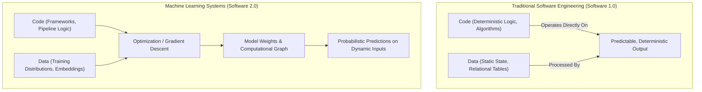

### 5.1. Comparative System Architecture

| Engineering Dimension | Traditional Software (SWE 1.0) | Machine Learning Systems (SWE 2.0) |
| :--- | :--- | :--- |
| **Separation of Concerns** | **Strict boundary between logic and state**. Code files (`.py`, `.cpp`) define logic; databases store state. | **Tight coupling of code, data, and artifacts**. The compiled logic resides inside learned parameter weights ($\mathbf{W}, \mathbf{b}$) produced by training code on training data. |
| **Testing & Verification** | Deterministic unit, integration, and end-to-end testing against explicit assertions (`assert output == expected`). | **Non-deterministic behavioral evaluation**. Requires slice-based testing, distribution shift detection, statistical parity audits, and performance regression suites. |
| **Versioning Paradigms** | Source code versioning via Git is sufficient to reconstruct system states deterministically. | **Dual versioning of code AND massive data artifacts**. Re-executing identical training code against slightly altered data yields a fundamentally different model artifact. |
| **Data Sample Valuation** | Uniform handling: All valid database rows are processed identically under fixed schema rules. | **Extreme sample value asymmetry**. One rare edge-case sample (e.g., malignant lung nodule) carries vastly higher optimization value than a million normal scans. |
| **Failure Modes** | **Fail Loudly**. Exceptions trigger crash logs, stack traces, null-pointer errors, or HTTP 500 error responses. | **Fail Silently**. The service returns HTTP 200 OK and valid probability tensors, but predictions are entirely uncalibrated or incorrect. |
| **Security Attack Surface** | SQL injection, cross-site scripting (XSS), buffer overflows, network-level DDoS. | **Data poisoning, backdoor weight insertion, adversarial evasion perturbations, model inversion, membership inference**. |

---

### 5.2. Unique Failure Modes: Data Poisoning & Silent Failures

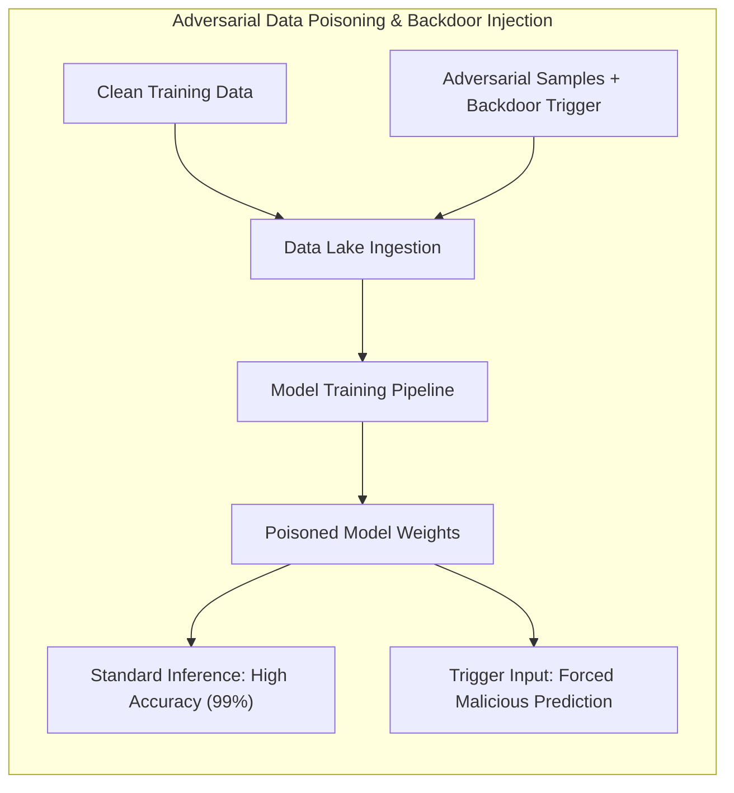

- **Data Poisoning & Targeted Backdoor Attacks**: Unlike traditional software systems where malicious code must bypass firewalls, production ML pipelines continuously ingest external, uncurated data to stay current. Adversaries can inject targeted anomalies into public or third-party datasets. As demonstrated by Chen et al. (2017), an attacker can embed subtle trigger artifacts (e.g., a specific pixel pattern on a face) during training. The resulting model behaves normally on clean test data, but misclassifies any unauthorized user presenting the trigger pattern.
- **The Rapid Evolution of Model Footprints**: In 2018, the release of BERT-Large (340M parameters, 1.35GB) was widely considered computationally prohibitive for real-time serving. Within two years, breakthroughs in quantization, distillation, and tensor compiler runtimes integrated BERT variants into nearly every English Google Search query. Systems that appear impractical today often become production baselines within short technological cycles.

---

## 6. The Four Pillars of Production ML Systems Design

> **Formal Definition**: **Machine Learning Systems Design** is the holistic engineering process of defining, orchestrating, and optimizing all architectural tiers of an ML product—including user interfaces, algorithmic models, data engineering pipelines, distributed compute infrastructure, and specialized accelerator hardware—to satisfy functional requirements and operational SLAs under real-world constraints.

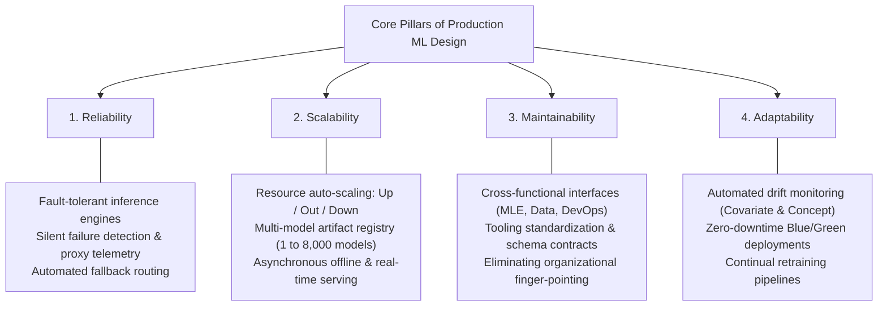

### 6.1. Reliability
- **System Definition**: The system must consistently deliver correct predictions at target performance thresholds despite environmental adversity, hardware crashes, network partitions, software bugs, and human operator errors.
- **The Silent Failure Challenge**: In traditional web architecture, a fatal bug surfaces via HTTP 500 errors or process terminations. In machine learning, a failing model runs smoothly:
  ```python
  # Silent failure: Executes cleanly without throwing exceptions
  prediction = model.predict(corrupted_feature_vector)
  return Response(status=200, data=prediction)
  ```
  The caller receives an HTTP 200 with valid floating-point numbers, but the output represents garbage predictions. Because true labels arrive with substantial lag (or never arrive), silent failures can degrade business operations undetected for weeks without proactive telemetry and proxy monitoring.

---

### 6.2. Scalability
Scalability measures a system's capacity to handle structural growth across three distinct operational vectors:

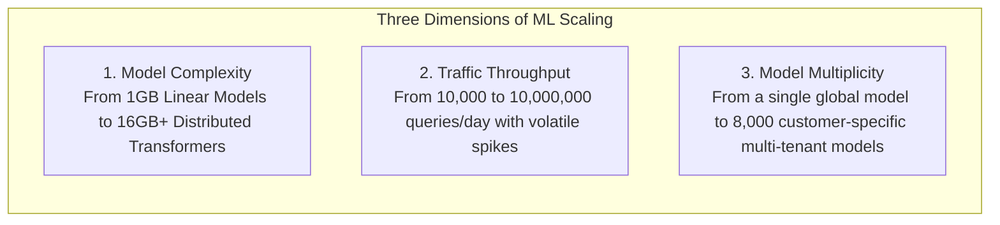

#### 1. Resource Scaling: Scale-Up vs. Scale-Out vs. Scale-Down
- **Scaling Up (Vertical)**: Upgrading to instances with larger VRAM, higher memory bandwidth, and faster compute (e.g., moving from an NVIDIA A10G to an H100).
- **Scaling Out (Horizontal)**: Distributing inference requests across auto-scaled pools of parallel workers behind an ingress load balancer.
- **Scaling Down (Cost Optimization)**: Production workloads exhibit distinct diurnal cycles. A system requiring 100 GPUs during peak hours must reliably scale down to 10 GPUs off-peak to control infrastructure costs.

> **Production Warning: The Prime Day Autoscaling Collapse**:
> Auto-scaling is notoriously difficult to configure correctly under sudden traffic surges. During Amazon's 2018 Prime Day, the auto-scaling infrastructure collapsed under traffic spikes, causing rolling downtime that cost an estimated **$72M to $99M** in lost transactions within hours.

#### 2. Artifact Management at Enterprise Scale
Managing one model in production can be handled with standard scripts and manual checkpoints. Managing **hundreds or thousands of tenant-specific models** (e.g., enterprise B2B SaaS platforms serving dedicated fine-tuned models per enterprise customer) requires fully automated orchestration: programmatic retraining, automated validation gates, dynamic multi-model routing, and centralized model registries.

---

### 6.3. Maintainability
- Production ML systems sit at the intersection of diverse disciplines: Data Engineers (Spark, Kafka, SQL), ML Engineers (PyTorch, Hugging Face, Ray), DevOps/Platform Engineers (Kubernetes, Terraform, C++ serving runtimes), and Business Domain Experts.
- **Minimizing Tool Fragmentation & Blame Cultures**: When prediction anomalies occur, poorly integrated tools trigger organizational friction: ML engineers blame data engineering pipelines for feature drift; data engineers blame infrastructure for dropped messages; platform engineers blame ML engineers for memory leaks. Systems must maintain rigid schema contracts, end-to-end data lineage tracking, and shared observability dashboards to isolate root causes efficiently.

---

### 6.4. Adaptability
- Production ML systems must evolve smoothly alongside shifting environments and mutating underlying data distributions without service disruptions.
- The system must incorporate architectural hooks to discover performance degradation automatically, trigger scheduled or event-driven retraining pipelines, and execute zero-downtime model updates via Blue/Green or Canary deployment strategies.

---

## 7. The Iterative Lifecycle of an ML System

Developing a production ML system is fundamentally **cyclical, heuristic, and continuous**. It is never a linear waterfall pipeline.

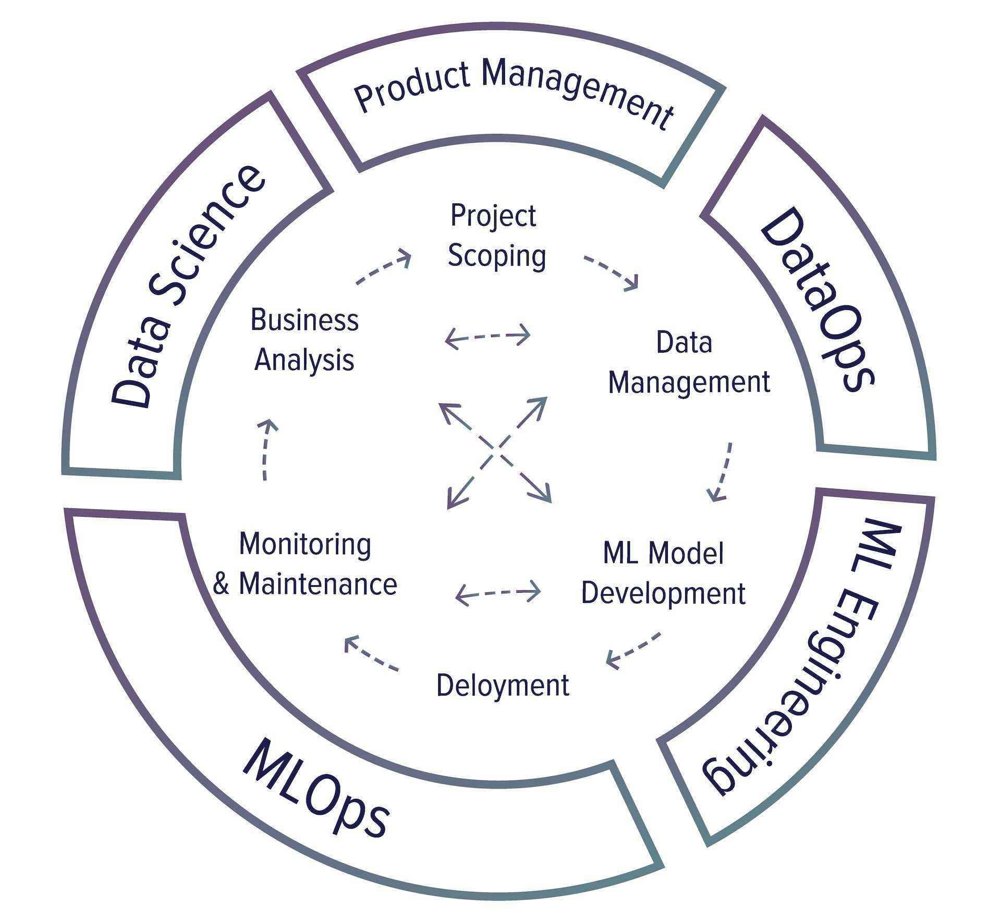

### 7.1. An Empirical 13-Step Workflow: The Search Ad Serving Engine

The following workflow illustrates the real-world feedback loops encountered when developing an ad prediction engine:

```
[Step 1] Define initial objective: Optimize Impressions (Ad Views).
    │
[Step 2] Instrument data collection & label extraction.
    │
[Step 3] Engineer features (text embeddings, historical CTR, user demographics).
    │
[Step 4] Train initial candidate models.
    │
[Step 5] Error Analysis ──► Discovers noisy, corrupted labels ──► [Relabel Dataset]
    │                                                                  │
[Step 6] Retrain Model ◄───────────────────────────────────────────────┘
    │
[Step 7] Error Analysis ──► Discovers model always predicts "No-Show"
    │                      (Root cause: 99.99% of query logs are No-Show; severe class imbalance)
    │                      └──► [Collect targeted Show data & apply under/oversampling]
    │                                              │
[Step 8] Retrain Model ◄───────────────────────────┘
    │
[Step 9] Evaluation ──► High performance on historical test split (2 months stale),
    │                   but accuracy plummets on live data from yesterday (Concept Drift)
    │                   └──► [Rebuild data pipeline to ingest streaming real-time logs]
    │                                              │
[Step 10] Retrain Model ◄──────────────────────────┘
    │
[Step 11] Deploy Model to Production Cluster.
    │
[Step 12] Business Alert: Executive leadership reports dropping ad revenue!
    │     (Root cause: Impressions increased, but user click-through and purchases dropped;
    │      the system optimized for views rather than engagement)
    │     └──► Shift objective to Click-Through Rate (CTR) and Conversion Value.
    │
[Step 13] Return to STEP 1 (Initiate new development lifecycle).
```

---

### 7.2. The Six-Phase Architectural Framework

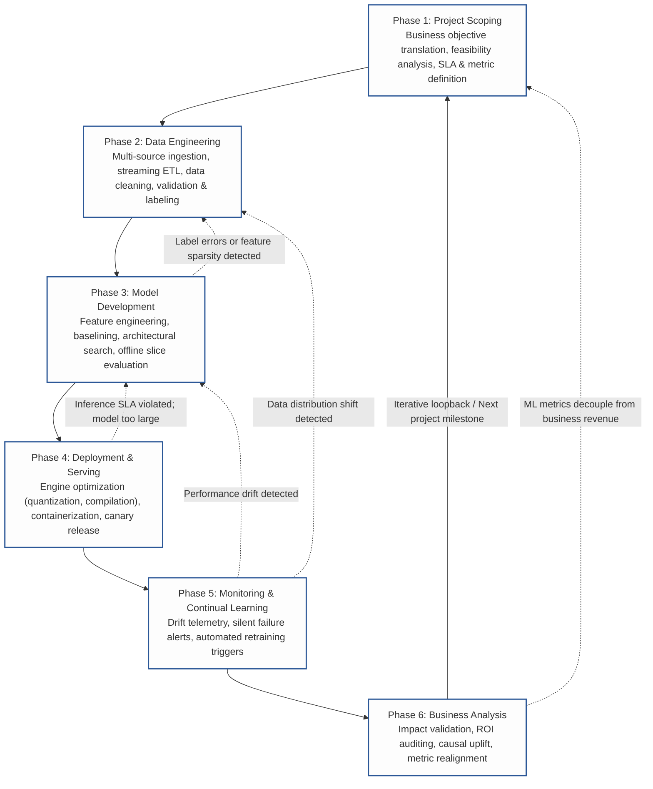

#### Detailed Phase Decomposition

1. **Phase 1: Project Scoping**:
   - Translate high-level business goals into precise mathematical formulations.
   - Establish technical constraints: Maximum allowable $p99$ response latency (e.g., $< 50\text{ ms}$), memory budgets for edge deployment, ethical fairness constraints, and data privacy firewalls.
   - Align stakeholders across engineering, product, legal, and operational domains.
2. **Phase 2: Data Engineering**:
   - Build reliable data pipelines handling both batch lakehouse storage and real-time event streams (e.g., Kafka, Flink).
   - Implement data cleaning, deduplication, schema validation, and programmatic labeling pipelines (weak supervision, active learning).
3. **Phase 3: Model Development**:
   - Establish simple heuristics or linear baselines before building deep neural models.
   - Extract, transform, and register features within centralized Feature Stores.
   - Execute model training, hyperparameter tuning, and comprehensive offline evaluation across critical demographic and behavioral slices.
4. **Phase 4: Deployment & Serving**:
   - Optimize model artifacts via quantization (FP32 $\to$ INT8/FP4), weight pruning, and graph compilation (TensorRT, ONNX Runtime).
   - Choose serving architectures: Batch vs. Real-time streaming; Cloud inference vs. On-device edge runtime.
   - Implement deployment safeguards: Shadow deployments, Canary rollouts, and multi-armed bandit A/B testing.
5. **Phase 5: Monitoring & Continual Learning**:
   - Monitor system health metrics (QPS, memory, GPU compute utilization, latency percentiles).
   - Track statistical data drift: Covariate shift ($P(X)$) and Concept drift ($P(Y \mid X)$).
   - Implement automated alerts using proxy feedback loops when ground-truth labels are delayed.
6. **Phase 6: Business Analysis**:
   - Evaluate technical model performance against top-line business indicators (conversion rate, retention, gross margins, user engagement).
   - Conduct causal impact analysis to ensure model predictions drive genuine business uplift rather than capturing incidental correlations.

---

## 8. Production Readiness Checklist

Before promoting any machine learning system from development to customer-facing production infrastructure, technical leads and systems architects must audit and verify the following operational gates:

| Category | Verification Item | Technical Evaluation Criteria | Status |
| :---: | :--- | :--- | :---: |
| **I. Problem Formulation & Economics** | **1.1. Deterministic Baseline Validation** | Verified that a simple heuristic rule set, regex engine, or SQL lookup cannot achieve acceptable performance at lower cost. | [ ] |
| | **1.2. Economic Viability (ROI Audit)** | Net projected enterprise value exceeds the total operational cost (data infrastructure, GPU compute, maintenance engineering). | [ ] |
| | **1.3. Decoupled Conflicting Objectives** | Conflicting business metrics (e.g., CTR vs. Profit Margin) are decoupled into distinct sub-models rather than merged into a single uninterpretable model. | [ ] |
| **II. Data Governance & Pipelines** | **2.1. Distribution Parity Audit** | Verified that training datasets reflect production inference distributions ($P_{\text{train}}(X) \approx P_{\text{prod}}(X)$). | [ ] |
| | **2.2. Immutable Data Versioning** | Training data splits, preprocessing pipelines, and feature transformations are immutably versioned and reproducible (e.g., DVC, Delta Lake). | [ ] |
| | **2.3. Data Poisoning & Anomaly Defense** | Input validation gates inspect incoming data to prevent training set corruption, data leakage, and adversarial backdoor injection. | [ ] |
| **III. Model Evaluation & Ethics** | **3.1. Baseline Comparison Gate** | The model demonstrably outperforms both naive baselines (majority class) and simple statistical models (Logistic Regression, shallow GBDT). | [ ] |
| | **3.2. Slice-Based Fairness Audit** | Evaluated error rates across sensitive demographic cohorts and minority slices to prevent algorithmic bias and ensure statutory fairness. | [ ] |
| | **3.3. Interpretability & Explainability** | Production models provide feature attribution vectors or interpretability fallbacks to debug anomalies and satisfy regulatory auditing. | [ ] |
| **IV. Serving Infrastructure & SLAs** | **4.1. High-Percentile Latency SLAs** | System satisfies hard $p90$, $p99$, and $p99.9$ latency thresholds under simulated peak production traffic loads. | [ ] |
| | **4.2. Tested Auto-scaling Mechanics** | Auto-scaling policies support both rapid horizontal scale-out under sudden traffic spikes and graceful scale-down during off-peak periods. | [ ] |
| | **4.3. Multi-Model Lifecycle Automation** | Automated pipelines govern artifact serialization, registry tracking, and dynamic loading across multi-tenant deployments. | [ ] |
| **V. Operations, Monitoring & Fallbacks** | **5.1. Silent Failure & Proxy Monitoring** | Telemetry pipelines track prediction probability distributions and proxy engagement metrics in real time to catch silent model failures. | [ ] |
| | **5.2. Automated Drift Alerting** | Telemetry captures covariate shift ($P(X)$) and concept drift ($P(Y \mid X)$) with automated alerts tied to retraining pipelines. | [ ] |
| | **5.3. Graceful Fallback Strategy** | If the ML inference engine experiences unhandled exceptions or latency timeouts, traffic automatically falls back to static heuristics or cached baselines without crashing user interfaces. | [ ] |
