# Chapter 2: Data Engineering Fundamentals

---

## Executive Summary
In production Machine Learning systems, data engineering is the dominant determinant of system reliability, serving latency, and engineering velocity. While academic ML treats data as static, pre-processed tensors loaded into memory via uniform iterators, production ML operates on dynamic, distributed, heterogeneously typed data pipelines. 

Data engineering for ML spans the entire lifecycle of data: ingestion from disparate sources, serialization into performant storage formats, modeling relationships via appropriate access paradigms, distributed query processing, asynchronous transport across services, and unifying batch and streaming pipelines. 

A failure at any stage of the data engineering stack propagates directly into model degradation, training-serving skew, and silent systemic failures.

---

## 1. Data Sources: Origins, Invariants, and Governance

A production ML system ingests data generated by three fundamentally distinct mechanical processes: User-Generated, System-Generated, and Enterprise Internal.

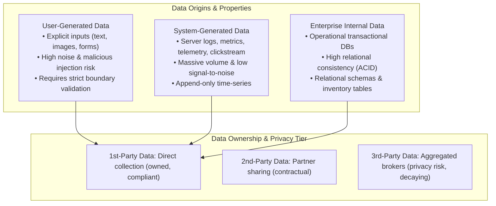

### 1.1. Categorization by Generative Process

1. **User-Generated Data (UGD)**:
   - **Characteristics**: High semantic density, highly unstructured (free text, mobile camera photos, ratings, form inputs).
   - **Failure Modes**: Missing values, malformed payloads, adversarial data injection (e.g., prompt injection, SQLi, evasion perturbations).
   - **Production Requirement**: Must undergo zero-trust input validation, sanitization, and schema conformance checks at the API gateway prior to entering storage or feature pipelines.

2. **System-Generated Data (SGD)**:
   - **Characteristics**: Machine logs, HTTP telemetry, service request payloads, daemon heartbeats, and client-side clickstream events (dwell time, scroll velocity).
   - **Volume vs. Value**: Extremely high ingestion throughput (hundreds of gigabytes to petabytes daily) characterized by a low signal-to-noise ratio.
   - **Storage Invariant**: Requires multi-tiered lifecycle management—hot in-memory buffers $\to$ warm columnar lakehouse tables $\to$ cold glacier object storage.

3. **Enterprise Internal Data (EID)**:
   - **Characteristics**: Relational enterprise state (customer CRM profiles, product catalogs, historical billing, inventory stock).
   - **Consistency Requirements**: Governed by strict relational integrity constraints and transaction boundaries (ACID).

### 1.2. Data Ownership, Attribution, and the Privacy Collapse

| Dimension | 1st-Party Data | 2nd-Party Data | 3rd-Party Data |
| :--- | :--- | :--- | :--- |
| **Collection Channel** | Direct interaction with users on company platforms | Shared directly between contracted business partners | Acquired from commercial data aggregators & brokers |
| **Data Quality & Lineage** | High; deterministic provenance and clear schema | Moderate; reliant on partner documentation and SLAs | Low to Variable; black-box methodology, high noise |
| **Regulatory & Privacy Resilience** | High; direct user consent under GDPR/CCPA | Moderate; subject to bilateral data processing agreements | **Critically Vulnerable**; collapsing under tracking restrictions |
| **Strategic Moat** | **Maximum**; unique to business operations | Moderate; competitive advantage shared with partner | Zero; commodity data available to competitors |

> **The Collapse of Third-Party Tracking**:
> Mobile ecosystem shifts—specifically Apple’s App Tracking Transparency (ATT) requiring explicit opt-in for IDFA tracking and the deprecation of third-party cookies—severely degraded advertising models relying on cross-app attribution. Production ML systems must architect their predictive pipelines around resilient First-Party Data telemetry.

---

## 2. Data Formats and Storage Serialization

Data format selection fundamentally dictates I/O bandwidth consumption, memory cache utilization, serialization/deserialization CPU overhead, and storage footprint.

### 2.1. Text vs. Binary Serialization

Textual formats (JSON, CSV, TSV) are human-readable but computationally inefficient for large-scale ML systems:
* **Storage Footprint**: Numerical representations are bloated. The integer `1,000,000` requires 7 ASCII bytes in text versus 4 bytes as a binary `int32` (or even fewer using bit-packing).
* **CPU Deserialization Overhead**: Parsing textual representations requires lexical scanning, float precision conversions, and string allocations, consuming up to $80\%$ of feature extraction CPU cycles.
* **Precision Degradation**: IEEE 754 floating-point values suffer precision truncation when converted to textual strings and parsed back into binary registers.

Binary formats (Parquet, ORC, Avro, Protocol Buffers) eliminate parsing overhead through direct memory mapping, packed bit-level encoding, and embedded schemas.

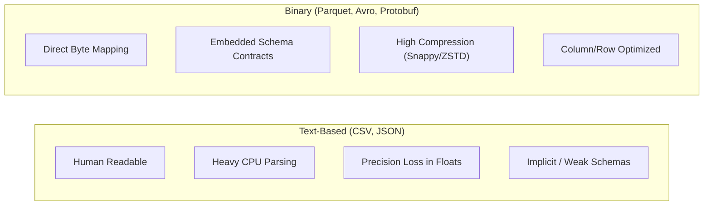

### 2.2. Row-Major vs. Column-Major Layouts

The architectural divergence between row-oriented and column-oriented storage dictates query performance and hardware cache efficiency.

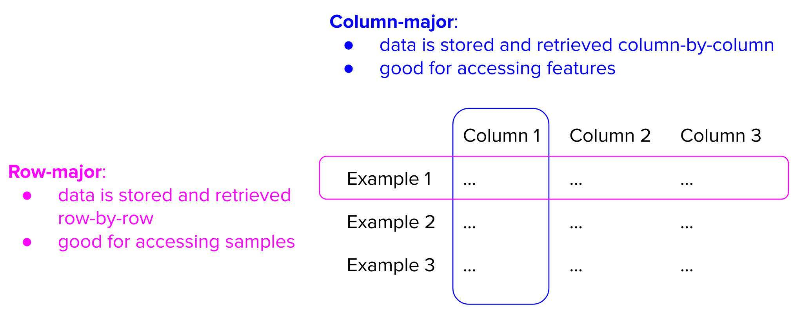

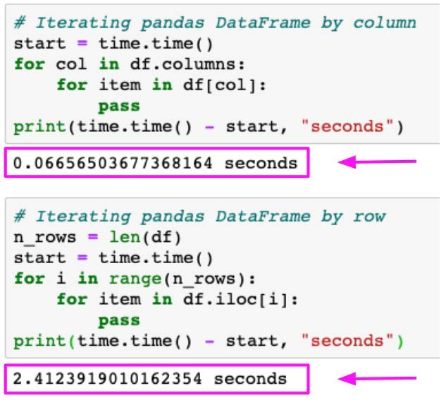

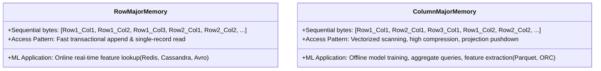

#### Mechanical Differences:
1. **Memory Locality & Cache Lines**:
   - Modern CPUs load data into cache in 64-byte lines. If an analytical model requires only 3 features out of 200 available columns:
     - **Row-Major Layout**: The CPU must load entire rows, saturating memory bus bandwidth with unused column bytes.
     - **Column-Major Layout**: Contiguous cache lines contain exclusively the needed column's values, maximizing SIMD register vectorization and instruction throughput.
2. **Columnar Compression Techniques**:
   - Column values share identical data types and similar distributions, enabling extreme lossless compression:
     - **Dictionary Encoding**: Replaces repetitive long strings with compact integer IDs.
     - **Run-Length Encoding (RLE)**: Compresses repeated contiguous values into `(value, count)` pairs.
     - **Bit Packing**: Allocates only the minimum number of bits required to represent the column's maximum value.
3. **Pandas (Columnar) vs. NumPy (Row-Oriented C-Contiguous)**:
   - `pandas.DataFrame` stores columns as individual contiguous NumPy arrays. Iterating over rows (`df.iterrows()`) incurs massive performance penalties because it forces row-wise object reconstruction on every step. Feature engineering pipelines must leverage vectorized column operations or extract underlying NumPy 2D memory blocks.

---

## 3. Data Models: Relational, NoSQL, and Graph Paradigms

A data model determines how data is structured, indexed, queried, and constrained.

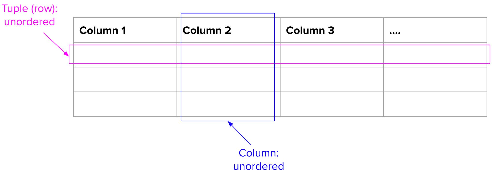

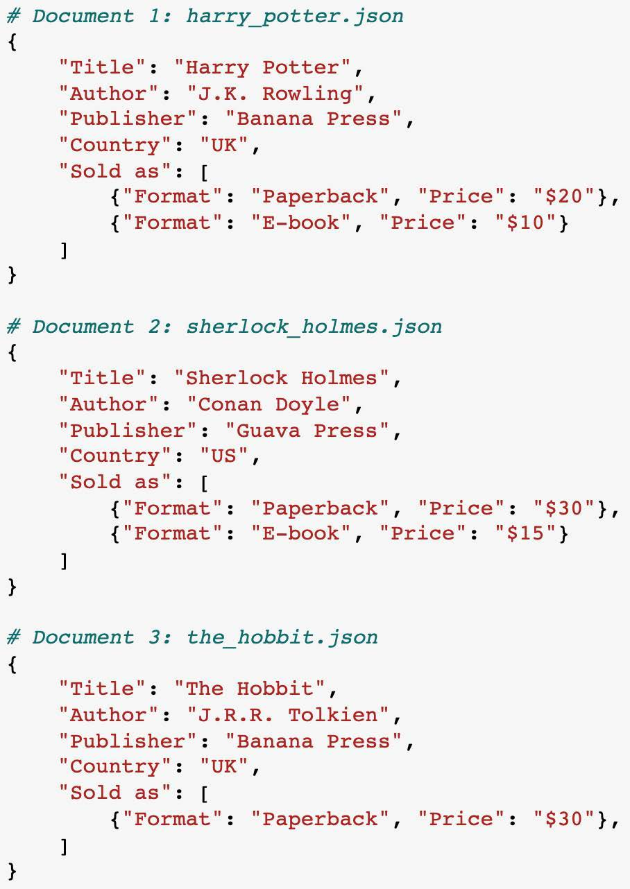

### 3.1. Comparison of Production Data Models

| Data Model | Core Structure | Best Suited For | Query Invariants | Trade-offs in ML |
| :--- | :--- | :--- | :--- | :--- |
| **Relational (SQL)** | Tables, Rows, Columns, Fixed Schema | Operational transaction records, financial accounting | ACID compliance, Declarative SQL, Joins | Multi-table joins across billions of rows become computationally intractable for real-time feature extraction. |
| **Document (NoSQL)** | Nested JSON/BSON documents | User profile catalogs, semi-structured product descriptions | High document locality, primary-key lookups | Lacks cross-document relational joins; updates require rewriting nested sub-documents. |
| **Key-Value** | Hash table mapping Key $\to$ Byte blob | Low-latency online feature serving, caching | $O(1)$ point lookup by entity ID | No secondary index scanning; cannot perform complex analytical aggregation queries. |
| **Graph Model** | Nodes (Entities) and Edges (Relationships) | Fraud rings, social recommendation networks, knowledge graphs | Index-free adjacency, recursive multi-hop traversal | Difficult to shard across distributed clusters; high memory requirements. |

### 3.2. Schema-on-Write vs. Schema-on-Read

* **Schema-on-Write (RDBMS, Protobuf)**:
  - Enforces rigid type safety and structural constraints before any data is persisted.
  - *Advantage*: Prevents corrupted data from entering the storage layer.
  - *Disadvantage*: Upstream schema evolution requires complex database migrations.
* **Schema-on-Read (Data Lakes, S3 Object Storage)**:
  - Data is dumped in its raw form (JSON, raw logs). The schema is applied dynamically during query execution by engines like Presto/Trino or Spark.
  - *Critical Vulnerability in ML*: **The Illusion of Schemalessness**. In reality, code still depends on an implicit schema. If an upstream service silently changes a field name or coerces `null` to `0`, downstream feature pipelines ingest corrupt signals without throwing runtime errors—leading to catastrophic model degradation.

---

## 4. Storage Engines & Processing: OLTP vs. OLAP and Lakehouse Architecture

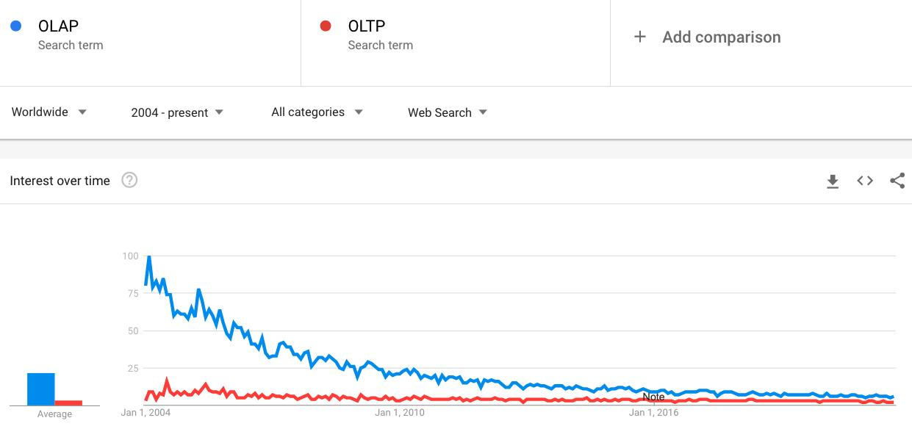

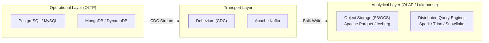

### 4.1. Mechanical Differences: OLTP vs. OLAP

1. **OLTP (Online Transaction Processing)**:
   - Optimized for high-concurrency, low-latency ($<10\text{ms}$) single-row mutations (inserts, updates, deletes).
   - Utilizes row-oriented B-Tree indexes. Strict adherence to ACID transactions.
2. **OLAP (Online Analytical Processing)**:
   - Optimized for large-scale table scans, multi-way joins, and aggregations across billions of rows.
   - Utilizes column-oriented storage, LSM-trees, and massive parallel processing (MPP).
3. **Decoupling Storage from Compute**:
   - Modern data warehouses (Snowflake, BigQuery) and Lakehouse table formats (Apache Iceberg, Delta Lake) separate compute nodes from underlying cloud object storage (S3/GCS), allowing independent, auto-scaling resource allocation.

### 4.2. Ingestion Paradigms: ETL vs. ELT

* **ETL (Extract, Transform, Load)**: Data is transformed in memory before being loaded into the target analytical warehouse.
  - *Limitation for ML*: Raw source data is discarded during transformation. If feature requirements change, historical signals cannot be recovered.
* **ELT (Extract, Load, Transform)**: Raw data is ingested directly into object storage (Data Lake) as an immutable source of truth, and transformations are executed downstream via declarative SQL/dbt/Spark.
  - *ML Production Standard*: Preserves immutable raw telemetry for future model retraining and backtesting.

---

## 5. Modes of Dataflow: Passing Data Across System Boundaries

Data must traverse process boundaries between services, databases, and ML models via one of three structural modes:

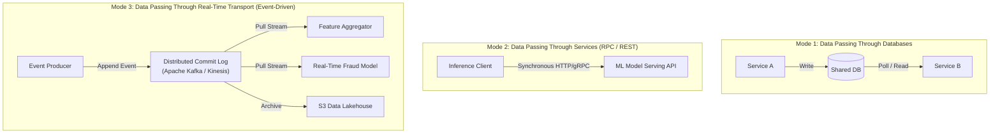

### 5.1. Evaluation of Dataflow Modes

1. **Mode 1: Passing Through Databases (Anti-Pattern for High Scale)**:
   - Multiple services read/write from a shared database.
   - *Bottleneck*: Introduces severe locking contention, tight schema coupling, and high polling latency.
2. **Mode 2: Service-to-Service Request-Driven (REST vs. gRPC)**:
   - **REST (HTTP/1.1 + JSON)**: Simple, universal, but incurs heavy text-parsing serialization overhead and connection management latency.
   - **gRPC (HTTP/2 + Protocol Buffers)**: Binary serialization, multiplexed bidirectional streaming, header compression, and strict schema compilation across polyglot microservices. Recommended standard for low-latency online inference APIs.
3. **Mode 3: Event-Driven Transport (Apache Kafka / AWS Kinesis)**:
   - **Architecture**: Distributed, partitioned, append-only commit logs.
   - **Asynchronous Decoupling**: Producers publish events without knowledge of downstream consumers. Multiple consumers process streams independently at their own cadence.
   - **Replayability**: Consumers can reset offsets to replay historical event streams to backfill new features or retrain models over past states.

---

## 6. Batch Processing vs. Stream Processing & Feature Pipelines

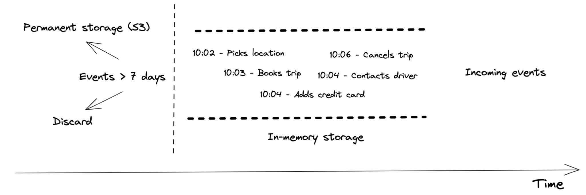

### 6.1. Paradigm Shift: Bounded vs. Unbounded Data

* **Batch Processing**: Processes bounded, static historical datasets on scheduled cron intervals (hourly, daily). Uses engines like Apache Spark or MapReduce. High throughput, high latency (minutes to hours).
* **Stream Processing**: Processes unbounded, continuously arriving event tuples in near real-time ($<100\text{ms}$). Uses stateful engines like Apache Flink.

### 6.2. Streaming Windowing Mechanisms

When aggregating events over continuous streams (e.g., *number of failed logins in the last 10 minutes*), streaming engines employ formal window topologies:

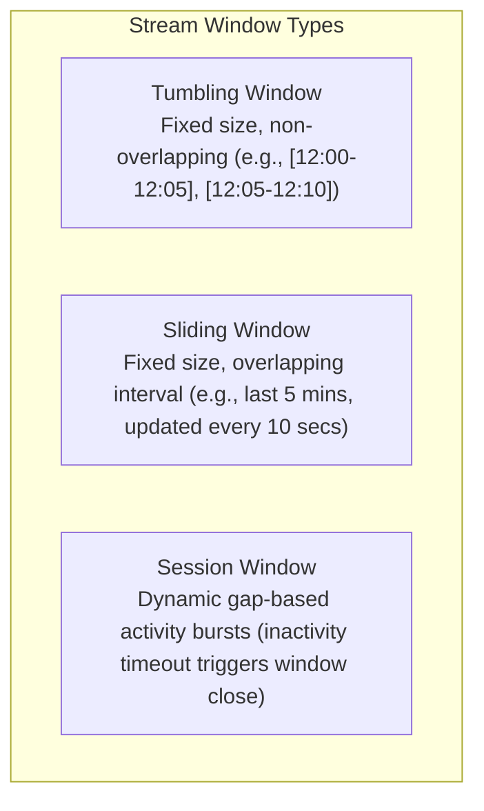

* **Event Time vs. Processing Time**:
  - **Processing Time**: The wall-clock time of the server processing the record.
  - **Event Time**: The deterministic timestamp when the event actually occurred on the client device.
  - **Watermarks**: A streaming metric tracking progress in event time, defining when the system assumes no more late-arriving events will be observed for a given time window.

### 6.3. Unifying Batch and Streaming Pipelines: Lambda vs. Kappa Architecture

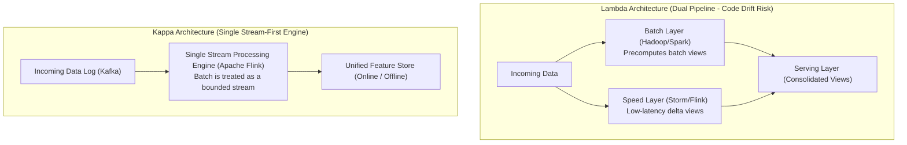

* **The Lambda Pitfall**: Requiring developers to maintain dual codebases (e.g., Python/Spark for batch historical training and Java/C++ for online streaming inference). This inevitably leads to **Code Drift** and fatal training-serving skew.
* **The Kappa Solution**: Treat all data processing as stream processing. Historical batch data is simply a bounded stream read from the beginning of an immutable log (e.g., Kafka retention or Parquet replay), using a unified computation engine (Apache Flink) to ensure deterministic feature equivalence.

---

## 7. Production Data Engineering Checklist

| Dimension | Verification Requirement | Priority | Verification Method |
| :--- | :--- | :---: | :--- |
| **Data Ingestion** | Schema validation enforced at API boundary | **P0** | Protobuf / JSON-Schema contract verification |
| **Storage Optimization** | Columnar format (Parquet/ORC) used for analytical feature extract | **P0** | Storage format audit & compression verification |
| **Pipeline Invariance** | Zero-trust validation for `NULL` handling and type coercion | **P0** | Automated unit tests simulating corrupted payloads |
| **Point-in-Time Correctness** | Features extracted strictly using timestamps prior to inference | **P0** | As-of join tests preventing lookahead data leakage |
| **Latency SLA** | Online feature store lookup p99 within serving latency budget | **P1** | Distributed tracing across Redis / Cassandra key lookups |
| **Pipeline Architecture** | Unified feature logic across batch training and online serving | **P1** | Training-serving feature parity hash comparison |
