# Chapter 3: Training Data

> **System Architecture & Technical Scope**: Mathematical foundations, algorithmic proofs, and engineering trade-offs across data sampling, labeling pipelines, class imbalance remediation, and data augmentation in production machine learning systems.

---

## 1. Training Data in Production: The Systems Paradigm Shift

In academic and research environments, data is traditionally treated as a **static dataset**: finite in size, stationary in distribution, cleanly segmented, and assumed to satisfy the Independent and Identically Distributed ($i.i.d.$) condition. 

In production systems, training data is **dynamic, infinite, and non-stationary**. It arrives as continuous, unbounded **data streams** influenced by feedback loops, distribution shifts, concept drift, and upstream pipeline changes.

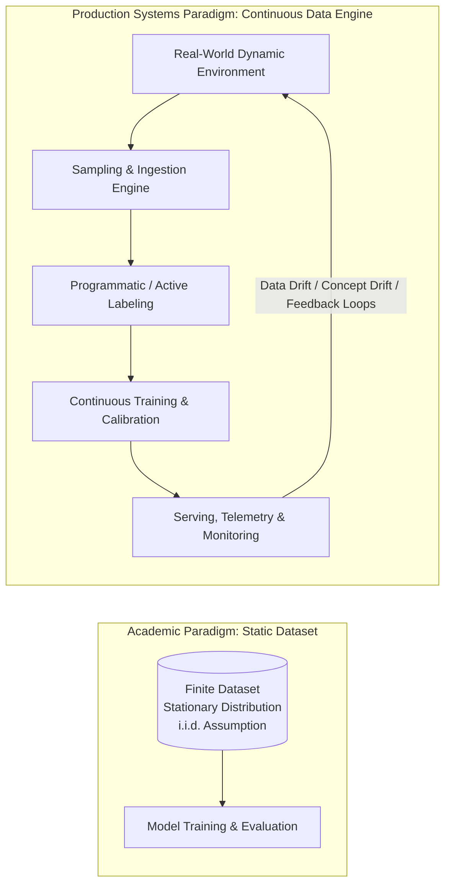

### 1.1. Taxonomy of Latent Biases in Training Data

Historical production data reflects real-world operations, including structural and human imperfections. Machine learning models do not merely reflect these biases—they risk mathematically encoding and amplifying them into automated feedback loops:

*   **Selection Bias**: Occurs when data points are selected through a non-random process that fails to reflect the true operational environment.
    *   *Production Example*: Self-driving vehicle datasets historically collected almost exclusively in Phoenix, Arizona (regulatory permissiveness) and the San Francisco Bay Area (headquarters proximity). Both regions exhibit sunny climates, leaving models ill-equipped for Kirkland, Washington’s heavy rain or Midwestern snowfall.
*   **Sampling Bias**: Arises when the sampling mechanism systematically favors easily accessible slices of data over representative segments (e.g., training general language models on Reddit, CommonCrawl, or Wikipedia).
*   **Labeling Bias**: Introduced when human annotators possess differing domain competencies, subjective prejudices, or inconsistent interpretations of labeling guidelines.
*   **Historical / Societal Bias**: Structural disparities already codified in legacy databases (e.g., historical loan approvals or criminal justice records) that an optimization algorithm interprets as genuine predictive signal.

---

## 2. Sampling Methods

Sampling occurs at multiple stages of the ML lifecycle:
1.  Subsampling production streams to create training datasets.
2.  Splitting datasets into train, validation, and test sets.
3.  Selecting system events and requests for observability and monitoring.

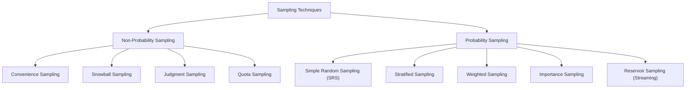

### 2.1. Non-Probability vs. Probability Sampling

| Dimension | Non-Probability Sampling | Probability Sampling |
| :--- | :--- | :--- |
| **Selection Criterion** | Non-random; driven by convenience, availability, subjective judgment, or fixed quotas. | Quantitative probability distribution; every sample $x$ has a known, non-zero probability $P(x) > 0$. |
| **Representativeness** | Poor; introduces severe selection bias; cannot statistically generalize to the population. | High; preserves population distribution or provides quantifiable correction weights. |
| **Computational Complexity** | $O(1)$ to minimal; rapid data collection. | Requires indexing population space, strata partitioning, or streaming reservoir state. |
| **Production Utility** | Acceptable only for early-stage PoC, initial exploratory labeling, or baseline debugging. | Mandatory for production training sets, unbiased evaluation splits, and performance benchmarks. |

#### Non-Probability Sampling Mechanisms
1.  **Convenience Sampling**: Data is selected entirely by operational accessibility (e.g., scraping Reddit or Wikipedia for LLMs; using IMDb or Amazon product reviews for sentiment analysis). 
    *   *Failure Mode*: Skews heavily toward online vocal majorities, omitting non-participating demographics and rare operational edge cases.
2.  **Snowball Sampling**: Successive samples are acquired via links from existing samples (e.g., crawling Twitter follower networks). Creates closed echo chambers and localized topological graphs.
3.  **Judgment Sampling**: Domain experts hand-pick samples they deem "representative." Prone to human cognitive bias and confirmation bias.
4.  **Quota Sampling**: Selecting fixed numbers of samples for predefined slices (e.g., 100 samples each for age groups $<30$, $30\text{--}60$, $>60$) without reflecting their actual demographic base rates.

---

### 2.2. Probability Sampling Algorithms and Mathematical Formulations

#### 2.2.1. Simple Random Sampling (SRS)
Every instance in population size $N$ possesses an equal selection probability:
$$P(x_i) = \frac{k}{N}$$

*   **Engineering Advantage**: Minimal implementation complexity; unbiased under uniform distributions.
*   **Fatal Failure Mode in Production**: Under extreme class imbalance, minority slices vanish. If a rare fraud class constitutes $0.01\%$ of transactions, drawing a $1\%$ random sample yields an expected count near zero, causing models to collapse to majority-class trivial solutions.

#### 2.2.2. Stratified Sampling
The population is partitioned into $m$ mutually exclusive, collectively exhaustive strata $\{S_1, S_2, \dots, S_m\}$ based on critical features (e.g., class labels, user region). Samples are drawn independently from each stratum according to predefined ratios.

*   **Engineering Advantage**: Guarantees that rare categories and critical slices are represented across train, validation, and test partitions.
*   **Architectural Limitation in Multi-Label Systems**: In multi-label classification tasks where an instance simultaneously belongs to multiple overlapping classes (e.g., an image containing `[Vehicle, Pedestrian, Traffic Light]`), independent strata partitioning is an NP-hard combinatorial problem requiring iterative stratification heuristics.

#### 2.2.3. Weighted Sampling
Each instance $x_i$ is assigned an explicit weight $w_i > 0$. The probability of selecting $x_i$ is:
$$P(x_i) = \frac{w_i}{\sum_{j=1}^N w_j}$$

*   **Production Applications**:
    *   *Recency Weighting*: Downweighting older data points and upweighting recent events to adapt to temporal non-stationarity without discarding historical context.
    *   *Distribution Correction*: Compensating for known operational sampling skew. If a sensor pool yields $75\%$ blue and $25\%$ red readings, but ground truth prevalence is $50:50$, weighting red samples by $3\times$ corrects the training distribution.

```python
import random

# Weighted sampling implementation
population = [1, 2, 3, 4, 100, 1000]
weights = [0.2, 0.2, 0.2, 0.2, 0.1, 0.1]
sampled = random.choices(population=population, weights=weights, k=2)
```

> [!IMPORTANT]
> **Architectural Distinction: Weighted Sampling vs. Sample Weights**
> *   **Weighted Sampling**: An ingestion/filtering mechanism that determines *which* samples enter the training dataset.
> *   **Sample Weights**: A loss formulation parameter that assigns a continuous multiplier $w_i$ directly inside the objective function:
>     $$\mathcal{L}(\theta) = \sum_{i=1}^M w_i \cdot \ell(f(x_i; \theta), y_i)$$
>     Sample weights scale gradient vectors during backpropagation, shifting the decision boundary toward heavily weighted points without altering dataset size.

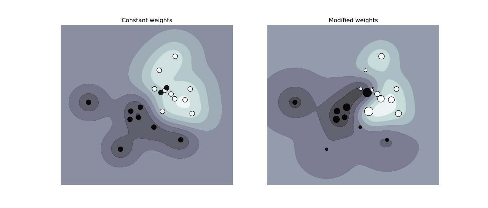
*Figure 3-1: Impact of sample weights on an SVM decision boundary. Left: Uniform sample weights. Right: Non-uniform sample weights forcing the hyperplane to accommodate penalized instances (sklearn).*

---

#### 2.2.4. Importance Sampling: Derivation and Off-Policy Estimation

Importance sampling estimates mathematical properties (such as expectations) of a target distribution $P(x)$ using samples drawn from a different, readily accessible proposal distribution $Q(x)$.

*   **System Invariant**: $Q(x) > 0$ for all $x$ where $P(x) \neq 0$ (the support of $P$ must be contained within the support of $Q$).
*   **Formal Derivation**:
    $$\mathbb{E}_{x \sim P}[f(x)] = \sum_{x} P(x) f(x) = \sum_{x} Q(x) f(x) \frac{P(x)}{Q(x)} = \mathbb{E}_{x \sim Q}\left[ f(x) \frac{P(x)}{Q(x)} \right]$$
    For continuous distributions:
    $$\mathbb{E}_{x \sim P}[f(x)] = \int f(x) P(x) dx = \int f(x) \frac{P(x)}{Q(x)} Q(x) dx = \mathbb{E}_{x \sim Q}\left[ f(x) w(x) \right]$$
    where $w(x) = \frac{P(x)}{Q(x)}$ is the **Importance Weight** (or Likelihood Ratio).
*   **Production ML Application**:
    *   **Off-Policy Reinforcement Learning (e.g., PPO, IMPALA)**: Evaluating a newly updated policy $\pi_{\text{new}}$ using trajectory transitions generated by an older behavioral policy $\pi_{\text{old}}$. Re-simulating or executing rollouts in production is latency-prohibitive; importance weights $\frac{\pi_{\text{new}}(a|s)}{\pi_{\text{old}}(a|s)}$ rescale the recorded rewards.

---

#### 2.2.5. Reservoir Sampling: Streaming Unbounded Ingestion

**Problem Formulation**: An unbounded data stream arrives continuously with total size $N$ **unknown in advance** (or infinite). The entire stream cannot fit in memory. We must extract a random sample of exact capacity $k$ such that at any termination point $N \ge k$, every item observed so far has had an exact, uniform selection probability:
$$P(x_i \in \text{Reservoir}) = \frac{k}{N}$$

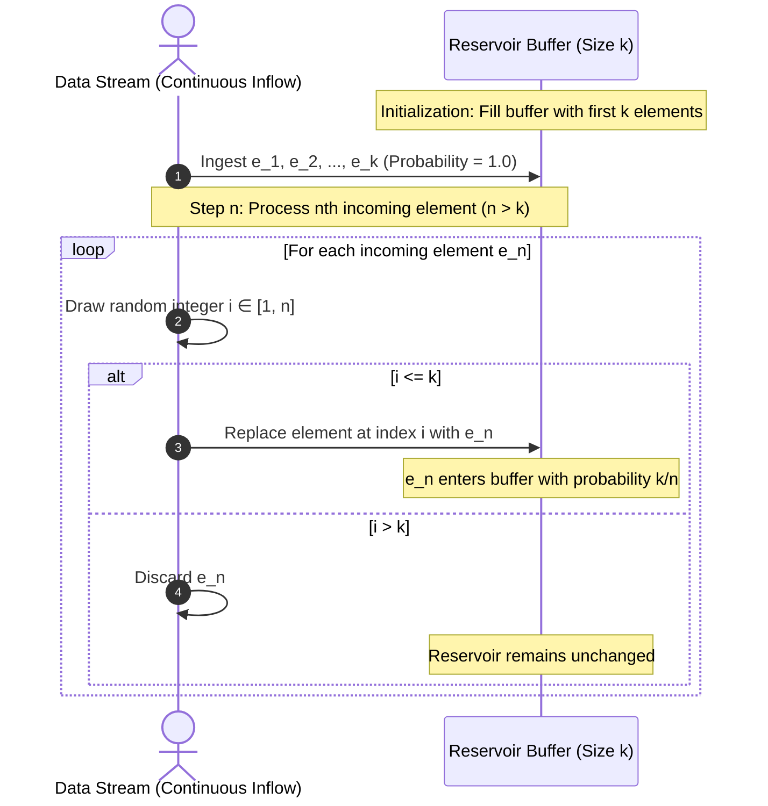

##### Algorithmic Specification (Algorithm R)
1.  Initialize array `reservoir` of capacity $k$. Store the first $k$ stream elements directly into `reservoir`.
2.  For each subsequent incoming element $e_n$ at stream position $n$ ($n = k + 1, k + 2, \dots$):
    *   Generate a uniformly distributed pseudorandom integer $i \in \{1, 2, \dots, n\}$.
    *   If $1 \le i \le k$: Replace `reservoir[i]` with $e_n$.
    *   If $i > k$: Discard $e_n$.

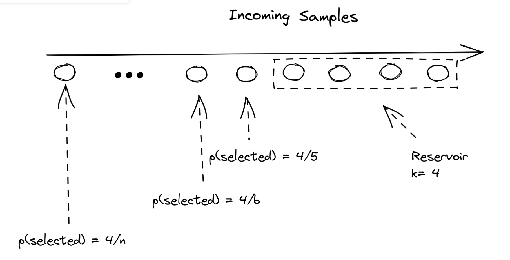
*Figure 3-2: Schematic of Reservoir Sampling on streaming data.*

##### Mathematical Proof by Induction
*   **Base Case ($n = k$)**:
    The reservoir contains the first $k$ elements. Each has been selected with probability:
    $$P_k = \frac{k}{k} = 1.0 \quad \text{(Trivially holds)}$$
*   **Inductive Hypothesis**:
    Assume that after processing element $n - 1$ ($n - 1 \ge k$), every item $e_m$ ($1 \le m \le n - 1$) resides in the reservoir with probability:
    $$P_{n-1}(e_m) = \frac{k}{n - 1}$$
*   **Inductive Step (Processing element $n$)**:
    1.  *Probability that the $n$-th element enters the reservoir*:
        By definition of Algorithm R, $e_n$ is placed into the reservoir if and only if the generated index $i \le k$. Since $i$ is drawn uniformly from $\{1, \dots, n\}$:
        $$P(\text{insert } e_n) = \frac{k}{n}$$
    2.  *Probability that an existing element $e_m$ ($m < n$) survives the step*:
        Element $e_m$ is evicted if and only if $e_n$ is selected for insertion AND the eviction slot chosen uniformly at random among $k$ positions is the exact slot occupied by $e_m$.
        $$P(\text{evict } e_m) = P(\text{insert } e_n) \times P(\text{slot chosen} = \text{slot of } e_m) = \frac{k}{n} \times \frac{1}{k} = \frac{1}{n}$$
        Therefore, the conditional probability that $e_m$ is retained in the reservoir is:
        $$P(\text{retain } e_m \mid e_m \in \text{Reservoir}_{n-1}) = 1 - \frac{1}{n} = \frac{n - 1}{n}$$
    3.  *Unconditional probability that $e_m$ remains in the reservoir at step $n$*:
        By the Law of Total Probability:
        $$P_n(e_m) = P_{n-1}(e_m) \times P(\text{retain } e_m \mid e_m \in \text{Reservoir}_{n-1})$$
        Substituting the inductive hypothesis:
        $$P_n(e_m) = \left( \frac{k}{n - 1} \right) \times \left( \frac{n - 1}{n} \right) = \frac{k}{n}$$
*   **Conclusion**:
    Every element in the stream up to step $n$ has an identical probability $\frac{k}{n}$ of residing in the reservoir. The algorithm is provably unbiased for all $n \ge k$. $\blacksquare$

---

## 3. Labeling Challenges and Architectural Solutions

Modern enterprise machine learning relies overwhelmingly on supervised learning. Consequently, model performance is fundamentally bounded by label quantity, quality, and freshness.

While tasks with natural labels (such as ad click-through rate prediction or recommendation systems) capture ground truth directly from user telemetry, the majority of enterprise tasks require explicit annotation pipelines.

### 3.1. The Production Bottlenecks of Hand Labeling

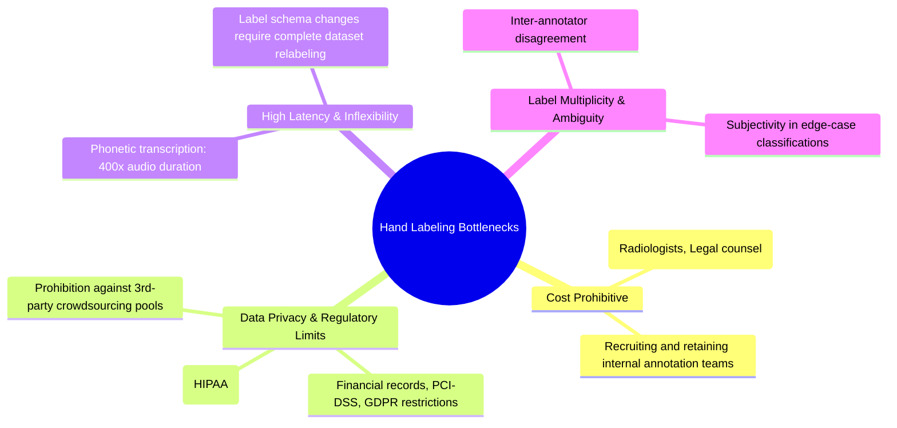

1.  **Cost Escalation**: General tasks (spam detection) can be crowdsourced at low hourly rates. Specialized tasks (radiograph interpretation, contract extraction) require credentialed professionals (e.g., board-certified radiologists, attorneys). Andrej Karpathy observed that building an in-house data annotation operations team is as permanent and strategic as building an core engineering team.
2.  **Privacy and Regulatory Compliance**: Regulated domains (HIPAA, GDPR) forbid sending sensitive customer records or medical scans to third-party crowdsourcing vendors. Annotators must be vetted, background-checked, and restricted to secure on-premise enclaves or audited zero-egress virtual desktops.
3.  **Latency and Lack of Adaptability**:
    *   Phonetic-level speech annotation requires up to $400\times$ the raw utterance duration (1 hour of audio requires 400 annotator hours).
    *   *Schema Inflexibility*: If an deployed binary sentiment system (`POSITIVE`, `NEGATIVE`) must be updated to triage severe customer complaints by adding an `ANGRY` class, existing datasets must be completely audited and relabeled by hand. The resulting multi-month delay degrades model responsiveness to changing business environments.
4.  **Label Multiplicity and Inter-Annotator Disagreement**:
    When multiple annotators label identical instances, consensus is rarely unanimous. 

| Annotator | # Entities | Extracted Entities |
| :---: | :---: | :--- |
| **Annotator 1** | 3 | `[Darth Sidious]`, known simply as the Emperor, was a `[Dark Lord of the Sith]` who reigned over the galaxy as `[Galactic Emperor of the First Galactic Empire]` |
| **Annotator 2** | 6 | `[Darth Sidious]`, known simply as the `[Emperor]`, was a `[Dark Lord]` of the `[Sith]` who reigned over the galaxy as `[Galactic Emperor]` of the `[First Galactic Empire]` |
| **Annotator 3** | 4 | `[Darth Sidious]`, known simply as the `[Emperor]`, was a `[Dark Lord of the Sith]` who reigned over the galaxy as `[Galactic Emperor of the First Galactic Empire]` |

*Table 3-1: Illustrative Named Entity Recognition (NER) ambiguity across three annotators.*

*   *Paradox of "Human-Level Performance"*: When certified human experts exhibit substantial inter-annotator variance, defining a singular ground truth becomes ill-posed.
*   *Engineering Mitigation*: Implement rigorous, versioned **Labeling Guidelines** containing deterministic conflict resolution rules (e.g., in NER, strictly enforcing longest-substring span matches).

---

### 3.2. Data Lineage

Data lineage is the tracking and immutability management of metadata across a data point's lifecycle: collection source, transformation pipelines, annotator identity, guideline version, and ingestion timestamp.

*   **Production Root-Cause Debugging**: If ingesting $1,000,000$ crowdsourced samples degrades an existing model's accuracy, data lineage isolates the problematic batch, tracing failures to specific annotator pools or flawed guideline interpretations, enabling targeted rollbacks without corrupting baseline training artifacts.

---

### 3.3. Methodological Comparison: Overcoming the Lack of Hand Labels

| Technique | Operational Mechanism | Ground Truth Requirement | Primary Architectural Advantage | Engineering Risks & Trade-offs |
| :--- | :--- | :--- | :--- | :--- |
| **Weak Supervision** | Heuristic rules (Labeling Functions) aggregated by a generative label model. | None strictly required; 100–500 samples recommended for LF calibration. | Rapid scaling ($1\text{K} \to 1\text{M}$); programmatic, versioned domain expertise; preserves data privacy. | Output labels are probabilistic/noisy; relies on expert heuristic coverage; conflicts must be mathematically modeled. |
| **Semi-Supervised Learning** | Mathematical/structural manifold assumptions to propagate labels from seeds. | Small initial set of verified seed labels ($D_L$). | Leverages massive unlabeled corpora ($D_U$); reduces human labeling by orders of magnitude. | Risk of confirmation bias and cascading error propagation during self-training. |
| **Transfer Learning** | Repurposing representations from a foundation model trained on a self-supervised task. | Zero for zero-shot inference; minimal for fine-tuning / linear probes. | Eliminates training from scratch; democratizes state-of-the-art architectures. | Susceptible to domain shift; substantial inference compute footprint; dependency on upstream architectures. |
| **Active Learning** | Model actively scores and queries annotators for high-value informative instances. | Progressive batch labeling driven by query heuristics. | Maximizes sample efficiency, minimizing total labeling budget. | Pipeline coordination overhead; human annotator latency remains the operational bottleneck. |

---

### 3.4. Deep Dives into Labeling Paradigms

#### 3.4.1. Weak Supervision and Programmatic Labeling (Snorkel Architecture)

Weak supervision replaces direct manual annotation with **Labeling Functions (LFs)**—executable programs encoding domain heuristics, constraints, and external signals:
*   **Keyword Heuristics**: String matching for clinical or domain-specific indicators (e.g., flagging `"pneumonia"` in a radiology triage note).
*   **Regular Expressions**: Pattern extractors for structured entities (phone numbers, account identifiers, syntax trees).
*   **Knowledge Base / Database Lookups**: Cross-referencing entities against curated databases (e.g., hazardous chemicals, ICD-10 medical codes).
*   **Auxiliary & Legacy Classifiers**: Using legacy rule engines, heuristic classifiers, or specialized sub-models as noisy voters.

```python
# Canonical Labeling Function example in Python
def lf_pneumonia_priority(note: str) -> str:
    if "pneumonia" in note.lower() or "infiltrate" in note.lower():
        return "EMERGENT"
    return "ABSTAIN"
```

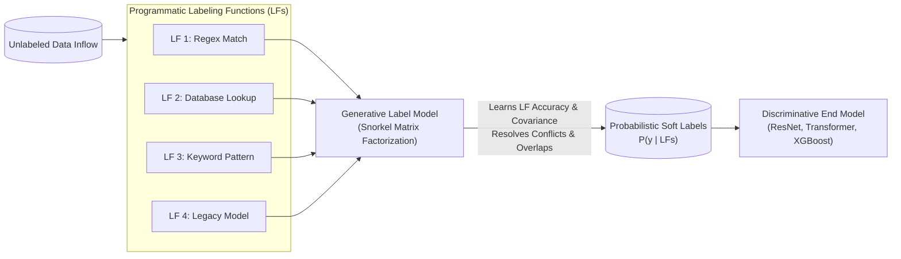

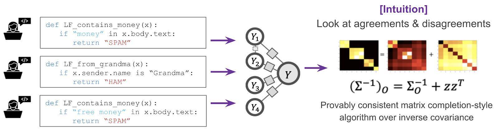
*Figure 3-3: High-level architectural pipeline of combining noisy Labeling Functions through a Generative Label Model (Ratner et al.).*

##### Mathematical Conflict Resolution
Individual LFs exhibit variable accuracy, overlap, and correlation. Rather than taking a naive majority vote, Snorkel models the true, unobserved label $Y \in \{-1, 1\}$ as a latent variable in a probabilistic graphical model. Given $m$ labeling functions $\Lambda = (\lambda_1, \dots, \lambda_m)$ evaluating $n$ samples, the generative model estimates the parameters $\theta$ (accuracy and propensity) without ground truth by observing agreement and disagreement matrices across the unlabeled data:
$$P_\theta(\Lambda, Y) = \frac{1}{Z_\theta} \exp \left( \sum_{i=1}^m \theta_i \lambda_i Y + \sum_{i, j} \theta_{ij} \lambda_i \lambda_j \right)$$
The resulting posterior probabilities $P(Y=1 \mid \Lambda)$ serve as **probabilistic soft labels** used to train the final discriminative deep model under cross-entropy loss.

##### Production Case Study: Stanford Medicine (Dunnmon et al.)
In a clinical imaging benchmark, a radiologist invested **8 hours** authoring labeling functions in Snorkel. The downstream model matched the receiver operating characteristics of a model trained on ground truth labels accumulated through **nearly one year of manual hand labeling**. Furthermore, 6 labeling functions were directly reused across distinct clinical modalities (Chest Radiographs [CXR] and Extremity Radiographs [EXR]).

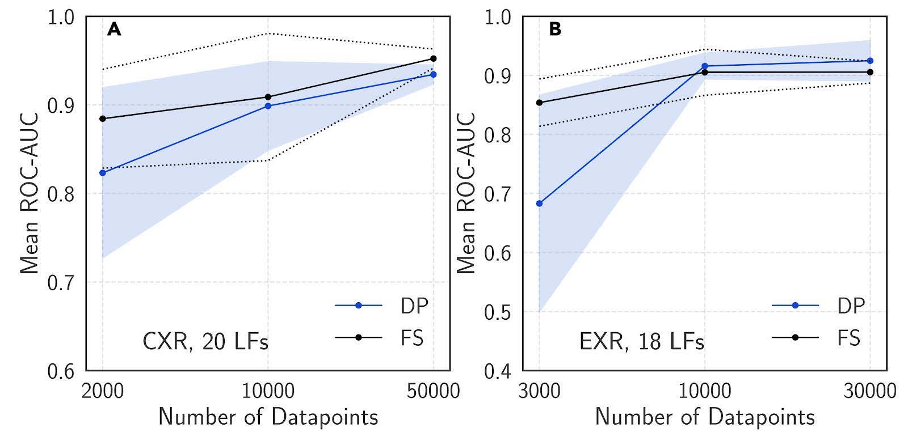
*Figure 3-4: Comparative validation of models trained on Fully Supervised (FS) vs. Data Programming (DP / Weakly Supervised) labels across CXR and EXR diagnostic tasks (Dunnmon et al.).*

---

#### 3.4.2. Semi-Supervised Learning
Semi-supervised learning utilizes a small seed set of verified labels $D_L = \{(x_i, y_i)\}_{i=1}^L$ alongside an extensive corpus of unlabeled samples $D_U = \{x_u\}_{u=1}^U$ ($U \gg L$).

1.  **Self-Training / Pseudo-Labeling**:
    *   Train base model $\mathcal{M}$ on $D_L$.
    *   Generate class predictions $\hat{y}_u = \mathcal{M}(x_u)$ for all $x_u \in D_U$.
    *   Select instances satisfying a high confidence threshold: $\max_c P(y=c \mid x_u) \ge \tau$ (e.g., $\tau = 0.95$).
    *   Append pseudo-labeled instances into $D_L$; retrain $\mathcal{M}$ iteratively until convergence.
2.  **Structural Manifold & Cluster Assumptions**: Assumes high-density data clusters share uniform labels, and the decision boundary resides in low-density interstitial regions.
    *   *Semantic Proximity*: Leveraging metadata co-occurrence (e.g., Twitter user profiles co-locating `#AI`, `#ML`, and `#BigData` to propagate topic classifications).
3.  **Consistency Regularization (Perturbation Invariance)**: A valid representation should output invariant predictions under minor input or representation perturbations:
    $$\mathcal{L}_{\text{consistency}} = \| f(x; \theta) - f(x + \epsilon; \theta) \|^2$$

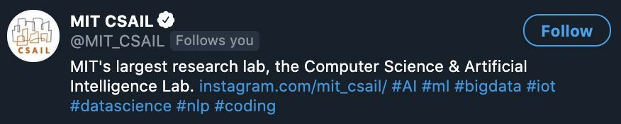
*Figure 3-5: Semi-supervised topic propagation based on entity co-occurrence in Twitter profiles.*

> [!WARNING]
> **Evaluation Pitfall in Low-Resource Regimes**
> When labeled data is scarce, withholding samples for validation/test splits starves the model of valuable training data. Conversely, choosing the top-performing model checkpoint evaluated on an under-sized validation set guarantees **overfitting to the validation set**.

---

#### 3.4.3. Transfer Learning
Transfer learning reuses parameter weights learned on a generic, resource-abundant base task (e.g., autoregressive next-token prediction, masked image modeling) to accelerate convergence on a specialized downstream task.

*   **Production Deployment Modes**:
    *   *Zero-Shot / Few-Shot In-Context Learning*: Providing instructions and demonstration exemplars within the context window without updating model weights.
    *   *Linear Probing (Feature Extraction)*: Freezing the pretrained backbone and optimizing only the final classification head ($W_{\text{head}} \in \mathbb{R}^{d \times C}$).
    *   *Fine-Tuning*: Updating the full network (or Parameter-Efficient Fine-Tuning adapters, e.g., LoRA) with a low learning rate.
*   **Industry Economics**: Training modern foundation models (e.g., GPT-3, PaLM) requires tens of millions of dollars in compute infrastructure. Enterprise ML engineering has shifted predominantly toward adapting foundation models via fine-tuning or retrieval-augmented generation.

---

#### 3.4.4. Active Learning

Active learning transforms the training pipeline from a passive consumer of annotations into an active querying system that requests labels exclusively for instances yielding maximal parameter updates.

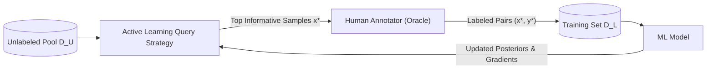

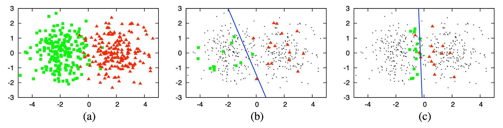
*Figure 3-6: Uncertainty-based active learning efficacy. (a) 400 instances drawn from two Gaussians. (b) Random sampling of 30 labeled points yields 70% accuracy. (c) Active sampling of 30 points near the decision boundary yields 90% accuracy (Settles, 2010).*

##### Query Strategies
1.  **Uncertainty Sampling**:
    *   *Least Confidence*: Queries the sample whose highest predicted class probability is minimal:
        $$x^*_{\text{LC}} = \arg\min_x \max_y P(y \mid x; \theta)$$
    *   *Margin Sampling*: Targets instances positioned closest to the decision boundary by measuring the gap between the two most likely classes:
        $$x^*_{\text{Margin}} = \arg\min_x \left[ P(\hat{y}_1 \mid x; \theta) - P(\hat{y}_2 \mid x; \theta) \right]$$
    *   *Entropy Sampling*: Evaluates the Shannon entropy of the predicted posterior distribution:
        $$x^*_{\text{Entropy}} = \arg\max_x \left( -\sum_{c=1}^C P(y=c \mid x; \theta) \log P(y=c \mid x; \theta) \right)$$
2.  **Query-by-Committee (QBC)**: Maintains an ensemble of models $\mathcal{C} = \{\theta_1, \dots, \theta_K\}$. The algorithm selects samples that maximize prediction disagreement across committee members (measured via Vote Entropy or Jensen-Shannon Divergence).
3.  **Expected Gradient Length (EGL)**: Selects instances that would induce the largest parameter gradient update norm if their true label were revealed:
    $$x^*_{\text{EGL}} = \arg\max_x \sum_{c=1}^C P(y=c \mid x; \theta) \left\| \nabla_\theta \mathcal{L}(f(x; \theta), y=c) \right\|_2$$

---

## 4. Class Imbalance

Class imbalance occurs when the class distribution is severely skewed across training samples. It is not an anomaly in production ML—it is the default operational reality.
*   **Binary / Multi-class Imbalance**: Fraud detection ($0.068\%$ fraud rate in credit card transactions), rare disease screening ($0.01\%$ prevalence), automated object detection (background bounding boxes outnumber foreground objects by $10^4 : 1$).
*   **Continuous / Regression Imbalance**: High-severity financial losses or healthcare bills, where the 95th percentile claims exhibit extreme values and heavy tails, making regression errors on rare tails exponentially more costly.

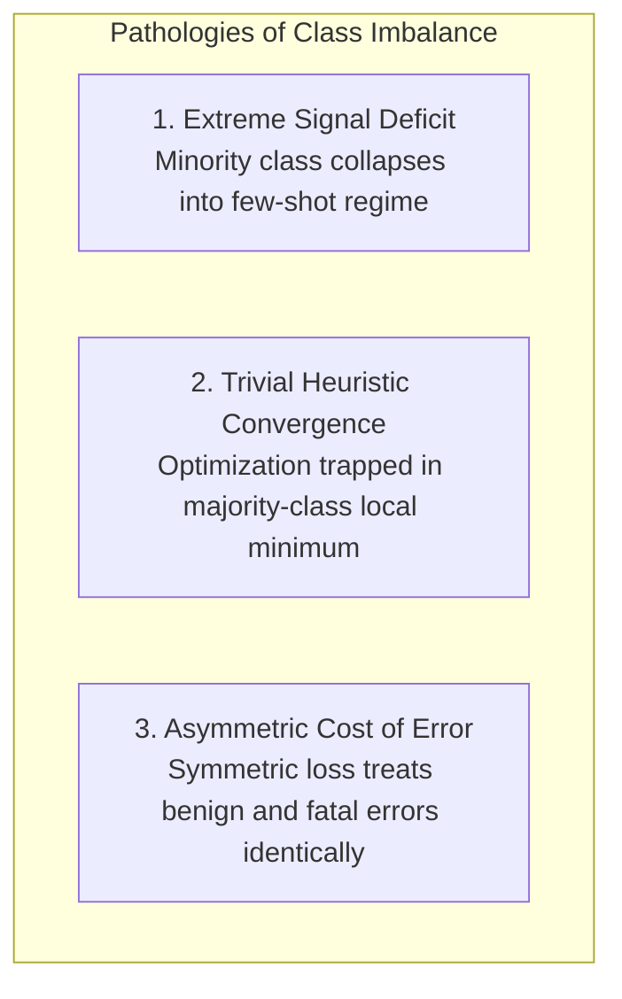

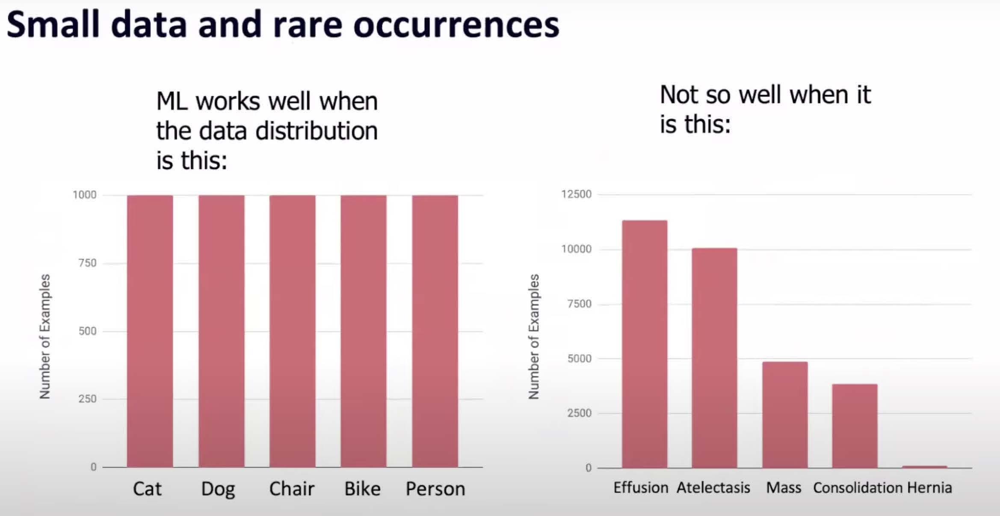
*Figure 3-7: Machine learning algorithms optimize effectively on balanced distributions, but degrade significantly under severe skew (Andrew Ng).*

### 4.1. The Pathology of Imbalance in Gradient Optimization
1.  **Insufficient Learning Signal**: Minority instances produce too few gradient signals, allowing cumulative majority-class updates to dominate parameter updates.
2.  **The Trivial Heuristic Minimum**: When a negative class represents $99.99\%$ of the data, a model predicting negative uniformly achieves $99.99\%$ overall accuracy. Gradient descent easily becomes trapped in this sharp local minimum.
3.  **Asymmetric Costs**: A false negative in cancer diagnosis or fraud screening incurs severe real-world costs, whereas a false positive merely triggers a low-cost secondary review. Standard symmetric loss formulations fail to capture this asymmetry.
4.  **Task Complexity Impact**: Nathalie Japkowicz established that class imbalance sensitivity correlates directly with task complexity: linearly separable problems remain unaffected by imbalance, whereas complex non-linear classification tasks degrade rapidly.

---

### 4.2. Evaluation Metrics: Why Accuracy Fails

Consider an evaluation split containing $1,000$ clinical scans ($100$ `CANCER` positive, $900$ `NORMAL` negative):

| Confusion Matrix Metric | Model A | Model B |
| :--- | :---: | :---: |
| **Predicted CANCER / Actual CANCER (TP)** | 10 | 90 |
| **Predicted NORMAL / Actual CANCER (FN)** | 90 | 10 |
| **Predicted CANCER / Actual NORMAL (FP)** | 10 | 90 |
| **Predicted NORMAL / Actual NORMAL (TN)** | 890 | 810 |
| **Overall Accuracy** | **90.0%** | **90.0%** |
| **Precision ($\frac{TP}{TP + FP}$)** | $0.50$ | $0.50$ |
| **Recall ($\frac{TP}{TP + FN}$)** | **0.10** | **0.90** |
| **F1-Score** | **0.17** | **0.64** |

*Table 3-2: Performance breakdown demonstrating the complete breakdown of raw Accuracy.*

While Model A and Model B both achieve an identical Accuracy of $90.0\%$, Model A misses $90\%$ of cancer patients (Recall = $10\%$), rendering it clinically dangerous. Model B identifies $90\%$ of malignancies (Recall = $90\%$).

#### ROC-AUC vs. PR-AUC Deep Dive

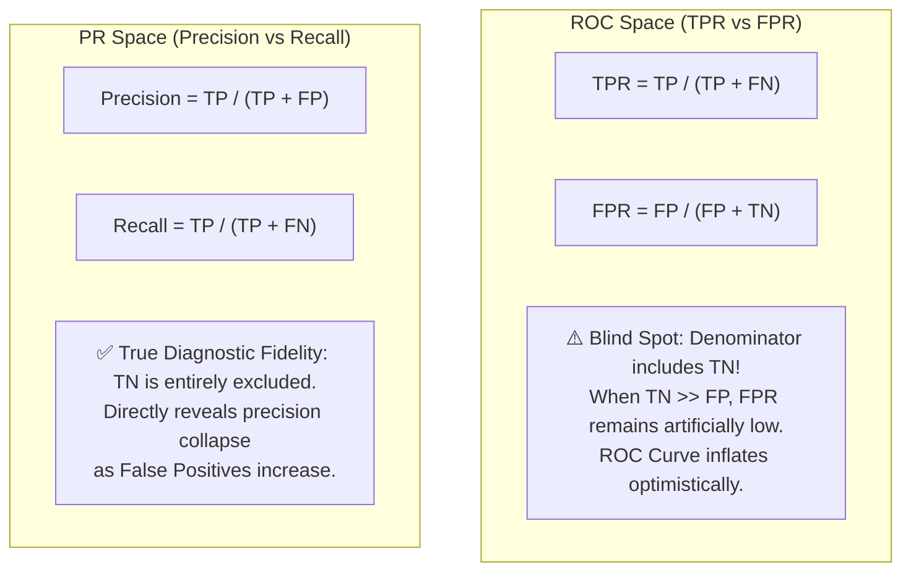

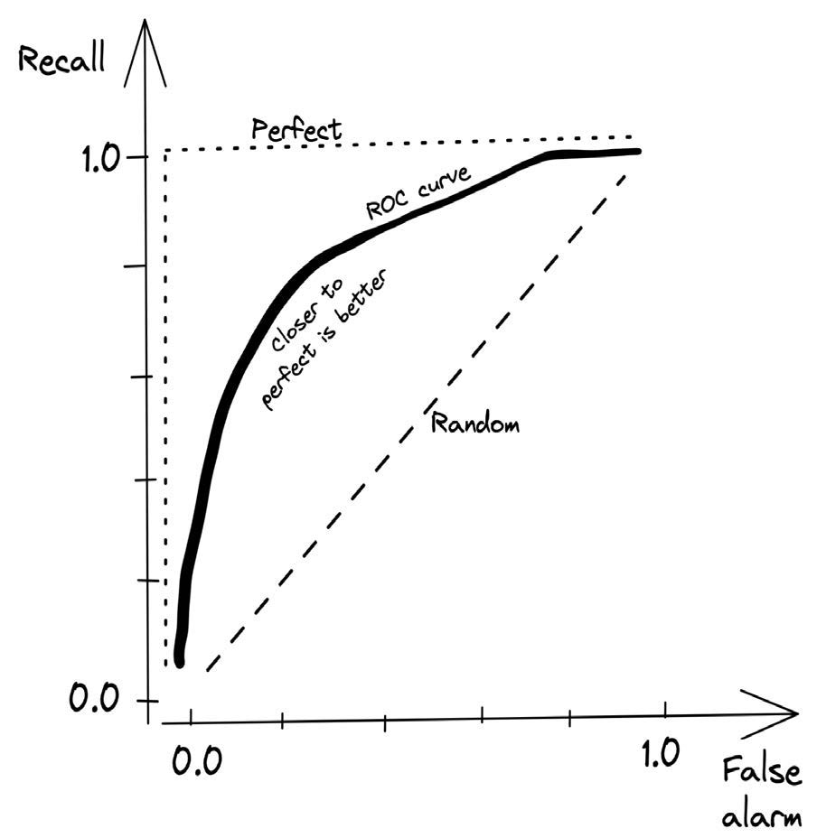
*Figure 3-8: Canonical Receiver Operating Characteristic (ROC) curve tracing TPR against FPR.*

*   **ROC Curve (Receiver Operating Characteristic)**: Plots True Positive Rate ($TPR = \text{Recall}$) against False Positive Rate ($FPR = \frac{FP}{FP + TN}$).
    *   *The Negative Class Blind Spot*: When the negative class dominates ($TN \gg FP$), the denominator $(FP + TN)$ remains enormous. Consequently, substantial increases in absolute false positives result in negligible shifts in $FPR$. The ROC curve displays a deceptively optimistic picture of model performance.
*   **PR Curve (Precision-Recall Curve)**: Plots Precision ($\frac{TP}{TP + FP}$) against Recall ($\frac{TP}{TP + FN}$).
    *   *Production Invariant*: The calculation entirely omits $TN$. Every false positive directly degrades the precision denominator. For severely imbalanced production problems, **PR-AUC is the mandatory metric**.

---

### 4.3. Data-Level Methods: Resampling

Data-level remediation alters the training distribution to mitigate class skew before passing batches to the model.

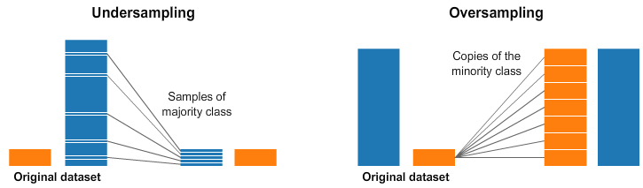
*Figure 3-9: Comparison of Undersampling (majority class reduction) and Oversampling (minority class replication) topologies (Rafael Alencar).*

#### 4.3.1. Resampling Mechanics
1.  **Random Undersampling (RUS)**: Randomly discards instances from the majority class until the desired class ratio is achieved.
    *   *Critical Risk*: Discards valuable majority-class information, degrading decision boundary fidelity in feature-dense regions.
2.  **Random Oversampling (ROS)**: Replicates existing minority instances uniformly at random.
    *   *Critical Risk*: Encourages overfitting, as models memorize exact duplicate representations, creating narrow, brittle decision boundaries.
3.  **Tomek Links (Boundary Cleaning)**:
    *   *Algorithm*: Identifies pairs of instances $(x_i, x_j)$ from opposite classes that are each other's nearest neighbors:
        $$d(x_i, x_j) < d(x_i, x_k) \quad \text{and} \quad d(x_i, x_j) < d(x_j, x_k) \quad \forall k \notin \{i, j\}$$
    *   *Action*: Evict the majority-class instance from the pair. This cleans ambiguous, noisy points from the decision boundary.
4.  **SMOTE (Synthetic Minority Over-sampling Technique)**:
    Synthesizes novel minority instances along the convex line segments joining $k$-nearest minority neighbors:
    $$x_{\text{new}} = x_i + \lambda (x_{zi} - x_i) \quad \text{where } \lambda \sim U(0, 1)$$
    where $x_i$ is a minority instance and $x_{zi}$ is a randomly selected minority instance among its $k$-nearest neighbors.
    *   *High-Dimensional Failure Mode*: SMOTE relies on Euclidean distance metrics. In high-dimensional representation spaces (e.g., deep neural net embeddings), the distance between all points converges (Curse of Dimensionality), rendering Euclidean nearest neighbors semantically meaningless and computationally expensive ($O(N^2)$).

> [!CAUTION]
> **Strict Operational Rule: Never Resample Evaluation Splits**
> Resampling must be strictly confined to training sets. Validation and test sets must **always preserve the raw, unadulterated operational distribution**. Resampling evaluation splits distorts prior class probabilities and yields invalid offline performance estimates.

#### 4.3.2. Advanced Production Resampling for Deep Learning
*   **Two-Phase Learning**:
    *   *Phase 1*: Train the backbone feature extractor on a heavily resampled, balanced dataset ($50:50$) to learn robust latent representations.
    *   *Phase 2*: Freeze the feature extractor (or apply a heavily decayed learning rate) and fine-tune only the classification head on the original, imbalanced data distribution to calibrate predicted posterior probabilities to real-world base rates.
*   **Dynamic Sampling**: Real-time batch-level reweighting: dynamically increase the sampling probability of classes exhibiting high instantaneous training error while decreasing sampling rates for well-converged classes.

---

### 4.4. Algorithm-Level Methods: Loss Function Modification

Algorithm-level approaches maintain the original training data distribution intact, modifying the loss function $\mathcal{L}(\theta)$ to penalize errors on minority or difficult instances.

#### 4.4.1. Cost-Sensitive Learning
Introduces a non-symmetric **Cost Matrix** $C$, where $C_{ij}$ denotes the financial or operational cost of classifying ground-truth class $i$ as class $j$ ($C_{ii} = 0$):

| Ground Truth \ Prediction | Predicted NEGATIVE ($j=0$) | Predicted POSITIVE ($j=1$) |
| :--- | :---: | :---: |
| **Actual NEGATIVE ($i=0$)** | $C_{00} = 0$ | $C_{01}$ (Cost of False Alarm / FP) |
| **Actual POSITIVE ($i=1$)** | $C_{10}$ (Cost of Missed Detection / FN) | $C_{11} = 0$ |

The expected risk loss for instance $x$ belonging to class $i$ becomes:
$$\mathcal{L}_{\text{cost}}(x; \theta) = \sum_{j} C_{ij} P(j \mid x; \theta)$$
If missing a positive fraud transaction is 50 times more expensive than investigating a false alarm, set $C_{10} = 50 \times C_{01}$.

#### 4.4.2. Class-Balanced Loss
Applies a static loss multiplier inversely proportional to class frequency:
$$W_i = \frac{N}{N_i} \quad \implies \quad \mathcal{L}_{\text{CB}}(x, y; \theta) = - W_y \log P(y \mid x; \theta)$$
*   *Effective Number of Samples* (Cui et al., CVPR 2019): Accounting for feature-space overlap among instances, the effective sample volume scales as $\frac{1 - \beta^{N_i}}{1 - \beta}$, yielding loss weight:
    $$W_i = \frac{1 - \beta}{1 - \beta^{N_i}} \quad \text{where } \beta \in [0, 1)$$

---

#### 4.4.3. Focal Loss: Mathematical Formulation and Gradient Dynamics

Designed by Lin et al. (RetinaNet) to resolve extreme foreground-background class imbalance ($1:1000$) in dense object detection.

##### Mathematical Formulation
Standard binary Cross-Entropy (CE) loss is defined as:
$$\text{CE}(p, y) = \begin{cases} -\log(p) & \text{if } y = 1 \\ -\log(1 - p) & \text{if } y = 0 \end{cases}$$
Defining the convenient shorthand $p_t$:
$$p_t = \begin{cases} p & \text{if } y = 1 \\ 1 - p & \text{if } y = 0 \end{cases} \quad \implies \quad \text{CE}(p_t) = -\log(p_t)$$
Even when a model is confident in classifying a simple majority sample ($p_t \ge 0.9$), the sample still generates a small loss ($-\log(0.9) \approx 0.105$). Summed across millions of background candidate locations, these minor losses overwhelm the total gradient.

**Focal Loss (FL)** introduces a dynamically adjusting modulating factor $(1 - p_t)^\gamma$:
$$\text{FL}(p_t) = -\alpha_t (1 - p_t)^\gamma \log(p_t)$$
where:
*   $\alpha_t \in [0, 1]$ addresses base-rate class frequency imbalance.
*   $\gamma \ge 0$ is the **focusing parameter**. When $\gamma = 0$, Focal Loss reduces identically to Cross-Entropy.

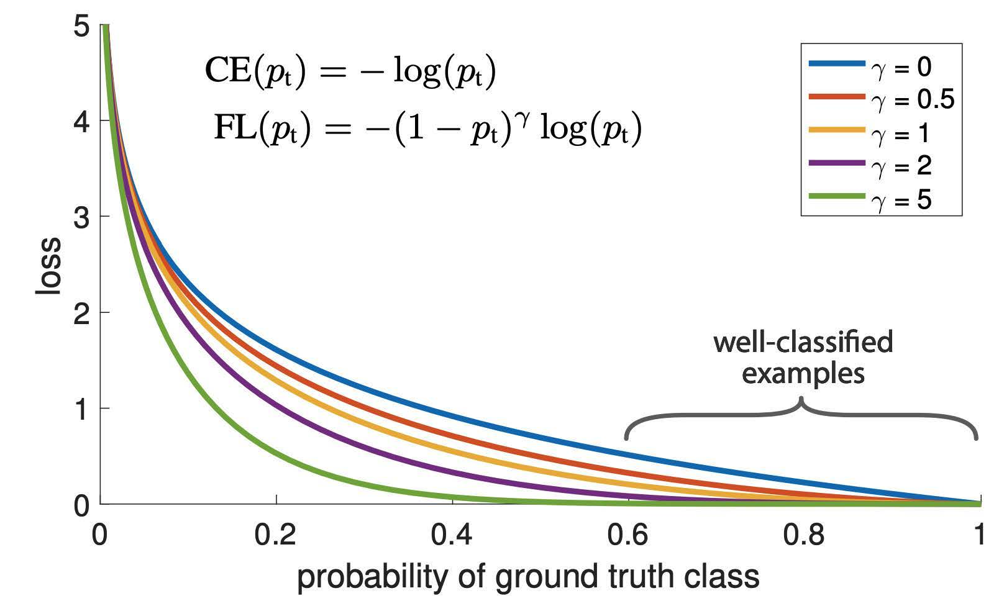
*Figure 3-10: Loss values under Focal Loss ($\gamma \in [0, 5]$) as predicted probability $p_t$ increases. Easy instances ($p_t > 0.5$) have their loss contribution suppressed by orders of magnitude (Lin et al.).*

##### Mathematical Mechanics of the Modulating Factor
*   **Misclassified, difficult samples ($p_t \to 0$)**:
    $(1 - p_t)^\gamma \approx 1$. The loss contribution is unattenuated.
*   **Well-classified, easy samples ($p_t \to 1$)**:
    $(1 - p_t)^\gamma \to 0$. The loss contribution is exponentially suppressed.
    *Example*: If $\gamma = 2$, a well-classified sample with $p_t = 0.99$ incurs $(1 - 0.99)^2 = 0.0001$ of its standard CE loss—a $10,000\times$ reduction.
*   **Gradient Dynamic**:
    Differentiating Focal Loss with respect to the pre-activation logit $z$ ($p = \sigma(z)$):
    $$\frac{\partial \text{FL}}{\partial z} = \alpha_t \left( \gamma (1 - p_t)^{\gamma - 1} p_t \log(p_t) + (1 - p_t)^\gamma \right) (p_t - 1)$$
    The gradient contribution of correctly classified examples is suppressed, focusing optimization steps entirely on the hard, under-represented minority cases.

---

## 5. Data Augmentation

Data augmentation encompasses techniques that artificially synthesize new training instances to enhance generalization, enforce operational invariance, and improve robustness against noise and distribution shifts.

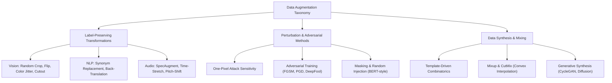

### 5.1. Simple Label-Preserving Transformations

Transformations that modify sample appearance while preserving true semantic labels.

#### 5.1.1. Computer Vision
*   **Geometric Transformations**: Horizontal/Vertical flips, random crops, affine scaling, rotation, shearing.
*   **Photometric Distortions**: Contrast, brightness, saturation jitter, grayscale conversion.
*   **Information Dropping**: Cutout, Random Erasing (forces models to leverage distributed cues rather than relying on single local features).
*   **Asynchronous Pipeline Integration**: In production pipelines, augmentation is executed asynchronously on the host CPU data loader while the GPU processes the preceding batch (Krizhevsky et al., AlexNet). This makes data augmentation computationally free, avoiding training throughput bottlenecks.

#### 5.1.2. Natural Language Processing (NLP)
*   **Synonym Replacement**: Replace non-essential words with synonyms via WordNet or nearest neighbors in embedding space.
*   **Back-Translation**: Translate source sentences to an intermediate pivot language (e.g., English $\to$ German) and back to the source language (German $\to$ English). Generates diverse syntactic paraphrasing while maintaining semantic consistency.
*   **Contextual Token Substitution**: Use a Masked Language Model (e.g., RoBERTa) to predict alternative vocabulary that fits the surrounding context.

---

### 5.2. Perturbation and Adversarial Augmentation

Deep neural networks exhibit sharp sensitivity to localized noise. Su et al. (2017) demonstrated the **One-Pixel Attack**: altering a single pixel's value causes neural networks to misclassify $67.97\%$ of CIFAR-10 test instances and $16.04\%$ of ImageNet images with high confidence.

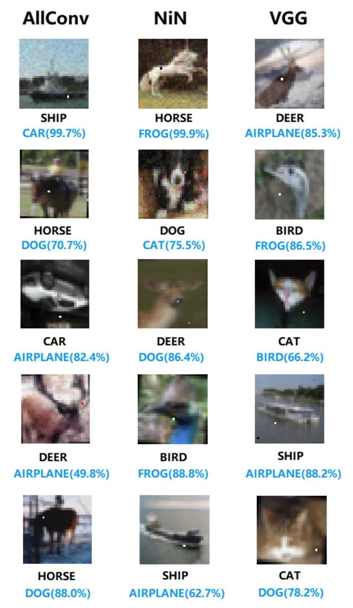
*Figure 3-11: One-Pixel Attacks causing AllConv, NiN, and VGG deep convolutional networks to misclassify images with high confidence (Su et al.).*

#### Adversarial Training Formulations
Rather than injecting uniform Gaussian noise, adversarial training computes worst-case bounded perturbations $\delta$ designed to maximize the model's loss:
$$\min_\theta \mathbb{E}_{(x, y) \sim \mathcal{D}} \left[ \max_{\|\delta\|_p \le \epsilon} \mathcal{L}(f(x + \delta; \theta), y) \right]$$
*   **Fast Gradient Sign Method (FGSM)**:
    $$\delta = \epsilon \cdot \text{sign}\left( \nabla_x \mathcal{L}(f(x; \theta), y) \right)$$
*   **DeepFool / PGD (Projected Gradient Descent)**: Iterative inner optimization computing the minimal perturbation necessary to push $x$ across the nearest decision boundary. Incorporating these adversarial points into training regularizes the boundary, smoothing classification margins.
*   **Perturbation in Language Models (BERT Pretraining)**:
    BERT randomly samples $15\%$ of token positions:
    *   $80\%$ replaced with the special `[MASK]` token.
    *   $10\%$ retained as the original token.
    *   $10\%$ replaced with a randomly selected vocabulary token.
    Ablation studies confirm that injecting a small fraction of random noise ($1.5\%$ of all tokens) prevents representation collapse and improves downstream generalization.

---

### 5.3. Data Synthesis

#### 5.3.1. Template-Based Generation
Widely deployed in Task-Oriented Dialog and Conversational AI to bootstrap slot-filling and intent classifiers prior to collecting user interaction telemetry:
$$\text{Template: } \text{"Find me a } [\text{CUISINE}] \text{ restaurant within } [\text{DISTANCE}] \text{ miles of } [\text{LOCATION}]."$$
Systematically populating slots from entity catalogs generates tens of thousands of diverse training utterances at zero annotation cost.

#### 5.3.2. Mixup: Beyond Empirical Risk Minimization
Proposed by Zhang et al. (2017), Mixup constructs synthetic training examples through convex linear combinations of pairs of samples $(x_i, y_i)$ and $(x_j, y_j)$:
$$\tilde{x} = \lambda x_i + (1 - \lambda) x_j$$
$$\tilde{y} = \lambda y_i + (1 - \lambda) y_j$$
where $\lambda \sim \text{Beta}(\alpha, \alpha)$ for $\alpha \in (0, \infty)$ (typically $\alpha \in [0.1, 0.4]$).

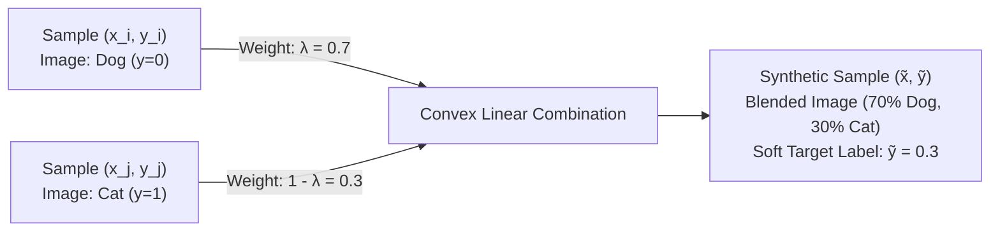

*   **Mathematical Impact**: Mixup regularizes neural networks to favor linear behavior between training points. It prevents overconfident predictions along unpopulated feature regions, mitigates memorization of corrupt labels, and stabilizes gradient dynamics.

#### 5.3.3. Deep Generative Synthesis
*   **Architectures**: Generative Adversarial Networks (GANs), CycleGAN, and Latent Diffusion Models synthesizing realistic instances for under-represented classes (e.g., synthesizing rare pathology in CT scans from normal baselines; Sandfort et al., 2019).
*   **Production Risks**: Mode collapse (generating limited feature variance) and synthetic hallucinations (introducing artifacts that models exploit as false predictive signals).

---

## 6. Production Training Data Architecture Checklist

| Stage | Verification Checkpoint | Criticality | Operational Invariant |
| :--- | :--- | :---: | :--- |
| **Sampling** | **Stratification Verification** | **P0** | Training, validation, and test splits must use stratified sampling on critical labels and slices. |
| | **Reservoir Correctness** | **P0** | Streaming ingestion pipelines must use Reservoir Sampling to guarantee uniform selection probability without knowing stream volume $N$. |
| | **Selection Bias Audit** | **P1** | Explicitly audit convenience sources against the operational serving environment (e.g., geographic, demographic, or temporal coverage). |
| **Labeling** | **Deterministic Conflict Rules** | **P0** | Labeling guidelines must contain formal disambiguation protocols (e.g., longest substring match for NER) to bound inter-annotator variance. |
| | **Data Lineage Tracking** | **P0** | Every sample must log metadata: ingestion source, annotator ID, labeling function version, and pipeline timestamp. |
| | **LF Denoising (Snorkel)** | **P1** | When using weak supervision, fit a generative label model to estimate LF covariance and error rates rather than relying on unweighted majority voting. |
| **Imbalance** | **Metric Alignment** | **P0** | Never evaluate imbalanced tasks using overall Accuracy. Require PR-AUC, per-class F1-scores, and cost-weighted utility matrices. |
| | **Evaluation Split Isolation** | **P0** | **Resampling (RUS, ROS, SMOTE) must NEVER be applied to validation or test sets.** They must strictly reflect the natural operational base rate. |
| | **Loss Function Calibration** | **P1** | For severe skew, replace standard Cross-Entropy with Focal Loss ($\gamma \in [1, 2]$) or Cost-Sensitive Loss matrices. |
| **Augmentation** | **Asynchronous Execution** | **P1** | Vision augmentations must execute asynchronously on host CPUs during the GPU forward/backward compute loop to ensure zero GPU starvation. |
| | **Label-Preservation Verification** | **P0** | Transformations must preserve true semantic labels (e.g., avoiding horizontal flips on asymmetric optical character recognition tasks). |
| | **Adversarial Regularization** | **P2** | Apply Mixup or gradient perturbation (e.g., FGSM / PGD) to smooth boundary overconfidence and boost out-of-distribution robustness. |

---

## 7. Architectural Summary

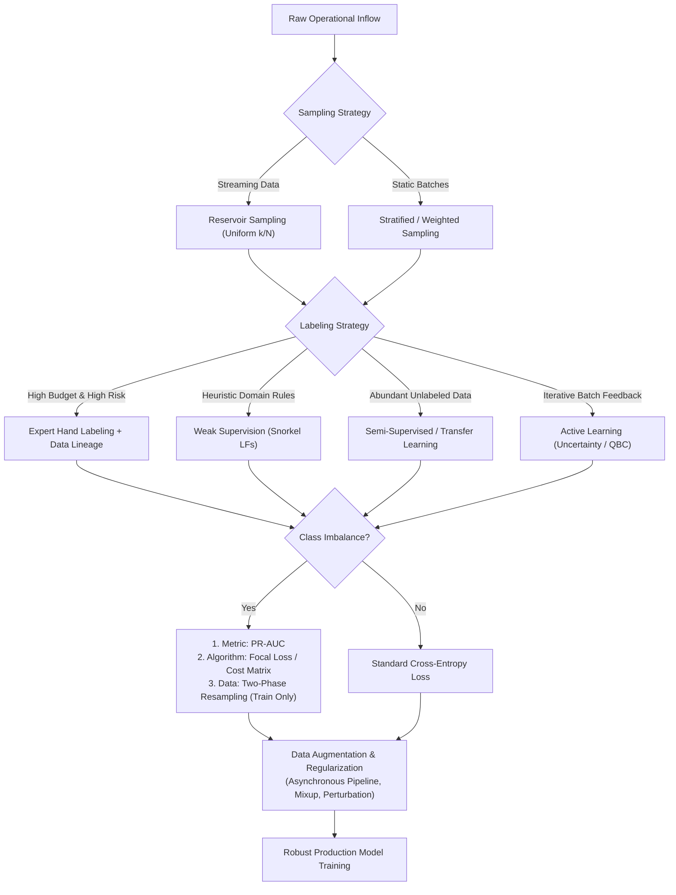
