# Chapter 4: Feature Engineering in Production Machine Learning Systems

> **Distilled Master Notes**:  
> In production machine learning, having the right features consistently delivers orders-of-magnitude greater performance gains than hyperparameter optimization or marginal model architecture tweaks. Feature engineering is the discipline of translating raw domain data into informative mathematical representations that maximize the learning capacity of algorithms. Far from being rendered obsolete by Deep Learning, feature engineering remains the core technical determinant of success in enterprise systems—bridging statistical modeling, domain expertise, and distributed systems engineering.

---

## 1. Learned Features vs. Engineered Features: Foundations & Evolution

### 1.1. The Paradigm Shift: Classical Machine Learning to Feature Learning

In classical Machine Learning (Linear Regression, Logistic Regression, Support Vector Machines, Random Forests, Gradient Boosted Decision Trees), raw data cannot be fed directly into an algorithm. Engineers manually design transformation pipelines to extract informative signals:

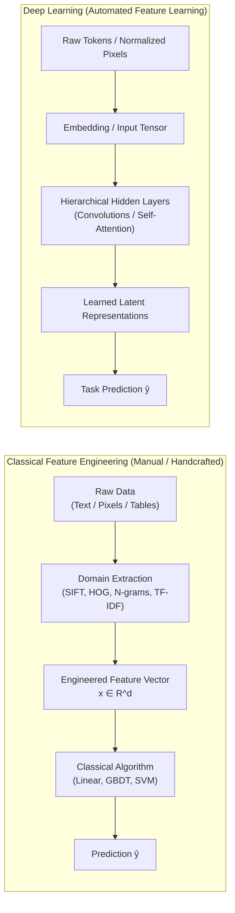

#### Classical Natural Language Processing (NLP) Pipelines
Prior to modern sequence models, textual data required a deterministic preprocessing pipeline:
1. **Normalization**: Case-folding (lowercasing), expanding contractions (`don't` $\to$ `do not`), stripping punctuation, and regex-based token cleaning.
2. **Morphological Reduction**:
   - *Stemming*: Heuristic chopping of word affixes (e.g., Porter/Snowball stemmers).
   - *Lemmatization*: Dictionary lookup utilizing Part-of-Speech (POS) tags to resolve words to their canonical lemma (e.g., `better` $\to$ `good`).
3. **$n$-Gram Generation**: Extracting contiguous sequences of $n$ items (characters, phonemes, or words) from a text sample. For a post `"I like food"`, the word-level unigrams ($n=1$) and bigrams ($n=2$) are:
   $$\text{Unigrams} = [\text{"I"}, \text{"like"}, \text{"food"}]$$
   $$\text{Bigrams} = [\text{"I like"}, \text{"like food"}]$$
4. **Vector Space Encoding (Bag-of-Words / TF-IDF)**: Constructing an immutable vocabulary $V$ of size $|V|$. Every document $d$ is encoded as a sparse vector $\mathbf{x} \in \mathbb{R}^{|V|}$ where each coordinate corresponds to term frequency or term frequency-inverse document frequency ($\text{TF-IDF}$):
   $$\text{TF-IDF}(t, d, D) = \text{TF}(t, d) \times \log\left(\frac{|D|}{1 + |\{d \in D : t \in d\}|}\right)$$

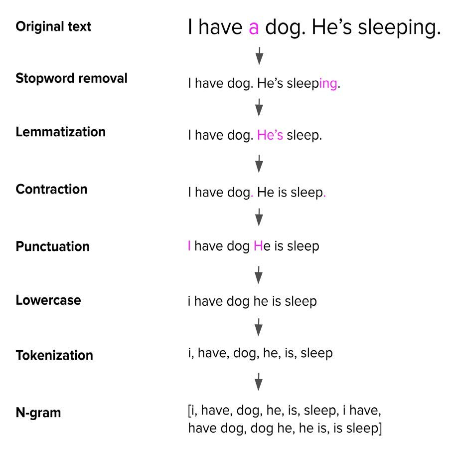

#### Classical Computer Vision (CV) Pipelines
Before Convolutional Neural Networks (CNNs), vision systems relied on deterministic mathematical operators designed to identify local invariant structures:
- **SIFT (Scale-Invariant Feature Transform)**: Computes gradient vectors invariant to image scaling, rotation, and affine distortions.
- **HOG (Histogram of Oriented Gradients)**: Counts occurrences of gradient orientation in localized portions of an image.
- **Haar Cascades**: Rectangular contrast filters applied across integral images for rapid object/face detection.

#### The Rise of Deep Learning (Feature Learning)
Deep Learning fundamentally altered this workflow by unifying representation extraction with parameter optimization. Hidden neural layers automatically learn hierarchical features directly via backpropagation:
- *In Computer Vision*: Low-level filters capture Gabor-like directional edges and textures; mid-level layers capture motifs and contours; high-level layers capture semantic object geometries.
- *In Natural Language Processing*: Raw text is split into subword units (Byte-Pair Encoding, WordPiece) and mapped to continuous vector spaces (Word2Vec, GloVe, or learned embedding matrices). Multi-head self-attention mechanisms compute contextual interactions dynamically.

---

### 1.2. The Tabular Data Imperative: Why GBDT Continues to Dominate

Despite the absolute dominance of Deep Learning across unstructured modalities (audio, natural language, vision), **the vast majority of enterprise production ML systems operate on structured, tabular data stored in relational databases and data warehouses** (e.g., ad click prediction, payment fraud detection, dynamic pricing, churn forecasting, risk underwriting).

In the tabular domain, Gradient Boosted Decision Trees (GBDT—specifically implementations like **XGBoost**, **LightGBM**, and **CatBoost**) consistently outperform or match deep tabular architectures (e.g., TabNet, FT-Transformer) while requiring orders-of-magnitude less compute and tuning overhead.

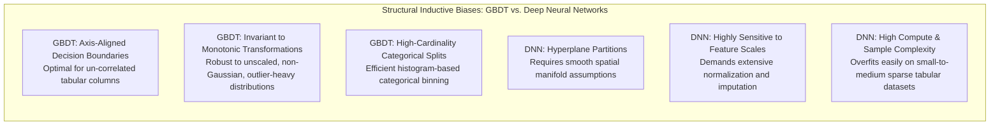

The mathematical and operational causes for GBDT's tabular superiority include:
1. **Decision Boundaries on Coordinate Hyperplanes**: Tabular features typically have independent physical meanings (e.g., `Age`, `Credit_Score`, `Past_Purchases`). Tree partitions are orthogonal to the coordinate axes ($x_j \le \theta$), which naturally aligns with tabular business rules, whereas neural networks partition space using linear hyperplanes ($\mathbf{w}^T \mathbf{x} + b \le 0$) that assume smooth rotational invariance.
2. **Monotonic Invariance**: Tree algorithms depend strictly on the rank-ordering of feature values at split points. They are completely invariant to any monotonic transformation $g(x_j)$ where $x_a > x_b \iff g(x_a) > g(x_b)$. Consequently, trees are resilient to raw scales, heavy-tailed outliers, and skewed distributions.
3. **Data Efficiency on Heterogeneous Types**: Tabular data mixes continuous, ordinal, nominal, and sparse categorical columns. Deep networks require every feature to be mapped into continuous metric vector spaces, introducing massive parameter bloat and overfitting vulnerabilities.

---

### 1.3. Multimodal Context & Entity Metadata in Production Systems

A common anti-pattern is assuming that an end-to-end deep learning model trained on raw unstructured data (such as user comment text) suffices for production classification. In real-world environments, **contextual and relational metadata are mandatory**:

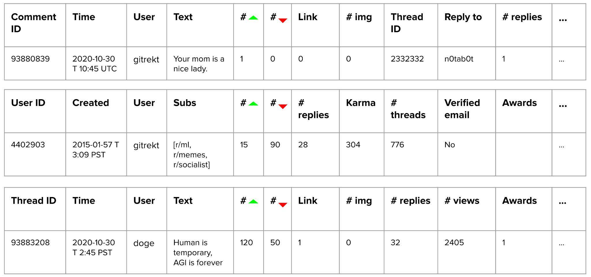

Consider a production spam detection classifier for social media comments:
1. **Comment Entity (Learned + Engineered Features)**:
   - *Learned*: Text embeddings extracted from a Transformer language model.
   - *Engineered*: Comment character length, presence of obfuscated URLs, uppercase character ratio, emoji density, count of recipient mentions.
2. **User Entity (Relational Telemetry Features)**:
   - Account age (in days/hours), lifetime spam-report ratio, past 24-hour post frequency, account verification status, device fingerprint entropy.
3. **Thread Entity (Contextual Dynamics Features)**:
   - Total thread views, velocity of incoming replies (comments/minute), thread topic classification, historical spam density within the thread. Viral threads inherently attract automated spam syndicates.

> **Production Architectural Rule**:  
> In industrial recommendation engines (e.g., TikTok, YouTube, Instagram) and ad ranking systems (Facebook, Google), models process **hundreds of millions of heterogeneous features**. High-level semantic embeddings from deep sub-networks are concatenated with high-dimensional engineered feature vectors to provide both semantic understanding and fine-grained historical behavioral signals.

---

### 1.4. Trade-off Matrix: Handcrafted Engineered Features vs. Learned Representations

| Architectural Dimension | Handcrafted Engineered Features (Classical ML) | Learned Features (Deep Learning / Feature Learning) |
| :--- | :--- | :--- |
| **Extraction Mechanism** | Domain knowledge, business logic heuristics, explicit statistical aggregations. | Gradient-based loss minimization across parameterized layers ($W \mathbf{x} + \mathbf{b}$). |
| **Algorithmic Compatibility** | Optimal for linear models, tree-based models (XGBoost, LightGBM), shallow networks. | Requires deep neural network architectures (Transformers, ResNets, ConvNets). |
| **Tabular Data Performance** | **Decisive Advantage**: Captures business thresholds, ratios, and entity aggregations. | Often suboptimal; prone to overfitting or excessive computational latency. |
| **Interpretability & Auditability** | **High**: Every feature possesses clear physical/business semantics (e.g., `debt_to_income_ratio`). | **Low (Black Box)**: Distributed latent representations across continuous embedding spaces. |
| **Brittleness & Pipeline Drift** | High maintenance overhead; changes in upstream database schemas break transformation logic. | Lower pipeline maintenance on raw inputs; automatically adapts to nuanced unstructured variations. |
| **Data & Compute Requirements** | Highly sample-efficient; trains rapidly on standard CPU clusters. | Extremely data-hungry; demands extensive GPU/TPU acceleration for training and inference. |
| **Generalization Limits** | Constrained by the manual hypotheses and domain assumptions of the system designer. | High generalization on in-distribution data; brittle under radical out-of-distribution domain shifts. |

---

## 2. Common Feature Engineering Operations: Mathematical Foundations & Production Implementations

### 2.1. Handling Missing Values: The Statistical Framework

Missing data is pervasive in production due to network timeouts, schema migrations, upstream sensor faults, optional user form fields, and dynamic application telemetry. However, treating all missing values identically is a critical engineering mistake.

```mermaid
flowchart TD
    Start[Missing Value Encountered] --> Mechanism{Determine Missingness Mechanism<br/>Rubin's Classification}
    
    Mechanism -->|P(M|X,Y) = P(M)| MCAR[MCAR: Missing Completely at Random]
    Mechanism -->|P(M|X,Y) = P(M|X)| MAR[MAR: Missing at Random]
    Mechanism -->|P(M|X,Y) = P(M|Y)| MNAR[MNAR: Missing Not at Random]
    
    MCAR --> MCR_Ratio{Missing Ratio?}
    MCR_Ratio -->|< 0.1%| RowDel[Row Deletion Permitted]
    MCR_Ratio -->|Significant| ImpMean[Simple Imputation:<br/>Median / Mode / KNN]
    
    MAR --> ImpCond[Conditional Imputation / Model-Based<br/>DO NOT use Listwise Row Deletion]
    
    MNAR --> Flag[Informative Missingness:<br/>Preserve Missing Indicator Feature<br/>I_M ∈ {0, 1}]
```

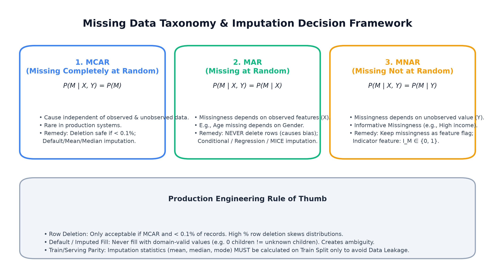

#### 2.1.1. Rubin's Missingness Taxonomy

Formally, let $Y$ represent the variable subject to missingness, $X$ represent completely observed covariates, and $M$ represent a binary indicator variable such that:
$$M = \begin{cases} 1 & \text{if } Y \text{ is missing} \\ 0 & \text{if } Y \text{ is observed} \end{cases}$$

1. **MCAR (Missing Completely at Random)**:
   - **Mathematical Condition**:
     $$P(M = 1 \mid X, Y) = P(M = 1)$$
   - *Physical Meaning*: The probability of missingness is entirely independent of both observed features $X$ and unobserved values $Y$. The missing data points constitute a uniform random sample of the dataset (e.g., intermittent sensor packet loss caused by network hardware glitches).
   - *Production Reality*: **Extremely rare**. Almost all missing data in software systems has an underlying operational or behavioral cause.
2. **MAR (Missing at Random)**:
   - **Mathematical Condition**:
     $$P(M = 1 \mid X, Y) = P(M = 1 \mid X)$$
   - *Physical Meaning*: The probability of missingness depends on other observed variables $X$, but is independent of the missing value $Y$ itself once conditioned on $X$.
   - *Production Example*: In a real estate predictive system, the variable `Age` is disproportionately missing for users where `Gender = 'Prefer Not to Disclose'`. Once conditioned on the observed `Gender` attribute, the probability of missingness does not depend on the user's actual age.
3. **MNAR (Missing Not at Random / Informative Missingness)**:
   - **Mathematical Condition**:
     $$P(M = 1 \mid X, Y) = P(M = 1 \mid Y)$$
   - *Physical Meaning*: The probability of missingness depends directly on the true unobserved value of $Y$ itself.
   - *Production Example*: In credit underwriting, individuals with extremely high net worth or individuals with high debt loads frequently refuse to disclose their `Annual_Income`. The fact that the value is missing is itself an exceptionally strong predictor of financial behavior.

---

#### 2.1.2. Deletion Strategies & Failure Modes

* **Column Deletion (Feature Dropping)**:
  - *Heuristic*: Drop an entire feature column if its missingness exceeds a chosen threshold (e.g., $>50\%$).
  - *Failure Mode*: Drops high-signal features. For instance, if `Marital_Status` is missing in 60% of mortgage applications, dropping it discards critical predictive power: married applicants historically exhibit significantly higher homeownership and repayment rates.
* **Row Deletion (Listwise Deletion)**:
  - *Heuristic*: Discard any record containing one or more missing fields.
  - *Operational Bound*: **Permissible strictly when the data is MCAR and the missing row proportion is negligible ($<0.1\%$)**.
  - *Production Catastrophe*:
    - Under **MAR**: Discarding records missing `Age` drops entire sub-populations (e.g., `Gender A`), permanently biasing the model and crippling its inference reliability on that demographic segment.
    - Under **MNAR**: Discarding records missing `Annual_Income` truncates the upper and lower tails of the wealth distribution, causing the model to severely underestimate credit default risks.

---

#### 2.1.3. Imputation Strategies & The "Silent Bug" Anti-Pattern

* **Descriptive Statistics Imputation**:
  - Continuous variables: Impute using the median (robust to outliers) or mean (under strict Gaussian distributions).
  - Categorical variables: Impute using the mode (most frequent category) or assign a dedicated `'UNKNOWN'` token.
  - *Conditional / Hierarchical Imputation*: Impute by subgroup. If `Temperature` is missing for a record in `July`, fill using the historical median of `July` records rather than the full-year median.
* **Advanced / Model-Based Imputation**:
  - $k$-Nearest Neighbors ($k$-NN) imputation, regression imputation, and MICE (Multivariate Imputation by Chained Equations). While statistically powerful, these methods incur substantial computational overhead and are difficult to deploy in low-latency online serving pipelines.
* **The "Ghost Bug / Silent Failure" Anti-Pattern**:
  - *Filling with valid domain values*: Imputing `0` for missing `Number_of_Children` destroys the distinction between *a verified family with zero children* and *an unverified applicant who omitted the field*.
  - *Frontend-Backend Decoupling Failure*: An engineering team updates a mobile onboarding flow, removing the mandatory `Age` input field. The backend feature extractor silently fills missing values with `0`. Because the model was trained on ages spanning $18$ to $80$, inputting `0` causes the model to generate nonsensical predictions in production—without throwing a single software exception or logging an alert.
* **Production Best Practice: The Missing Indicator Feature**:
  Whenever imputing a feature $x_j$, always generate an accompanying binary indicator feature $I_{x_j}$:
  $$I_{x_j} = \begin{cases} 1 & \text{if } x_j \text{ was originally missing} \\ 0 & \text{if } x_j \text{ was observed} \end{cases}$$
  This converts informative missingness (MNAR) into an explicit, learnable signal while enabling safe numerical imputation on the primary feature column.

---

### 2.2. Feature Scaling & Transformations

#### 2.2.1. Mathematical Motivations

Consider a linear or neural architecture predicting house acquisition where feature $x_1$ (`Age`) $\in [20, 40]$ and feature $x_2$ (`Annual_Income`) $\in [10\,000, 150\,000]$.

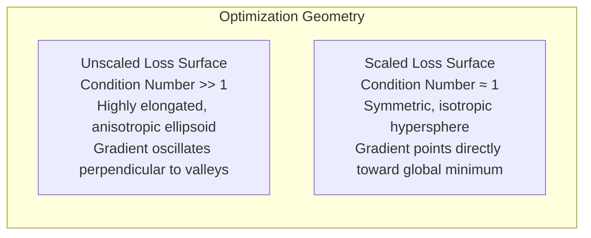

1. **Gradient Descent Dynamics**:
   For an objective function $J(\mathbf{w})$, the gradient vector components are:
   $$\frac{\partial J}{\partial w_1} = \frac{\partial J}{\partial \hat{y}} x_1, \quad \frac{\partial J}{\partial w_2} = \frac{\partial J}{\partial \hat{y}} x_2$$
   Because $x_2 \gg x_1$, the gradient along dimension $w_2$ is orders of magnitude larger than along $w_1$. The resulting Hessian matrix exhibits a massive condition number:
   $$\kappa(H) = \frac{\lambda_{\max}(H)}{\lambda_{\min}(H)} \gg 1$$
   Gradient descent violently oscillates across the steep $w_2$ walls while making glacial progress along the shallow $w_1$ axis, requiring excessively small learning rates and prolonged training times.
2. **Metric Distance Dominance**:
   In distance-based algorithms ($k$-NN, SVMs with RBF kernels, $K$-Means, PCA), the Euclidean distance is:
   $$\| \mathbf{x}_a - \mathbf{x}_b \|_2 = \sqrt{(x_{a1} - x_{b1})^2 + (x_{a2} - x_{b2})^2}$$
   Here, $(x_{a2} - x_{b2})^2 \approx 10^8$ completely overwhelms $(x_{a1} - x_{b1})^2 \approx 10^2$. The algorithm degenerates into computing distances solely on `Annual_Income`, rendering `Age` completely inert.

---

#### 2.2.2. Core Scaling Formulations

1. **Min-Max Normalization (Rescaling to Unit Interval)**:
   $$x' = \frac{x - \min(x)}{\max(x) - \min(x)}$$
   - Maps bounded data strictly into $[0, 1]$.
   - *Generalization to Arbitrary Range $[a, b]$*:
     $$x' = a + \frac{(x - \min(x))(b - a)}{\max(x) - \min(x)}$$
   - *Empirical Production Takeaway*: Rescaling into the symmetric interval $[-1, 1]$ typically yields faster convergence in neural architectures than $[0, 1]$ because it facilitates zero-centered activation distributions.
   - *Critical Vulnerability*: **Extreme sensitivity to outliers**. A single anomalous maximum value compresses all standard operational points into a tiny sub-interval near zero.
2. **Standardization (Z-Score Normalization)**:
   $$x' = \frac{x - \mu}{\sigma}$$
   Where the empirical mean $\mu$ and standard deviation $\sigma$ are:
   $$\mu = \frac{1}{N} \sum_{i=1}^N x_i, \quad \sigma = \sqrt{\frac{1}{N} \sum_{i=1}^N (x_i - \mu)^2}$$
   - Transforms the feature to possess zero mean ($\mu = 0$) and unit variance ($\sigma^2 = 1$).
   - Far more robust to outliers than Min-Max scaling; does not bound the feature to a rigid interval.
3. **Log Transformation for Heavy-Tailed Skewness**:
   Features representing counts, financial amounts, durations, or engagement metrics frequently exhibit power-law or log-normal distributions ($P(X) \sim X^{-\alpha}$).

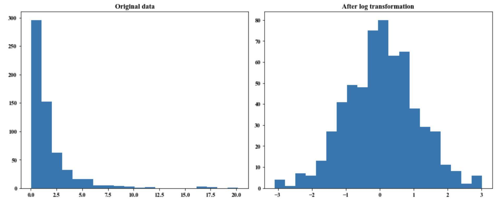

$$\tilde{x} = \log(x) \quad \text{or} \quad \tilde{x} = \log(1 + x) \quad (\text{for non-negative } x \ge 0)$$
- **Effect**: Compresses the extreme upper tail while expanding the lower range, stabilizing variance and transforming skewed distributions closer to a Gaussian manifold.
- *Caution*: Models trained on log-transformed targets predict expected values in log-space ($\mathbb{E}[\log Y]$), which systematically underestimates the arithmetic mean on the original scale ($\log \mathbb{E}[Y]$) due to Jensen's Inequality:
  $$\mathbb{E}[\log Y] \le \log(\mathbb{E}[Y])$$

---

#### 2.2.3. The Production Invariant: Global Statistics Boundaries

> [!CAUTION]
> **Production System Invariant: Freezing Normalization Statistics**  
> All global statistical parameters $(\min, \max, \mu, \sigma)$ **MUST BE CALCULATED SOLELY ON THE TRAINING SPLIT**.
> 
> $$\mu_{\text{train}} = \frac{1}{|D_{\text{train}}|} \sum_{i \in D_{\text{train}}} x_i, \quad \sigma_{\text{train}} = \sqrt{\frac{1}{|D_{\text{train}}|} \sum_{i \in D_{\text{train}}} (x_i - \mu_{\text{train}})^2}$$
> 
> During validation, testing, and live online inference, **never recompute statistics dynamically**. The serving pipeline must load and apply the frozen parameters $(\mu_{\text{train}}, \sigma_{\text{train}})$. Recomputing statistics over small batch windows at inference introduces severe prediction instability and invalidates model calibration.

---

### 2.3. Discretization (Bucketing / Binning / Quantization)

Discretization is the process of partitioning continuous numerical features into discrete ordinal or categorical buckets.

#### 2.3.1. Technical Motivations
- **Suppressing Micro-Noise**: Continuous values contain high-frequency noise that carries zero business significance. For example, distinguishing an annual income of $\$45\,120.50$ from $\$45\,200.00$ forces a model to learn meaningless variations.
- **Enabling Non-Linear Mappings in Linear Formulations**: When fed into a linear model, a single continuous feature $x$ can only exert a monotonic linear effect ($w \cdot x$). When bucketed into $K$ one-hot categories ($[b_1, b_2, \dots, b_K]$), the model learns an independent weight for each bucket ($\sum_{k=1}^K w_k b_k$), effectively approximating an arbitrary step function.

#### 2.3.2. Binning Algorithms
1. **Uniform Width Binning**:
   Divides the range into $K$ intervals of equal width:
   $$\delta = \frac{\max(x) - \min(x)}{K}$$
   *Failure Mode*: Under skewed distributions, a single bucket contains 98% of all samples, while remaining buckets are sparse or empty.
2. **Quantile Binning (Equal Frequency)**:
   Selects split points based on empirical percentiles ($q$-quantiles) such that each bucket contains exactly $\frac{N}{K}$ observations.
   *Advantage*: Guarantees balanced sample distribution across buckets, neutralizing outlier distortion.
3. **Domain-Specific Rule Bucketing**:
   Partitions based on physical or regulatory thresholds (e.g., standard demographic age intervals: $[<18, 18\text{--}25, 26\text{--}35, 36\text{--}50, 51\text{--}65, >65]$).

---

### 2.4. Categorical Encoding & The Hashing Trick

#### 2.4.1. The Challenge of Dynamic Categorical Cardinality

In production systems, categorical vocabularies are **fundamentally dynamic and unbounded**:
- Amazon processes over 2 million distinct product brands; hundreds of new vendor brands register daily.
- Features such as `user_id`, `merchant_id`, `search_query`, `referrer_domain`, and `ip_subnet` produce continuous streams of previously unseen keys.

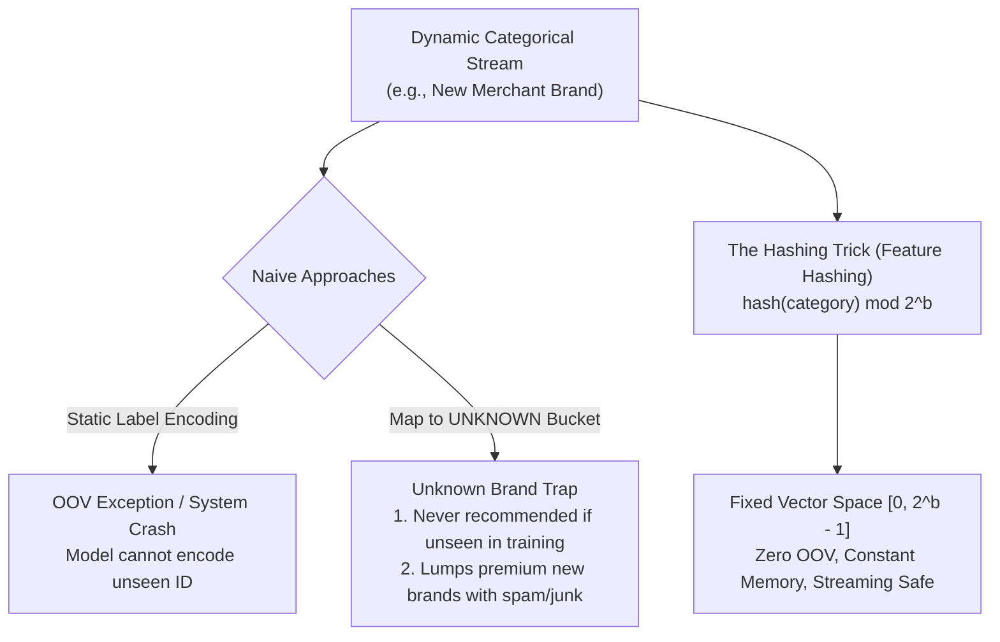

**The Breakdown of Naive Approaches**:
1. *Static Integer Encoding*: Maps each known brand to an integer index $[0, N-1]$. When an unseen brand appears at inference, the serving pipeline crashes with an Out-of-Vocabulary (OOV) key error.
2. *The Dedicated `UNKNOWN` Bucket Trap*: Assigning all unseen tokens to an `UNKNOWN` category (index $N$) produces two pathological failure modes:
   - *Cold-Start Starvation*: If `UNKNOWN` was absent or rare during training, the model assigns it a strongly negative prior, permanently suppressing recommendations for all new brands.
   - *Contamination of Premium Entities*: If the bottom 1% of training brands are grouped into `UNKNOWN`, any newly registered luxury brand is mathematically treated as low-quality spam.

---

#### 2.4.2. The Hashing Trick (Feature Hashing)

Popularized in industrial production by Microsoft's *Vowpal Wabbit* framework, the Hashing Trick eliminates the need for an in-memory vocabulary dictionary by mapping arbitrary categorical strings directly into a fixed-size index space via a deterministic hash function:

$$\text{Index} = \text{hash}(\text{category}) \pmod{2^b}$$

Where $b$ denotes the bit-depth of the hash space (e.g., $b = 18 \implies 2^{18} = 262\,144$ slots).

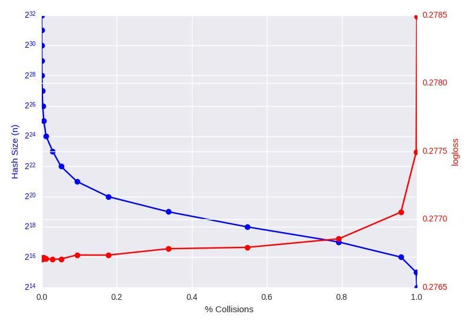

**Architectural Properties & System Guarantees**:
1. **Bounded In-Memory Footprint**: The serving system requires zero megabytes of RAM for vocabulary lookups. The index range is hard-capped at $[0, 2^b - 1]$.
2. **Continual & Streaming Learning Compatibility**: New categories appearing in live production streams are immediately mapped into the existing coordinate space without retraining or expanding parameter matrices.
3. **Collision Dynamics & The Booking.com Benchmark**:
   When two distinct categories $c_1 \neq c_2$ satisfy $\text{hash}(c_1) \equiv \text{hash}(c_2) \pmod{2^b}$, a hash collision occurs.
   - Crucially, collisions are distributed uniformly at random across the entire feature space.
   - *Empirical Industrial Result (Booking.com)*: In an extensive empirical study conducted by Lucas Bernardi, **even under a 50% feature collision rate, model performance degraded by less than 0.5% in Log-Loss**. The gradient descent optimization treats random collision noise as an acceptable regularizer without corrupting primary predictive signals.
4. **Locality-Sensitive Hashing (LSH)**:
   For text queries or URLs, LSH functions (e.g., MinHash, SimHash) can be used to ensure that semantically or syntactically similar items are mapped to identical or adjacent indices with high probability.

---

### 2.5. Feature Crossing (Interaction Features)

#### 2.5.1. Mathematical Formulation

Feature crossing computes the Cartesian product of two or more discrete or binned features to explicitly capture non-linear multiplicative interactions:

$$\mathbf{x}_{\text{cross}} = \mathbf{x}_A \otimes \mathbf{x}_B$$

Given two categorical variables $\mathbf{x}_A \in \{0, 1\}^{|A|}$ and $\mathbf{x}_B \in \{0, 1\}^{|B|}$, their cross product yields a high-dimensional vector in $\{0, 1\}^{|A| \times |B|}$.

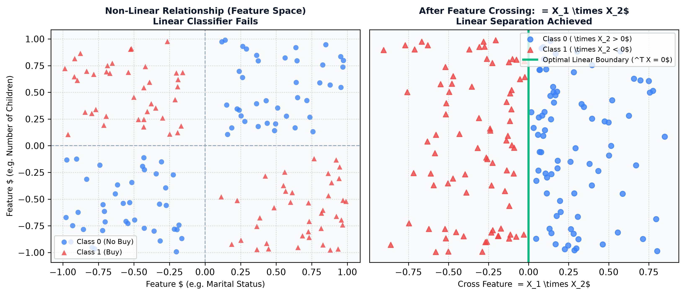

Consider predicting house acquisition likelihood:
- Single feature $A$: `Marital_Status` $\in \{\text{Single}, \text{Married}\}$
- Single feature $B$: `Children_Count` $\in \{0, 1, 2+\}$
- Crossed feature: `Marital_Status` $\times$ `Children_Count` produces 6 explicit compound states:
  $$\{(\text{Single}, 0), (\text{Single}, 1), (\text{Single}, 2+), (\text{Married}, 0), (\text{Married}, 1), (\text{Married}, 2+)\}$$

---

#### 2.5.2. Non-Linearity & Inductive Biases

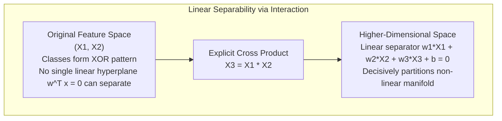

- **Essential for Linear and Logistic Formulations**: A purely linear model $\hat{y} = \sigma(\mathbf{w}^T \mathbf{x} + b)$ cannot learn the XOR interaction between two features. Explicit feature crossing projects the inputs into a higher-dimensional space where the classes become linearly separable.
- **Explicit Crosses in Deep Architectures**: Although multi-layer perceptrons can theoretically approximate non-linear interactions, research from Google (**Wide & Deep**, **DeepFM**, **xDeepFM**) proves that injecting explicit feature interaction layers allows recommendation architectures to learn sparse conjunctions significantly faster, with lower compute requirements and higher memorization fidelity.
- **The Curse of Dimensionality & Sparsity Risk**:
  Crossing feature $A$ ($|A| = 10^4$) with feature $B$ ($|B| = 10^4$) spawns a parameter space of $10^8$ possible coordinates. The vast majority of these conjunctions will possess zero observed training instances, inducing severe model sparsity and high overfitting risks unless combined with $L_1$ regularization, low-rank factorization, or embedding tables.

---

### 2.6. Positional Embeddings: Discrete vs. Continuous

#### 2.6.1. Why Attention Architectures Require Positional Signals

Recurrent Neural Networks (RNNs, LSTMs) process tokens sequentially ($t_1, t_2, \dots$), naturally incorporating temporal ordering. In contrast, the Multi-Head Self-Attention mechanism in **Transformers** is completely permutation-invariant:

$$\text{Attention}(Q, K, V) = \text{softmax}\left(\frac{QK^T}{\sqrt{d_k}}\right)V$$

For any permutation matrix $P$, $\text{Attention}(PQ, PK, PV) = P \cdot \text{Attention}(Q, K, V)$. Without explicit positional signals, the network treats `"a dog bites a child"` as mathematically identical to `"a child bites a dog"`.

**Why naive numerical positions fail**:
1. *Feeding Raw Integers ($0, 1, 2, \dots, N$)*: Breaches unit-variance principles; network gradients explode or oscillate on long sequences.
2. *Rescaling to $[0, 1]$ ($0, \frac{1}{N-1}, \dots, 1$)*: The relative step size between adjacent tokens scales inversely with sequence length $N$. The model cannot learn a consistent spatial step operator across sequences of variable length.

---

#### 2.6.2. Discrete Positional Embeddings

1. **Learned Positional Embeddings**:
   An embedding parameter matrix $P \in \mathbb{R}^{L_{\max} \times d_{\text{model}}}$ is allocated, where each row represents an integer position index $pos \in [0, L_{\max}-1]$. The final input representation $\mathbf{e}_{\text{final}}$ is the element-wise addition of token and position vectors:
   $$\mathbf{e}_{\text{final}}(pos) = \mathbf{e}_{\text{token}} + P[pos]$$
   - *Limitation*: The model cannot generalize or extrapolate to sequence lengths exceeding the hard limit $L_{\max}$ encountered during training (e.g., standard BERT is limited to $L_{\max} = 512$).

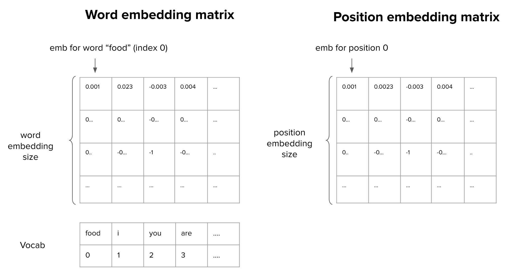

2. **Fixed Sinusoidal Positional Embeddings**:
   Introduced in *Attention Is All You Need* (Vaswani et al., 2017), fixed positional encodings utilize sinusoidal functions of geometric frequencies:
   $$PE_{(pos, 2i)} = \sin\left(\frac{pos}{10000^{2i/d_{\text{model}}}}\right)$$
   $$PE_{(pos, 2i+1)} = \cos\left(\frac{pos}{10000^{2i/d_{\text{model}}}}\right)$$
   Where $pos$ is the token position and $i \in [0, d_{\text{model}}/2 - 1]$ is the channel dimension.

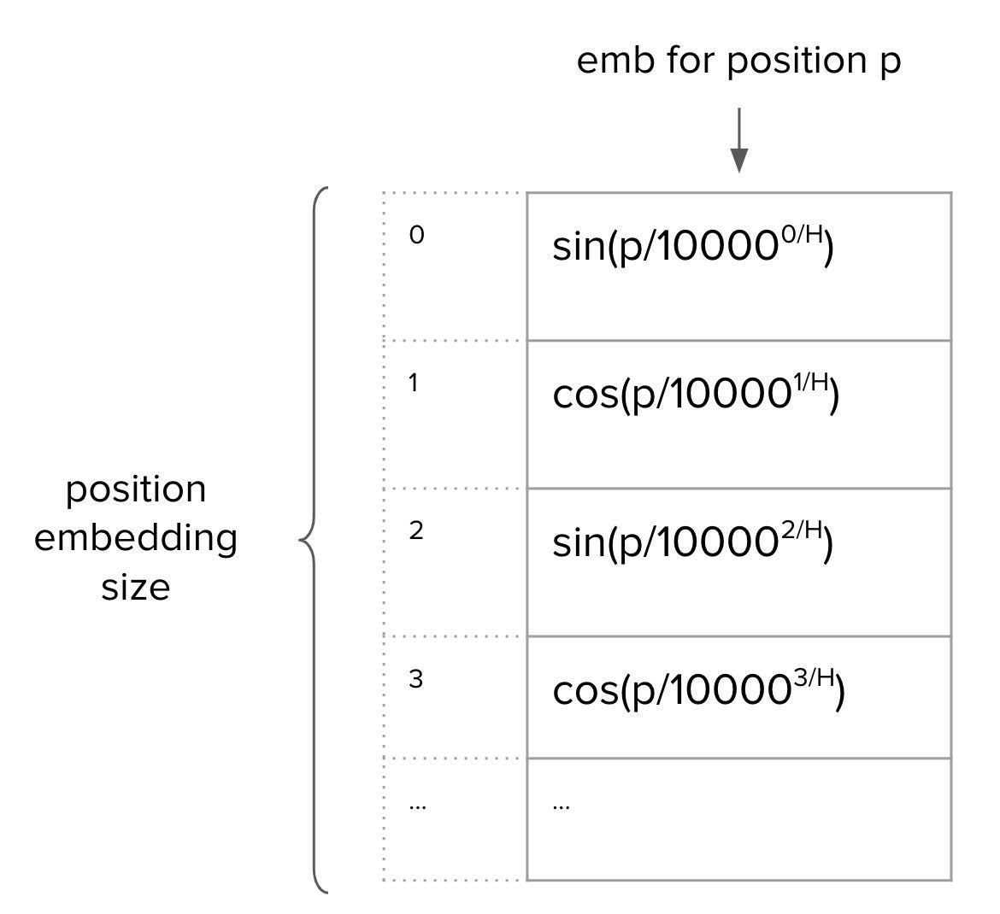

- *Mathematical Invariant*: For any fixed offset $k$, there exists a linear transformation matrix $M_k \in \mathbb{R}^{2 \times 2}$ such that:
  $$\begin{bmatrix} PE_{(pos+k, 2i)} \\ PE_{(pos+k, 2i+1)} \end{bmatrix} = \begin{bmatrix} \cos(\omega_i k) & \sin(\omega_i k) \\ -\sin(\omega_i k) & \cos(\omega_i k) \end{bmatrix} \begin{bmatrix} PE_{(pos, 2i)} \\ PE_{(pos, 2i+1)} \end{bmatrix}$$
  This geometric property allows self-attention to learn relative positional affinities via standard linear projections.

---

#### 2.6.3. Continuous Positional Embeddings: Fourier Features

When inputs exist in continuous metric spaces (e.g., $(x, y, z)$ 3D coordinates in NeRF rendering, robotics point clouds, or continuous GPS latitude/longitude trajectories), discrete lookup matrices cannot be constructed.

**Fourier Feature Encodings** (Tancik et al., 2020) map continuous coordinate vectors $\mathbf{v} \in \mathbb{R}^d$ into higher-dimensional hyperspheres:

$$\gamma(\mathbf{v}) = \left[ a_1 \cos(2\pi \mathbf{b}_1^T \mathbf{v}),\; a_1 \sin(2\pi \mathbf{b}_1^T \mathbf{v}),\; \dots,\; a_m \cos(2\pi \mathbf{b}_m^T \mathbf{v}),\; a_m \sin(2\pi \mathbf{b}_m^T \mathbf{v}) \right]^T$$

Where frequency vectors $\mathbf{b}_j \sim \mathcal{N}(0, \sigma^2)$ are drawn from Gaussian distributions.
- **Overcoming Spectral Bias**: Standard deep neural networks exhibit an intrinsic "spectral bias" (Rahaman et al., 2019), learning low-frequency functions rapidly while failing to capture high-frequency spatial variations. Projecting continuous coordinates through random Fourier features enables networks to resolve sharp spatial discontinuities, high-resolution geometry, and fine-grained physical topologies.

---

## 3. Data Leakage: The Silent Production Killer

### 3.1. Formal Definition & System Failure Mechanics

> **Formal Academic Definition**:  
> **Data Leakage** is the unintentional inclusion of information regarding the ground-truth target label $Y$ or future unobserved system states within the feature matrix $X$ used to train a model, where that identical information is **strictly unavailable at production inference serving time**.

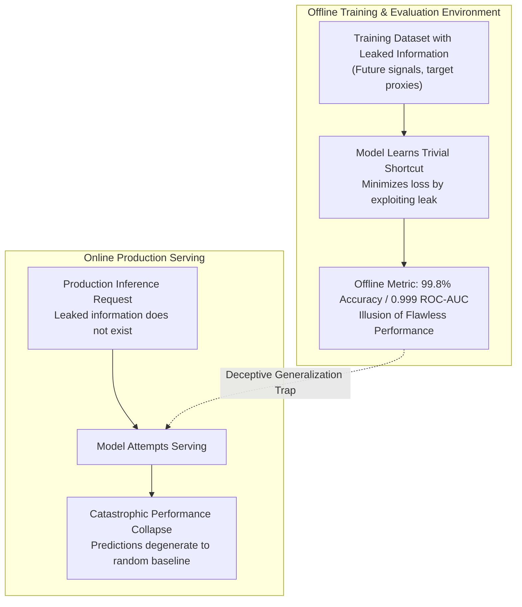

Data leakage is the most pernicious failure mode in applied machine learning:
1. **Zero Technical Exceptions**: The model does not throw errors, crash servers, or violate database types. It functions perfectly from a software perspective.
2. **Deceptive Optimization**: Objective loss functions decrease rapidly. The learning algorithm discovers an effortless non-causal statistical shortcut directly to the label, bypassing true underlying patterns.
3. **Severe Real-World Impact**: The defect remains completely invisible through cross-validation, unit tests, and staging benchmarks, detonating only upon live user exposure.

---

### 3.2. Case Studies: Anatomy of Real-World Leaks

#### Case 1: The Hospital Lung CT Scan Diagnostic Failure
- **The Setup**: An engineering team trained a deep convolutional network to detect malignant lung nodules from pulmonary CT scan volumes collected at Hospital A.
- **The Illusion**: The model achieved near-perfect sensitivity ($99.2\%$) and specificity ($98.9\%$) on held-out test splits from Hospital A.
- **The Collapse**: When evaluated on patient scans from Hospital B, classification accuracy plummeted to random chance ($\approx 50\%$).
- **Root-Cause Analysis**: At Hospital A, attending physicians routinely assigned patients with severe oncological symptoms to a newer, specialized high-resolution CT scanner, while ambulatory screening patients used standard machines. The specialized scanner produced subtle reconstruction artifacts, peripheral border contrast differences, and distinct spatial dimensions. The neural network never learned oncological tissue pathology; it learned to classify **which scanner machine produced the image**. Because Hospital B routed patients to scanners uniformly at random, the model's shortcut vanished.

#### Case 2: Kaggle Ion Switching 2020 Competition Leak
- **The Setup**: Competitors were tasked with predicting the count of open ion channels at discrete time points from electrophysiology telemetry.
- **The Leak**: Organizers synthesized synthetic test data from continuous training segments. Competitors reverse-engineered the underlying mathematical transformation and discovered that exact test labels were encoded directly in the synthesized noise floor and temporal offsets, allowing teams exploiting the leak to attain synthetic, perfect evaluation scores.

---

### 3.3. Six Common Causes of Data Leakage & Engineering Mitigations

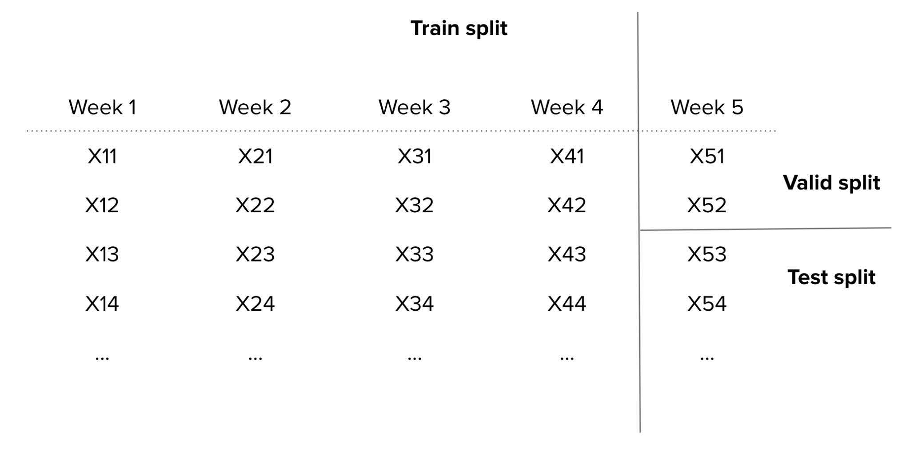

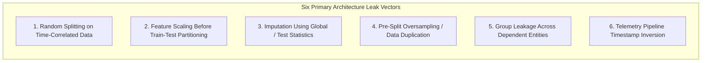

#### 1. Random Splitting of Time-Correlated Data (Temporal Inversion)
- **Mechanics**: In sequential or time-series data (e.g., ad click-through rates, financial transactions, user song streams), events are strongly auto-correlated with macro-trends of day $T$. Applying a random split distributes events from day $T$ across both training and test sets. The model memorizes that day's specific macro-environment, effectively using future knowledge to predict the past.
- **Remedy**: **Strict Temporal Splitting**. If training on 5 weeks of data, assign weeks 1–4 to the training split, and partition week 5 chronologically into validation and testing splits.

#### 2. Scaling Before Splitting
- **Mechanics**: Computing min, max, mean, or standard deviation across the entire combined dataset prior to calling `train_test_split()`. The empirical moments ($\mu_{\text{test}}, \sigma_{\text{test}}$) are infused into the training representations, allowing the model to adapt to the future test distribution.
- **Remedy**: Partition the raw dataset first. Fit all scalers strictly on `Train Split` data; apply the frozen scaler transforms to validation, test, and serving pipelines.

#### 3. Imputation Using Test Set Statistics
- **Mechanics**: Imputing missing values using the mean or median of the entire dataset. The missing values in the training set absorb distributional information from the held-out evaluation set.
- **Remedy**: Calculate all imputation replacement values strictly from the training partition.

#### 4. Pre-Split Oversampling & Data Duplication
- **Mechanics**:
  - *Data Duplication*: Redundant records naturally exist in raw scrapes or unified data lakes (e.g., 3.3% of CIFAR-10 test images are duplicated in the training set).
  - *Synthetic Oversampling*: Applying SMOTE or random replication to balance an imbalanced dataset *before* partitioning causes identical copies of synthetic instances to populate both train and test splits.
- **Remedy**: Execute end-to-end data deduplication on raw storage before partitioning. Apply oversampling/undersampling **strictly inside the training partition after the split**.

#### 5. Group Leakage (Entity Contamination)
- **Mechanics**: Multiple records belong to the same core entity (e.g., a patient undergoing 4 successive CT scans across two weeks, or a customer browsing 10 products within an hour). Random row splitting allocates 3 scans to train and 1 to test. The model simply identifies unique patient physiological baseline traits to "predict" the diagnosis of the 4th scan.
- **Remedy**: **Group-Based Partitioning (`GroupKFold`)**. Ensure all records associated with a given entity (`patient_id`, `user_id`, `organization_id`) are assigned atomically to a single split.

#### 6. Pipeline Inversion (Data Collection Leakage)
- **Mechanics**: Telemetry fields written to database rows *after* the target event occurs are accidentally included in feature extracts. For instance, in fraud detection, including a field `chargeback_status_timestamp` or `ticket_escalated_flag` provides an instantaneous giveaway of fraudulent activity, but these fields are completely unpopulated when the transaction is first evaluated in real time.
- **Remedy**: Establish strict event-time lineage auditing. Enforce time-travel assertions verifying that every feature timestamp $t_{\text{feature}} < t_{\text{inference}}$.

---

### 3.4. Leakage Detection Methodologies

1. **Target Correlation Auditing**:
   Calculate bivariate correlations (Pearson, Spearman) or Mutual Information between individual features and the label $Y$:
   $$I(X_j; Y) = \sum_{y \in Y} \sum_{x \in X_j} p(x, y) \log\left(\frac{p(x, y)}{p(x)p(y)}\right)$$
   - *Heuristic Alert*: Any standalone feature exhibiting $|r| > 0.90$ or yielding an individual ROC-AUC $> 0.95$ must be treated with immediate suspicion and audited for causal validity.
   - *Interaction Leak Auditing*: Beware of pairs of non-predictive features that encode the label when combined. For example, predicting employee tenure where `Start_Date` and `Resignation_Date` independently look benign, but their difference explicitly computes the target label:
     $$\text{Tenure} = \text{Resignation\_Date} - \text{Start\_Date}$$
2. **Feature Ablation Studies**:
   Iteratively drop features and observe performance degradation:
   $$\Delta \mathcal{M} = \mathcal{M}_{\text{full}} - \mathcal{M}_{\setminus \{x_j\}}$$
   If removing a single feature induces an immediate, catastrophic metric cliff (e.g., ROC-AUC drops from $0.98$ to $0.72$), that feature is almost certainly a vehicle for target leakage.
3. **Air-Gapped Test Set Protocol**:
   The test dataset must remain an immutable, air-gapped vault. Under no circumstances should test splits be inspected for feature inspiration, used for bin threshold discovery, or queried during hyperparameter optimization.

---

## 4. Engineering Good Features: Selection, Importance & Infrastructure

### 4.1. The Cost of Feature Accumulation

While adding features frequently improves initial model accuracy, unconstrained feature accumulation creates **five major operational liabilities**:

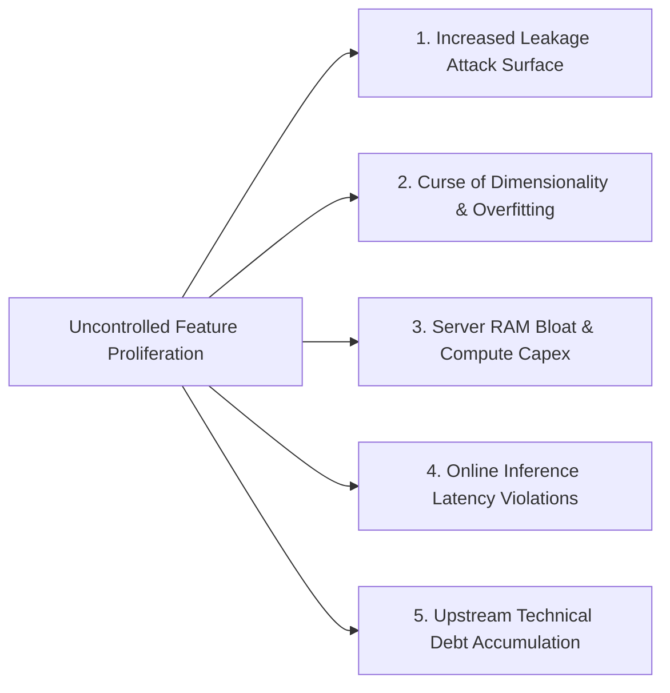

1. **Elevated Leakage Surface**: Every additional data stream integrated into the training pipeline increases the probability of accidental temporal inversion or label proxy leakage.
2. **Overfitting & Curse of Dimensionality**: In high-dimensional spaces ($\mathbb{R}^d$ where $d \gg 1$), sample density decreases exponentially ($V \sim r^d$), causing models to fit idiosyncratic training noise rather than true population regularities.
3. **Serving Memory Footprint**: In-memory serving systems must allocate massive RAM buffers for wide feature vectors, driving up cloud infrastructure expenditures.
4. **Online Inference Latency Degradation**: In mission-critical online serving (e.g., ad auctions, payment fraud checks), strict p99 Service Level Agreements (SLAs) dictate response budgets (e.g., $<25$ms). Calculating hundreds of remote, non-cached features at runtime violates latency guarantees.
5. **Technical Debt**: When upstream application databases deprecate or modify a single column, all dependent downstream feature pipelines break, requiring expensive incident response and engineering maintenance.

---

### 4.2. Feature Importance: Mathematical Formulations & Comparison

#### 4.2.1. Methodologies Compared

| Metric / Methodology | Mathematical Mechanism | Strengths | Critical Vulnerabilities / Limitations |
| :--- | :--- | :--- | :--- |
| **Mean Decrease Impurity (MDI / Gini Importance)** | $\sum_{t \in T, v(s_t) = j} p(t) \Delta i(s_t, t)$<br/>Aggregates impurity reduction across all tree splits. | Extremely fast; computed directly during tree construction. | **Severe Cardinality Bias**: Artificially inflates continuous variables and high-cardinality IDs. Computed on training data (ignores overfitting). |
| **Permutation Feature Importance** | $\Delta \mathcal{L} = \mathcal{L}(f, X^{\text{perm}}_j, y) - \mathcal{L}(f, X, y)$<br/>Shuffles column $j$ on held-out validation data. | Model-agnostic; directly evaluates degradation on target evaluation metrics. | Computationally intensive; **distorted by multicollinearity**: shuffling one feature when an identical correlated feature exists underestimates true importance. |
| **SHAP (SHapley Additive exPlanations)** | $\phi_j(x) = \sum_{S \subseteq F \setminus \{j\}} \frac{\|S\|! (\|F\| - \|S\| - 1)!}{\|F\|!} [f(S \cup \{j\}) - f(S)]$<br/>Cooperative game theory marginal attribution. | **The Gold Standard**: Satisfies Efficiency, Symmetry, Dummy, and Additivity axioms. Unifies local explanation and global ranking. | High computational complexity ($O(2^{|F|})$ exact, though TreeSHAP optimizes to $O(TLD^2)$ for trees). |

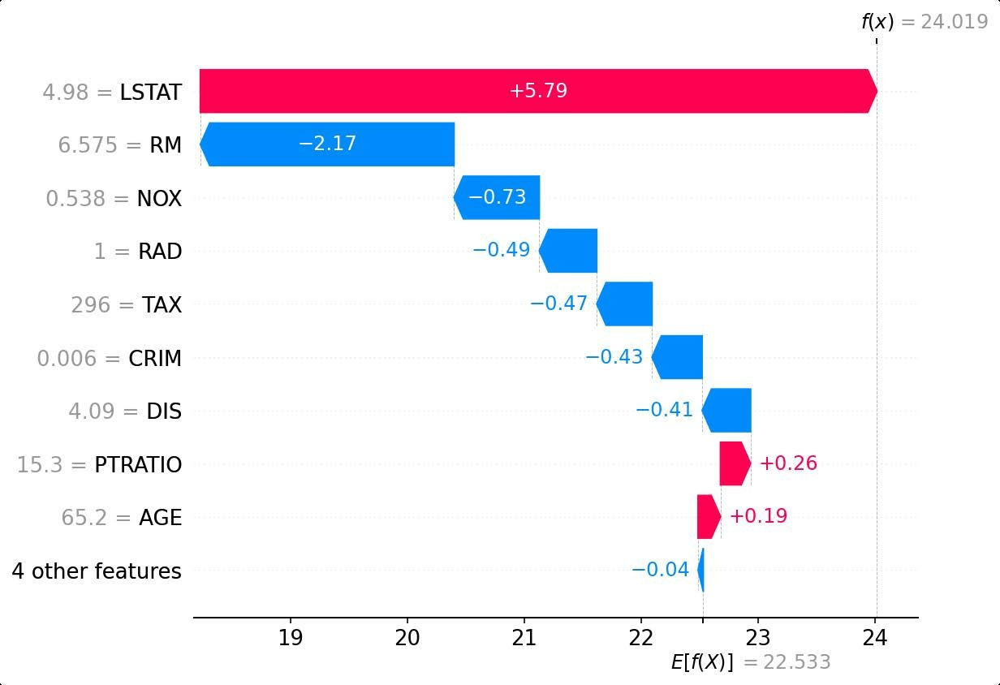

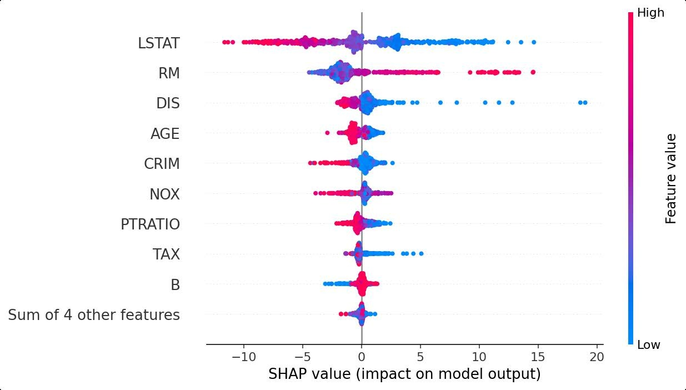

---

#### 4.2.2. The Pareto Principle in Industrial Feature Spaces: The Facebook Ads Case Study

In the foundational paper *Practical Lessons from Predicting Clicks on Ads at Facebook* (He et al., 2014), the engineering team analyzed the relative importance of features in their production boosted-tree click-through-rate (CTR) ranking models:

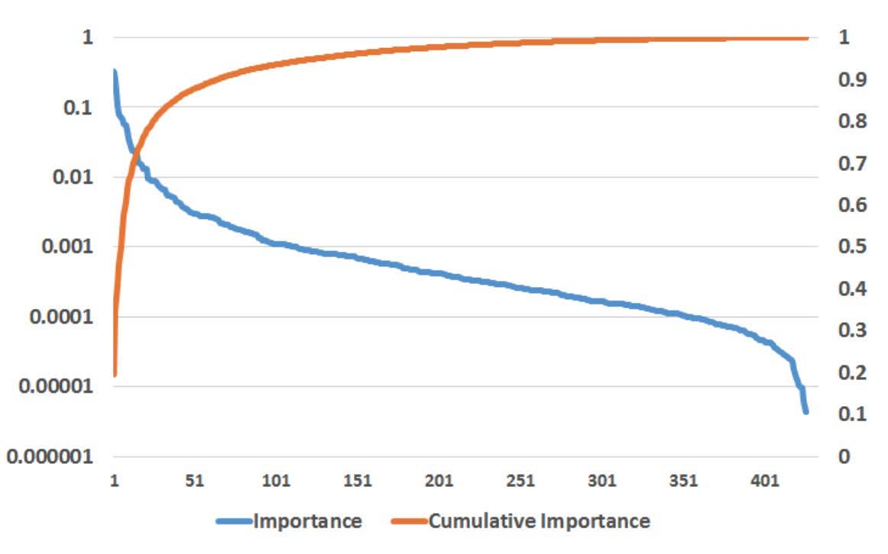

- **The Discovery**: Feature importance follows an extreme power-law distribution. **The top 10 features alone accounted for approximately 50% of total model importance**.
- **The Long Tail**: Conversely, the bottom 300 features contributed less than **1% cumulative importance**.
- **Architectural Action**: Aggressively pruning the bottom 300 long-tail features slashed inference serving latency, reduced embedding memory consumption by orders of magnitude, and eliminated pipeline failure points—with **virtually zero degradation in online AUC or business revenue**.

---

### 4.3. Feature Generalization vs. Memorization

The primary objective of machine learning is out-of-sample generalization. Features must balance predictive specificity with statistical coverage:

```
[Pure Identifier: Comment_ID]     ---> 100% Memorization, 0% Generalization (HARMFUL: MUST PRUNE)
[Recurring Entity: User_ID]       ---> Partial Memorization (VIABLE VIA EMBEDDINGS / HASHING)
[Aggregated Telemetry: Post_Freq] ---> Pure Generalization of Underlying Behavioral Patterns (OPTIMAL)
```

1. **Feature Coverage**:
   The percentage of instances in the dataset containing a non-missing value for the given feature:
   $$\text{Coverage}(x_j) = \frac{1}{N} \sum_{i=1}^N \mathbb{I}(x_{ij} \text{ is observed})$$
   - *General Rule*: Features with coverage $<1\%$ are candidates for elimination due to negligible utility.
   - *Exception (Informative Sparse Features / High-Precision Indicators)*: If a feature is populated in only 0.5% of rows, but **99% of those instances carry the positive fraud label**, the feature possesses immense precision and must be retained.
2. **Distributional Overlap Between Splits**:
   A feature must exhibit structural invariance between training and serving splits.
   - *The Taxi ETA Case Study*:
     - Predicting urban taxi arrival times using data from Monday through Saturday to forecast Sunday traffic.
     - Feature `DAY_OF_THE_WEEK`: 100% coverage, but zero overlap between train (`{Mon,...,Sat}`) and test (`{Sun}`). Deploying this feature actively corrupts Sunday predictions.
     - Feature `HOUR_OF_THE_DAY`: 100% coverage, 100% distribution overlap across both splits. Exceptional generalization power.
3. **Generalization vs. Specificity Trade-Off**:
   Replacing `HOUR_OF_THE_DAY` with a binary `IS_RUSH_HOUR` indicator improves generalization and resists noise, but discards fine-grained intra-day variations. The optimal resolution depends on sample scale and model capacity.

---

### 4.4. Modern Feature Store Architecture

#### 4.4.1. The Root Cause: Train-Serve Skew

The most prevalent architectural failure in production ML systems is **Train-Serve Skew** (discrepancy between training and inference feature generation):
- *Offline (Training)*: Data scientists write analytical queries (SQL, PySpark, Pandas) on historical data warehouses.
- *Online (Inference)*: Software engineers re-implement feature extraction in low-latency systems languages (C++, Java, Go, Rust) within production microservices.
- *The Breach*: Differences in floating-point rounding, library implementations, time-zone offsets, or upstream schema synchronization introduce subtle feature drift, causing production inference inputs to deviate from training distributions.

---

#### 4.4.2. Dual-Storage Engine Architecture (Feast, Hopsworks, Tecton)

A modern Feature Store resolves Train-Serve Skew by standardizing feature definitions into a **Single Source of Truth** with dual physical storage backends:

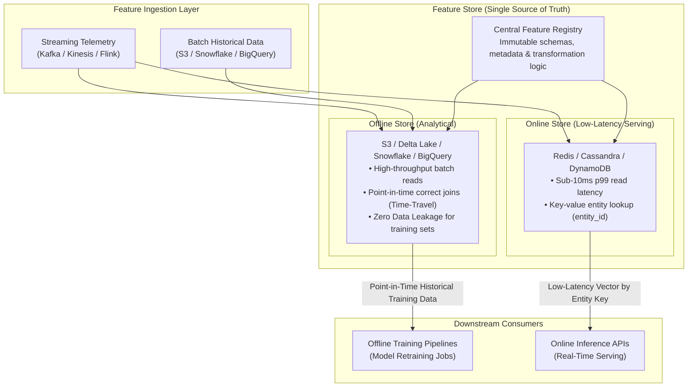

1. **The Offline Store (Analytical Engine)**:
   - *Technologies*: Snowflake, BigQuery, AWS S3 / Delta Lake, Apache Iceberg.
   - *Design Goal*: Optimized for high-throughput batch extraction over terabytes of historical data.
   - *Point-in-Time Correctness (Time-Travel)*: When assembling a training dataset for an event that occurred at timestamp $T$, the offline store performs an `AS-OF` join, retrieving feature values precisely as they existed at $T - \epsilon$. This eliminates future data leakage during training set generation.
2. **The Online Store (Low-Latency Engine)**:
   - *Technologies*: Redis, Apache Cassandra, AWS DynamoDB.
   - *Design Goal*: Optimized for ultra-low latency (p99 $<10$ms) single-entity key lookups (`entity_id` $\to$ `feature_vector`).
   - Continuously ingests streaming updates to ensure real-time features (e.g., `user_transaction_count_last_10_minutes`) are immediately accessible during live inference.
3. **The Feature Registry**:
   Centralizes schema definitions, documentation, lineage, and computation code, enabling cross-team feature discovery, reuse, and strict version control.

---

## 5. Production-Ready Feature Engineering Checklist

A standardized pre-deployment operational checklist for machine learning systems engineers:

| Pipeline Stage | Inspection Item | Verification Criteria & Production Thresholds | Status |
| :--- | :--- | :--- | :---: |
| **1. Data Splitting** | Temporal Split Validation | Time-correlated and sequential telemetry **must use chronological splits**. Random splitting strictly prohibited. | [ ] |
| | Group Isolation (`GroupKFold`) | Confirm all records sharing an `entity_id` (patient, user, device) reside atomically within a single partition. | [ ] |
| | Deduplication & Oversampling | Deduplicate raw corpora before splitting. Apply oversampling/SMOTE **strictly after partitioning and solely on the training set**. | [ ] |
| **2. Missing Values** | Missingness Mechanism Audit | Classify as MCAR, MAR, or MNAR. Prohibit row deletion if missingness $>0.1\%$ or if data is MAR/MNAR. | [ ] |
| | Silent Bug Prevention | Never fill missing entries with valid domain values (e.g., age=0, children=0) without a dedicated boolean `is_missing` flag. | [ ] |
| **3. Scaling & Bounds** | Parameter Boundary Freezing | Scaler parameters $(\mu, \sigma, \min, \max)$ fit strictly on the Training Split. Parameters frozen and loaded as immutable assets at serving. | [ ] |
| | Outlier & Skewness Check | Inspect feature skewness. Apply $\log(1+x)$ transformations on heavy-tailed distributions. Prefer Standardization over Min-Max if outliers exist. | [ ] |
| **4. Categorical Encoding** | Out-of-Vocabulary Defense | Implement the Hashing Trick ($\text{hash}(x) \pmod{2^b}$) or a hardened, frequency-audited UNKNOWN fallback strategy. | [ ] |
| | Dimensionality Explosion | Audit cardinality of one-hot and crossed features. Verify sample density prevents extreme parameter sparsity and memorization. | [ ] |
| **5. Leakage Auditing** | Target Correlation Threshold | Flag and investigate any feature exhibiting $|r| > 0.90$ or standalone ROC-AUC $> 0.95$. Check for compound leakage pairs. | [ ] |
| | Ablation Cliff Check | Verify that dropping an individual feature does not cause catastrophic metric collapse. Confirm zero future timestamps exist in inputs. | [ ] |
| | Air-Gapped Test Isolation | Verify the test split was never touched for feature creation, threshold selection, or hyperparameter exploration. | [ ] |
| **6. Serving Readiness** | Train-Serve Skew Elimination | Feature extraction logic unified via a centralized Feature Store (Feast, Tecton) or cross-compiled transformation pipelines. | [ ] |
| | Inference Latency SLA | Benchmark p99 online extraction latency against production serving budgets (e.g., $<25$ms). | [ ] |
| | Feature Drift Telemetry | Deploy real-time distribution drift monitors (Population Stability Index / Wasserstein Distance) over live serving features. | [ ] |

---

## 6. Architectural Takeaways & System Invariants

1. **Features Dictate the Performance Ceiling**: While novel neural architectures and automated hyperparameter sweeps provide incremental optimization, engineering informative, discriminative features provides the largest step-function improvements in real-world ML systems.
2. **Deep Learning Complements, But Does Not Replace, Feature Engineering**: Unstructured domains (vision, audio, text) thrive on automated feature learning, but enterprise core workloads (tabular databases, click logs, financial records) remain dominated by Gradient Boosted Decision Trees coupled with sophisticated manual feature engineering.
3. **Data Leakage Is an Architectural Failure**: Leakage cannot be diagnosed via standard validation loss curves. Preventing leakage requires rigorous system discipline: strict temporal partitioning, pre-split deduplication, statistical isolation of scalers, and time-travel assertions.
4. **Prune the Long Tail**: High-dimensional feature bloat inflates infrastructure costs, increases inference latency, and accelerates technical debt. Enforce feature selection via SHAP or permutation importance—harvesting the top 20% of features that deliver 80% of predictive power.
5. **Feature Stores Bridge the Offline-Online Divide**: To achieve operational parity between offline model development and low-latency online inference, modern enterprises must decouple feature computation from model serving using dual-storage Feature Stores that enforce point-in-time correctness.
