# Chapter 5: Model Development & Offline Evaluation — Distilled Master Notes

---

## 1. Framing Machine Learning Problems

An engineering business requirement (e.g., *"reduce customer support response times by 2×"*) is rarely an ML problem out of the box. Machine learning problems require formal specification of:
1. **Input Space ($\mathcal{X}$)**: Precise feature representations and data pipelines.
2. **Output Space ($\mathcal{Y}$)**: Target label topology and dimensionality.
3. **Objective Function ($\mathcal{L}$)**: Differentiable or measurable proxy mathematically aligned with business objectives.

```
+-------------------------------------------------------------+
|                     Business Problem                        |
|       "Reduce customer support turnaround time by 2x"       |
+-------------------------------------------------------------+
                              |
                              v [Bottleneck Discovery]
+-------------------------------------------------------------+
|    Triage Latency: Routing customer tickets to departments   |
+-------------------------------------------------------------+
                              |
                              v [ML Problem Formulation]
+-------------------------------------------------------------+
|  Input: Ticket text & metadata  x in X                      |
|  Output: Department ID          y in {Accounting, HR, IT, ..}|
|  Objective: Multi-class Cross-Entropy Loss                  |
+-------------------------------------------------------------+
```

---

### 1.1 Types of ML Tasks

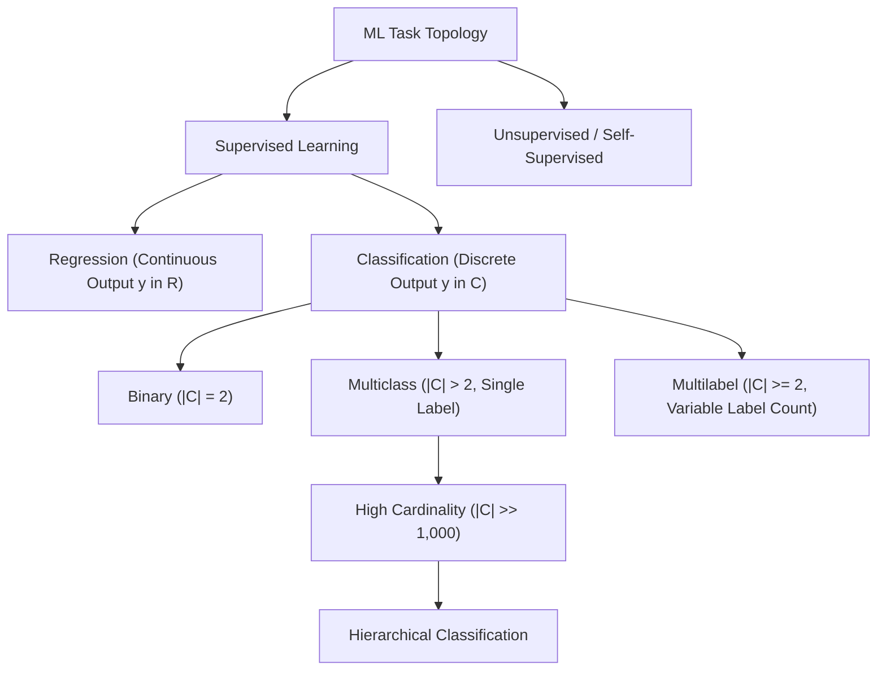

#### Classification vs. Regression
- **Regression**: Maps inputs $x \in \mathbb{R}^d$ to continuous scalar/vector outputs $\hat{y} \in \mathbb{R}$. Evaluated via Mean Squared Error (MSE), Root Mean Squared Error (RMSE), or Mean Absolute Error (MAE).
- **Classification**: Maps inputs $x \in \mathbb{R}^d$ into categorical buckets $c \in \{1, \dots, C\}$. Evaluated via Cross-Entropy, Log-Loss, $F_\beta$-Score, or Area Under the ROC Curve (AUROC).
- **Interchangeability**:
  - *Regression $\to$ Classification*: Continuous targets can be quantized into discrete intervals (e.g., continuous housing valuation binned into $[\$0-\$200\text{k}, \$200\text{k}-\$500\text{k}, \dots]$).
  - *Classification $\to$ Regression*: Predicting calibrated class probabilities $\hat{p} \in [0, 1]$ against continuous targets or ranking scores.

#### Binary, Multiclass, and Multilabel Taxonomy
- **Binary Classification**: Target $y \in \{0, 1\}$. The decision boundary splits a single latent score threshold $\tau$.
- **Multiclass Classification**: Target $y \in \{1, \dots, C\}$ with mutually exclusive classes:
  $$\sum_{c=1}^C P(y=c \mid x) = 1$$
- **High-Cardinality Challenges**:
  - When $C > 10^3$ to $10^5$ (e.g., ICD-10 medical coding, e-commerce item categories), empirical minimums require $\ge 100$ labeled samples per class, leading to severe long-tail sample sparsity.
  - **Hierarchical Classification**: Decomposes high-cardinality label spaces into a directed tree/DAG (e.g., Main Department $\to$ Category $\to$ Subcategory), mitigating vocabulary explosion and enabling localized negative sampling.
- **Multilabel Classification**: Target $y \subseteq \{1, \dots, C\}$; an instance can simultaneously possess $0, 1,$ or multiple labels.
  - *Method 1 (Binary Relevance)*: Train $C$ independent binary classifiers $h_c(x) \to \{0, 1\}$. Ignores inter-label correlations.
  - *Method 2 (Joint Softmax / Multi-BCE)*: Output a probability vector $q \in [0, 1]^C$ optimized under element-wise Binary Cross-Entropy:
    $$\mathcal{L}_{\text{MultiBCE}} = -\sum_{c=1}^C \left[ y_c \log \hat{y}_c + (1 - y_c)\log(1 - \hat{y}_c) \right]$$
  - *Operational Failure Modes*: Label multiplicity leads to high human annotator variance (disagreements on complete label sets). Dynamic probability thresholding is non-trivial (fixed $\tau=0.5$ vs. adaptive top-$k$ selection).

---

### 1.2 Mathematical Reframing: State-Space & Cardinality Reduction

Framing decisions drastically dictate engineering complexity, model parameter counts, and deployment maintainability.

#### Case Study: Next-App Prediction on Mobile OS
A mobile operating system needs to predict which application a user will launch next.

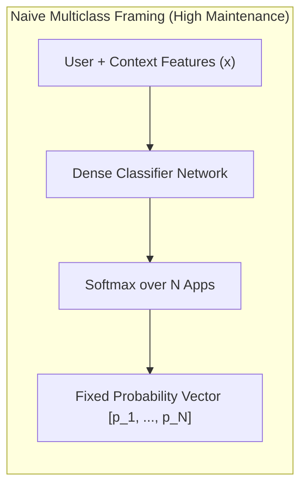

- **Naive Framing (Multiclass Classification)**:
  - Input: $x = [\text{User Features}, \text{Contextual Features}]$.
  - Output: Categorical probability distribution across all $N$ installed applications:
    $$\hat{y} = \text{Softmax}(W x + b), \quad W \in \mathbb{R}^{N \times d}$$
  - **Fatal Flaw**: Whenever a user installs, uninstalls, or updates an app ($N \to N+1$), the final projection layer dimension $W$ changes. The model must be re-architected and retrained from scratch.

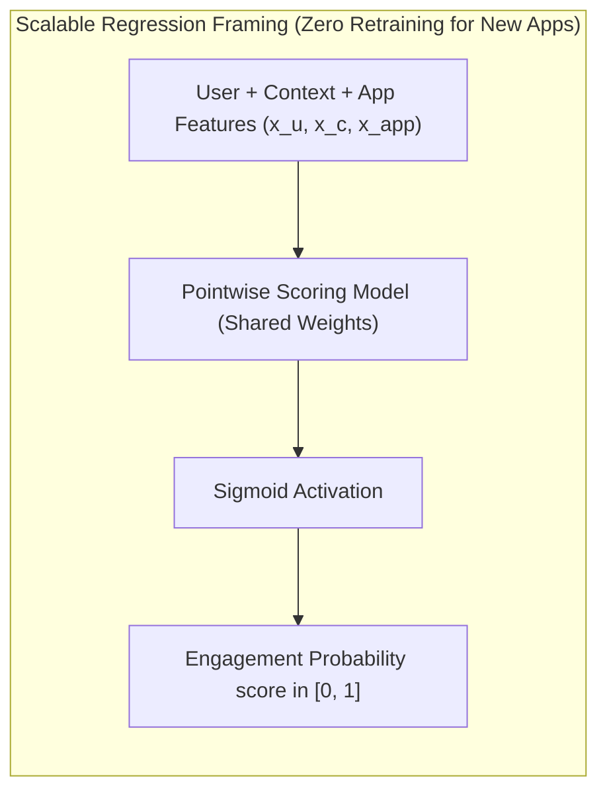

- **Production Reframing (Pointwise Regression / Ranking)**:
  - Input: Composite vector combining user, context, and candidate application features:
    $$x_i = [x_{\text{user}}, x_{\text{context}}, x_{\text{candidate\_app\_}i}]$$
  - Output: Scalar likelihood $\hat{y}_i = \sigma(f(x_i)) \in [0, 1]$.
  - Inference: Execute $N$ scalar forward evaluations (batched) and rank candidate applications by descending $\hat{y}_i$.
  - **System Invariant**: Adding a new application requires zero retraining; the system simply constructs a new input feature vector $x_{\text{new\_app}}$ and evaluates it against the existing, stable inference engine.

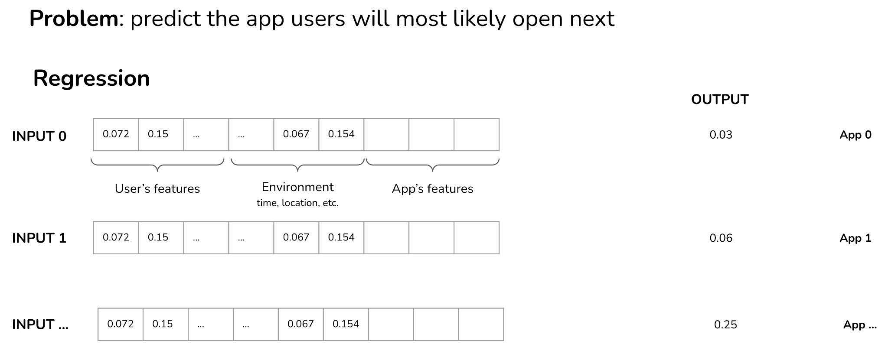
*Figure 5.1: Architectural reframing of app prediction from static multi-class categorization to dynamic pointwise regression over candidate item embeddings.*

---

### 1.3 Objective Functions & Loss Formulations

The objective function operationalizes learning by penalizing deviations between predicted distribution $q = f(x)$ and empirical ground truth $p$.

#### Common Loss Formulations
- **Root Mean Squared Error (RMSE)**: Highly sensitive to extreme outliers; enforces Gaussian distributed errors:
  $$\mathcal{L}_{\text{RMSE}} = \sqrt{\frac{1}{N} \sum_{i=1}^N (y_i - \hat{y}_i)^2}$$
- **Mean Absolute Error (MAE)**: Enforces Laplacian distributed errors; robust to heavy tails:
  $$\mathcal{L}_{\text{MAE}} = \frac{1}{N} \sum_{i=1}^N |y_i - \hat{y}_i|$$
- **Binary Cross-Entropy (Logistic Loss)**: Directly optimizes Bernoulli log-likelihood:
  $$\mathcal{L}_{\text{LogLoss}} = -\frac{1}{N} \sum_{i=1}^N \left[ y_i \log(\hat{y}_i) + (1 - y_i) \log(1 - \hat{y}_i) \right]$$
- **Multiclass Cross-Entropy**: Measures the divergence between one-hot ground-truth $p$ and softmax model outputs $q$:
  $$\mathcal{L}_{\text{CE}}(p, q) = -\sum_{c=1}^C p_c \log(q_c)$$

---

### 1.4 Decoupled Objectives Architecture

In real-world recommender and feed-ranking systems (e.g., social feeds, streaming platforms), optimizing for a single metric generates toxic side effects:
- Maximizing raw click-through rate (CTR) rewards extreme sensationalism, rage-bait, and clickbait.
- Incorporating content quality, safety, and engagement requires balancing conflicting vectors.

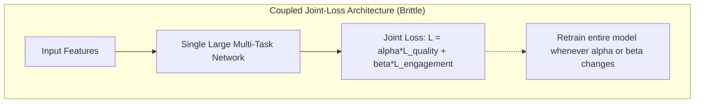

#### The Coupled Approach Failure Mode
A single monolithic model trained against an aggregated multi-objective loss:
$$\mathcal{L}_{\text{coupled}} = \alpha \mathcal{L}_{\text{quality}} + \beta \mathcal{L}_{\text{engagement}}$$

1. **Retraining Penalty**: Business requirements and user tolerance thresholds fluctuate dynamically. Modifying hyperparameters $\alpha$ and $\beta$ invalidates previously learned network weights, demanding an expensive, full end-to-end retraining run.
2. **Gradient Conflict & Pareto Suboptimality**: Gradients from $\nabla_\theta \mathcal{L}_{\text{quality}}$ and $\nabla_\theta \mathcal{L}_{\text{engagement}}$ frequently point in opposite directions in parameter space, causing gradient cancellation, destructive interference, and suboptimal saddle-point stagnation.

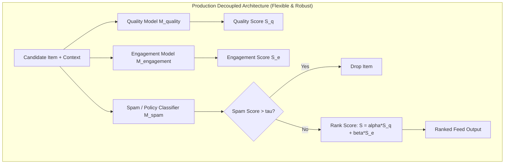

#### The Decoupled Production Architecture
Decompose the objective into distinct models specialized on individual, stationary tasks:
1. $M_{\text{quality}}(x) \to S_{\text{quality}} \in [0, 1]$
2. $M_{\text{engagement}}(x) \to S_{\text{engagement}} \in \mathbb{R}^+$
3. $M_{\text{spam}}(x) \to S_{\text{spam}} \in [0, 1]$

The final ranking utility score is computed at serving time via a linear or non-linear combination:
$$\text{Rank}(x) = \alpha \cdot S_{\text{quality}}(x) + \beta \cdot S_{\text{engagement}}(x) - \gamma \cdot \mathbb{I}(S_{\text{spam}}(x) > \tau)$$

#### Architectural Advantages of Decoupling
- **Dynamic Policy Tuning**: Engineers can modulate $\alpha, \beta, \gamma$ in production config files in real-time (via A/B testing or bandit controllers) without modifying or retraining the underlying models.
- **Asymmetric Maintenance Cadence**:
  - Adversarial spam and clickbait evolve within days, requiring daily or hourly retraining cycles for $M_{\text{spam}}$.
  - Content quality criteria evolve slowly over quarters, allowing $M_{\text{quality}}$ to remain on a monthly retraining cadence.

---

## 2. Model Development, Selection & System Lifecycle

### 2.1 The Four Phases of Machine Learning Adoption
*(Synthesized from Martin Zinkevich’s foundational Google Rules of Machine Learning)*

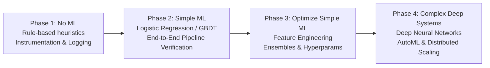

| Phase | System Topology | Primary Engineering Objective | Critical Invariant |
| :--- | :--- | :--- | :--- |
| **Phase 1: Before Machine Learning** | Hard-coded heuristic rules, SQL filters, chronological or frequency sort. | Instrument data pipelines, establish metric tracking, validate end-user logging infrastructure. | If a heuristic cannot establish a reliable baseline, ML will only amplify telemetry errors. |
| **Phase 2: Simplest ML Models** | Linear/Logistic Regression, small Decision Trees, Naive Bayes. | Validate pipeline continuity from data extraction to production inference; ensure zero training-serving skew. | The first model must be simple enough that pipeline bugs can be isolated from model bugs. |
| **Phase 3: Optimizing Simple Models** | Feature engineering, hyperparameter tuning, objective decoupling, GBDT ensembles. | Maximize performance ceiling of interpretable architectures; measure production model drift. | Establish the empirical performance ceiling of simple models before introducing neural architectures. |
| **Phase 4: Complex Systems** | Deep Neural Networks, Transformer backbones, Multimodal architectures, NAS. | Optimize marginal performance gains on high-value business bottlenecks where simple models plateau. | Deploy deep learning only when compute budgets, latency SLAs, and data volumes justify operational overhead. |

---

### 2.2 Six Architectural Rules for Model Selection

1. **Avoid the State-of-the-Art (SOTA) Trap**:
   - Academic SOTA reflects marginal improvements on frozen, curated benchmarks (e.g., ImageNet, SQuAD) under unbounded compute budgets.
   - SOTA models frequently exhibit prohibitive serving latencies, high memory footprints, and poor out-of-distribution robustness on noisy production traffic.
2. **Start with the Simplest Models**:
   - Simple models train orders of magnitude faster, enabling rapid iteration over feature transformations.
   - They provide an interpretable anchor to verify that data labels, feature values, and evaluation metrics are free of corruptions.
3. **Mitigate Human Evaluation Bias**:
   - Comparing a newly favored deep architecture against a baseline requires identical hyperparameter tuning budgets.
   - Running 500 tuning iterations on a Transformer while evaluating a baseline Random Forest with default hyperparameters produces skewed, unscientific conclusions.
4. **Evaluate Performance Trajectory (Current vs. Future)**:
   - Deep architectures scale monotonically with data volume, whereas linear models and small trees saturate early.
   - **Learning Curves**: Plot training and validation loss against dataset scale $N$. High asymptotic slope indicates that investments in data labeling will unlock significant architectural gains.

```
Model Performance Metric
       ^
       |                      / Neural Network (High Capacity)
       |                     /
       |       -------------+  <- Saturation crossover point
       |      /            /
       |     /            /
       |    /------------/  Linear / Simple Model (Low Capacity Saturation)
       |   /
       +--------------------------------------------->
       0                     Dataset Size (N)
```

5. **Expose and Navigate System Trade-offs**:
   - *Precision vs. Recall*: Biometrics/authentication systems demand near-zero False Positives (FPR); medical diagnosis systems demand near-zero False Negatives (FNR).
   - *Inference Latency vs. Accuracy*: Quantization, pruning, or selecting smaller architectures is required to satisfy 10ms real-time SLA limits.
   - *Interpretability vs. Capacity*: Regulatory requirements (e.g., credit underwriting, healthcare) mandate explainability over black-box deep representations.
6. **Explicitly Verify Model Assumptions**:

| Model Family | Core Mathematical Assumptions | Production Violation Vulnerabilities |
| :--- | :--- | :--- |
| **Linear / Logistic Regression** | Linear separability; features are linearly independent; additive effects. | High-order non-linear feature interactions; severe multicollinearity. |
| **Naive Bayes** | Conditional feature independence given the class label: $P(X \mid Y) = \prod P(x_i \mid Y)$. | Correlated text tokens, redundant sensor readings distort probability calibration. |
| **Deep Neural Networks** | Samples are Independent and Identically Distributed (I.I.D.); smooth underlying mapping. | Temporal drift, seasonal shifts, covariate shift, adversarial perturbations. |
| **Generative Models** | Tractable latent distribution computation $P(Z \mid X)$. | High-dimensional multimodal distribution collapse. |

---

### 2.3 Systematic Debugging Playbook for ML Systems

Debugging machine learning is uniquely challenging because ML models fail silently: standard software crashes on syntax or memory errors, whereas buggy ML pipelines happily optimize incorrect objectives, learn spurious correlations, and output predictions without exceptions.

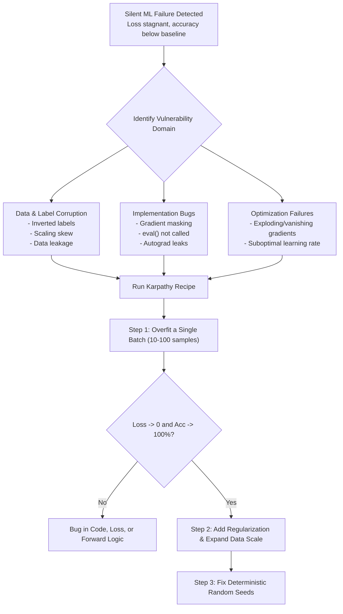

#### The Karpathy-Style Debugging Playbook
1. **Start Minimalist**: Begin with an un-regularized, single-layer model before adding complex skip connections, multi-head attention, or custom loss penalties.
2. **Overfit a Single Batch**:
   - Restrict the training set to 10–50 samples. Turn off regularization, dropout, and weight decay.
   - *Invariant*: A correctly implemented model architecture must drive empirical loss to near-zero and achieve 100% training accuracy. Inability to overfit a minimal batch proves the presence of code bugs (e.g., incorrect tensor shapes, missing loss terms, gradient graph disconnection).
3. **Lock Deterministic Seeds**: Enforce exact determinism across random seed generators (Python `random`, `numpy.random`, PyTorch `torch.manual_seed`, CUDA deterministic backends) to guarantee that experimental variance stems strictly from architectural changes.

---

### 2.4 Experiment Tracking vs. Artifact Versioning

```
                     +------------------------------------------------+
                     |                 ML Experiment                  |
                     +------------------------------------------------+
                                     /                \
                                    /                  \
                                   v                    v
+------------------------------------+  +-------------------------------------+
|        Experiment Tracking         |  |         Artifact Versioning         |
|  - Real-time training loss curves  |  |  - Code commit hashes (Git)         |
|  - Validation metrics (F1, AUC)    |  |  - Exact dataset snapshots (DVC)    |
|  - System telemetry (GPU, RAM)     |  |  - Serialized model weights (.pt)   |
|  - Layer gradient & weight norms   |  |  - Environment specs (Docker/Cuda)  |
+------------------------------------+  +-------------------------------------+
```

#### Telemetry Checklist for Production Experiment Tracking
- **Loss Surfaces**: Real-time logging of train loss, validation loss, and sub-component losses across mini-batch iterations.
- **Task Evaluation Metrics**: Periodic calculation of domain-specific metrics ($F_1$, AUROC, Top-$k$ Recall, BLEU, Perplexity) on validation splits.
- **Compute Telemetry**: Streaming utilization rates of GPU compute engines, VRAM allocations, and CPU-to-GPU data transfer bus latencies (identifies data loader bottlenecks).
- **Internal Tensor Dynamics**: Tracking parameter weight norms $\|\theta\|_2$, gradient norms $\|\nabla_\theta \mathcal{L}\|_2$, and activation distributions to diagnose gradient explosion, vanishing, or neuron death.

#### Data Versioning Challenges
Unlike source code where line-by-line text diffs are minimal and deterministic:
1. **Scale**: Data artifacts measure in gigabytes or terabytes. Storing complete copies of raw data for every experiment causes storage explosion.
2. **Diff Semantics**: A byte-level diff in a binary parquet file reveals no semantic meaning regarding feature distribution shifts. Data versioning tools (e.g., DVC) track cryptographic checksums (SHA-256) of data directories.
3. **Regulatory Constraints (GDPR / CCPA)**: The "Right to be Forgotten" legally forces deletion of user records from historical datasets, breaking strict cryptographic immutability of historical data versions.

---

## 3. Ensemble Methods: Mathematics, Topologies & Trade-offs

Ensemble methods aggregate predictions from multiple base learners to achieve generalization performance superior to any individual constituent model.

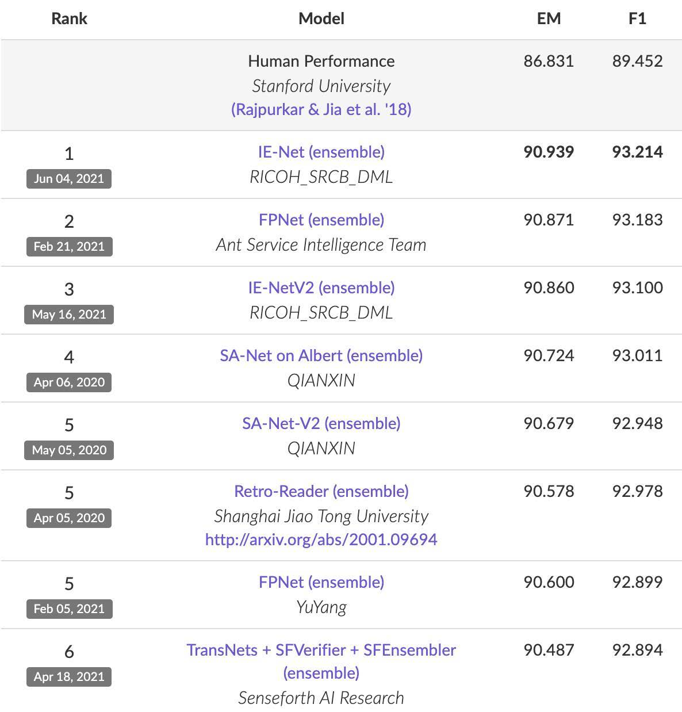
*Figure 5.2: Production ensemble topologies: Bagging (parallel variance reduction), Boosting (sequential bias reduction), and Stacking (meta-learning combination).*

---

### 3.1 Mathematical Rationale: Majority Voting Error Reduction

Consider an ensemble of $N$ binary classifiers $\{h_1, h_2, \dots, h_N\}$ predicting target $y \in \{0, 1\}$.
- **Core Assumption**: Each base learner has an identical independent error probability $\epsilon < 0.5$, and the base learners' prediction errors are **mutually uncorrelated**.

Under majority voting, the ensemble makes an erroneous prediction if and only if at least $\lceil (N+1)/2 \rceil$ base learners make an error. The ensemble error follows the cumulative binomial distribution:
$$P(\text{Ensemble Error}) = \sum_{k=\lceil (N+1)/2 \rceil}^{N} \binom{N}{k} \epsilon^k (1 - \epsilon)^{N-k}$$

#### Proof of Improvement (3 Classifiers with 70% Accuracy)
Let $N = 3$, individual accuracy $p = 1 - \epsilon = 0.70$:
- All 3 correct: $\binom{3}{3} (0.7)^3 = 0.343$
- Exactly 2 correct: $\binom{3}{2} (0.7)^2 (0.3)^1 = 3 \times 0.49 \times 0.3 = 0.441$
- Exactly 1 correct: $\binom{3}{1} (0.7)^1 (0.3)^2 = 3 \times 0.7 \times 0.09 = 0.189$
- None correct: $\binom{3}{0} (0.3)^3 = 0.027$

$$\text{Ensemble Accuracy} = P(\ge 2 \text{ correct}) = 0.343 + 0.441 = \mathbf{0.784} \quad (78.4\%)$$

> [!IMPORTANT]
> **The Independence Invariant**: If base learners are perfectly correlated ($\rho = 1$), the ensemble provides zero error reduction ($P(\text{correct}) = 0.70$). The power of ensembling is directly proportional to error diversity among base learners.

---

### 3.2 Bagging, Boosting, and Stacking

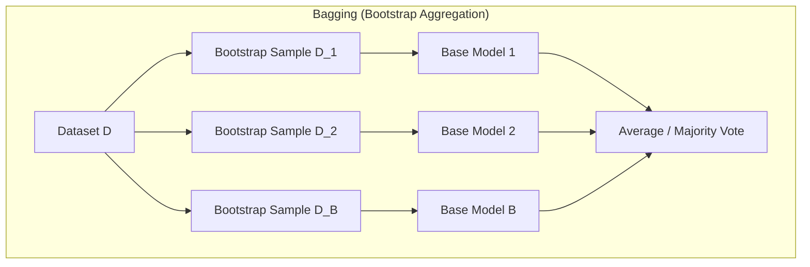

#### 1. Bagging (Bootstrap Aggregating)
- **Goal**: Minimize **variance** without increasing bias; stabilize unstable learners.
- **Algorithm**:
  1. Given training dataset $D$ of size $M$, draw $B$ bootstrap samples $D_b$ of size $M$ by sampling **uniformly with replacement**.
  2. Train base learner $h_b$ independently on each bootstrap $D_b$.
  3. Aggregate:
     $$\hat{y}_{\text{bagging}} = \begin{cases} \text{mode}\{h_1(x), \dots, h_B(x)\} & \text{Classification} \\ \frac{1}{B} \sum_{b=1}^B h_b(x) & \text{Regression} \end{cases}$$
- **Variance Derivation**:
  For $B$ models with variance $\sigma^2$ and average pairwise correlation $\rho$:
  $$\text{Var}(\hat{y}_{\text{bagging}}) = \rho \sigma^2 + \frac{1 - \rho}{B}\sigma^2$$
  As $B \to \infty$, the second term approaches 0, leaving minimum variance $\rho \sigma^2$. To minimize this bound, feature randomness is introduced (as in **Random Forests**, which subsample $k \le \sqrt{d}$ features at each split to drive correlation $\rho \to 0$).
- **Applicability**: Highly effective for high-variance, unstable base learners (unpruned Decision Trees, Deep Neural Networks). Degrades performance on stable, low-variance learners (e.g., $k$-Nearest Neighbors).

---

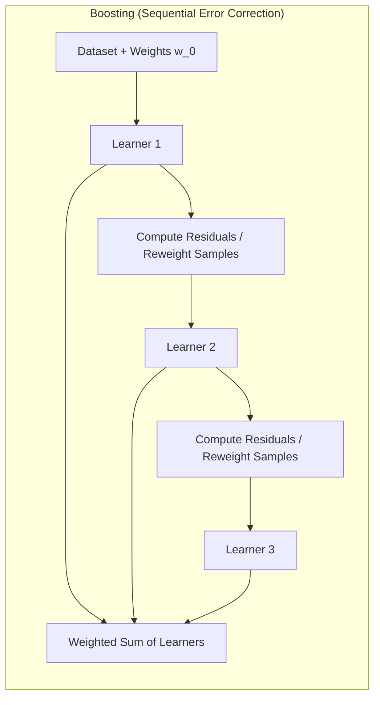

#### 2. Boosting
- **Goal**: Minimize **bias** by sequentially converting weak learners into a strong learner.
- **Algorithm**:
  1. Train base learner $h_1$ on initial dataset with uniform weights.
  2. Evaluate errors; increase weights of misclassified instances (or compute pseudo-residuals of the differentiable loss function).
  3. Train learner $h_2$ on reweighted samples to fit the residual errors of $h_1$.
  4. Aggregate learners via stage-wise additive modeling:
     $$F_M(x) = \sum_{m=1}^M \gamma_m h_m(x)$$
- **Implementations**:
  - **AdaBoost**: Reweights samples exponentially based on 0-1 loss classification error.
  - **Gradient Boosting Machine (GBM)**: Fits each subsequent base learner to the negative gradient of an arbitrary differentiable loss function $\mathcal{L}(y, F(x))$:
    $$r_{im} = -\left[ \frac{\partial \mathcal{L}(y_i, F(x_i))}{\partial F(x_i)} \right]_{F(x) = F_{m-1}(x)}$$
  - **XGBoost & LightGBM**: Industry standard implementations utilizing second-order Taylor expansion approximations of the loss function, histogram-based gradient bucketing, and tree sparsity awareness.

---

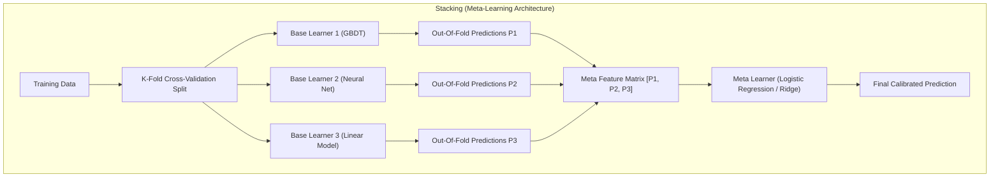

#### 3. Stacking
- **Goal**: Maximize **generalization capacity** by combining heterogeneous model classes.
- **Architecture**:
  - *Level-0 (Base Learners)*: Train diverse model families (e.g., GBDT, Transformer, Logistic Regression) on raw features $x$.
  - *Level-1 (Meta-Learner)*: Train a meta-model (e.g., Ridge Regression or shallow Linear Model) that takes the predictions of Level-0 learners as its input features:
    $$\hat{y} = g\left( h_1(x), h_2(x), \dots, h_K(x) \right)$$
- **Critical Leakage Failure Mode**: The meta-learner cannot be trained on predictions generated from the same data used to train base learners (otherwise it simply overfits to the base learner that memorized the training set).
  - **Solution: Out-Of-Fold (OOF) Prediction Protocol**: Partition training data into $K$ folds. Base learners are trained on $K-1$ folds and generate predictions on the held-out fold. Stacking meta-features are constructed strictly from these out-of-fold evaluations.

---

### 3.3 Production Trade-Off Matrix

```
Performance Lift (Kaggle / SQuAD Winner)
      ^
      |                                  * Complex Multi-Layer Stacking
      |                     * LightGBM Ensemble
      |         * Standalone XGBoost
      |     * Single Deep Neural Net
      | * Logistic Regression
      +-------------------------------------------------------->
      Low                  Inference Latency & Ops Overhead       High
```

| Dimension | Single Simple Model | Bagging (Random Forest) | Boosting (XGBoost/LightGBM) | Stacking (Heterogeneous) |
| :--- | :--- | :--- | :--- | :--- |
| **Primary Error Targeted** | Neither | **Variance** | **Bias** | Generalization error |
| **Inference Latency** | $\mathcal{O}(1)$ (Microseconds) | $\mathcal{O}(B)$ (Parallelizable) | $\mathcal{O}(M)$ (Sequential depth) | $\sum \text{Base} + \text{Meta}$ (High) |
| **Training Parallelism** | Embarrassingly simple | Embarrassingly parallel | Strictly sequential (across trees) | Parallel base models |
| **Serving Complexity** | Minimal (single binary) | Low | Moderate | Severe dependency overhead |
| **Production ROI** | Ideal default | High for tabular noise | Highest tabular ROI | Reserved for non-SLA batch/CTR |

---

## 4. Distributed Training Architectures & Large-Scale Optimization

As parameter scales expand from millions to hundreds of billions (e.g., GPT-3 175B), models exceed the memory and compute capacity of individual accelerators (GPUs/TPUs).

### 4.1 Memory Footprint Anatomy & Gradient Checkpointing

The memory footprint during deep neural network training consists of:
1. **Model Parameters**: $4$ bytes per parameter under FP32 ($2$ bytes under FP16/BF16).
2. **Gradients**: $4$ bytes per parameter under FP32 ($2$ bytes under FP16/BF16).
3. **Optimizer States**: Under Adam (FP32), storing model weight copies, first momentum ($m_t$), and second momentum ($v_t$) requires $12$ bytes per parameter ($16$ bytes total when mixed-precision master weights are maintained).
4. **Activations**: Intermediate forward-pass activations retained for the backward-pass chain-rule execution. Memory scales with:
   $$\text{Batch Size} \times \text{Sequence Length} \times \text{Hidden Dimension} \times \text{Layers}$$

#### Gradient Checkpointing (Activation Rematerialization)
- **Trade-off**: Memory Footprint vs. Compute Flops.
- **Mechanism**: Rather than caching all intermediate layer activations during the forward pass, drop non-checkpoint activations from VRAM. During the backward pass, recompute missing activations on-the-fly from the nearest upstream checkpoint.
- **Empirical Impact**: Reduces activation memory by up to **$80-90\%$** (enabling $>10\times$ larger effective batch sizes or model footprints) at the expense of an approximate **$20-30\%$ computational overhead** (re-running forward operations).

---

### 4.2 Data Parallelism: Synchronous vs. Asynchronous Optimization

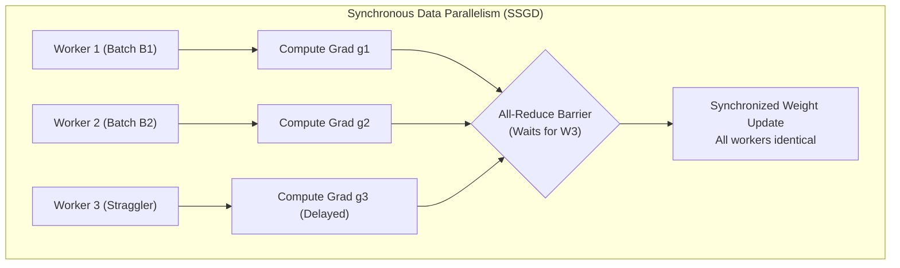

#### Synchronous Stochastic Gradient Descent (SSGD)
- Workers receive distinct mini-batches, run forward and backward passes independently, and synchronize gradients via an `All-Reduce` collective communication operation before updating weights:
  $$\Delta W = \frac{1}{K} \sum_{k=1}^K g_k$$
- **The Straggler Failure Mode**: Total step time is bounded by the slowest accelerator across all machines. In a cluster of $1,000$ GPUs, the probability of at least one node encountering memory bus throttling, network jitter, or hardware thermal downclocking approaches 1, stalling the entire cluster at the synchronization barrier.

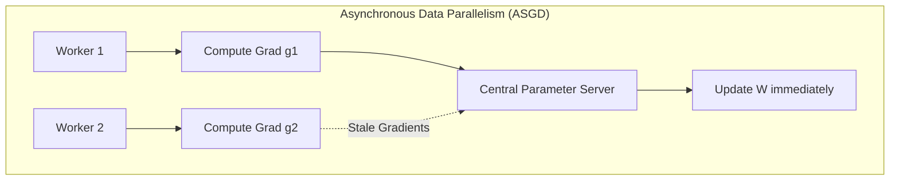

#### Asynchronous Stochastic Gradient Descent (ASGD)
- Workers compute gradients independently and transmit them to a Central Parameter Server without barriers. The Parameter Server applies updates immediately upon arrival.
- **The Gradient Staleness Failure Mode**: If Worker 2 calculates gradient $g(W_t)$ while Worker 1 applies an update ($W_t \to W_{t+1}$), Worker 2’s update arrives stale. Applying $g(W_t)$ against $W_{t+1}$ introduces gradient variance that degrades mathematical convergence, destabilizing optimization unless gradients are sparse.

#### Large Batch Size Limits
Data parallelism scales aggregate batch size linearly with worker count:
$$\text{Effective Batch Size} = B_{\text{local}} \times K$$
- Beyond a critical batch size threshold $B^*$, gradient updates yield diminishing statistical returns.
- Simple linear learning rate scaling ($\eta = K \times \eta_0$) destabilizes early training phases, requiring **Learning Rate Warmup schedules** to prevent immediate gradient divergence.

---

### 4.3 Model Parallelism & Pipeline Parallelism

When model parameters exceed the VRAM of a single GPU, the layers must be partitioned across multiple GPUs.

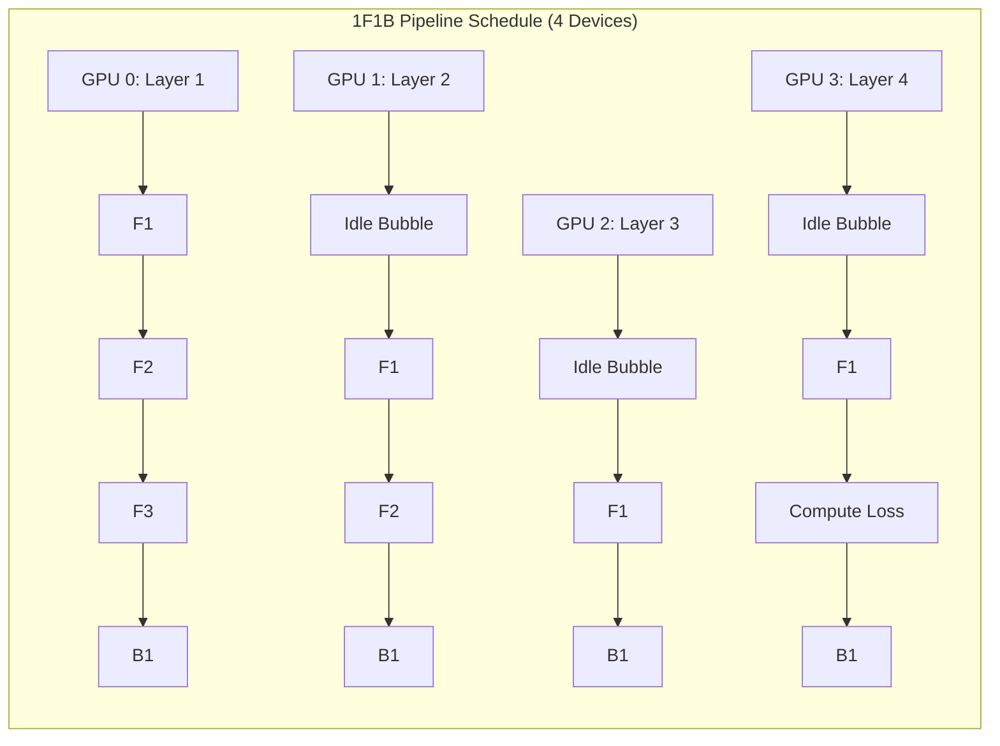

- **Naive Inter-Layer Parallelism Problem**: If Layer 1 is on GPU 0 and Layer 2 is on GPU 1, GPU 1 remains completely idle waiting for GPU 0's forward pass. Device utilization drops severely ($1/K$).
- **Pipeline Parallelism (GPipe / 1F1B Scheduling)**:
  - Decomposes each mini-batch into $M$ micro-batches.
  - Micro-batches stream through partitioned pipeline stages concurrently.
  - In steady-state **1F1B (One-Forward-One-Backward)** execution, each accelerator balances memory footprint by alternating one forward activation evaluation with one backward gradient computation for outstanding micro-batches.
  - **The Pipeline Bubble**: Idle execution fraction $\mathcal{F}_{\text{bubble}}$:
    $$\mathcal{F}_{\text{bubble}} = \frac{K - 1}{M + K - 1}$$
    where $K$ is pipeline depth and $M$ is the number of micro-batches ($M \gg K$ minimizes idle bubbles).

---

### 4.4 DeepSpeed ZeRO (Zero Redundancy Optimizer)

Standard Data Parallelism duplicates identical optimizer states, gradients, and model parameters across all workers. The ZeRO memory partitioning paradigm eliminates this redundancy without communication overhead penalties.

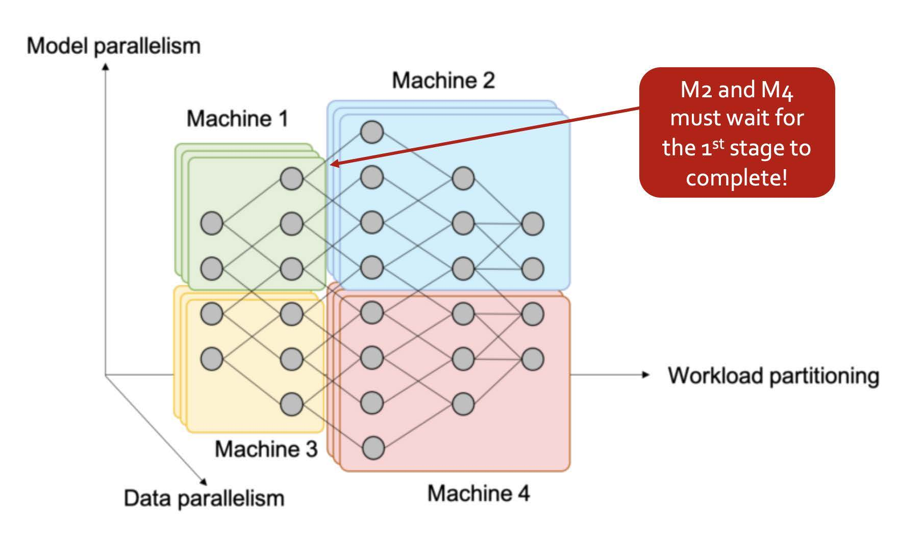
*Figure 5.3: Memory partitioning progression across ZeRO Stages 1, 2, and 3, systematically eliminating optimizer, gradient, and parameter replication.*

#### Mathematical Mechanics of ZeRO Stages

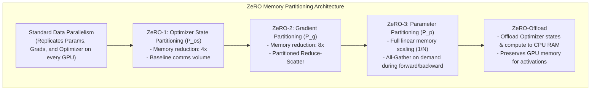

1. **ZeRO-Stage 1 (Optimizer State Partitioning: $P_{os}$)**:
   - Partitions FP32 Adam optimizer states ($m_t, v_t$, master weights) across all $N_d$ data-parallel processes.
   - Each GPU updates only $1/N_d$ of the model parameters.
   - **Memory Reduction**: $4\times$ memory reduction compared to standard mixed-precision training with zero increase in communication volume.
2. **ZeRO-Stage 2 (Gradient Partitioning: $P_g$)**:
   - As gradients are computed during the backward pass, their values are immediately reduced and partitioned across GPUs via `Reduce-Scatter`.
   - Each GPU only retains gradients corresponding to its assigned parameter partition.
   - **Memory Reduction**: $8\times$ cumulative reduction.
3. **ZeRO-Stage 3 (Parameter Partitioning: $P_p$)**:
   - Model parameters are partitioned across $N_d$ processes.
   - During the forward and backward passes, the specific parameter weights needed for layer execution are retrieved on-demand via an `All-Gather` collective operation and immediately discarded post-computation.
   - **Memory Scaling**: Memory scales linearly with $1/N_d$, enabling trillion-parameter models to fit within GPU clusters without manual tensor splitting.
4. **ZeRO-Offload**:
   - Exploits heterogeneous hardware topologies by offloading optimizer state storage and optimizer gradient updates to CPU host RAM over PCIe, reserving accelerator VRAM purely for high-speed tensor operations and activation caches.

---

### 4.5 Automated Machine Learning (AutoML)

```
                       +-----------------------------------+
                       |              AutoML               |
                       +-----------------------------------+
                                  /               \
                                 /                 \
                                v                   v
+------------------------------------+  +-------------------------------------+
|            Soft AutoML             |  |             Hard AutoML             |
|   (Hyperparameter Optimization)    |  |     (Neural Architecture Search)    |
|  - Continuous/Discrete search space|  |  - Discrete layer building blocks   |
|  - Random / Grid Search            |  |  - Search Strategies: RL, Evolution |
|  - Bayesian Optimization (GP/TPE)  |  |  - Continuous relaxation (DARTS)   |
|  - Early stopping (Hyperband/ASHA) |  |  - Learned Optimizers               |
+------------------------------------+  +-------------------------------------+
```

- **Soft AutoML (Hyperparameter Optimization - HPO)**: Automates exploration of learning rates, batch sizes, regularization terms, and dropout rates.
  - *Random Search*: Provably more sample-efficient than Grid Search over high-dimensional spaces because it evaluates more distinct values along sensitive dimensions.
  - *Bayesian Optimization*: Constructs a probabilistic surrogate model (e.g., Gaussian Processes, Tree-structured Parzen Estimators) mapping hyperparameter configurations to validation performance, trading off exploration vs. exploitation via acquisition functions (Expected Improvement).
  - *ASHA / Hyperband*: Employs successive halving to kill poorly performing configurations early, reallocating compute budgets to promising trials.
- **Hard AutoML (Neural Architecture Search - NAS)**: Automates the discovery of neural topologies.
  - *Search Space*: Graph connectivity of predefined building blocks (e.g., Convolutions, Multi-Head Attention, Skip-Connections).
  - *Search Strategy*: Reinforcement Learning (RNN controller rewarded on validation accuracy) or Genetic Algorithms (mutation/crossover of candidate architectures).
  - *Continuous Relaxation (DARTS)*: Makes categorical layer selection continuous via softmax mixtures of operations, allowing gradient descent to optimize architecture weights directly.

---

## 5. Comprehensive Offline Evaluation & Validation Rigor

### 5.1 The Five Critical Evaluation Baselines

Evaluation metrics (e.g., Accuracy, $F_1 = 0.90$) are meaningless in a vacuum. A model must be measured against explicit reference anchors:

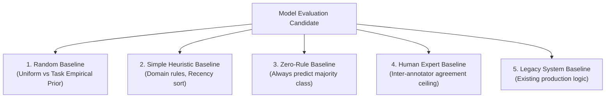

#### Mathematical Proof: Random Baselines Under Class Imbalance
Consider an imbalanced binary task with positive class prior $\pi = P(Y=1) = 0.10$ and negative class prior $1 - \pi = 0.90$.

1. **Uniform Random Predictor** ($P(\hat{Y}=1) = 0.50$):
   $$\text{Precision} = \frac{0.5 \cdot \pi}{0.5 \cdot \pi + 0.5 \cdot (1-\pi)} = \pi = 0.10$$
   $$\text{Recall} = 0.50$$
   $$F_1 = \frac{2 \times \text{Precision} \times \text{Recall}}{\text{Precision} + \text{Recall}} = \frac{2 \times 0.10 \times 0.50}{0.10 + 0.50} = \frac{0.10}{0.60} \approx \mathbf{0.167}$$
   $$\text{Accuracy} = 0.5(0.90) + 0.5(0.10) = \mathbf{0.50}$$

2. **Empirical Task Label Distribution Predictor** ($P(\hat{Y}=1) = \pi = 0.10$):
   $$\text{Precision} = \frac{0.10 \times 0.10}{(0.10 \times 0.10) + (0.10 \times 0.90)} = \frac{0.01}{0.10} = 0.10$$
   $$\text{Recall} = 0.10$$
   $$F_1 = \frac{2 \times 0.10 \times 0.10}{0.10 + 0.10} = \mathbf{0.10}$$
   $$\text{Accuracy} = (0.90)^2 + (0.10)^2 = 0.81 + 0.01 = \mathbf{0.82}$$

> [!CAUTION]
> A naive model achieving $82\%$ accuracy on this task has learned nothing beyond the empirical label distribution. Always evaluate accuracy against the Zero-Rule baseline ($\text{Accuracy} = 90\%$).

---

### 5.2 Behavioral Testing Matrix

Adapted from software engineering principles and the CheckList methodology, models must pass behavioral property tests before release:

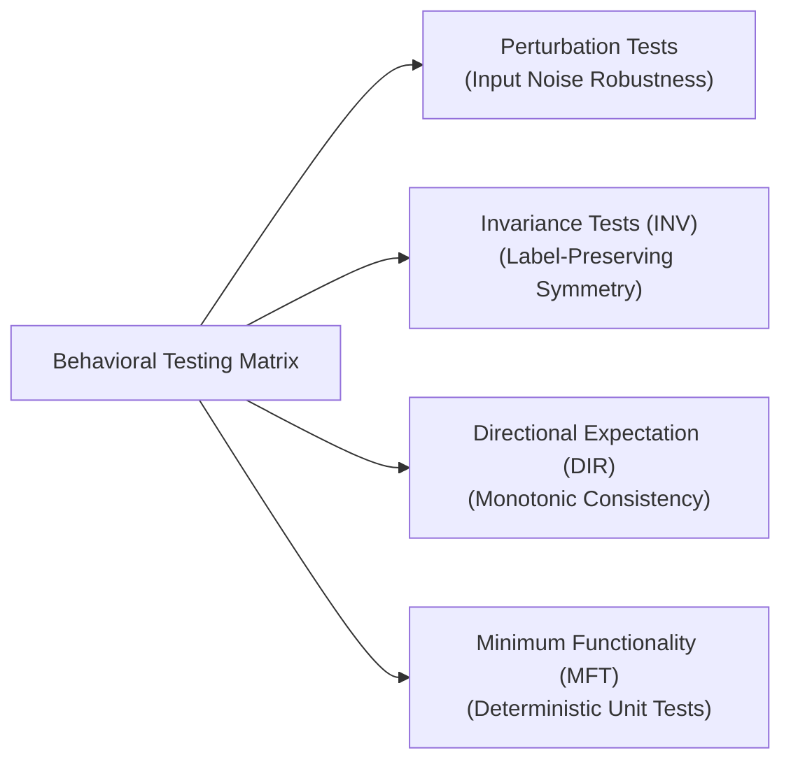

| Test Class | Operational Definition | Concrete Implementation Example | Expected Invariant |
| :--- | :--- | :--- | :--- |
| **Perturbation Testing** | Inject synthetic noise into test samples (Gaussian noise, audio background chatter, typos). | Add audio noise or random clipping to COVID-19 cough classification recordings. | Performance degradation must not exceed threshold $\delta$; fails brittle models. |
| **Invariance Testing (INV)** | Perturb input features that should have zero causal relationship to target label. | Swap applicant names, racial identifiers, or gender markers in resume parsing and credit underwriting models. | $\hat{y}(x_{\text{original}}) \equiv \hat{y}(x_{\text{perturbed}})$. Violations expose severe societal bias. |
| **Directional Expectation (DIR)** | Apply monotonically directional feature adjustments that guarantee predictable output movement. | In real-estate valuation: increase square footage or lot size while holding other features constant. | $\hat{y}(x_{\text{larger}}) \ge \hat{y}(x_{\text{smaller}})$. Inverted outputs reveal spurious correlations. |
| **Minimum Functionality (MFT)** | Core deterministic corner-case tests (analogous to software unit tests). | Query an NLP sentiment classifier with unambiguous polarity primitives: *"I hated this movie"*. | Must achieve $100\%$ accuracy on hand-crafted edge cases. |

---

### 5.3 Model Calibration & Reliability

A classification model is calibrated if its predicted probability $\hat{p} = P(Y=1 \mid X)$ corresponds directly to the true empirical probability of the event occurring.

$$\mathbb{P}(Y = 1 \mid \hat{P} = p) = p, \quad \forall p \in [0, 1]$$

*Example*: If a model predicts a $70\%$ probability of rain across $1,000$ independent days, exactly $700$ of those days must experience rain.

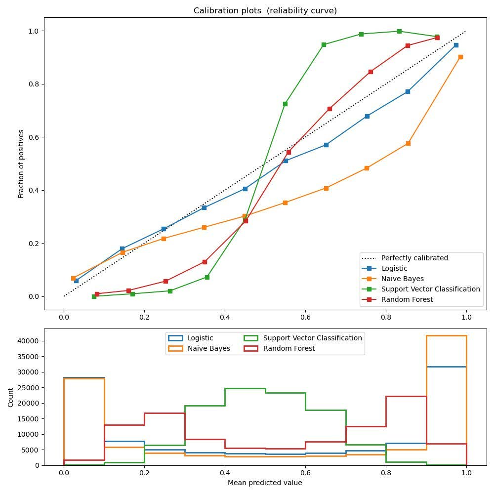
*Figure 5.4: Reliability diagram (Calibration Curves) comparing models. Logistic Regression achieves near-perfect calibration by directly optimizing log-loss, whereas deep networks and boosted trees often require post-hoc scaling.*

#### Why Calibration is Mandatory in Production
- **Decision Thresholding**: In fraud detection, blocking transactions with risk $> 0.80$ assumes $0.80$ represents true likelihood, not uncalibrated model confidence.
- **Expected Value Optimization**: Downstream ad bidding algorithms calculate expected value as:
  $$\mathbb{E}[\text{Revenue}] = \text{Bid} \times P(\text{Click})$$
  Overconfident probabilities distort bid pricing and deplete marketing budgets.

#### Measuring Calibration
1. **Reliability Diagram**: Bin predictions into $M$ equal intervals $B_m \subset (0, 1]$. Plot average confidence within $B_m$ against empirical accuracy within $B_m$.
2. **Expected Calibration Error (ECE)**:
   $$\text{ECE} = \sum_{m=1}^M \frac{|B_m|}{N} \left| \text{acc}(B_m) - \text{conf}(B_m) \right|$$
3. **Maximum Calibration Error (MCE)**:
   $$\text{MCE} = \max_{m \in \{1,\dots,M\}} \left| \text{acc}(B_m) - \text{conf}(B_m) \right|$$

#### Calibration Techniques
- **Platt Scaling**: Trains a scalar logistic regression model over raw model logits $f(x)$ on a held-out validation set:
  $$\hat{q}_i = \sigma(A f(x_i) + B) = \frac{1}{1 + \exp(-(A f(x_i) + B))}$$
  Parameters $A, B \in \mathbb{R}$ are optimized via maximum likelihood.
- **Isotonic Regression**: Non-parametric piecewise constant mapping. Fits a monotonic step-function minimizing squared error:
  $$\min \sum (y_i - m_i)^2 \quad \text{subject to } m_i \le m_j \text{ whenever } f_i \le f_j$$
  Effective when validation calibration sets are large; prone to overfitting on small sets.
- **Temperature Scaling** (for Multi-Class Neural Networks): A single parameter $T > 0$ softens or sharpens the softmax output without altering the argmax rank order:
  $$\hat{q}_i = \frac{\exp(z_i / T)}{\sum_j \exp(z_j / T)}$$

---

### 5.4 Instance-Level Confidence Scoring & Selective Prediction

Macro-level metrics (e.g., aggregate accuracy) mask dangerous individual failures. Production architectures must support **Selective Classification (Prediction with a Reject Option)**:

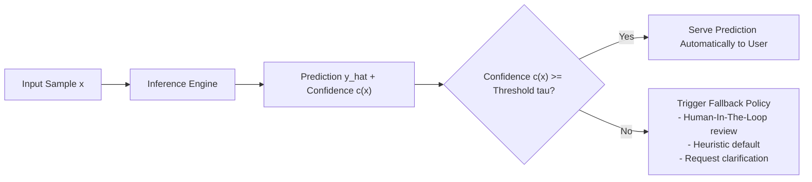

- **Confidence Threshold Tuning ($\tau$)**: Set via cost-utility matrices balancing the cost of human verification against the cost of serving a silent error.
- **Uncertainty Quantification**:
  - *Aleatoric Uncertainty*: Inherent data noise/ambiguity (measured via output entropy).
  - *Epistemic Uncertainty*: Lack of model knowledge in unobserved regions of the feature space (measured via Monte Carlo Dropout or Deep Ensembles variance).

---

### 5.5 Slice-Based Evaluation & Simpson's Paradox

Evaluating a model purely on aggregate metrics across an entire test split obscures catastrophic failures in critical subpopulations.

#### Majority vs. Minority Subgroup Masking
Consider a dataset where $90\%$ of traffic comes from a majority cohort and $10\%$ from a protected minority:
- **Model A**: Achieves $98\%$ on the majority cohort, $80\%$ on the minority cohort $\to$ **$96.2\%$ Overall Accuracy**.
- **Model B**: Achieves $95\%$ on the majority cohort, $95\%$ on the minority cohort $\to$ **$95.0\%$ Overall Accuracy**.
- *System Trap*: A team deploying Model A based on aggregate accuracy unknowingly releases an algorithm biased against underrepresented demographics, exposing the organization to legal, ethical, and churn risks.

---

#### Simpson's Paradox in Production Slices
Simpson's Paradox occurs when a statistical trend evident within individual subgroups **disappears or completely reverses** when the subgroups are aggregated.

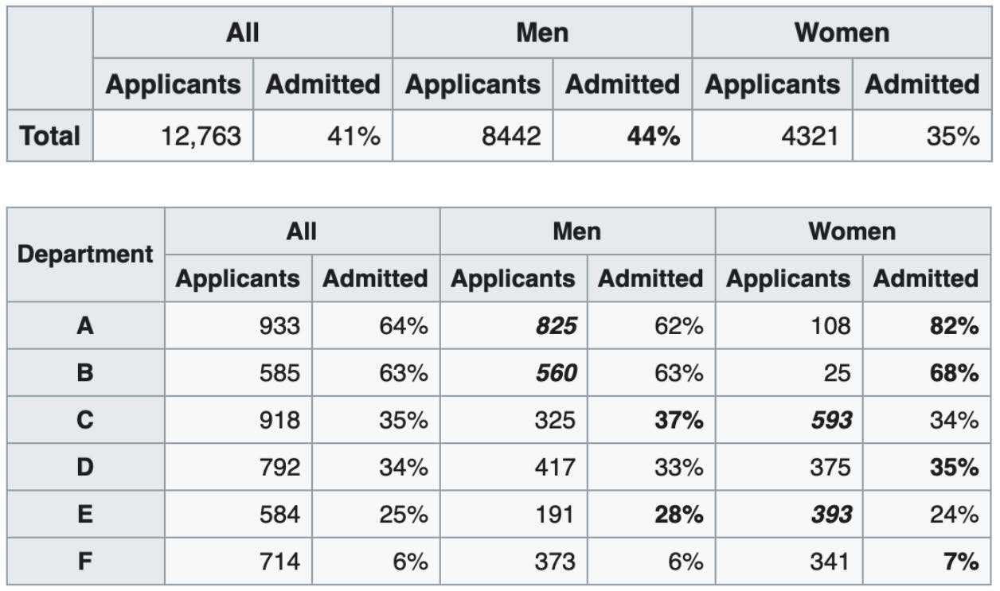
*Figure 5.5: Simpson's Paradox illustrated: Aggregation conceals subpopulation realities due to confounding base rates (e.g., the 1973 UC Berkeley admissions data).*

#### Concrete Medical Case Study (Kidney Stone Treatment / Charig et al.)
Comparing two treatments (Model A vs. Model B) across small and large kidney stones:

| Data Slice | Treatment / Model A Success Rate | Treatment / Model B Success Rate | Winning Model |
| :--- | :--- | :--- | :--- |
| **Group A (Small Stones)** | **93%** ($81/87$) | 87% ($234/270$) | **Model A Wins** |
| **Group B (Large Stones)** | **73%** ($192/263$) | 69% ($55/80$) | **Model A Wins** |
| **Overall Combined** | 78% ($273/350$) | **83%** ($289/350$) | **Model B Wins!** |

- **Mathematical Cause**: Model A was disproportionately assigned to severe cases (large stones, $263/350 = 75\%$), whereas Model B was assigned predominantly to mild cases (small stones, $270/350 = 77\%$). The confounding variable (severity) distorts the aggregate metric.

#### Historical Real-World Case: UC Berkeley Graduate Admissions (1973)
- Aggregate figures indicated an apparent institutional bias: Male applicants had an overall admission rate of $44\%$, while female applicants had an admission rate of $35\%$.
- Subgroup analysis across 6 individual departments revealed that women achieved **equal or higher admission rates than men in 4 of the 6 departments**.
- **Confounder**: Female candidates applied disproportionately to highly competitive humanities departments with low overall admission quotas, whereas male candidates applied to engineering departments with higher baseline acceptance rates.

#### Systematic Discovery of Critical Slices
1. **Domain Heuristics**: Segment by hardware platform (iOS vs. Android), browser client, geographic region, network latency profile, and user subscription tiers.
2. **Error Clustering**: Cluster misclassified samples in feature or embedding space to discover latent failure cohorts.
3. **Automated Slice Finders**:
   - Algorithms such as **Slice Finder** and **Domino** utilize beam search, decision tree rule-mining, or cross-modal embeddings to automatically surface slices that maximize the mutual information between subpopulation identity and error rate.

---

## 6. Production Architectural Checklist & System Invariants

### 6.1 Architectural System Invariants
- [ ] **Frame for Maintainability**: Ensure target labels do not tie model architecture dimensions to transient runtime entities (e.g., pointwise regression scoring over item vectors instead of fixed $N$-class softmax).
- [ ] **Decouple Multi-Objectives**: Never couple conflicting business goals into a single composite training loss if objective weights require frequent operational adjustments.
- [ ] **Zero Training-Serving Skew**: Guarantee that feature transformations utilized in offline validation match real-time feature store calculations identically.
- [ ] **Enforce Random Seeds**: Fix global pseudo-random seeds across Python, NumPy, PyTorch, and CUDA during experimental baselining.

### 6.2 Pre-Deployment Production Gate
- [ ] **Baseline Surpassed**: The model decisively outperforms Random, Empirical Label Prior, Zero-Rule, and simple domain heuristics.
- [ ] **Behavioral Test Suite Passing**:
  - [ ] Perturbation noise injection degradation $\le \epsilon$.
  - [ ] Invariance checks pass on all protected attributes (race, gender, synthetic identifiers).
  - [ ] Directional expectations verified across monotonic features.
  - [ ] Minimum functionality unit tests achieve 100% pass rate.
- [ ] **Calibration Confirmed**: The model produces calibrated probabilities (ECE below SLA threshold); post-hoc Platt scaling or Isotonic regression applied if raw logits are uncalibrated.
- [ ] **Slice Audits Passed**: No severe performance cliffs detected on critical business slices or underrepresented demographic cohorts; Simpson's paradox confounded aggregations ruled out.
- [ ] **Selective Prediction Active**: Calibrated confidence thresholding operationalized with explicit human-in-the-loop or fallback execution paths for low-certainty inference requests.
