# Chapter 6: Model Deployment and Serving

> **Executive Architectural Summary**: Model deployment is not merely packaging a machine learning model into a lightweight REST endpoint; it is an industrial-scale systems engineering discipline. Production deployment operates under strict Service Level Agreements (SLAs) regarding sub-second tail latencies ($P_{99} < 20\text{ms}$), high throughput (thousands of QPS), high availability ($99.99\%$ uptime), infrastructure unit economics, and continuous mitigation of performance degradation (concept drift and software rot). This chapter formalizes prediction paradigms (Batch vs. Online vs. Streaming), deep model compression techniques (Low-rank Factorization, Knowledge Distillation, Pruning, Quantization), compiler-level hardware optimizations (Intermediate Representations, Operator Fusion, AutoTVM), client-side in-browser inference (WASM, WebGPU), and safe deployment methodologies (Canary, Blue-Green, Shadow) alongside an operational production checklist.

---

## 1. The Nature of ML Model Deployment in Production

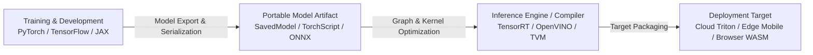

### 1.1. The Production Spectrum
In enterprise ML, "production" is a broad continuum characterized by the scale of traffic, operational stakes, and latency constraints:
- **Exploratory / Ad-hoc Tier**: Generating plots, static score files, or offline reports directly from Jupyter Notebooks to present to stakeholders. The "production" environment is essentially identical to the local development environment.
- **Internal / Staging Tier**: Wrapping a model artifact inside a lightweight web service (e.g., Flask, FastAPI, Streamlit, Dash) accessible only by internal operations teams or a limited cohort of pilot users. Traffic is low, and brief downtime is tolerable.
- **Mission-Critical Industrial Tier**: Serving hundreds of millions of daily active users (DAUs), handling tens of thousands of queries per second (QPS), committing to rigid tail-latency SLAs ($P_{99} \le 20\text{ms}$), providing fault tolerance ($99.99\%$ uptime), and maintaining automated continuous integration and delivery pipelines (CD4ML).

### 1.2. The Fallacy of Separation of Concerns
Historically, engineering organizations bifurcated ML lifecycle responsibilities into isolated silos:
1. **Data Science / ML Research Team**: Prototypes feature transforms and neural architectures in Python environments (Jupyter, PyTorch, TensorFlow). Once offline evaluation metrics (AUC, F1, RMSE) reach targets, the model artifact is handed over the fence.
2. **Operations / Deployment Engineering Team**: Receives the raw artifact, rewrites feature preprocessing pipelines into low-latency languages (C++, Java, Go), provisions serving infrastructure, and deploys endpoints.

**Failure Modes of Bifurcation**:
- **Communication Overhead & Iteration Slog**: Release cycles drag out over months. Model updates require coordination across multiple engineering teams.
- **Training-Serving Skew**: Subtly divergent preprocessing logic between offline Python scripts and online C++/Java pipelines creates silent, critical bugs that degrade inference accuracy in production without throwing runtime errors.
- **Debug Paralysis**: During operational anomalies, data scientists lack visibility into production server runtimes, while operations engineers lack the statistical and mathematical context to diagnose model degradation.

*Modern Standard*: Modern production organizations adopt **End-to-End Ownership** (MLOps), where cross-functional product squads manage the full lifecycle—from feature ingestion and model training to deployment, monitoring, and live maintenance.

### 1.3. Model Serialization and Export Formats
Model exporting converts an in-memory compute graph and weight state into a standardized, language-agnostic disk format. A serializable model encompasses two components:
1. **Model Definition (Compute Topology)**: Directed Acyclic Graph (DAG) describing tensor dimensions, operation nodes, activations, and connectivity.
2. **Model Parameters (Learned Weights)**: Numerical matrices representing trained weights, biases, and running normalization statistics.

**Standard Serialization Formats**:
- **TensorFlow SavedModel**: A unified directory format containing the execution graph (`saved_model.pb`) and weight checkpoint shards (`variables/`), native to TensorFlow Serving.
- **TorchScript (`torch.jit.trace` / `torch.jit.script`)**: Compiles dynamic PyTorch execution graphs into optimized Intermediate Representations that execute within a pure C++ runtime, bypassing Python's Global Interpreter Lock (GIL).
- **Open Neural Network Exchange (ONNX)**: An open standard bridging diverse frameworks (PyTorch, TensorFlow, Scikit-learn) with target hardware-accelerated runtimes (NVIDIA TensorRT, Intel OpenVINO, DirectML).

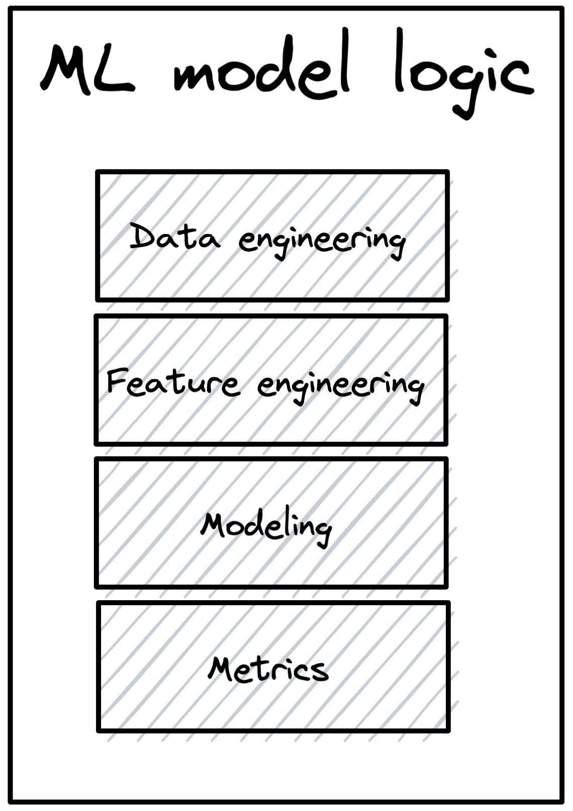

---

## 2. The Four Machine Learning Deployment Myths

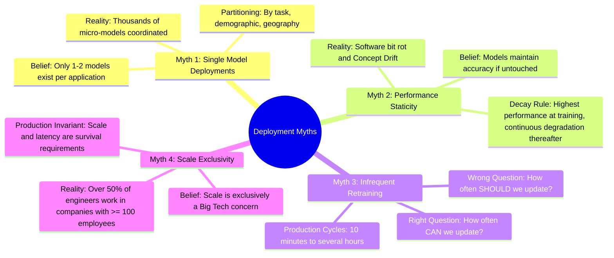

### 2.1. Myth 1: Organizations Only Deploy One or Two Models at a Time
- **The Misconception**: Systems consist of a single monolithic ML model handling the entire application domain.
- **Production Reality**: Modern commercial systems run as distributed ensembles of hundreds to thousands of specialized micro-models:
  - **Task Decomposition**: A ridesharing platform (e.g., Uber) relies on distinct specialized models for passenger demand forecasting, driver dispatch availability, Estimated Time of Arrival (ETA), dynamic pricing, credit card fraud detection, churn prediction, and destination autocomplete.
  - **Geographic and Segment Partitioning**: User distributions, infrastructure topologies, and behavioral patterns vary significantly across regions. A company operating in 20 countries with 10 functional ML tasks per country maintains at minimum $20 \times 10 = 200$ discrete production models.
- **Empirical Industry Figures**:
  - **Uber**: Executes thousands of live models concurrently across its Michelangelo platform.
  - **Google**: Trains and serves thousands of models concurrently, spanning hundreds of billions of parameters.
  - **Booking.com**: Maintains over 150 production models concurrently serving reservation, pricing, and recommendation queries.
  - **Algorithmia Enterprise Survey**: $41\%$ of enterprises with $> 25,000$ employees operate over 100 ML models in active production.

### 2.2. Myth 2: If Left Untouched, Model Performance Remains Constant
- **The Misconception**: A trained model with a static set of weights will retain its benchmarked test accuracy indefinitely.
- **Production Reality**:
  - **Software Rot / Bit Rot**: External environments change continuously. Underlying operating system drivers, dependent microservices, client schemas, and hardware abstractions mutate, introducing subtle runtime breakages.
  - **Data Drift & Concept Drift**: The real-world data distribution $P(X)$ and conditional target relationships $P(Y \mid X)$ deviate continuously from the training set distribution $P_{train}(X, Y)$.
  - **The Law of Model Degradation**: An ML model exhibits its maximum performance **immediately upon completing training**; its predictive fidelity decays monotonically from that moment forward as entropy increases in the live data environment.

### 2.3. Myth 3: Models Do Not Require Frequent Updates
- **The Misconception**: Retraining a model once a quarter or once a month is sufficient for production utility.
- **Production Reality**:
  - Asking *"How often SHOULD we update our models?"* represents flawed thinking. The correct systems question is: **"How often CAN our infrastructure update our models?"**
  - Model utility in dynamic domains (recommendation feeds, ad-click prediction, financial arbitrage, fraud detection) decays rapidly as data freshness degrades.
  - **Industry Update Cadences**:
    - High-velocity DevOps benchmarks: Etsy deploys code $\sim 50$ times/day; Netflix updates services thousands of times/day; AWS deploys every 11.7 seconds.
    - ML continual training cadences: Platforms such as Weibo, ByteDance (TikTok), and Alibaba retrain and deploy updated ranking models on iteration loops of **10 minutes** via real-time streaming feedback engines.

### 2.4. Myth 4: Most ML Engineers Do Not Need to Worry About Scale
- **The Misconception**: Massive scale (hundreds of QPS, millions of users, petabyte data pipelines) is an edge problem exclusive to FAANG companies.
- **Production Reality**:
  - StackOverflow developer surveys reveal that more than $50\%$ of software engineers and data scientists work in companies with **100 or more employees**.
  - At this organizational size, consumer-facing software applications routinely exceed hundreds of thousands of daily active users, demanding predictable sub-100ms response latencies under concurrent traffic spikes.
  - An academically superior neural architecture that introduces 500ms of tail latency or crashes under high memory utilization will never pass production review. **Scale is a fundamental architectural constraint, not an afterthought.**

---

## 3. Prediction Paradigms: Batch vs. Online vs. Streaming

```mermaid
flowchart TD
    subgraph Batch_Architecture["Batch Prediction Architecture (Asynchronous / Precomputed)"]
        DW[(Data Warehouse / Lake)] -->|Scheduled ETL / Cron| BF[Batch Feature Pipeline]
        BF -->|Offline Batch Inference| M1[Offline Model Scoring]
        M1 -->|Bulk Writes| KV[(Key-Value Cache / DB)]
        Client1[User Client] -->|Fetch Request| API1[Gateway API]
        API1 -->|Key Lookup O(1)| KV
        KV -->|Static Prediction| API1
        API1 -->|Response| Client1
    end

    subgraph Online_Architecture["Streaming / Online Prediction Architecture (Synchronous / On-Demand)"]
        Client2[User Client] -->|Dynamic Request + Context| API2[Prediction Service API]
        API2 -->|Retrieve Real-Time Features| StreamStore[(In-Memory Feature Store / Redis)]
        API2 -->|Retrieve Historical Features| BatchStore[(Batch Store)]
        StreamStore --> API2
        BatchStore --> API2
        API2 -->|Payload + Feature Vector| M2[Optimized Model Runtime]
        M2 -->|Instant Inference| API2
        API2 -->|Dynamic Response| Client2
    end
```

### 3.1. Architectural Taxonomy

| Architectural Dimension | Batch Prediction (Asynchronous) | Online Prediction (Synchronous) |
| :--- | :--- | :--- |
| **Execution Trigger** | Periodic schedule (cron job, Airflow orchestrator, bulk data event). | Client request over network protocol (HTTP REST, gRPC). |
| **Serving Mechanism** | Precomputed predictions written to persistent storage (SQL, Redis, S3). | Inference evaluated on-the-fly inside execution runtime. |
| **Serving Latency** | Ultra-low: Dominated by simple database read overhead ($O(1)$ key lookup $\approx 2 - 5\text{ms}$). | Variable: Feature extraction latency $+$ compute graph forward pass latency ($\approx 15 - 200\text{ms}$). |
| **Throughput Optimization** | Maximized: High-degree parallelization, distributed matrix-matrix vectorization. | Constrained: Bound by concurrent request contention, GPU kernel launch overhead, and batching queues. |
| **Prediction Freshness** | Low: Stale by the duration of the batch interval (hours to days). | Instantaneous: Reflects immediate real-time user context and current state. |
| **Input Query Space** | **Finite & Predefined**: Requires knowing the full universe of entity keys (e.g., User IDs) prior to inference. | **Unbounded & Dynamic**: Capable of evaluating novel, ad-hoc, previously unseen input combinations. |
| **Computational Efficiency** | Highly inefficient when user participation is sparse ($90\%+$ compute wasted). | Optimal: Computations are instantiated if and only if an explicit request occurs. |

### 3.2. Computational Waste in Batch Prediction
Batch prediction systems precalculate scores for an entire user database regardless of actual consumption. 

**Mathematical Formalization of Compute Waste**:
Let $U_{total}$ be the total population of registered users, and $U_{active}$ be the set of daily active users who actually initiate sessions within the prediction window:
$$\text{Compute Waste Ratio } (W) = 1 - \frac{|U_{active}|}{|U_{total}|} = \frac{|U_{total}| - |U_{active}|}{|U_{total}|}$$

*Empirical Example (GrubHub)*:
- Registered user base ($U_{total}$): 31 million users.
- Daily active ordering users ($U_{active}$): 622,000 users ($\approx 2\%$).
- If batch recommendations are generated across all registered accounts nightly:
  $$W = \frac{31,000,000 - 622,000}{31,000,000} \approx 98\%$$
The organization exhausts $98\%$ of its compute budget generating recommendations that expire without ever being fetched. Synchronous online prediction eliminates this overhead by evaluating inference purely on demand.

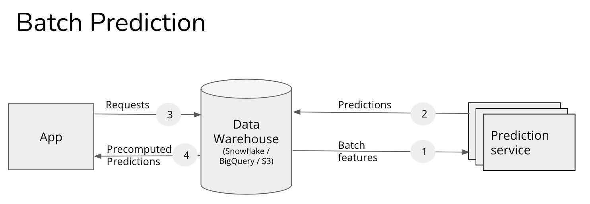

### 3.3. Hybrid Serving Paradigms
Rather than viewing batch and online paradigms as mutually exclusive, modern production architectures combine them:
1. **Precompute Head Queries (Power-Law Distribution)**: Evaluate and cache predictions offline for the top $5\% - 10\%$ most frequent entities (e.g., trending items, high-volume search queries) into fast in-memory key-value stores.
2. **Online Evaluation for the Long Tail**: Route the remaining $90\%$ of infrequent, dynamic, or personalized long-tail queries to an on-demand inference cluster.
3. **Multi-Stage Serving (e.g., DoorDash / UberEats)**:
   - *Stage 1 (Store Recommendation)*: Batch inference generates candidate restaurant rankings every few hours based on geographic zones (coarse candidate generation).
   - *Stage 2 (Dynamic Food Recommendation & ETA)*: Online inference generates specific meal rankings and delivery ETA upon restaurant selection, parameterized by real-time kitchen backlog, driver availability, and live traffic.

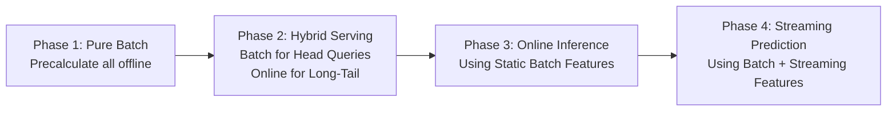

### 3.4. Streaming Prediction: Combining Batch and Streaming Features
Online prediction models reach their highest efficacy when consuming both historical depth and immediate temporal context:
- **Batch Features (Static / Historical)**: Derived from deep historical logs stored in data warehouses (e.g., restaurant historical order fulfillment time, user 90-day category preference).
- **Streaming Features (Dynamic / Real-time)**: Computed over sliding event windows over real-time message buses (e.g., number of active orders placed at this restaurant in the last 10 minutes, weather delta, available delivery couriers within a 2km radius).

### 3.5. Unifying Batch and Streaming Pipelines
When online prediction incorporates real-time features, architectural divergence between training and serving represents the primary source of critical production defects.

```mermaid
flowchart TD
    subgraph Dual_Pipeline_Problem["Dual-Pipeline Architecture (Training-Serving Skew Risk)"]
        RawBatch[(Data Lake)] -->|Pandas / PySpark| BatchPipe[Batch Pipeline (ML Team)]
        BatchPipe --> ModelTrain[Model Training]
        
        RawStream[Message Queue] -->|Java / Flink / Scala| StreamPipe[Streaming Pipeline (Ops Team)]
        StreamPipe --> OnlineInf[Online Inference Serving]
        BatchPipe -.->|Logic Divergence!| StreamPipe
    end

    subgraph Unified_Kappa_Pipeline["Unified Pipeline (Kappa Architecture)"]
        EventLog[Immutable Append-Only Log: Apache Kafka] --> FlinkEngine[Unified Engine: Apache Flink]
        FlinkEngine -->|Historical Replay| FeatureStore[(Unified Feature Store)]
        FlinkEngine -->|Real-Time Tail| FeatureStore
        FeatureStore --> ModelTrain2[Training Pipeline]
        FeatureStore --> OnlineInf2[Inference Serving]
    end
```

#### Causes of Training-Serving Skew:
1. **Codebase Bifurcation**: Data preprocessing written in Python (for offline training) and reimplemented in C++/Java (for low-latency online serving) results in subtle mathematical divergences (e.g., floating-point rounding, distinct handling of null/NaN values, zero-division fallbacks).
2. **Temporal Windowing Discrepancies**: Inconsistent edge-case handling across sliding time windows versus tumbling time windows between batch MapReduce jobs and streaming micro-batches.
3. **Timezone and Clock Skew**: Processing timestamps on server nodes drifting from event generation timestamps on client devices.

#### Architectural Solutions: Lambda vs. Kappa
- **Lambda Architecture**: Runs parallel systems: a Batch Layer (MapReduce/Spark for exhaustive, accurate, high-latency historical computation) and a Speed Layer (Storm/Flink for low-latency approximations).
  - *Failure mode*: Requires synchronizing two independent codebases, doubling operational maintenance costs, and inviting constant feature skew.
- **Kappa Architecture**: Eliminates the dual-path design. All data is modeled as an **immutable append-only event stream** (e.g., Apache Kafka). A **single stream computation engine** (e.g., Apache Flink) handles both real-time stream processing at the tail of the log and historical backfills via stream replay from the head. This enforces the operational invariant: **One single codebase for both training and serving feature extraction.**

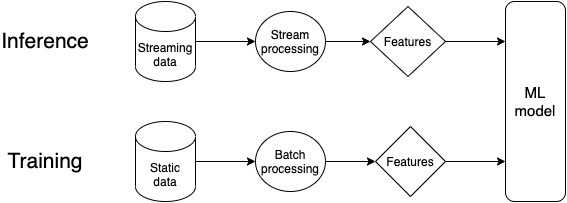

---

## 4. Model Compression and Fast Inference Optimization

When serving models online or on resource-constrained hardware, lowering inference latency while preserving predictive power is paramount. The system design space balances three levers:
1. **Inference Optimization**: Maximizing kernel performance on target hardware runtimes.
2. **Model Compression**: Structurally minimizing the parameter count and bit-depth of the neural network.
3. **Hardware Acceleration**: Deploying specialized hardware backends (GPUs, TPUs, ASICs).

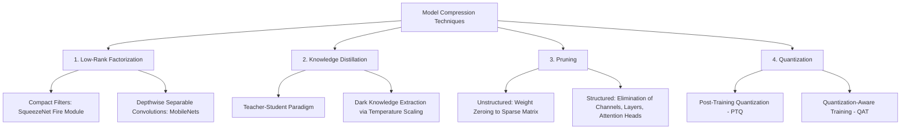

### 4.1. Low-Rank Factorization

#### Mathematical Foundations
Low-rank factorization decomposes high-dimensional weight tensors into combinations of lower-rank tensors, leveraging linear redundancy within over-parameterized neural layers.

#### Compact Convolutional Filters: SqueezeNet
SqueezeNet replaces costly standard $3 \times 3$ convolutions with **Fire Modules** composed of two distinct phases:
- **Squeeze Phase**: Uses $1 \times 1$ convolution filters to dramatically compress the input channel dimension.
- **Expand Phase**: Mixes $1 \times 1$ and $3 \times 3$ convolution kernels across the compressed channels.
- *Performance Impact*: Matches AlexNet accuracy on ImageNet while utilizing **$50\times$ fewer parameters** and requiring $< 0.5\text{MB}$ in model file size.

#### Depthwise Separable Convolutions: MobileNets
Consider an input feature map of spatial dimensions $D_F \times D_F$ with $C_{in}$ channels. A standard convolutional layer applies $C_{out}$ kernels of dimension $K \times K \times C_{in}$ (where $K$ is the spatial kernel width/height).

**Standard Convolution Computational Cost**:
$$\text{Cost}_{standard} = D_F \cdot D_F \cdot K \cdot K \cdot C_{in} \cdot C_{out} = D_F^2 \cdot K^2 \cdot C_{in} \cdot C_{out}$$
$$\text{Parameter Count}_{standard} = K^2 \cdot C_{in} \cdot C_{out}$$

MobileNet factorizes this single standard operation into two decoupled steps:
1. **Depthwise Convolution**: Applies a single spatial filter of size $K \times K \times 1$ per input channel independently (yielding $C_{in}$ filters total).
   $$\text{Cost}_{depthwise} = D_F \cdot D_F \cdot K \cdot K \cdot C_{in} = D_F^2 \cdot K^2 \cdot C_{in}$$
2. **Pointwise Convolution**: Applies a $1 \times 1 \times C_{in} \times C_{out}$ convolution to compute linear combinations across all channels.
   $$\text{Cost}_{pointwise} = D_F \cdot D_F \cdot 1 \cdot 1 \cdot C_{in} \cdot C_{out} = D_F^2 \cdot C_{in} \cdot C_{out}$$

**Total Separable Convolution Computational Cost**:
$$\text{Cost}_{separable} = D_F^2 \cdot K^2 \cdot C_{in} + D_F^2 \cdot C_{in} \cdot C_{out}$$

**Computation & Parameter Reduction Ratio**:
$$\text{Reduction Ratio} = \frac{D_F^2 \cdot K^2 \cdot C_{in} + D_F^2 \cdot C_{in} \cdot C_{out}}{D_F^2 \cdot K^2 \cdot C_{in} \cdot C_{out}} = \frac{K^2 \cdot C_{in} + C_{in} \cdot C_{out}}{K^2 \cdot C_{in} \cdot C_{out}} = \frac{1}{C_{out}} + \frac{1}{K^2}$$

*Evaluation for Standard $3 \times 3$ Kernels ($K = 3$)*:
$$\text{Reduction Ratio} \approx \frac{1}{C_{out}} + \frac{1}{9} \approx \frac{1}{9} \quad (\text{for large } C_{out})$$
Factorization yields an **$8\times$ to $9\times$ reduction** in computational operations (FLOPs) and parameter storage with negligible accuracy drop.


### 4.2. Knowledge Distillation

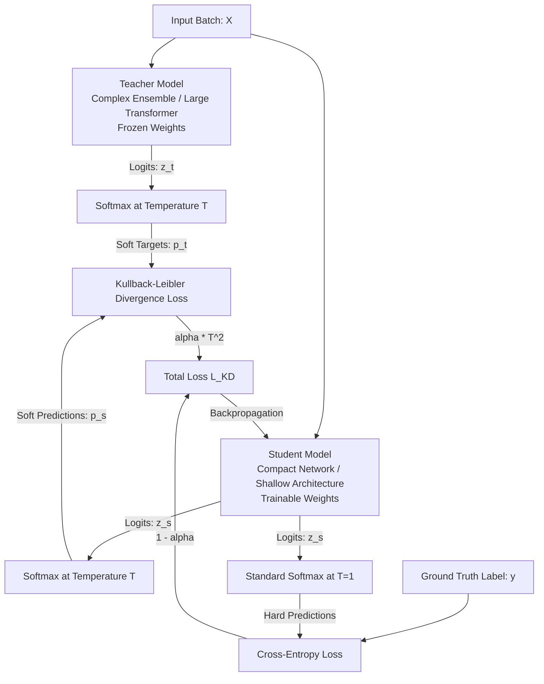

#### The "Dark Knowledge" Principle
Standard hard classification training represents targets as one-hot encoded vectors (e.g., $[0, 0, 1, 0]$). This formulation discards rich inter-class topological relationships. A large teacher network predicts soft probabilities (e.g., an image of a BMW might output: `Car: 0.85`, `Truck: 0.14`, `Cat: 0.01`). The $0.14$ probability for `Truck` encodes vital structural similarity ("a BMW shares visual features with a truck, but none with a cat")—this constitutes **Dark Knowledge**.

#### Mathematical Formulation
To expose Dark Knowledge, the Softmax function is scaled by a **Temperature hyperparameter ($T$)**:
$$p_i(z, T) = \frac{\exp(z_i / T)}{\sum_j \exp(z_j / T)}$$
- At $T = 1$: Yields standard argmax-biased categorical Softmax probabilities.
- As $T \to \infty$: Softmax flattens into a smooth, softened distribution, magnifying small inter-class logit nuances.

**Total Distillation Objective Function ($\mathcal{L}_{KD}$)**:
$$\mathcal{L}_{KD} = (1 - \alpha) \mathcal{L}_{CE}(y, \sigma(z_s)) + \alpha T^2 \mathcal{D}_{KL}\left(\sigma\left(\frac{z_t}{T}\right) \,\middle\|\, \sigma\left(\frac{z_s}{T}\right)\right)$$
Where:
- $z_t, z_s$: Unnormalized output logits of Teacher and Student models respectively.
- $\sigma$: Softmax activation operator.
- $y$: True ground-truth one-hot vector.
- $\mathcal{L}_{CE}$: Cross-entropy loss against ground truth labels (evaluated at $T=1$).
- $\mathcal{D}_{KL}$: Kullback-Leibler Divergence between temperature-softened probability vectors.
- $\alpha \in [0, 1]$: Weighting factor balancing hard label supervision and soft distillation signals.
- **The $T^2$ Scaling Factor**: Because the gradients of $\mathcal{D}_{KL}$ with respect to logits $z_s$ scale proportionally to $1/T^2$ when temperature is applied, multiplying by $T^2$ ensures that the relative gradient magnitude contributed by soft targets remains balanced against the cross-entropy gradient as $T$ varies.

#### Production Benchmark: DistilBERT
- **Teacher**: $\text{BERT-base}$ (110M parameters, 12 layers).
- **Student**: $\text{DistilBERT}$ (66M parameters, 6 layers).
- **Production Impact**: Achieves a **$40\%$ parameter reduction**, runs **$60\%$ faster**, while retaining **$97\%$** of BERT's full language understanding score on the GLUE benchmark.

### 4.3. Pruning

#### Unstructured Pruning vs. Structured Pruning

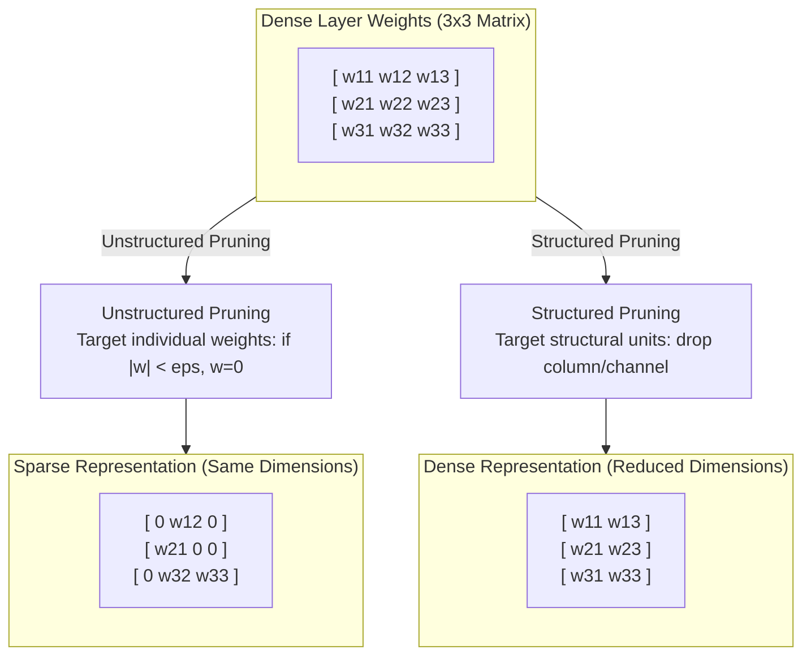

| Pruning Taxonomy | Unstructured Pruning (Weight Pruning) | Structured Pruning (Channel/Node Pruning) |
| :--- | :--- | :--- |
| **Target Element** | Individual weight values throughout weight tensors. | Complete rows, columns, convolution channels, or attention heads. |
| **Matrix Topology** | Matrix dimensions remain unchanged; matrix becomes sparse. | Physical dimensions shrink ($M \times N \to M' \times N'$ where $M' < M, N' < N$). |
| **Disk Storage Footprint** | Compresses significantly via sparse storage (CSR/CSC formats) or standard gzip. | Compresses natively without specialized sparse data structures. |
| **Hardware Latency Speedup** | **Minimal to zero speedup on commodity hardware**. Standard CPUs/GPUs cannot accelerate irregular sparse matrices unless sparsity exceeds $95\%$, or requires specialized architectures (NVIDIA Ampere Sparse Tensor Cores). | **Immediate hardware acceleration** on all standard computing backends because the post-pruned model remains a standard dense matrix. |
| **Fidelity Impact** | Highly resilient: Can prune up to $80-90\%$ of weights with negligible loss. | Sensitive: Structural removal can trigger noticeable accuracy drops without extensive fine-tuning. |

#### The Lottery Ticket Hypothesis
Formulated by Frankle & Carbin (ICLR 2019):
> A dense, randomly-initialized feed-forward network contains a sparse subnetwork ("winning ticket") that—when trained in isolation from the exact same initialization—can match the test accuracy of the original network in an equivalent number of training iterations.

The algorithm to locate these winning tickets—**Iterative Magnitude Pruning (IMP)**—remains computationally expensive:
1. Train a dense model to convergence;
2. Prune the lowest-magnitude $p\%$ of weights;
3. Reset remaining unpruned parameters back to their **original initial values $W_0$**;
4. Retrain the sparse architecture iteratively.

### 4.4. Quantization

Quantization is the most universally applicable, hardware-friendly model compression methodology in production engineering.

#### Precision Representations and Memory Footprint
- **FP32 (Single Precision IEEE 754)**: 1 sign bit, 8 exponent bits, 23 mantissa bits (4 bytes/parameter).
- **FP16 (Half Precision)**: 1 sign bit, 5 exponent bits, 10 mantissa bits (2 bytes/parameter).
- **BF16 (Bfloat16)**: 1 sign bit, 8 exponent bits, 7 mantissa bits (matches FP32 dynamic range; 2 bytes/parameter).
- **INT8 (Fixed-point Integer)**: 8 bits total representing values in $[-128, 127]$ or $[0, 255]$ (1 byte/parameter).

$$\text{Memory Footprint for 100M Parameters:}\quad \text{FP32} = 400\text{MB} \implies \text{FP16/BF16} = 200\text{MB} \implies \text{INT8} = 100\text{MB}$$

#### Uniform Affine Quantization Mathematics
To map continuous floating-point values $r \in [\alpha, \beta]$ (the dynamic range of weights or activations) into integer quantization steps $q \in [q_{min}, q_{max}]$:

$$q = \text{round}\left(\frac{r}{S}\right) + Z$$

Where:
- **Scale Factor ($S$)**: A positive 32-bit floating-point value specifying the continuous interval step represented by each discrete integer increment:
  $$S = \frac{\beta - \alpha}{q_{max} - q_{min}}$$
- **Zero-Point ($Z$)**: An integer matching the exact representation of real-value $0.0$, guaranteeing that zero-padded data introduces zero computational quantization distortion:
  $$Z = \text{round}\left(-\frac{\alpha}{S}\right) + q_{min}$$

**Dequantization Reconstruction Formula**:
$$r \approx \hat{r} = S \cdot (q - Z)$$

#### Post-Training Quantization (PTQ) vs. Quantization-Aware Training (QAT)

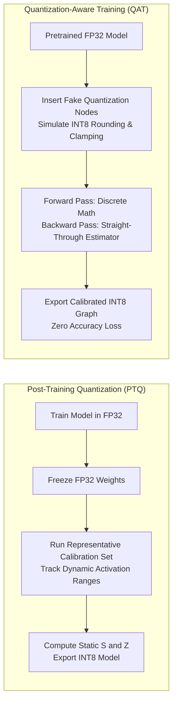

1. **Post-Training Quantization (PTQ)**:
   - Weights and activations are quantized to INT8 after full training convergence without retraining.
   - Requires running an unlabelled **Calibration Dataset** (typically 100 to 1,000 domain examples) through the forward pass to observe activation distributions and calculate dynamic ranges $[\alpha, \beta]$.
   - *Advantage*: Rapid, zero retraining compute cost, natively automated in TensorRT, ONNX Runtime, and TFLite.
   - *Limitation*: Can cause severe accuracy degradation in architectures sensitive to dynamic ranges (e.g., low-bitwidth Transformer models).
2. **Quantization-Aware Training (QAT)**:
   - Simulates quantization error directly within the training/fine-tuning loop.
   - **Forward Pass**: Inserts **Fake Quantization Nodes** that clamp and round continuous activations to discrete steps corresponding to the target bitwidth.
   - **Backward Pass**: Because the derivative of a step rounding operation $\text{round}(x)$ is zero almost everywhere (which kills gradient backpropagation), QAT employs the **Straight-Through Estimator (STE)**:
     $$\frac{\partial \text{round}(x)}{\partial x} \approx 1$$
   - *Advantage*: Model parameters adapt to quantization noise, maintaining baseline FP32 accuracy even when compressed down to INT8 or INT4.

#### Production Case Study: Roblox Scaling BERT to 1B+ Daily Queries on CPUs
- **Challenge**: Serve real-time NLP classification across $> 1\text{ Billion daily requests}$, requiring throughput exceeding **$25,000\text{ QPS}$** under strict tail-latency constraints (**$P_{99} < 20\text{ms}$**) deployed exclusively on commodity CPU clusters to control server costs.
- **Optimization Strategy**:
  1. Replaced monolithic $\text{BERT-base}$ with distilled $\text{DistilBERT}$;
  2. Migrated input tensor layout from static padding (fixed 128 tokens) to **dynamic sequence padding** matching actual sentence lengths;
  3. Applied **INT8 quantization** across all linear projections.
- **Empirical Results**: Quantizing from FP32 to INT8 yielded a **$7\times$ reduction in inference latency** and an **$8\times$ increase in throughput**, allowing Roblox to fulfill strict operational SLAs on inexpensive CPU nodes without requiring expensive GPU infrastructure.

---

## 5. Machine Learning on the Cloud vs. on the Edge

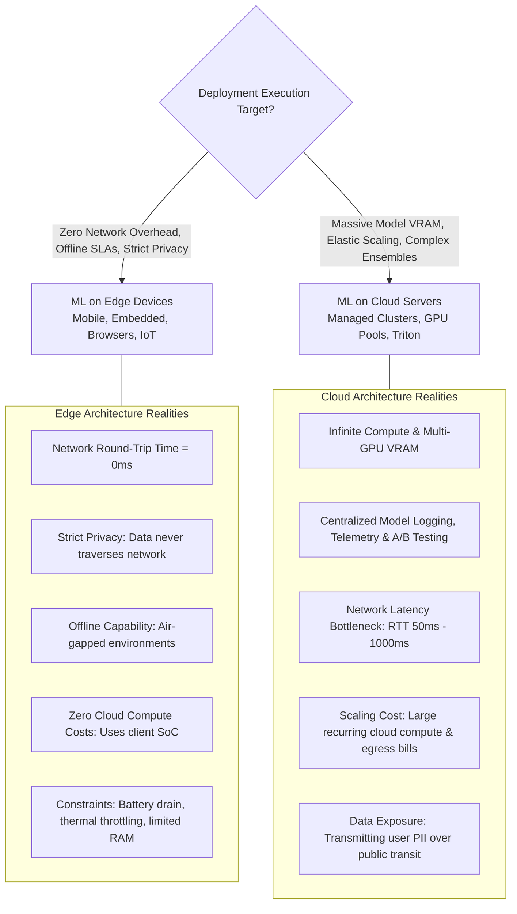

### 5.1. Comprehensive Trade-off Analysis

| System Dimension | Cloud Deployment | Edge Deployment |
| :--- | :--- | :--- |
| **Network Latency** | High variability: Subject to network Round-Trip Time (RTT $\approx 50\text{ms} - 800\text{ms}$). Often dwarf model execution time. | **Zero Network Overhead**: Execution is co-located with local application memory. |
| **Offline Resilience** | **Zero**: Loss of cellular or WiFi connectivity produces total application failure. | **Full Autonomy**: Operates cleanly in disconnected, remote, or air-gapped environments. |
| **Data Privacy & Compliance** | Data must traverse public networks and central servers. Vulnerable to interception; subject to GDPR, HIPAA, and CCPA regulatory scrutiny. | **Maximized Privacy**: Raw user telemetry (biometrics, audio, camera) never leaves the physical device. |
| **Compute & Bandwidth Cost** | Scales directly with user queries. Enterprises spend millions annually on cloud GPU/CPU instances and data egress. | **Zero Cloud Server Incurrence**: Compute cost is completely decentralized onto consumer hardware. |
| **Hardware Constraints** | Virtually unbounded: Multi-node GPU pooling (NVIDIA H100/A100 clusters) with terabytes of aggregate VRAM. | Extremely tight: Restricted by system RAM, flash storage, thermal dissipation thresholds, and battery life. |

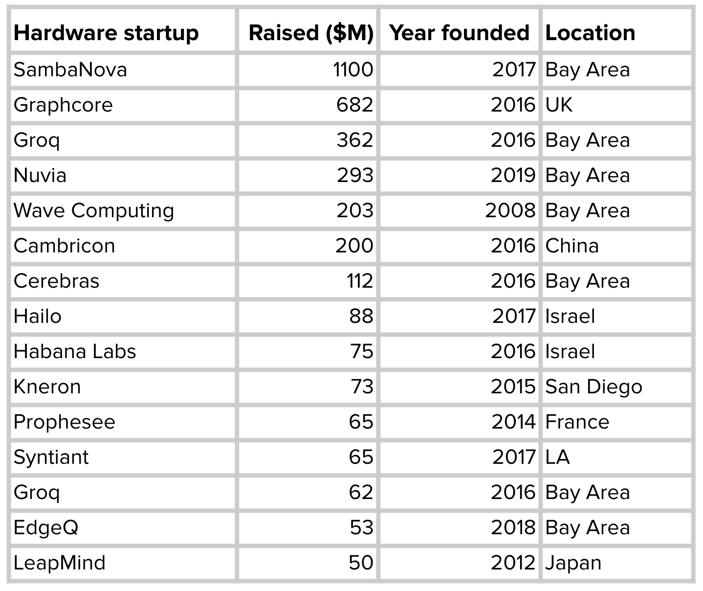

### 5.2. Compiling and Optimizing Models for Edge Devices

#### The $M \times N$ Framework-to-Hardware Dilemma
- Development environments feature **$M$ machine learning frameworks** (PyTorch, TensorFlow, JAX, Scikit-Learn).
- Production environments encompass **$N$ target hardware backends** (Intel x86, ARM Cortex, Apple Neural Engine, NVIDIA Tensor Cores, Qualcomm Snapdragon NPU, Google Edge TPU, diverse FPGAs and ASICs).
- Handcrafting dedicated translation pipelines requires $M \times N$ distinct compilers, which is engineering-intractable.

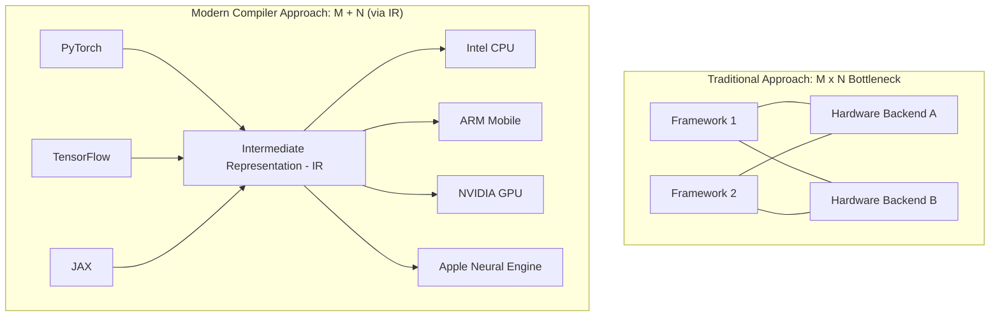

#### Intermediate Representations (IR) and the "Lowering" Process
Modern ML compilers solve this via **Intermediate Representations (IR)**, decomposing the compilation pipeline into stages:
1. **High-Level IR (Computational Graph)**: Represents operations as a computation DAG. Captures high-level operator semantics (e.g., Convolution, Batch Normalization, ReLU) independent of physical hardware details. Enables graph-level structural rewrites.
2. **Low-Level IR**: Encapsulates target-specific primitives, hardware memory layouts, vector registers, and loop execution bounds (e.g., LLVM IR, TVM TIR).
3. **The Lowering Process**: Translates high-level computational graphs down through progressively lower-level IR abstractions, culminating in target-specific assembly or binary machine instructions.

#### Hardware Compute Primitives
Executing models efficiently requires matching computation graphs to distinct physical hardware primitives:
- **CPU Primitives**: Optimized around scalar registers and SIMD vector instructions (e.g., AVX-512, ARM Neon).
- **GPU Primitives**: Optimized around SIMT (Single Instruction, Multiple Threads), thread warps, and high-bandwidth shared memory.
- **TPU / NPU Primitives**: Optimized around 2D systolic arrays executing massive matrix multiply-accumulate operations directly in physical silicon registers.

### 5.3. Compiler Optimization Strategies

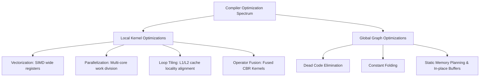

1. **Vectorization**: Compiles loops to leverage wide hardware registers, computing across 4, 8, or 16 contiguous elements in parallel within a single CPU/GPU clock cycle via SIMD instructions.
2. **Parallelization**: Partitions independent multi-dimensional tensor slices across multiple execution cores or thread blocks.
3. **Loop Tiling (Loop Blocking)**: Reorganizes nested iteration orders over multi-dimensional arrays into smaller, localized sub-blocks ("tiles") sized to fit precisely within local L1/L2 cache lines. Prevents repeated, high-latency memory fetches from off-chip DRAM (**Cache Miss Penalty mitigation**).
4. **Operator Fusion (The Premier Optimization)**:
   - *Unfused Execution*: Evaluating `Conv2D` $\to$ `BatchNorm` $\to$ `ReLU` sequentially forces the system to write intermediate activation matrices to DRAM after each step and read them back for the next. Off-chip memory bandwidth saturation dominates latency.
   - *Fused Execution*: Fuses all three operations into a single kernel (`Fused_CBR`). Intermediate values remain in on-chip registers, entirely eliminating intermediate DRAM read/write roundtrips.

### 5.4. Machine Learning for Machine Learning Optimization (AutoTVM / Ansor)
- **Failure of Handcrafted Heuristics**: Hardware vendors historically relied on optimization engineers to write manual heuristics for common models (e.g., tuning ResNet-50 for an NVIDIA DGX A100). This approach fails to scale across non-standard custom architectures or new hardware revisions.
- **ML-Driven Optimization (Apache TVM & AutoTVM)**:
  1. Decomposes the full compute graph into discrete subgraphs.
  2. Constructs a combinatorial search space over potential schedules (unrolling factors, tiling sizes, vectorization widths).
  3. Uses an **ML Cost Model** (typically a Gradient Boosted Tree or Tree-GRU) to evaluate candidates and predict execution latencies without running every variant to completion.
  4. Profiles the highest-ranked execution schedules on physical target hardware to collect true runtime latencies, continuously updating the cost model via active learning.
  5. *Outcome*: Generates hardware-tuned code that routinely out-performs vendor-handcrafted libraries (e.g., outperforming cuDNN on TITAN X hardware within 70 to 100 tuning iterations).

### 5.5. Machine Learning in Browsers

Deploying model inference directly inside web browsers achieves universal cross-platform delivery without requiring local native app installation.

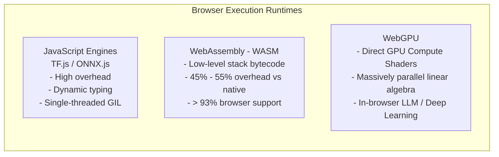

1. **JavaScript Engines (TensorFlow.js, Brain.js)**:
   - High interpretative overhead, dynamic type conversions, and garbage collector pauses; poor fit for compute-intensive workloads.
2. **WebAssembly (WASM)**:
   - A standardized binary instruction format running inside browser sandboxes at near-native execution speed.
   - Allows exporting C++/Rust preprocessing logic and neural inference libraries into a `.wasm` binary module.
   - Backed by over $93\%$ of active browsers globally; incorporates SIMD vector instructions and multithreading via Web Workers.
   - *Performance Benchmark*: Empirical evaluations (Jangda et al.) indicate WASM execution incurs only a **$45\% - 55\%$ performance penalty** compared to bare-metal native C++ execution.
3. **WebGPU**:
   - Successor to WebGL, granting web runtimes low-level access to local GPU hardware via modern **Compute Shaders**.
   - Enables heavy parallel matrix arithmetic directly in browser tabs, paving the way for running localized deep neural networks and on-device Large Language Models (LLMs) with high throughput.

---

## 6. Safe Deployment Strategies and Operational Readiness

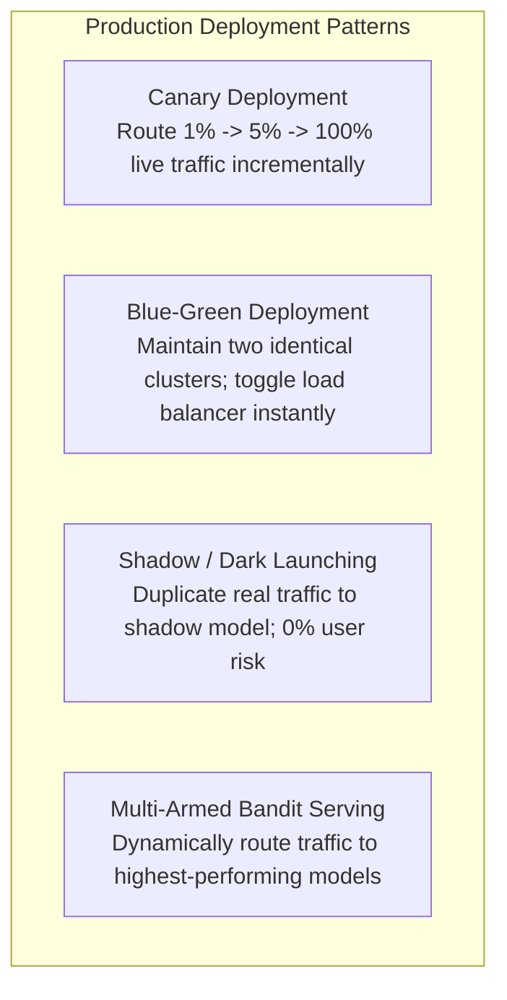

### 6.1. Deployment Patterns

#### 1. Canary Deployment
- **Mechanism**: Routes a small slice of live production traffic (e.g., $1\% - 2\%$) to the candidate model (the "Canary"), while the remaining $98\%$ continues to the current stable model.
- **Validation**: Telemetry monitors technical metrics (latency, HTTP 5xx errors) and product metrics (click-through rates, conversion). Once verified over a designated window, traffic ramps up incrementally ($1\% \to 5\% \to 25\% \to 100\%$).
- **Architectural Value**: **Blast Radius Containment**: If a catastrophic failure occurs, only a tiny fraction of users experience errors.

#### 2. Blue-Green Deployment
- **Mechanism**: Provisions two identical, parallel production environments:
  - **Blue Cluster**: Actively serves $100\%$ of production traffic on the existing model version.
  - **Green Cluster**: Hosts the candidate model version; undergoes synthetic validation in isolation.
- **Cutover**: The API Gateway/Load Balancer updates its routing table, switching all incoming traffic from Blue to Green instantly.
- **Architectural Value**: **Zero Downtime**: Cutover occurs without service interruption. Provides **instantaneous rollback capability**—if anomalies surface post-switch, the router switches traffic back to Blue in seconds.

#### 3. Shadow Deployment (Dark Launching)
- **Mechanism**: Duplicates (mirrors) production request payloads at the ingress gateway.
  - The live production model receives the request, computes inference, and returns responses to users.
  - Simultaneously, an asynchronous duplicate payload is sent to the candidate model running in "shadow" mode. Its predictions are logged for offline analysis and never presented to clients.
- **Architectural Value**: **Zero User-Facing Risk**: Validates candidate model behavior, latency characteristics, and hardware stability under authentic, real-world peak concurrent load.
- **Trade-off**: Requires doubling infrastructure capacity and operational costs during the shadow window.

#### 4. A/B Testing vs. Multi-Armed Bandits (MAB)
- **Static A/B Testing**: Splits traffic evenly across two or more variants ($50/50$) over a predetermined statistical sample window.
  - *Limitation*: Suffers from high **regret**: routing half of all users to an inferior model until statistical significance is achieved causes business losses.
- **Multi-Armed Bandits (MAB)**: Employs dynamic reinforcement learning algorithms (e.g., Thompson Sampling, Upper Confidence Bound) to continuously balance **Exploration** (gathering data on newer/uncertain models) with **Exploitation** (routing the majority of queries to the proven best-performing model). Automatically converges traffic toward top-performing variants, minimizing cumulative regret.

---

### 6.2. Production Deployment Readiness Checklist

| Category | Technical Evaluation Item | Production Acceptance Criteria |
| :--- | :--- | :--- |
| **1. Latency & Tail SLAs** | Comprehensive load benchmarking across $P_{50}, P_{95},$ and $P_{99}$ percentiles under peak QPS. | $P_{99} \le \text{SLA}$ bound (e.g., $< 20\text{ms}$); zero memory leaks observed over 24-hour continuous stress testing. |
| **2. Graceful Fallbacks** | Deterministic handling for runtime exceptions, model timeout thresholds, or malformed payloads. | Returns cached predictions, safe default outputs, or falls back to rule-based heuristics within $< 5\text{ms}$. |
| **3. Input Validation** | Structural schema verification (data types, matrix shapes, acceptable value boundaries). | Rejects or sanitizes out-of-boundary inputs at the API gateway; implements imputation strategies for missing fields. |
| **4. Asynchronous Telemetry** | Structured audit logging capturing: `(Request_ID, Feature_Vector, Model_Version, Prediction, Latency)`. | Logs written asynchronously to streaming queues (Kafka) without degrading request serving latency; PII stripped. |
| **5. Automated Rollback** | Circuit-breaking triggers based on real-time error rates or operational anomaly thresholds. | Automatically shifts traffic back to the prior stable deployment if HTTP 5xx errors exceed $1\%$ over a 3-minute window. |
| **6. Skew Detection Hooks** | Live distribution monitoring comparing real-time serving features against training baselines. | Automated statistical distance alerts (e.g., KL-divergence, Population Stability Index $> 0.1$) piped to on-call dashboards. |

---

## 7. Architectural Summary and Future Directions

1. **The Paradigm Shift from Batch to Streaming**: Batch prediction is a historical artifact of legacy batch computing infrastructures. The future of enterprise ML serving belongs to **Online and Streaming Prediction**, powered by unified Kappa-style stream computation engines (such as Apache Flink) that completely eliminate training-serving skew.
2. **Model Compression as an Operational Prerequisite**: Techniques such as INT8 Quantization, Knowledge Distillation, and Depthwise Separable Factorization are no longer niche edge optimizations. They serve as primary engineering tools to slash cloud infrastructure bills by $70\% - 90\%$ and fulfill sub-20ms tail latency SLAs.
3. **Decentralized Inference on the Edge**: The maturation of optimizing ML compilers (Apache TVM, TensorRT) and open web standards (WASM, WebGPU) is moving machine learning inference directly onto billions of client-side edge devices. This decentralization eliminates network RTT bottlenecks, safeguards data privacy, and lowers cloud compute infrastructure expenditures.
