# Chapter 7: Why Machine Learning Systems Fail in Production

> **Distilled Master Notes (English Edition)**  
> **Target Audience**: Principal ML Systems Architects, Tech Leads, and Senior MLOps Engineers  
> **Core Principle**: 100% Technical & Mathematical Rigor Preserved. Zero Narrative Fluff. Production-grade Trade-offs, Equations, Statistical Drift Tests, and Observability Frameworks.

---

## 1. Anatomy of ML System Failures: Software Crashes vs. Silent Failures

An ML system is formally defined as having **failed** when it violates at least one operational or statistical invariant. While traditional software systems evaluate correctness primarily through deterministic execution and operational metrics, ML systems operate within a bi-modal failure envelope: **Operational Expectations** and **ML Performance Expectations**.

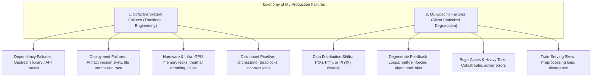

### 1.1. Comparative Analysis: Software vs. ML Failures

| Dimension | Software System Failures (Traditional Infra) | ML-Specific Failures (Statistical / Algorithmic) |
| :--- | :--- | :--- |
| **Root Cause** | Syntax errors, concurrency deadlocks, network timeouts, broken dependencies, corrupted storage. | Data distribution drift, sample selection bias, feedback loops, conceptual drift over time. |
| **Manifestation** | **Loud / Explicit**: Process crash, HTTP `500 Internal Server Error`, `OOMKilled`, segmentation faults. | **Silent / Implicit**: HTTP `200 OK`, nominal P99 latency ($<20\text{ ms}$), but predictions are completely nonsensical or hazardous. |
| **Detection Complexity** | Trivial: Real-time telemetry via APM, Prometheus, Grafana alerts on error rates or latency thresholds. | High: Dependent on natural ground truth feedback loops (delayed by hours to months) or continuous statistical two-sample tests. |
| **Remediation Skillset** | Traditional Site Reliability Engineering (SRE), DevOps, Distributed Systems Engineering. | Statistical Theory, Data Architecture, Continual Learning, MLOps, Active Exploration. |

### 1.2. Production Outage Realities: The Google Empirical Study
In a seminal empirical study by Daniel Papasian and Todd Underwood (Google, 2020), the authors analyzed **96 production outages across major Google ML pipelines over a 15-year span**:
* **62.5% (60 out of 96 outages)** were caused by conventional software engineering and distributed infrastructure failures, completely unrelated to ML mathematical modeling.
* The two dominant failure categories:
  1. **Distributed Pipeline Failures**: Orchestrators/schedulers misfiring, worker deadlocks, worker race conditions.
  2. **Data Pipeline Failures**: Schema drift, improper SQL joins across distributed databases, implicit type casting, and corrupted data structures.
* **Core Architectural Takeaway**: *"The majority of ML engineering is software engineering."* However, ML-specific failures pose far greater existential risks to production systems because of their **silent nature**—models continue serving predictions without triggering standard telemetry alerts, inflicting sustained business and legal damage before detection.

---

## 2. Natural Ground Truth Labels & Feedback Loops

### 2.1. Nature of Natural Labels
A production task has **Natural Ground Truth Labels** if the deployed model's inferences can be automatically or semi-automatically evaluated by the system through subsequent user behavior or closed-loop environmental feedback.

* **Google Maps ETA**: The predicted travel duration is automatically verified the moment the vehicle completes the trip.
* **Ad Click-Through Rate (CTR)**: The recommendation is verified when the user clicks (positive) or scrolls past without clicking (assumed negative).
* **Community Feedback Loops**: Google Translate provides an explicit feedback mechanism allowing bilingual users to submit corrective translations for poor predictions.

### 2.2. Feedback Loop Latency Spectrum
The **Feedback Loop Length** ($\Delta t_{\text{feedback}}$) is the time elapsed between serving a prediction ($t_{\text{serve}}$) and receiving the verified ground truth label ($t_{\text{ground\_truth}}$):

$$\Delta t_{\text{feedback}} = t_{\text{ground\_truth}} - t_{\text{serve}}$$

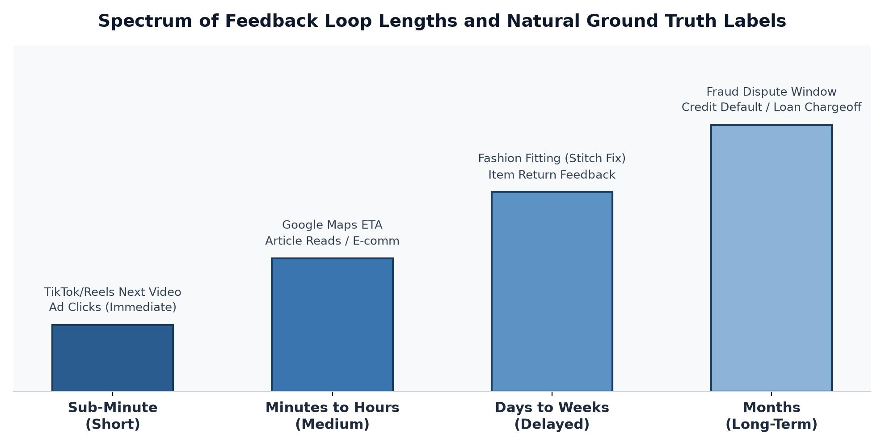

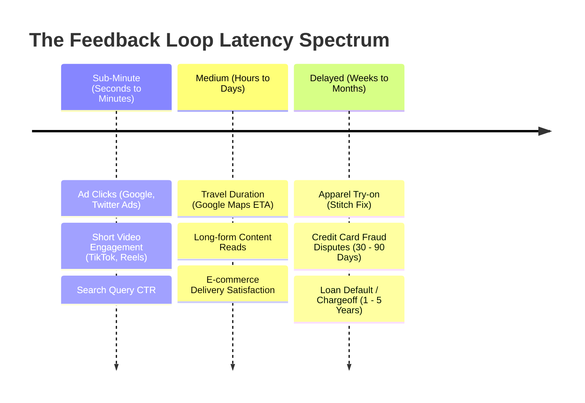

#### Implicit Feedback & Premature Negative Labeling
In domains characterized by short feedback loops (such as Recommender Systems and Ad Ranking):
* **Asymmetry of Feedback**: Systems observe explicit positive interactions (clicks, purchases, watch time $\ge 80\%$). Explicit negative interactions rarely exist (users seldom click "I do not like this ad").
* **Negative Label Heuristic**: An impression is labeled negative ($Y=0$) if no positive interaction occurs within a predetermined observation window $W$.
* **The Window Length Dilemma**:
  * **Short Window $W$**: Fast label generation enables real-time monitoring and low-latency continual learning. However, it introduces **Premature Negative Labels**, underestimating the true CTR/conversion rate.
  * **Long Window $W$**: High label accuracy, but delayed signals prevent rapid detection of model degradation.
  * *Empirical Evidence (Twitter Ads, 2021)*: Although the majority of clicks take place within the first 5 minutes of ad display, a significant tail of clicks trickles in hours later. Fixed short windows introduce a systematic negative bias in training distributions.

---

## 3. Degenerate Feedback Loops

### 3.1. Mechanistic Flow & Failure Dynamics
A **Degenerate Feedback Loop** occurs when a system's predictions directly dictate user exposures, and those user interactions are captured as training data for future iterations of the model:

$$\text{Model}_t \xrightarrow{\text{infers}} \hat{Y}_t \xrightarrow{\text{conditions}} \text{Exposures}_t \xrightarrow{\text{drives}} \text{Interactions}_t \xrightarrow{\text{labels}} \mathcal{D}_{t+1} \xrightarrow{\text{trains}} \text{Model}_{t+1}$$

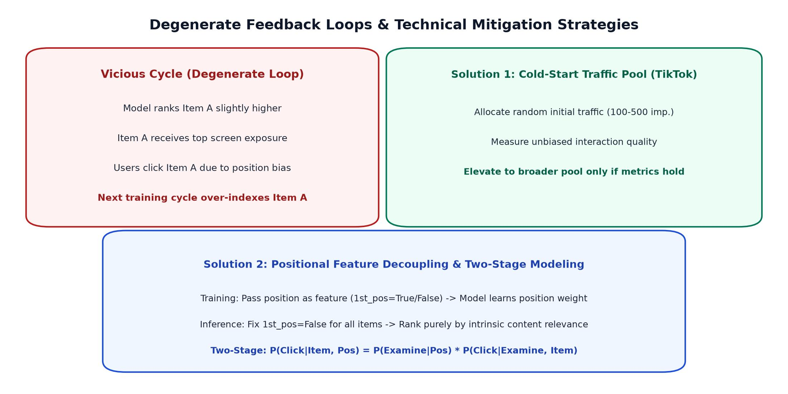

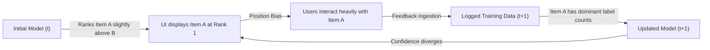

#### Production Consequences:
1. **Popularity & Exposure Bias**: Items that gain an early marginal advantage monopolize impressions. Long-tail items are starved of impressions regardless of quality (*"The rich get richer"*).
2. **Filter Bubbles & Echo Chambers**: In content platforms, algorithmic self-reinforcement confines user exposure to homogeneous ideological content, deteriorating system engagement.
3. **Systemic Discrimination Amplification**:
   * *Resume Screening Scenario*: A model identifies that feature $X$ (e.g., `"Graduated from Elite University"`, `"Gender = Male"`) correlates positively with historical hires. The system preferentially recommends resumes exhibiting $X$. Recruiters interview only candidates with $X$, exclusively hiring candidates with $X$. Future iterations weight feature $X$ as an absolute requirement, completely blinding the pipeline to qualified candidates lacking $X$.

### 3.2. Quantitative Detection Techniques

#### Offline Diversity Metrics
Because degenerate feedback loops materialize dynamically through live user interactions, offline test-set metrics (such as NDCG or AUC) frequently fail to detect them. Production teams track structural diversity metrics:

1. **Aggregate Diversity & Catalog Coverage**:
   Measures the cardinality of unique items recommended across the entire user base $U$ within top-$K$ rankings:
   $$\text{Coverage@K} = \frac{\left| \bigcup_{u \in U} \text{TopK}(u) \right|}{|\mathcal{I}|}$$
   Where $\mathcal{I}$ represents the entire item catalog. A continuous decline in $\text{Coverage@K}$ across successive model checkpoints indicates degenerate loop collapse.

2. **Hit Rate by Popularity Buckets (Chia et al., 2021)**:
   * Partition the catalog into logarithmic interaction tiers: Bucket 1 ($<10^2$ impressions), Bucket 2 ($10^2 - 10^3$), Bucket 3 ($>10^3$).
   * Measure Hit Rate / Recall independently across each bucket.
   * **Diagnostic**: If the model achieves $95\%$ Hit Rate on Bucket 3 but collapses on Bucket 1, the system is severely degraded by popularity bias.

#### Online Telemetry Metrics
* **Prediction Homogeneity (Gini Coefficient)**: Monitor the Gini coefficient or Shannon entropy of served recommendation IDs over time. Spikes in concentration index early degenerate loop onset.

### 3.3. Algorithmic Mitigation Strategies

#### Strategy 1: Randomization & Intelligent Exploration
* **Cold-Start Traffic Pools (The TikTok Protocol)**: Newly created content is allocated an initial traffic budget ($100 - 500$ random impressions) independent of historical profile embeddings. Engagement within this randomized pool yields an **unbiased quality baseline**.
* **Contextual Bandits**: Trade off exploitation of high-scoring items with exploration of uncertain items via **Upper Confidence Bound (UCB)** or **Thompson Sampling**:
  $$\text{Score}(a) = \hat{\mu}_a + c \sqrt{\frac{\ln N}{n_a}}$$
* **Inverse Propensity Scoring (IPS)**: Mitigate exposure bias during offline loss calculation by weighting each observed sample inversely to its historical display probability:
  $$\mathcal{L}_{\text{IPS}}(\theta) = \sum_{i=1}^{N} \frac{y_i \cdot \ell(f_\theta(x_i), y_i)}{P(\text{Exposed} \mid \text{Context}_i)}$$

#### Strategy 2: Positional Features Decoupling
Position strongly influences click probability independent of intrinsic item quality (Position Bias). To isolate intrinsic relevance:
* **Training Phase**: Append positional attributes (e.g., `rank_index`, or binary indicator `is_first_slot`) as explicit covariates in feature vector $X$. The gradient descent optimizer assigns the position bias weight directly to these positional parameters.
* **Inference Phase**: Neutralize positional bias by setting positional features to a fixed constant (e.g., `is_first_slot = False` or `rank_index = median`) across all candidate items. Predictions then reflect pure content relevance.

#### Strategy 3: Two-Stage Decoupled Modeling
Factorize the joint click probability into two conditionally independent models:

$$P(\text{Click} = 1 \mid \text{Item}, \text{Position}) = \underbrace{P(\text{Examine} = 1 \mid \text{Position})}_{\text{Position Bias Model}} \times \underbrace{P(\text{Click} = 1 \mid \text{Item}, \text{Examine} = 1)}_{\text{Intrinsic Relevance Model}}$$

1. **Model 1**: Parameterizes examination likelihood given visual layout and device type.
2. **Model 2**: Scores candidate items purely on intrinsic user-item relevance, operating without positional input.

---

## 4. Production Data Divergence & Edge Cases

### 4.1. The Collapse of the Stationary Distribution Assumption
Classical Statistical Learning Theory relies on the **Stationary Hypothesis**: training data ($D_{\text{train}}$) and inference data ($D_{\text{prod}}$) are independent and identically distributed ($\text{i.i.d.}$) samples drawn from an invariant joint distribution:

$$P_{\text{train}}(X, Y) = P_{\text{production}}(X, Y)$$

In production systems, this hypothesis is universally violated due to:
1. **Sample Selection Bias**: Training data is a finite, temporally bounded snapshot constrained by compute and annotation budgets.
2. **Non-Stationary Real-World Environment**: Global events, language evolution, and competitor moves shift distributions permanently (e.g., post-2019 semantic shift of the search term `"Wuhan"` from general tourism to pandemic origin).

### 4.2. Internal Pipeline Bugs vs. External Distribution Shifts
> [!IMPORTANT]
> **Production Reality**: Approximately **80% of detected distribution shifts** on monitoring dashboards are caused by **internal software bugs**, not genuine external user behavioral shifts.

* **Upstream Feature Inconsistencies**: Feature pipelines written in Python for offline training but re-implemented in Go/Java/C++ for online serving without byte-level parity.
* **Imputation Discrepancies**: Missing values imputed with `-1` or `0` in production while imputed with the dataset mean during offline training.
* **Scaling / Normalization Leakage**: Normalization applied using parameters calculated on a stale or mismatched data subset.
* **Corrupted Schema / NaNs**: Upstream library upgrades silently propagating `NaN` or unparsed strings into feature tables.

### 4.3. Edge Cases vs. Outliers

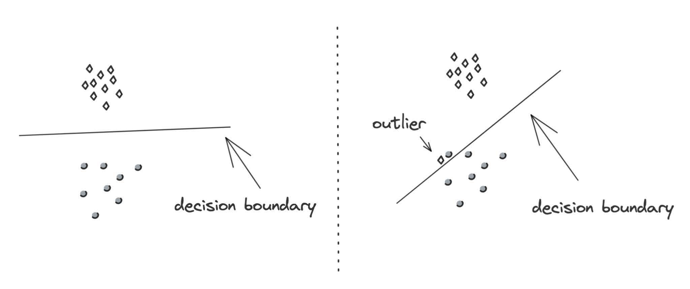
*Figure 7-1: Decision boundaries under outlier-free (left) versus outlier-contaminated (right) training data.*

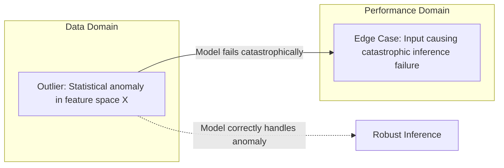

* **Outlier (Data Property)**: A data sample that deviates significantly from the statistical central tendency of the feature space.
* **Edge Case (Model Performance Property)**: A data sample on which the model produces an extreme, catastrophic prediction error.
* **The Distinction**: An outlier is not necessarily an edge case if the model generalizes well to it. For example, a jaywalker on a highway is an extreme outlier; if the autonomous driving model detects the pedestrian and halts smoothly, it is **not** an edge case. If the model misclassifies the pedestrian as road texture and accelerates, it is an **edge case**.
* **The Long-Tail Problem**: In safety-critical architectures (e.g., autonomous driving, medical diagnostics, legal discovery), an overall accuracy of $99.99\%$ is inadequate if the remaining $0.01\%$ long-tail edge cases trigger fatal consequences.

---

## 5. Mathematical Taxonomy of Data Distribution Shifts

Supervised machine learning optimizes the conditional probability $P(Y \mid X)$ over data drawn from the joint probability distribution $P(X, Y)$. The joint distribution decomposes via probability chain rules into two formulations:

1. **Discriminative Decomposition**:
   $$P(X, Y) = P(Y \mid X) P(X)$$
2. **Generative Decomposition**:
   $$P(X, Y) = P(X \mid Y) P(Y)$$

Where:
* $P(X)$ is the **Input Feature Distribution**.
* $P(Y)$ is the **Prior / Label Distribution**.
* $P(Y \mid X)$ is the **Posterior / Decision Mapping**.
* $P(X \mid Y)$ is the **Class-Conditional Feature Distribution**.

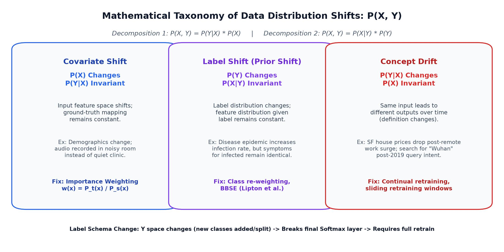

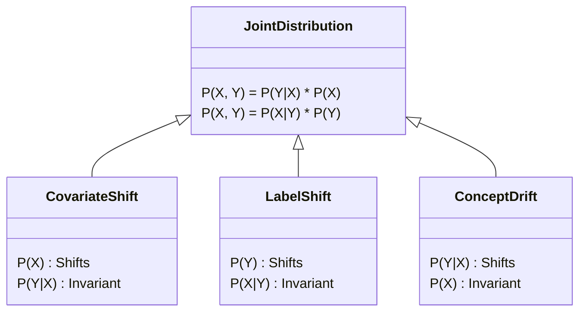

---

### 5.1. Covariate Shift

$$\begin{cases} P_{\text{target}}(X) \neq P_{\text{source}}(X) \\ P_{\text{target}}(Y \mid X) = P_{\text{source}}(Y \mid X) \end{cases}$$

* **Core Definition**: The marginal distribution of input features $P(X)$ changes between training (source) and serving (target), but the underlying conditional label assignment $P(Y \mid X)$ remains perfectly invariant.
* **Real-World Scenarios**:
  * *Medical Diagnostics*: An oncology diagnostic model is trained on data from a specialist referral hospital where patients over 40 predominate. In production, it is deployed across general clinics serving a broader demographic. While cancer risk given age 45 ($P(Y \mid X=45)$) is identical, the age distribution $P(X)$ is vastly different.
  * *Audio Classification*: Training on high-fidelity, studio-recorded cough sounds versus inference on smartphones with background traffic noise.
* **Mathematical Adaptation: Importance Weighting**:
  * If the target distribution $P_{\text{target}}(X)$ is known, weight each training instance by the density ratio:
    $$w(x) = \frac{P_{\text{target}}(x)}{P_{\text{source}}(x)}$$
  * Solve the weighted Empirical Risk Minimization (ERM):
    $$\theta^* = \arg\min_\theta \frac{1}{N} \sum_{i=1}^{N} w(x_i) \cdot \mathcal{L}\left(f_\theta(x_i), y_i\right)$$
  * Direct density ratio estimation techniques: **Kernel Mean Matching (KMM)**, **Kullback-Leibler Importance Estimation Procedure (KLIEP)**.

---

### 5.2. Label Shift (Prior Probability Shift)

$$\begin{cases} P_{\text{target}}(Y) \neq P_{\text{source}}(Y) \\ P_{\text{target}}(X \mid Y) = P_{\text{source}}(Y) \end{cases}$$

* **Core Definition**: The marginal prior distribution of labels $P(Y)$ shifts, but the conditional feature generator given a class label $P(X \mid Y)$ remains static.
* **Real-World Scenarios**:
  * *Epidemiology*: A seasonal influenza outbreak surges the base rate of positive flu cases ($P(Y=1)$). However, given an individual has contracted flu, their clinical biomarker distribution (body temperature, leukocyte count: $P(X \mid Y=1)$) remains unchanged.
  * *Preventive Interventions*: Deploying a preventive drug lowers overall incidence rates $P(Y)$, shifting label frequencies without altering symptomatic manifestations.
* **Detection & Remediation without Target Labels**:
  * **Black Box Shift Estimation (BBSE, Lipton et al., 2018)**: Exploits the confusion matrix $C \in \mathbb{R}^{K \times K}$ obtained from validation data to estimate target label proportions without ground truth:
    $$\hat{\mu}_{\text{target}}(\hat{Y}) = C \cdot P_{\text{target}}(Y) \implies P_{\text{target}}(Y) = C^{-1} \cdot \hat{\mu}_{\text{target}}(\hat{Y})$$

---

### 5.3. Concept Drift (Posterior Shift)

$$\begin{cases} P_{\text{target}}(Y \mid X) \neq P_{\text{source}}(Y \mid X) \\ P_{\text{target}}(X) = P_{\text{source}}(X) \end{cases}$$

* **Core Definition**: The input feature distribution $P(X)$ remains completely identical, but the relationship mapping inputs to outputs $P(Y \mid X)$ changes. Known as *"Same input, different output"*.
* **Real-World Scenarios**:
  * *Real Estate Pricing*: A 3-bedroom flat in San Francisco ($X$) evaluated at $\$2,000,000$ in 2019 dropped to $\$1,500,000$ during peak remote-work migrations in 2020. The asset features remained static, while market valuation dynamics inverted.
  * *Adversarial Fraud*: Fraudsters evolve new tactics to disguise transaction behaviors, altering fraud probabilities for previously benign feature vectors.
  * *Cyclic / Seasonal Drift*: Taxi fare willingness-to-pay shifts dramatically between weekday mornings and weekend nights for the identical route.

---

### 5.4. General & Structural Shifts

#### Feature Drift & Schema Invalidation
* Injections of new features, deprecation of existing features, or domain range modifications (e.g., feature `age` changing unit representation from years to months).

#### Label Schema Change
The output space $\mathcal{Y}$ alters its dimension or discrete cardinality:
* **Regression**: Boundary scaling shifts (e.g., credit scores moving from $[300, 850]$ to $[250, 900]$).
* **Classification**: Class split or new class introduction (e.g., splitting `NEGATIVE` into `SAD` and `ANGRY`).
* **Architectural Invalidation**: In a neural network classifier, the final Softmax projection matrix has shape $W_{\text{out}} \in \mathbb{R}^{d_{\text{hidden}} \times C}$. Increasing classes ($C \rightarrow C+1$) breaks the weight matrix geometry, **invalidating all pre-existing network weights and mandating a complete retrain from scratch**.

---

### 5.5. Comprehensive Comparison Matrix of Data Shifts

| Shift Type | Mathematical Invariant | $P(X)$ | $P(Y)$ | $P(Y \mid X)$ | $P(X \mid Y)$ | Remediation Strategy |
| :--- | :--- | :---: | :---: | :---: | :---: | :--- |
| **Covariate Shift** | $P(Y \mid X)$ Invariant | **Shifts** | Shifts | **Static** | Shifts | Importance Weighting (KMM), Active Domain Subsampling. |
| **Label Shift** | $P(X \mid Y)$ Invariant | Shifts | **Shifts** | Shifts | **Static** | Class re-weighting, BBSE confusion matrix inversion. |
| **Concept Drift** | $P(X)$ Invariant | **Static** | Shifts | **Shifts** | Shifts | Model retraining on sliding temporal window, Fine-tuning. |
| **Feature Drift** | Schema altered | **Shifts** | Variable | **Shifts** | **Shifts** | Feature store re-alignment, backward compatibility layer. |
| **Label Schema Change** | Card($\mathcal{Y}$) altered | Variable | **Shifts** | **Shifts** | **Shifts** | Softmax layer reconfiguration, complete retrain from scratch. |

---

## 6. Shift Detection Methodologies

Because production ground truth labels suffer from significant latency delays, monitoring pipelines must evaluate non-label-dependent distributions: **Input Feature Space $P(X)$** and **Model Prediction Space $P(\hat{Y})$**.

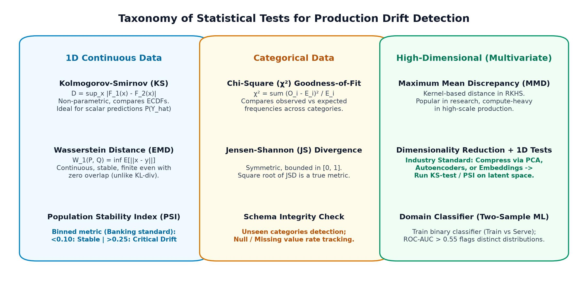

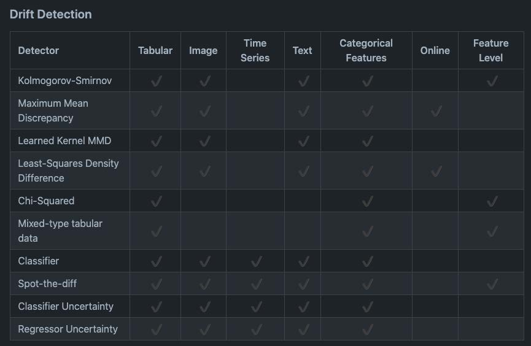
*Figure 7-2: Modern shift detection algorithms taxonomy as implemented by alibi-detect.*

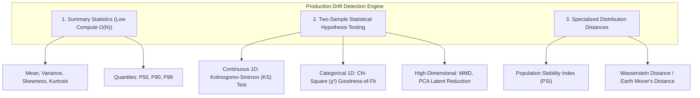

### 6.1. Limitations of Summary Statistics
Tracking simple statistics (Mean, Median, Variance, P90) across feature batches is computationally inexpensive ($O(N)$) but statistically flawed. Summary statistics provide adequate summaries only for unimodal, symmetric distributions. Two completely dissimilar distributions (e.g., a uniform distribution $U[-\sqrt{3}, \sqrt{3}]$ and a standard normal distribution $\mathcal{N}(0, 1)$) share identical mean ($\mu=0$) and variance ($\sigma^2=1$), allowing severe drift to pass undetected.

### 6.2. Two-Sample Hypothesis Testing Framework
Formulated as testing whether reference baseline data $S_1 \sim P_{\text{baseline}}$ and live production data $S_2 \sim P_{\text{prod}}$ originate from the identical distribution:
* **Null Hypothesis ($H_0$)**: $P_{\text{baseline}} = P_{\text{production}}$
* **Alternative Hypothesis ($H_1$)**: $P_{\text{baseline}} \neq P_{\text{production}}$
* **Decision Rule**: Reject $H_0$ if test p-value $< \alpha$ (typically $\alpha=0.05$ or $0.01$).

> [!WARNING]
> **The Large Sample Size Trap (P-Value Fallacy)**:
> In high-throughput production environments processing millions of events, **any microscopic, statistically negligible fluctuation yields $p < 0.01$**, triggering constant false-positive alert fatigue.
> * **Production Rule of Thumb**: If drift is detected on a **small sample size**, it represents a critical operational shift requiring immediate intervention. If drift is detected only on ultra-large sample sizes ($N > 10^6$), it is typically noise.

### 6.3. Statistical Test Algorithms

#### 1. Kolmogorov-Smirnov (KS) Test
* **Mechanism**: Non-parametric test comparing the maximum vertical deviation between two Empirical Cumulative Distribution Functions (ECDFs):
  $$D = \sup_x \left| F_{\text{baseline}}(x) - F_{\text{prod}}(x) \right|$$
* **Application**: 1D continuous features and prediction scores $P(\hat{Y})$.
* **Limitations**: Inapplicable to discrete/categorical features; scales poorly to multivariate spaces.

#### 2. Chi-Square ($\chi^2$) Goodness-of-Fit Test
* **Mechanism**: Compares observed category frequencies ($O_i$) in production against expected baseline frequencies ($E_i$):
  $$\chi^2 = \sum_{i=1}^K \frac{(O_i - E_i)^2}{E_i}$$
* **Application**: 1D categorical features and binned numerical variables.

#### 3. Population Stability Index (PSI)
The banking and financial industry standard for quantifying shift magnitude across binned intervals ($B=10$ quantiles derived from baseline):

$$\text{PSI} = \sum_{b=1}^B \left( \% \text{Actual}_b - \% \text{Expected}_b \right) \times \ln\left( \frac{\% \text{Actual}_b}{\% \text{Expected}_b} \right)$$

##### Operational Decision Thresholds for PSI:
| PSI Value Range | Shift Severity | System Action |
| :--- | :--- | :--- |
| $\mathbf{\text{PSI} < 0.10}$ | Negligible Shift | System stable. No intervention required. |
| $\mathbf{0.10 \le \text{PSI} < 0.25}$ | Moderate Shift | Warning flag. Increase monitoring frequency; schedule pipeline retraining. |
| $\mathbf{\text{PSI} \ge 0.25}$ | Significant Drift | **Critical Alert**. Trigger automated retrain or switch to rule-based fallback. |

#### 4. Wasserstein Distance (Earth Mover's Distance - EMD)
* **Mechanism**: Measures the minimum work required to transform one probability distribution into another:
  $$W_1(P, Q) = \inf_{\gamma \in \Pi(P, Q)} \mathbb{E}_{(x, y) \sim \gamma}[\|x - y\|]$$
* **Advantages over KL-Divergence**: Unlike Kullback-Leibler (KL) Divergence (which approaches infinity if support regions do not perfectly overlap), Wasserstein distance provides a smooth, finite metric reflecting geometric distance in feature space.

#### 5. Multivariate Drift Detection (High-Dimensional Space)
* **Maximum Mean Discrepancy (MMD)**: Computes distance between kernel feature map embeddings in a Reproducing Kernel Hilbert Space (RKHS).
* **Industry Standard Solution (Dimensionality Reduction + 1D Tests)**:
  Project high-dimensional vectors ($X \in \mathbb{R}^d$) into a low-dimensional latent space ($z \in \mathbb{R}^k, k \ll d$) via **Principal Component Analysis (PCA)** or **Autoencoder latent bottlenecks**, then apply univariate KS-tests or PSI across individual latent dimensions.
* **Two-Sample Domain Discriminator**: Train a binary classifier (e.g., LightGBM) to distinguish baseline samples (label 0) from production samples (label 1). If the classifier achieves validation $\text{AUC-ROC} > 0.55$, the two datasets are statistically distinguishable.

---

### 6.4. Monitoring Time Scale Windows

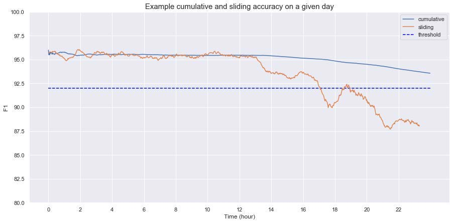
*Figure 7-4: Cumulative metrics smooth out and mask acute production outages, whereas sliding window metrics capture immediate degradation.*

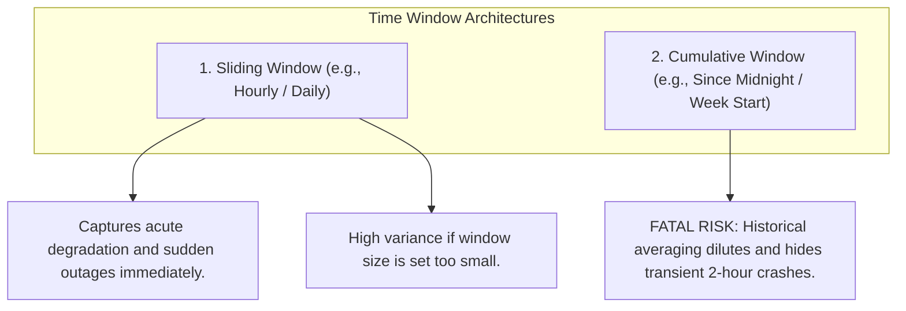

#### Time Scale Engineering Invariants:
1. **Sliding vs. Cumulative Metrics**: Never rely solely on cumulative accuracy dashboards. A model outage occurring between hours 16:00 and 18:00 is heavily diluted by the stable performance of the preceding 16 hours in a cumulative view. Production alerting must operate on **Sliding Windows**.
2. **Window Sizing Trade-offs**:
   * *Too short ($<1\text{ hour}$)*: Generates false alerts due to intra-day diurnal variations.
   * *Too long ($>7\text{ days}$)*: Incurs massive latency in detecting acute pipeline failures.
3. **Mergeable State Sketches (t-digest, HLL)**: Production streaming engines ingest real-time events into fixed 1-hour sketch summaries, allowing on-demand algebraic merges into 24-hour or 7-day rollup windows without rescanning raw parquet logs.

---

## 7. Engineering Strategies for Addressing Distribution Shifts

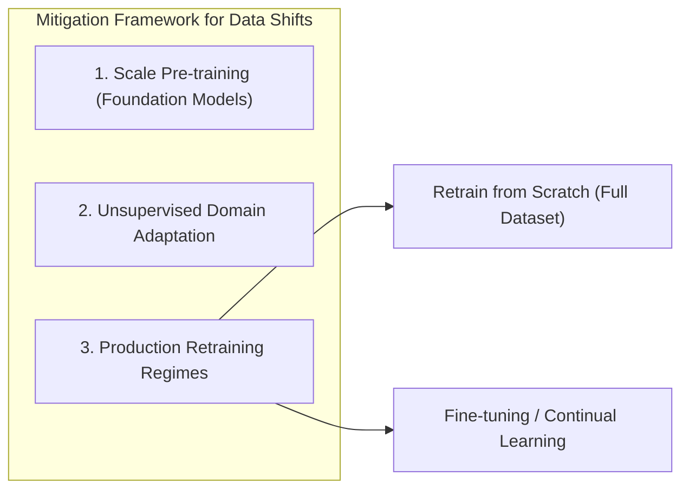

### 7.1. Retrain from Scratch vs. Fine-Tuning

| Engineering Metric | Retraining from Scratch | Fine-Tuning (Continual Learning) |
| :--- | :--- | :--- |
| **Optimization Method** | Random initialization; full optimization across merged historical and fresh datasets. | Warm-start from existing weights; gradient updates exclusively on newly ingested data batch. |
| **Compute Cost** | High (expensive multi-GPU cluster runs, extended pipeline runtimes). | Low (minutes to hours on single GPU/CPU instance). |
| **Catastrophic Forgetting Risk** | **Zero**. Model preserves global representation stability. | **High**. Model risks overfitting to recent temporal noise while losing historic patterns. |
| **Production Selection** | Recommended for medium-sized tabular models, complex NLP schemas, and regulated domains. | Recommended for massive foundation models, real-time recommender systems (TikTok, YouTube). |

### 7.2. Training Data Selection Policies
* **Drift-Point Truncation**: Discard data preceding the detected changepoint; retrain exclusively on data generated post-drift.
* **Sliding Window Retraining**: Retrain continuously on a sliding window of the last $N$ days (e.g., rolling 30-day window).
* **Replay Buffer Buffering**: Preserve a core $20\%$ historical anchor dataset mixed into the continual fine-tuning stream to stabilize gradient updates against catastrophic forgetting.

### 7.3. Proactive Architectural Design
1. **Feature Stability vs. Predictive Power Trade-off**:
   * *Anti-Pattern*: Utilizing hyper-volatile features (e.g., `app_store_rank`) yields high immediate offline gain but causes rapid performance decay within hours.
   * *Best Practice (Feature Coarsening)*: Bin volatile continuous features into categorical brackets (`Top 10`, `Top 11-100`, `Top 100+`). This slightly reduces peak accuracy while massively stabilizing model lifetime.
2. **Decoupled Segmented Architectures**:
   * If real estate values fluctuate rapidly in San Francisco but remain stagnant in rural Arizona, maintain two distinct decoupled models. Update the SF model weekly while retraining the rural Arizona model quarterly.

---

## 8. 3-Tier Production ML Observability Framework

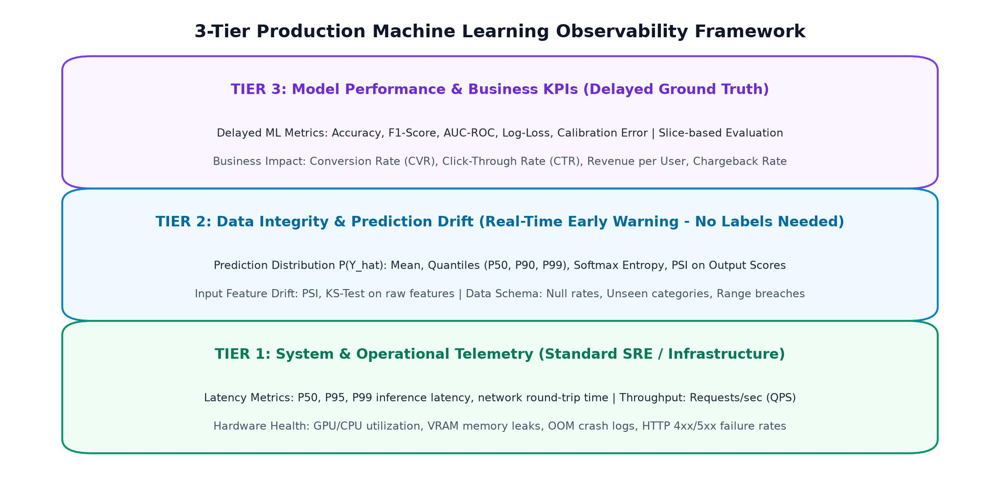

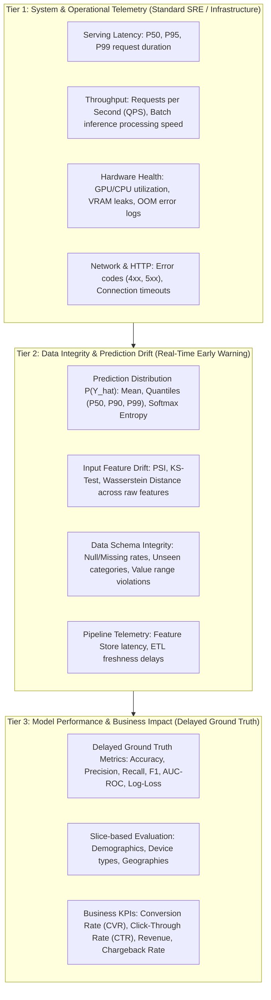

### Detailed Tier Breakdown:

#### Tier 1: System & Operational Telemetry (SRE Infrastructure Layer)
* **Monitored Signals**: P99 Latency, Queries Per Second (QPS), GPU VRAM memory leaks, process restarts, HTTP `5xx` rates.
* **Objective**: Guarantees service availability and Service Level Objectives (SLOs). Fast failure detection via standard APM tooling.

#### Tier 2: Data Integrity & Prediction Drift (The Critical Early Warning Layer)
* **No Ground Truth Labels Required**: Operates in real time on incoming payloads and outgoing inferences.
* **Prediction Distribution $P(\hat{Y})$**:
  * Track output probability distributions via PSI and KS-tests.
  * If the model's predicted probability distribution shifts significantly from baseline, **an alert is triggered immediately**—eliminating the need to wait weeks for ground truth labels.
* **Data Schema & Pipeline Health**: Detects missing value spikes, type mismatches, range breaches, and novel categorical tokens before data enters inference routines.

#### Tier 3: Model Performance & Business KPIs (The Impact Layer)
* **Ground Truth ML Metrics**: Computed asynchronously as true labels arrive (Accuracy, F1, Calibration curves).
* **Slice-Based Evaluation**: Global metrics often mask severe localized degradation. Disaggregate model evaluation across critical slices (e.g., user cohorts, geographies, mobile OS versions).
* **Business KPIs**: Continuous tracking of downstream metrics (CTR, CVR, refund requests, revenue per impression) to determine actual business impact.

---

## 9. Production Failure Prevention Checklist

Before clearing any production ML pipeline for live traffic, the Systems Architect must verify every invariant in this checklist:

### 1. Data Pipeline & Schema Invariants
- [ ] **Feature Store Consistency**: Inference feature transformation logic is 100% byte-for-byte identical to training feature transformations (enforced via unified codebases or shared Feature Store definitions).
- [ ] **Schema & Type Enforcement**: Incoming payloads are validated against strict schemas, blocking silent type casting (e.g., strings silently parsed to zeros).
- [ ] **Imputation Protection**: Missing values are routed through explicit imputation handlers; default sentinels (`-1`, `9999`) are flagged to prevent distribution distortion.
- [ ] **Feature Freshness Guards**: Automated alerts are configured for ingestion delays in batch and streaming feature pipelines.

### 2. Degenerate Loop & Bias Controls
- [ ] **Position Bias Mitigation**: Positional attributes are explicitly parameterized during training and fixed to neutral constants during inference, or decoupled via a two-stage examination model.
- [ ] **Exploration Traffic Budget**: A fixed traffic fraction ($1\% - 5\%$) is reserved for randomized item presentation (or contextual bandit exploration) to harvest unbiased quality labels.
- [ ] **Catalog Diversity Monitoring**: Dashboards track catalog coverage ($\text{Coverage@K}$) and Hit Rate across popularity tiers to detect algorithmic homogenization.

### 3. Drift Detection & Statistical Alarms
- [ ] **Frozen Reference Baseline**: A validated reference distribution $P_{\text{base}}(X)$ is frozen from clean evaluation sets or stable historical serving windows.
- [ ] **Real-Time Prediction Monitoring**: Prediction distributions $P(\hat{Y})$ are monitored continuously using PSI or KS-tests on sliding hourly windows.
- [ ] **Sample Size Throttling**: Statistical tests are calibrated against sample-size thresholds to avoid false alerts caused by high traffic volumes.
- [ ] **Sliding Window Alerting**: Operational alerts are wired to sliding window telemetry, ensuring transient acute drops are not diluted by cumulative metrics.

### 4. Resiliency, Safety Fallbacks & Failovers
- [ ] **Circuit Breakers & Rule-Based Fallbacks**: If model latency exceeds SLA thresholds or feature drift passes critical boundaries ($\text{PSI} \ge 0.25$), the system automatically fails over to deterministic heuristics or static cached responses.
- [ ] **Shadow & Canary Deployments**: New model candidates are deployed in shadow mode (evaluating live production traffic without serving live outputs) for $\ge 48\text{ hours}$ to verify prediction distribution consistency.
- [ ] **Automated Rollback Triggers**: Continual retraining pipelines feature automated rollbacks to preceding checkpoints if validation metrics on fresh data deteriorate.
