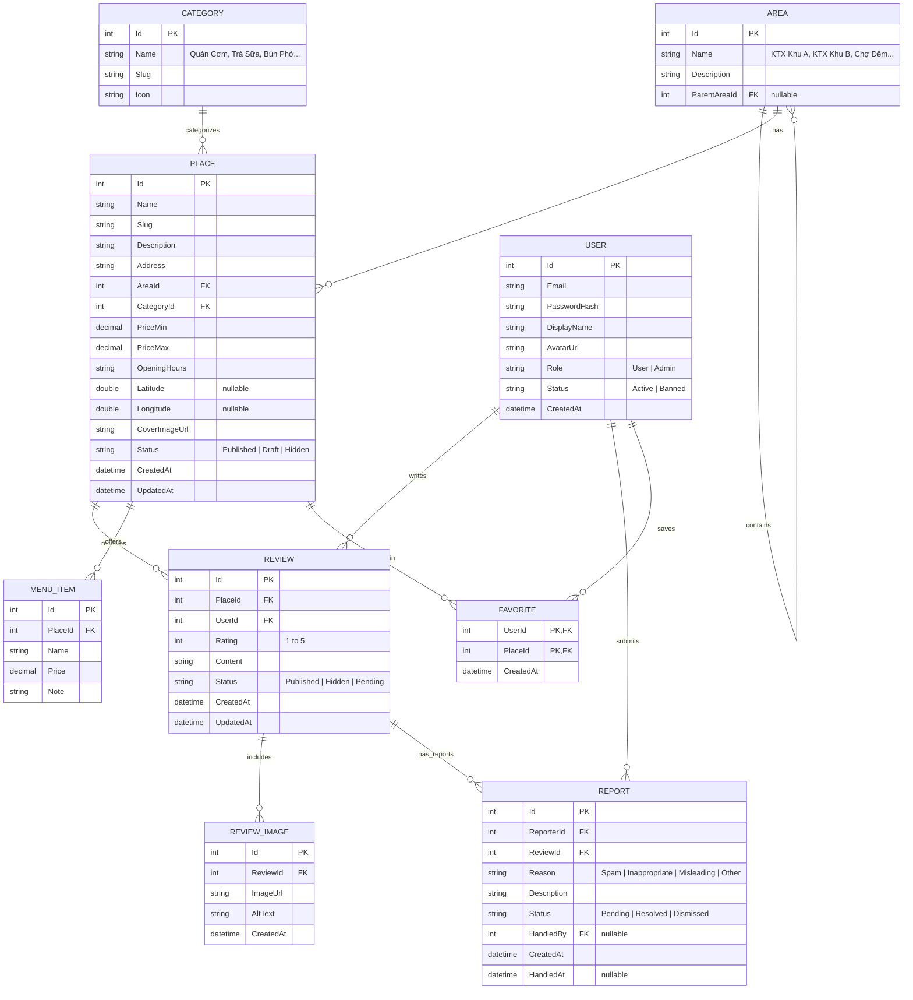

# ARCHITECTURE SPINE (KIẾN TRÚC HỆ THỐNG BACKEND)
## FOOD REVIEW - LÀNG ĐẠI HỌC (ĐHQG TP.HCM)

---

### 1. Công nghệ Lựa chọn (Technology Stack)

- **Platform & Runtime:** .NET 9 SDK (C# 13)
- **Framework:** ASP.NET Core Web API
- **Data Access Layer:** **Dapper Micro-ORM** (High-Performance Raw SQL & Multi-Mapping)
- **Database Engine:** PostgreSQL 16+ via Docker Compose, khởi tạo chuẩn từ `docs/schema.sql`.
- **Containerization & DevOps:** Docker & Docker Compose (`docker-compose.yml` gồm service `postgres` và service `api`).
- **Authentication & Security:** JWT (JSON Web Token), BCrypt / PBKDF2 Password Hashing, RBAC (Role-Based Access Control).
- **API Documentation:** Swagger / OpenAPI UI (`/swagger`).
- **File Storage:** Local File Server (Static Files `/uploads/...`) phục vụ upload ảnh quán và ảnh review.

---

### 2. Cấu trúc Thư mục Clean Layered

```
FoodReview.Api/
├── Controllers/              # RESTful API Endpoints (Routing, HTTP Responses)
│   ├── AuthController.cs
│   ├── PlacesController.cs
│   ├── CategoriesController.cs
│   ├── AreasController.cs
│   ├── ReviewsController.cs
│   ├── ReportsController.cs
│   ├── AdminController.cs
│   └── UploadController.cs
├── Models/                   # Domain Entities & Database Mapping
│   ├── User.cs
│   ├── Area.cs
│   ├── Category.cs
│   ├── Place.cs
│   ├── MenuItem.cs
│   ├── Review.cs
│   ├── ReviewImage.cs
│   ├── Report.cs
│   └── Favorite.cs
├── DTOs/                     # Data Transfer Objects (Request / Response Contracts)
│   ├── Auth/
│   ├── Places/
│   ├── Reviews/
│   └── Common/
├── Services/                 # Business Logic & Service Layer
│   ├── IAuthService.cs & AuthService.cs
│   ├── IPlaceService.cs & PlaceService.cs
│   ├── IReviewService.cs & ReviewService.cs
│   ├── IAdminService.cs & AdminService.cs
│   └── IFileStorageService.cs & LocalFileStorageService.cs
├── Data/                     # EF Core DbContext, Configurations & Seeding
│   ├── ApplicationDbContext.cs
│   ├── DbInitializer.cs      # Nạp mock/seed data tự động khi khởi chạy
│   └── SeedData/             # Thư mục chứa JSON data ban đầu
├── Middleware/               # Global Exception Handling & Auth Validation
├── Program.cs                # Dependency Injection, Middleware Pipeline
└── appsettings.json          # Configuration, JWT settings, DB Connection
```

---

### 3. Sơ đồ Quan hệ Thực thể (Entity Relationship Diagram - ERD)



---

### 4. Quy ước Hợp đồng API (RESTful Endpoints)

| Method | Endpoint | Quyền (Roles) | Mô tả |
|---|---|---|---|
| `POST` | `/api/auth/register` | `PUBLIC` | Đăng ký tài khoản sinh viên |
| `POST` | `/api/auth/login` | `PUBLIC` | Đăng nhập nhận JWT Token |
| `GET` | `/api/auth/me` | `AUTHENTICATED` | Lấy profile người dùng hiện tại |
| `GET` | `/api/areas` | `PUBLIC` | Lấy danh sách các khu vực Làng Đại học |
| `GET` | `/api/categories` | `PUBLIC` | Lấy danh mục món ăn/loại quán |
| `GET` | `/api/places` | `PUBLIC` | Tìm kiếm & lọc quán (q, areaId, categoryId, priceMin, priceMax, sort, page, pageSize) |
| `GET` | `/api/places/{id}` | `PUBLIC` | Xem chi tiết quán, thực đơn, điểm đánh giá trung bình |
| `POST` | `/api/places/{id}/reviews` | `AUTHENTICATED` | Đăng review mới kèm ảnh |
| `GET` | `/api/places/{id}/reviews` | `PUBLIC` | Xem danh sách review đã duyệt của quán |
| `PUT` | `/api/reviews/{id}` | `AUTHENTICATED` | Sửa review của chính mình (`guard: userId == authorId`) |
| `DELETE` | `/api/reviews/{id}` | `AUTHENTICATED` | Xóa review của chính mình (`guard: userId == authorId`) |
| `POST` | `/api/reviews/{id}/report` | `AUTHENTICATED` | Báo cáo review vi phạm |
| `POST` | `/api/places/{id}/favorite` | `AUTHENTICATED` | Toggle lưu quán yêu thích |
| `GET` | `/api/favorites` | `AUTHENTICATED` | Lấy danh sách quán sinh viên đã lưu |
| `POST` | `/api/upload` | `AUTHENTICATED` | Upload ảnh (ảnh đại diện, ảnh quán, ảnh review) |
| `GET` | `/api/admin/places` | `ADMIN` | Quản lý toàn bộ quán (bao gồm trạng thái ẩn/nháp) |
| `POST` | `/api/admin/places` | `ADMIN` | Thêm quán mới |
| `PUT` | `/api/admin/places/{id}` | `ADMIN` | Chỉnh sửa thông tin quán |
| `DELETE` | `/api/admin/places/{id}` | `ADMIN` | Ẩn/Xóa quán |
| `GET` | `/api/admin/reports` | `ADMIN` | Xem danh sách báo cáo vi phạm |
| `PUT` | `/api/admin/reports/{id}/resolve`| `ADMIN` | Xử lý báo cáo (ẩn review, bỏ qua báo cáo) |
| `GET` | `/api/admin/users` | `ADMIN` | Quản lý danh sách sinh viên, khóa/mở khóa tài khoản |

---

### 5. Mô hình Triển khai Container hóa (Docker & PostgreSQL)

Hệ thống được đóng gói thành 2 container độc lập thông qua Docker Compose:

1. **`foodreview-postgres` (PostgreSQL 16 Alpine):**
   - Lưu trữ toàn bộ dữ liệu quan hệ, tự động nạp `schema.sql` trong lần khởi chạy đầu tiên qua volume `docker-entrypoint-initdb.d`.
   - Cổng nội bộ: `5432`, volume bền vững: `postgres_data`.
   - Cơ chế kiểm tra sức khỏe (Healthcheck): `pg_isready -U foodreview_user -d foodreview` với chu kỳ 5 giây.

2. **`foodreview-api` (.NET 9 Web API):**
   - Đóng gói theo mô hình Multi-stage Dockerfile (build với .NET 9 SDK, chạy trên runtime `aspnet:9.0` tối ưu hóa kích thước).
   - Phụ thuộc trạng thái khỏe mạnh của PostgreSQL (`depends_on: postgres: condition: service_healthy`).
   - Cổng phục vụ: `5000:8080`, mount volume lưu trữ hình ảnh tải lên tại `api_uploads:/app/wwwroot/uploads`.


